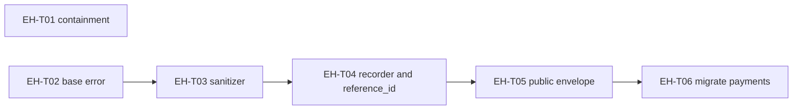

# Report template

Write one file, `docs/error-handling/audit-<YYYY-MM-DD>.md`, in this structure. Replace placeholders with observed evidence and remove instruction lines. Keep explicit unknowns; never fill a bucket with invented findings. Findings are `EH-AUDIT-nnn`; subtasks are `EH-Tnn`; rules are the constitution's `EH-nn` / `X-nn` plus check IDs from rules.md. Every finding and subtask names an engineer and an accountable manager, or `UNASSIGNED`, and each `UNASSIGNED` counts as an open ownership gap.

````markdown
# Error Handling Audit and Remediation Plan: <system/repo>, <YYYY-MM-DD>

## 1. Summary
- Scope: <whole repo | slice>, branch <name>, commit <sha>, worktree <clean | dirty: paths>
- Policy: <path to the error-handling constitution> v<version in its header>
- Inspection: <complete | partial: see section 12>; verification: <source only | local tests run | CI evidence>
- Confirmed findings: P0 <n> · P1 <n> · P2 <n>; provisional risks in the verification queue: <n>; unassigned: <n>
- Release recommendation: <BLOCK | PASS WITH EXCEPTIONS | PASS>.
  - BLOCK: any open P0, any open P1/P2 without an owner and an approved exception (X-02), or a "no" on completeness questions 1-4 or 7.
  - PASS WITH EXCEPTIONS: every remaining finding is P1/P2 with an engineer, a manager, an expiry date, and an approved X-02 exception recorded on the PR (or the legacy baseline exception for findings present at the first audit).
  - PASS: no open findings.
- Most consequential problem: <one sentence>
- Start here: <EH-Txx>, <EH-Tyy>, <EH-Tzz> (can run in parallel)

| Priority | Findings | Subtasks | Timing |
|---|---|---|---|
| P0 | <n> | <n> | Immediate containment and remediation |
| P1 | <n> | <n> | Before the next release of the affected component |
| P2 | <n> | <n> | Scheduled, owned, bounded |

### What P0, P1, and P2 mean
Priority is decided by **harm**: what a user sees, what leaks, and whether engineers can find the cause. It is not about how hard the fix is.

| Priority | In one sentence | When to fix | Typical examples |
|---|---|---|---|
| **P0** | Something dangerous is happening right now. | Immediately; blocks the release. | Secrets or personal data leaking, an auth check skipped, data silently lost, a write repeated by an unsafe retry. |
| **P1** | Things work, but users, machines, or engineers are let down when they fail. | Before the next release of that component. | No error code, raw or unclear messages on the wire, no reference ID, no failure tests. |
| **P2** | Housekeeping with no proven harm today. | Scheduled, with an owner and a date. | Missing docs, missing lint rules, a problem that cannot currently be reached. |

- A P2 on a public surface (API, UI, an API another internal service calls) moves up to P1. Nothing becomes P0 without a shown path to real harm.
- A suspected P0 that is not proven yet goes to the verification queue (section 8), not the findings count.
- Confidence is reported separately and never changes the priority.

### Why each finding got its priority
| Finding | Priority | Why this priority |
|---|---|---|
| EH-AUDIT-nnn <short title> | P1 | <one sentence: who is harmed, how reachable, why not higher or lower> |

### How many PRs to expect
One subtask = one PR = one concern, under about 400 changed production lines or 10 production files.

| Scope | Expected PRs | Notes |
|---|---|---|
| This audited scope | <n> | EH-T01 to EH-Tnn (section 7) |
| Verification queue | <0-n> | Only if provisional risks are confirmed |
| Rest of the service (not audited yet) | <about n-m> | Estimate from hotspot counts per module; becomes exact after each module is audited |
| **Whole service** | <about n-m> | Foundation PRs are built once; later PRs reuse them |

### What to do next
| # | Step | Who | Size | Done when |
|---|---|---|---|---|
| 1 | <P0 containment or the first foundation subtask> | <role> | <S/M> | <observable result, proven by a named test> |

**For the project owner, in short:** <3-4 plain sentences: the urgent item, the groundwork, the module-by-module migration, how progress is tracked in this file>

**For developers, in short:** pick a `todo` subtask whose dependencies are `done`; run the `implement-error-handling` skill with its `EH-Tnn`; write the failing test first; open one PR with the subtask's title and the 4 checklist lines; mark it `done` here with a `Verified by:` line.

### Completeness test
| # | Question | Answer | Evidence |
|---|---|---|---|
| 1 | Can the user understand what failed and what to do next? | yes/no | |
| 2 | Can an automated consumer identify the failure by a stable code and documented structured fields? | | |
| 3 | Can an authorized engineer use the reference ID to find sufficient sanitized context in centralized logging and monitoring? | | |
| 4 | Do automated tests verify the message, failure response, diagnostic record, and sensitive-data protection? | | |
| 5 | Does every finding have an assigned engineer and accountable manager? | | |
| 6 | Has the manager submitted the review scope, completed fixes, and test results? | | |
| 7 | Is retry and escalation guidance documented for every retryable or escalating failure? | | |

## 2. Ownership
| Role | Name |
|---|---|
| Accountable manager | UNASSIGNED |
| Review engineer | UNASSIGNED |

## 3. Scope and coverage
- Production systems and components reviewed
- Failure paths reviewed (surfaces from section 4, dependency failures, unexpected-failure fallback)
- Exclusions and why
- Candidates scanned: <n>; findings: <n>; dismissed: <n>; queued: <n> (counts reconcile)

| Component | Language | In-scope files | Inspected | Key surfaces | Remaining |
|---|---|---|---|---|---|

## 4. Error surfaces and baseline
| Surface type | Locations | One family? | Resolver where required? | Public envelope? | request_id? | recovery? | Failure tests? |
|---|---|---|---|---|---|---|---|

| Baseline item | Status | Location |
|---|---|---|
| Shared base error / one family, registered fallback code | present/absent | |
| Third-party error resolver per integration point | | |
| Internal code registry | | |
| debug_info schema + central sanitizer | | |
| recovery info + Retry-After | | |
| reference_id on construction, same value in record and response | | |
| Single boundary recorder to centralized logging + error tracker | | |
| Emergency path when the recorder fails | | |
| Public code map + one client envelope | | |
| Error catalog outside source | | |
| Error-handling lint rules in CI | | |
| PR checklist lines + AI PR-review check | | |

## 5. Rule evaluation
| Rule | Status | Evidence / finding IDs | Missing evidence or N/A reason |
|---|---|---|---|
| EH-01 Normalize at boundaries | verified / gap found / not applicable / unverified | | |
| ... through EH-13, then applicable X-01 to X-07 | | | |

## 6. Findings
Ordered P0, then P1, then P2.

Example only, showing the expected depth. Delete it and write only findings verified in the audited code.

### EH-AUDIT-001 [P1] Provider failures are copied onto the HTTP body
- Rule: EH-07 / P2, EH-03 / M2
- Locations: `src/payments/webhook.py:88`
- Evidence: `raise HTTPException(status_code=500, detail=str(e))`
- Separation test: human clause is `str(e)`; agent field (`code`, `debug_info`, `recovery`) absent; producer is a bare `except Exception` with no resolver branch.
- Trigger and behavior: provider returns 401; the client receives the provider body.
- Impact: provider wording and possibly host or credential text reach the client; no public code to branch on.
- Priority rationale / confidence: P1, public API, reachable on every provider failure; no secret observed in fixtures, so not P0. Confidence high.
- Fix: raise `resolve_provider_error(e)`; return the public envelope through the boundary handler.
- Acceptance test: provider 401 returns 502, `error.code=UPSTREAM_UNAVAILABLE`, default message, `request_id` present, no `debug_info`; the record found by `request_id` has the internal code.
- Closed by: EH-T04 · Engineer: UNASSIGNED · Manager: UNASSIGNED · Status: open

## 7. Remediation plan

### 7.1 Subtasks
| ID | PR title | Priority | Phase | Size | Closes | Depends on | Owner | Status |
|---|---|---|---|---|---|---|---|---|
| EH-T01 | fix(api): stop returning raw exception text | P0 | 0 | S | EH-AUDIT-002 | - | UNASSIGNED | todo |
| EH-T02 | feat(errors): add base error, code registry, fallback | P1 | 1 | M | EH-AUDIT-003 | - | UNASSIGNED | todo |

### 7.2 Dependency graph


### 7.3 Subtask details

#### EH-T04 feat(errors): assign reference_id and record failures at the boundary
- Priority: P1 · Phase: 1 · Size: M · Depends on: EH-T02, EH-T03
- Closes: EH-AUDIT-005, EH-AUDIT-007 · Rules: EH-08 / L1-L4, EH-10 / R5
- Goal: every system failure gets one `reference_id` that resolves to exactly one sanitized centralized record.
- Scope: `src/errors/base.py`, `src/api/handlers.py`, `src/observability/recorder.py`
- Out of scope: migrating individual routes (EH-T06+), public code mapping (EH-T05)
- Changes:
  - generate `reference_id` in the base error constructor; accept an existing one when wrapping
  - add `record_system_failure()` to the global handler only; remove duplicate logging in services
  - add `emergency_log()` fallback when the recorder raises
- Acceptance tests:
  - `test_reference_id_resolves_to_one_record`: returned `request_id` finds exactly one record with the internal code
  - `test_recorder_failure_keeps_original_error`: recorder raises; response keeps status, code, `request_id`
  - fake secret values injected upstream are absent from the record and captured logs
- Compatibility and rollback: adds a response field; no existing field changes. Revert is safe.
- Owner: Engineer UNASSIGNED · Manager UNASSIGNED
- Status: todo
- PR checklist:
  - [ ] Failure-path tests added or updated (timeout, auth, rate limit, dependency down, malformed response, unexpected exception)
  - [ ] No sensitive data in messages, API responses, logs, or diagnostic records
  - [ ] New or changed error codes are registered and mapped to a public code
  - [ ] Retry and escalation guidance documented where it applies

## 8. Verification queue
Not counted as findings.

| Provisional priority | Risk or missing evidence | What is established | Check needed | Owner / blocker |
|---|---|---|---|---|

## 9. Tests, CI, and release evidence
- Suite run: `<command>` → <passed>/<failed>/<skipped> (only with `--run-tests`; otherwise "not run, source only")
- Surfaces with no failure-path test: <list>
- Unexpected-failure fallback tested: <yes/no, where>
- Reference-ID correlation tested (T5): <yes/no, where>
- Fake-secret privacy tested (T7): <yes/no, where>
- Handler/sink failure tested (T8): <yes/no, where>
- Reported defects without a regression test (T6): <list>
- Release evidence tools: failure tests <tool>, static analysis <tool>, dependency scan <tool>, AI PR review <tool / missing>, PR checklist lines <present/missing>, required checks and branch protection <known/unknown>

## 10. Breaking changes and deviations
- Breaking changes: any change to a public code, envelope field, or exit code, with the migration note and the subtask that introduces it.
- Deviations: <rule> · <module> · <why the pattern does not fit> · <what was done instead> · <evidence the outcome holds>

## 11. Blockers, escalations, and manager submission
- Blockers: <blocker> · impact <...> · needed <...> · who decides <role> · raised <date>
- Manager submission: review scope (section 3); completed fixes (subtasks with `done` and `Verified by:`); test results (section 9); open findings and blockers; submitted by <manager> on <date> | NOT SUBMITTED

## 12. Dismissed candidates and continuation
- Dismissed: counts by reason; list individually only when the reason is not obvious.
- Continuation (if partial): remaining paths, unresolved hypotheses, next verification steps.
````

When a subtask is executed (by the `implement-error-handling` skill), update its row and block: Status `done` with `Verified by: <test names> · <command> → <result>`, or `in-progress` with what remains. Update the findings it closes. A subtask without a `Verified by:` line is not `done`.
