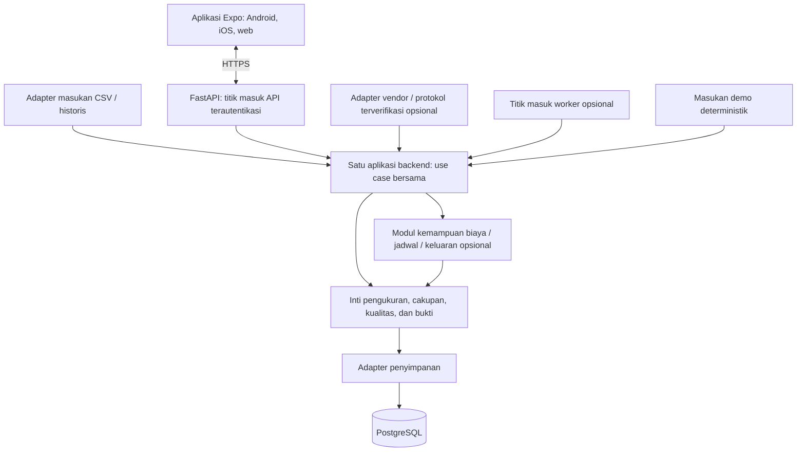

# HematDaya — Dokumen Kebutuhan Produk

Versi: Generik 1.3. Tanggal: 8 November 2026 (Asia/Jakarta).
Bahasa dokumen: Indonesia. Antarmuka produk: Bahasa Indonesia sebagai bawaan, dengan pilihan English. Mata uang awal: IDR.
Status: arah produk dan arsitektur modular diterima; spesifikasi pengembangan, verifikasi implementasi, dan validasi lapangan masih menunggu pelaksanaan.

## 0. Otoritas dokumen dan status bukti

Dokumen ini menetapkan perilaku produk HematDaya dan persyaratan penerimaan. Pemilik produk telah menerima arah monolit modular yang dapat digunakan kembali pada bagian 15; penerimaan arah tersebut bukan bukti bahwa arsitektur telah diimplementasikan. Jika persyaratan bertentangan, gunakan urutan prioritas berikut: keputusan eksplisit terbaru dari pemilik produk → PRD ini → keputusan implementasi yang disetujui secara eksplisit. Catat perubahan yang disetujui beserta persyaratan yang terdampak dan kriteria verifikasinya.

Label bukti yang digunakan dalam dokumen ini:

| Label | Makna |
|---|---|
| Wajib | Perilaku yang harus diimplementasikan dan diverifikasi untuk rilis generik |
| Target usulan | Target penerimaan rekayasa atau riset, bukan hasil pengukuran |
| Ditunda | Di luar v1 generik; tidak boleh menjadi prasyarat penggunaan inti |

Dokumen ini merupakan spesifikasi pengembangan, bukan bukti adanya aplikasi yang telah diimplementasikan, integrasi yang terverifikasi, layanan produksi, akurasi lapangan, hasil studi pengguna, atau penghematan yang telah terwujud. Setiap uji penerimaan dimulai dengan status **belum dijalankan**; kelulusan memerlukan bukti dari rilis yang diimplementasikan serta masukan, lingkungan eksekusi, dan cakupan yang dinyatakan. Persyaratan dalam dokumen ini berdiri sendiri.

## 1. Kontrak keberlakuan

HematDaya melayani pengguna rumah tangga, usaha, dan industri melalui satu produk pemantauan listrik dan saran. Semua konteks menggunakan semantik pengukuran, perhitungan yang menjaga batas cakupan, dan aturan pembuktian yang sama. Pemilihan konteks bersifat opsional; alur inti yang bermanfaat tidak memerlukan AC, jadwal operasi, ataupun data produksi. Alur rumah tangga dan industri merupakan gerbang rilis yang terpisah.

Generik berarti logika pemantauan listrik yang dapat digunakan kembali, bukan kompatibilitas perangkat keras universal, identifikasi peralatan secara otomatis, atau kesesuaian yang setara untuk setiap instalasi industri. Batas keluarga produk adalah produk terkait pemantauan listrik dan saran, termasuk rumah tangga, usaha, industri, dan konteks listrik terukur lainnya. Domain yang tidak terkait dengan tugas pengguna atau invarian berbeda merupakan produk terpisah; pola antarmuka atau infrastruktur yang berguna dapat digunakan kembali tanpa memaksakan domainnya ke dalam HematDaya.

## 2. Tujuan produk dan kontrak yang tidak dapat ditawar

HematDaya membantu seseorang memahami penggunaan listrik dalam cakupan pengukuran yang dinyatakan dan memutuskan hal yang perlu diperiksa atau disesuaikan. Produk inti yang sama harus dapat digunakan untuk kulkas dan router di rumah, penerangan di toko, atau kompresor dan oven di bengkel produksi.

Jika didukung data, produk menjawab:

1. Berapa banyak energi listrik yang tercatat pada periode ini?
2. Berapa estimasi biaya energi jika tarif diketahui?
3. Aset terpantau mana yang memberikan kontribusi terbesar dalam cakupan yang dipilih?
4. Bagaimana konsumsi dibandingkan dengan periode terdahulu yang setara?
5. Apa yang terjadi di luar rentang waktu pemakaian yang diharapkan pengguna, jika rentang tersebut diberikan?
6. Berapa energi yang digunakan per satuan keluaran, jika metrik keluaran yang valid diberikan?
7. Bukti apa yang mendukung setiap pengamatan, dan apa yang masih belum diketahui?

Prinsip inti:

- **Hanya pemantauan dan saran.** Tidak ada perintah, pemutusan listrik, relai, remote IR, pengendalian termostat, otomatisasi kedatangan, atau penyalaan/pemadaman tanpa pengawasan.
- **Tidak mewajibkan AC.** Tidak ada layar, perhitungan, fixture, cabang orientasi awal, atau uji penerimaan yang boleh bergantung pada keberadaan AC.
- **Tetap bermanfaat tanpa produksi atau jadwal.** Energi, kontribusi, riwayat, kualitas data, dan pengamatan tren yang memenuhi syarat tetap tersedia.
- **Cakupan yang jujur.** Meter colokan bukan pembacaan seluruh rumah atau seluruh pabrik. Pembacaan sirkuit bukan bukti konsumsi setiap peralatan yang terhubung.
- **Bukti mendahului saran.** Kategori, pola daya, dan meter yang luring tidak membuktikan kerusakan, keberadaan penghuni, pemborosan, ataupun bahwa suatu aset sedang mati.
- **Satu produk bersama.** Preset konteks tidak boleh memecah mesin perhitungan, skema, atau aplikasi menjadi produk rumah tangga dan industri yang terpisah.

## 3. Pengguna, konteks, dan hasil yang berhasil

| Pengguna/konteks | Contoh pertanyaan | Hasil minimum yang berhasil |
|---|---|---|
| Penghuni rumah tangga | “Perangkat terpantau mana yang paling banyak memakai energi minggu ini?” | Kontribusi dan riwayat tanpa penyiapan pabrik |
| Penyewa atau penghuni rumah bersama | “Berapa pemakaian perangkat yang saya ukur?” | Total dengan cakupan yang jelas; tanpa klaim tentang ruang yang tidak diukur atau pembagian tagihan |
| Pengelola toko, kantor, atau usaha jasa | “Apakah pemakaian berubah di luar jam buka?” | Jadwal opsional dan perbandingan yang setara |
| Pemilik bengkel produksi atau IKM | “Apakah energi per batch berubah?” | Metrik keluaran opsional dengan satuan dan batas pengukuran yang eksplisit |
| Operator industri | “Sirkuit atau mesin terukur mana yang berubah?” | Penerimaan data dari sumber yang kompatibel dengan cakupan yang aman dari tumpang tindih dan bukti kualitas data |
| Pengguna yang tidak memilih sektor | “Bisakah saya memeriksa CSV ini?” | Alur inti lengkap dengan label netral |

Produk awal: satu akun pemilik dan satu lokasi aktif, dengan beberapa aset dan sumber di dalamnya. Sebuah lokasi dapat mewakili rumah, toko, bengkel produksi, atau lokasi industri. Model data mengidentifikasi lokasi sejak awal. Dasbor lintas lokasi, izin tim, agregasi wilayah, dan administrasi perusahaan ditunda.

Preset konteks opsional: `household`, `business`, `industry`, `unspecified`. Nilai bawaan adalah `unspecified`; pemilihan preset dapat dilewati. Preset hanya mengubah contoh pengantar dan pilihan demo. Preset tidak boleh menyimpulkan keberadaan penghuni, menetapkan tarif, mengaktifkan notifikasi, menetapkan jadwal, atau mengaktifkan metrik keluaran. Perubahan preset mempertahankan seluruh pembacaan dan pengaturan.

Target riset usulan harus dievaluasi secara terpisah untuk peserta rumah tangga dan usaha/industri: sedikitnya 4 dari 5 pengguna baru menyelesaikan tugas inti penafsiran tanpa bantuan; sedikitnya 4 dari 5 mengidentifikasi kontributor terukur terbesar dalam 30 detik. Rata-rata gabungan tidak boleh menyembunyikan kegagalan salah satu segmen. Target ini tidak menyatakan efektivitas lapangan atau penghematan.

## 4. Cakupan rilis

### 4.1 Wajib untuk v1 generik

- Demo terisolasi tanpa perangkat keras, akses akun untuk data server yang disimpan, satu lokasi milik pengguna.
- Aset terpantau bebas dengan nama, kategori, label lokasi opsional, dan cakupan pengukuran yang eksplisit.
- Impor riwayat CSV sebagai jalur data awal yang lengkap; jalur meter langsung yang didukung hanya setelah adapter dan kesesuaian fisiknya diverifikasi.
- Energi interval, estimasi biaya, kontribusi, riwayat, perbandingan riwayat yang setara, kemutakhiran, dan cakupan waktu.
- Jadwal mingguan pemakaian yang diharapkan, bersifat opsional, dengan beberapa rentang waktu dan dukungan lintas tengah malam.
- Metrik energi yang dinormalisasi terhadap keluaran, bersifat opsional bagi pengguna yang membutuhkannya.
- Pengamatan yang menyertakan bukti, saran konservatif, dan umpan balik opsional.
- Pemulihan untuk keadaan kosong, mempelajari pola, parsial, usang, luring, sumber bertentangan, kemampuan yang tidak didukung, dan impor tidak valid.
- Implementasi bersama untuk Android, iOS, dan web dengan antarmuka dwibahasa serta persyaratan aksesibilitas.
- Fixture demo rumah tangga dan industri yang deterministik, menggunakan jalur perhitungan produksi.
- Batas konkret domain bersama, kemampuan opsional, dan adapter; komposisi produk tervalidasi serta proses rilis/peningkatan versi dari sumber bersama sebagaimana ditetapkan dalam FR-21–22 dan bagian 15.

### 4.2 Ditunda

Seluruh pengendalian fisik; inferensi cuaca atau keberadaan penghuni; pemisahan beban otomatis; diagnosis kerusakan; pemeliharaan prediktif; energi nonlistrik seperti bahan bakar atau panas; pembangkitan surya, ekspor, baterai, dan pencatatan energi neto bertanda; rekonsiliasi tagihan utilitas; penagihan daya maksimum, daya reaktif, bertingkat, atau berdasarkan waktu pemakaian; berbagi lintas pengguna; dasbor banyak lokasi; tolok ukur sektor; verifikasi penghematan otomatis; AI cloud berbayar; ML opsional di luar baseline; klaim sertifikasi.

Microservices, platform plugin dinamis, mesin aturan/alur kerja bebas, fork sumber per klien, penagihan SaaS, dan penyediaan tenant mandiri tidak diwajibkan untuk v1 generik. Penggunaan kembali tidak memerlukan hosting bersama atau penawaran white-label.

Pengecualian ini membatasi implementasi pertama, bukan pilihan kategori peralatan pengguna. Beban berkabel tetap atau tiga fase dapat dianalisis melalui data energi impor yang kompatibel dan cakupannya benar. Hal ini tidak menyatakan meter colokan yang dipilih cocok untuk beban tersebut dan tidak mewajibkan integrasi meter industri baru pada v1.

## 5. Domain bersama dan batas pengukuran

### 5.1 Rekaman dan tanggung jawab

| Rekaman | Makna yang wajib |
|---|---|
| Pengguna/sesi | Identitas pemilik; akses terautentikasi yang dapat dicabut ke data tersimpan |
| Lokasi | Pemilik, nama, preset konteks, zona waktu, mata uang; bawaan awal Asia/Jakarta dan IDR |
| Aset | ID stabil, lokasi, nama dari pengguna, kategori/lokasi opsional, jenis cakupan, induk yang dinyatakan secara opsional, profil pemakaian yang diharapkan secara opsional |
| Sumber/kanal pengukuran | Kanal meter atau deret impor; satuan, semantik interval, asal, frekuensi pencatatan, kualitas, dan status integrasi |
| Pengikatan sumber | Sumber → aset dengan tanggal berlaku; satu sumber energi otoritatif per aset pada setiap saat |
| Pengukuran | Identitas sumber, waktu/interval pengukuran, waktu penerimaan, nilai/satuan, kualitas, asal-usul, dan revisi |
| Pilihan agregasi | Kumpulan aset yang eksplisit dan tidak tumpang tindih sehingga pembacaannya dapat dijumlahkan |
| Jadwal pemakaian yang diharapkan | Bawaan lokasi atau pengganti pada aset; zona waktu, rentang mingguan, tanggal berlaku |
| Tarif | IDR/kWh opsional, waktu berlaku dan asal-usul; satu tarif tetap pada setiap saat |
| Metrik/masukan keluaran | Cakupan aset yang dipilih secara opsional, satuan, metode penyebut, kuantitas, dan periode yang tepat |
| Insight | Jenis pengamatan, snapshot bukti, versi, batasan, status, dan umpan balik |
| Impor | Pratinjau validasi, pemetaan sumber, kesalahan, jumlah baris diterima/dilewati/bertentangan, dan hasil komit |

Aset dapat mewakili `device`, `group`, `circuit`, atau `site_total`. Nama bukan ID. Dua aset dapat memiliki nama yang sama; pratinjau impor harus membedakan atau menyelesaikannya secara eksplisit. Kategori bukan kemampuan sensor atau identitas peralatan yang terverifikasi.

Label lokasi seperti “Dapur” atau “Area produksi” mengelompokkan aset. Label tersebut bukan pembacaan meter tambahan. Kelompok turunan dapat menjumlahkan anggota yang tidak saling tumpang tindih, tetapi tidak boleh membuat salinan kedua energinya dalam total lokasi.

Relasi ketercakupan yang dinyatakan harus tetap berada dalam lokasi yang sama dan tidak boleh membentuk siklus atau merujuk dirinya sendiri. Tumpang tindih fisik yang belum diketahui merupakan keadaan belum terselesaikan tersendiri, bukan izin untuk menganggap beban terpisah. Relasi induk sederhana dan pilihan terpisah yang dikonfirmasi sudah cukup untuk v1; editor topologi listrik lengkap ditunda.

### 5.2 Tidak ada penghitungan ganda

Setiap ringkasan menyertakan `aggregation_scope`, aset yang disertakan, aset yang dikecualikan beserta alasannya, dan cakupan data. Terapkan aturan berikut sebelum menampilkan total gabungan atau diagram kontribusi:

1. Dua sumber alternatif untuk aset dan interval yang sama merupakan pengganti, bukan penjumlahan. Pengikatan memilih sumber otoritatif; tumpang tindih yang belum terselesaikan memblokir interval tersebut dari total gabungan dan menampilkan konflik.
2. Induk terukur dan anak-anak yang tercakup di dalamnya tidak boleh semuanya menjadi anggota pilihan agregasi yang sama. Contoh: meter utama rumah 10 kWh dan kulkas terukur 1 kWh menghasilkan tampilan meter utama 10 kWh atau tampilan kulkas 1 kWh, tidak pernah 11 kWh.
3. Untuk meter yang tidak berelasi, pengguna mengonfirmasi bahwa beban yang diukur terpisah. Jika tumpang tindih fisiknya tidak diketahui, tampilkan nilai masing-masing dan minta klarifikasi; jangan menjumlahkannya diam-diam.
4. Ketika meter seluruh lokasi dipilih, detail anak dapat tetap terlihat secara terpisah. Persentase anak menggunakan induk hanya jika interval, batas, dan cakupannya dapat dibandingkan. Sisa yang tidak diukur bukan peralatan bernama atau bukti pemborosan.
5. Jangan diam-diam beralih dari meter utama ke meter anak ketika meter utama menjadi usang. Pertahankan cakupan yang dipilih dan keadaan kualitasnya sampai pengguna mengubahnya.
6. Jangan menjumlahkan energi total fase dengan jumlah masing-masing fase dari meter yang sama. Adapter harus menyatakan apakah kanal merupakan total atau komponen.

Untuk instalasi sederhana dengan satu sumber yang tidak tumpang tindih per aset, ringkasan merupakan jumlah aset tersebut. Penyuntingan hierarki yang rumit tidak diwajibkan: antarmuka minimum adalah pemilihan cakupan yang jelas dan peringatan tumpang tindih, dengan penolakan terhadap agregasi tingkat lanjut yang tidak pasti.

## 6. Kategori aset, pemakaian yang diharapkan, dan dukungan perangkat keras

### 6.1 Kategori tetap terbuka

Contoh opsional: pendinginan/refrigerasi, penerangan, elektronik/TI, pemompaan, pemanasan/memasak, motor/peralatan proses, pendinginan/ventilasi, lainnya. Pengguna dapat mempertahankan label khusus atau “Lainnya”. Jangan mengarahkan semua aset yang belum dikenal ke logika AC. Orientasi awal dasar melalui CSV tidak mewajibkan merek, kategori, nilai daya nominal, sensor ruangan, jadwal, atau masukan produksi.

### 6.2 Profil pemakaian yang diharapkan

| Profil | Contoh, bukan penetapan otomatis | Penafsiran yang diizinkan |
|---|---|---|
| Belum diketahui | Sirkuit impor yang belum diklasifikasikan | Total, kualitas, tren setara; tanpa klaim jam pemakaian yang diharapkan |
| Diharapkan terus-menerus | Kulkas, router, server, pendinginan proses yang diperlukan | Perubahan dapat diamati; pemakaian terus-menerus itu sendiri bukan pemborosan |
| Terjadwal | Penerangan toko, mesin proses tertentu | Bandingkan dengan rentang eksplisit; di luar jadwal merupakan pengamatan |
| Berselang/siklus | Pompa, mesin press, oven, TV | Energi periode; tanpa kesimpulan MATI dari sampel rendah atau celah data |

Pengguna memilih profil atau mempertahankan keadaan belum diketahui. Kategori dapat menyarankan penjelasan, tetapi tidak boleh diam-diam menetapkan perilaku. Pilihan eksplisit “diharapkan terus-menerus” pada aset menggantikan jadwal lokasi untuk aset tersebut. Jadwal khusus baru berlaku setelah konfirmasi. Penjelasan harus menyebutkan jadwal/profil yang digunakan.

### 6.3 Kontrak kemampuan sumber

Shelly Plug PM Gen3 dan perangkat TP-Link merupakan kandidat adapter pengukuran, bukan integrasi terverifikasi atau bukti kompatibilitas rumah tangga/industri. Kandidat harus tetap diberi label direncanakan atau tidak didukung sampai diimplementasikan dan diverifikasi untuk model dan kemampuan tertentu. Jalur demo dan CSV tidak boleh bergantung pada kedua penyedia tersebut.

Entri katalog menyatakan jenis pengukuran yang didukung, satuan, frekuensi pencatatan, cakupan kanal, dan status validasi. Tampilkan “Terhubung” hanya setelah pendaftaran sumber yang terautentikasi dan pembacaan pertama yang valid. Meter yang terhubung tetap tidak membuktikan bahwa suatu beban sesuai secara kelistrikan. Persyaratan instalasi dan spesifikasi vendor yang sebenarnya harus diperiksa untuk model dan beban yang dipilih; pengawatan tetap memerlukan pemasangan yang tepat oleh tenaga berkualifikasi. Jangan menyediakan alur menyambung ulang kabel listrik utama secara mandiri.

Tidak ada integrasi yang boleh menawarkan penyalaan/pemadaman hanya karena perangkat kerasnya memiliki relai. Tidak ada endpoint pengendalian dalam v1 generik.

## 7. Alur pengguna

| ID | Alur | Hasil penerimaan |
|---|---|---|
| P01 | Sambutan → Coba demo → demo rumah tangga | Data bermanfaat tanpa mewajibkan AC, jadwal, produksi, tarif, atau kredensial |
| P02 | Lokasi kosong → impor CSV → tinjau pemetaan dan kesalahan → konfirmasi | Cakupan dan total jelas; impor gagal mempertahankan masukan serta data yang ada |
| P03 | Beranda → periode → kontributor terbesar → riwayat | Paling banyak 3 ketukan yang disengaja; nilai dan cakupan selaras |
| P04 | Saran → pengamatan perubahan → bukti | Pengguna dapat mengidentifikasi nilai teramati, perbandingan, kualitas, dan penyebab yang belum diketahui |
| P05 | Pengaturan → jadwal pemakaian yang diharapkan secara opsional → pengganti pada aset | Rentang lintas tengah malam dan aset terus-menerus berperilaku konsisten |
| P06 | Metrik keluaran opsional → satuan dan cakupan → penyebut | Intensitas valid muncul; masukan hilang/tidak valid tidak pernah menjadi nol |
| P07 | Tambahkan sumber → merek/model → koneksi → pengikatan aset | Pembacaan pertama terverifikasi; percobaan ulang tidak membuat aset atau pengikatan ganda |
| P08 | Tanpa tarif, data hilang, sumber usang, atau klien luring → pemulihan | Nilai terakhir yang diketahui diberi label jujur; percobaan ulang mempertahankan draf |
| P09 | Dua sumber atau meter induk/anak → selesaikan cakupan | Konflik terlihat dan tidak ada total yang dihitung ganda |
| P10 | Umpan balik insight → tunda/sembunyikan → pulihkan | Umpan balik tersimpan, tidak pernah menghapus pengukuran atau mengirim tindakan perangkat keras |
| P11 | Preset rumah tangga → industri atau belum ditentukan | Pengukuran dan pengaturan opsional tetap utuh; hanya contoh yang berubah |

Lanjut tanpa data membuka Beranda kosong tanpa membuat ruang kerja di server. Konteks penggunaan bersifat opsional di Pengaturan. Tampilan MVP ringkas dengan kolom pendukung pada layar berisi data mulai 768 piksel logis. Formulir tetap satu kolom. Bahasa Indonesia adalah bawaan. Pilihan English tersedia setelah semua alur MVP, label aksesibilitas, dan pesan pemulihan siap. Pergantian bahasa menjaga konteks dan tidak mengirim atau mengulangi perubahan di server maupun mengevaluasi ulang Saran.

P01–P04, P08–P10 harus lengkap tanpa jadwal dan metrik keluaran. Industri juga harus dapat digunakan tanpa data keluaran. Tidak ada persona yang dipaksa mengisi kolom yang tidak relevan.

## 8. Arsitektur informasi dan kontrak layar

Tiga tab berlabel yang selalu tersedia: **Beranda**, **Perangkat**, **Saran**. “Perangkat” mencakup kelompok dan sirkuit bermeter, dengan label cakupan yang terlihat. Pengaturan, impor, dan skenario pengujian bersifat sekunder. Layar detail native menggunakan stack; web dapat memakai navigasi samping dengan tiga tujuan yang sama.

| ID | Layar | Isi dan tindakan yang berfungsi |
|---|---|---|
| S01 | Sambutan | Penjelasan singkat, Coba demo sebagai tindakan utama, Lanjut tanpa data, dan pilihan bahasa saat cakupan dwibahasa selesai |
| S02 | Beranda kosong | Utamakan Coba demo. Tambah data membuka layar CSV, lalu Pilih berkas membuka pemilih berkas. |
| S03 | Beranda berisi data | Periode, cakupan, kWh, estimasi biaya opsional, cakupan/kemutakhiran, kontribusi, satu pengamatan |
| S04 | Perangkat | Nama aset, kategori/cakupan, energi, kualitas; tambah/impor dan buka detail |
| S05 | Penyiapan sumber | Penyedia → model → koneksi/pembacaan pertama → nama/cakupan/pengikatan; draf dipertahankan |
| S06 | Detail aset | Riwayat, asal-usul sumber, total, kualitas, insight terkait; jadwal/intensitas hanya jika relevan |
| S07 | Saran | Daftar berbasis bukti; keadaan mempelajari pola/tidak ada temuan; umpan balik dan pemulihan yang disembunyikan |
| S08 | Detail insight | Apa yang berubah, periode baseline, perhitungan, kualitas, batasan, saran umum, dan umpan balik |
| S09 | Pengaturan | Nama/konteks/zona waktu lokasi, tarif, jadwal/metrik keluaran opsional, pilihan notifikasi |
| S10 | Impor | Berkas/tempel, contoh, konfirmasi satuan/zona waktu/interval, pemetaan cakupan, pratinjau, komit/coba lagi |
| S11 | Penyelesaian cakupan/sumber | Penjelasan induk/anak atau sumber ganda; pilih tampilan valid yang tidak tumpang tindih |
| S12 | Penyiapan metrik opsional | Pilih aset pembilang, satuan, metode/periode penyebut; pratinjau dan nonaktifkan |

Judul bawaan: “Energi yang dipantau”; judul biaya: “Estimasi biaya energi terpantau”. “Total tagihan” tidak pernah menjadi sinonim biaya energi terukur, termasuk ketika meter utama tersedia. Metrik keluaran tetap berada di luar Beranda sampai diaktifkan secara eksplisit dengan data valid. Layar rumah tangga tidak boleh memuat kartu “produksi” kosong yang permanen.

## 9. Persyaratan fungsional

### FR-01 Demo dan akun tersimpan

Demo berjalan tanpa kredensial, perangkat keras, izin push, atau layanan berbayar dan berlabel “Demo · Data simulasi”. Demo terisolasi dari impor pengguna dan data langsung yang tersimpan; reset hanya memengaruhi keadaan demo. Sumber daya server yang tersimpan memerlukan login, kredensial akses berumur pendek, sesi refresh yang dapat dicabut, penyimpanan rahasia native yang aman, dan perlindungan sesi web yang sesuai. Demo bukan bukti bahwa autentikasi server telah tersedia.

### FR-02 Lokasi dan konteks netral

Buat satu lokasi milik pengguna dengan zona waktu yang terlihat. Konteks bersifat opsional dan tidak bergantung pada data. Semua akses sumber daya dibatasi pada pemilik/lokasi. Perubahan zona waktu memerlukan konfirmasi dan menghitung ulang batas hari lokal serta perbandingan; timestamp impor tanpa zona waktu mempertahankan penafsiran aslinya, dan perubahan tidak menulis ulang saat UTC yang tersimpan.

### FR-03 Aset dan pengikatan

Buat, ubah nama, kategorikan, dan arsipkan aset bebas. Pertahankan ID stabil dan riwayat pengikatan. Pelepasan pengikatan sumber menghentikan asosiasi mendatang dan mempertahankan riwayat. Pengarsipan dapat dibatalkan; penghapusan data permanen merupakan tindakan eksplisit yang terpisah. Penggantian sumber menggunakan waktu berlaku dan tidak pernah menyambungkan aliran lama dan baru tanpa asal-usul.

### FR-04 Katalog dan pendaftaran

Tampilkan adapter yang sudah diimplementasikan dan yang direncanakan. Pendaftaran memiliki masa kedaluwarsa dan hanya dapat digunakan sekali, memverifikasi identitas sumber pada server, serta memerlukan pembacaan pertama yang valid. Percobaan ulang bersifat idempoten. Kesalahan penyedia menggunakan teks Indonesia yang dapat ditindaklanjuti dan mempertahankan masukan penyiapan. Model yang tidak didukung kembali ke katalog tanpa keberhasilan palsu.

### FR-05 Penerimaan data

Normalisasikan pengukuran yang didukung ke kontrak pada bagian 10. Pertahankan asal-usul mentah, waktu pencatatan/penerimaan, satuan, semantik interval/pencacah, ketidaktersediaan data, dan kualitas. Tangani pengiriman ganda, pembacaan terlambat, dan reset pencacah. Telemetri tidak valid ditolak atau dikarantina dengan diagnostik; tidak pernah diubah menjadi pengukuran nol yang valid.

### FR-06 Impor dan pratinjau CSV

Dukung alias CSV yang diterima dan format kanonis pada bagian 10. Lakukan parsing, pemetaan, validasi, dan pratinjau sebelum komit. Laporkan baris diterima, dilewati, duplikat identik, dan bertentangan secara terpisah. Komit impor bersifat atomik dan aman untuk dicoba ulang. Unggahan buruk tidak boleh menghapus data terdahulu. Semua batas baris/ukuran, zona waktu, dan asumsi frekuensi pencatatan yang disimpulkan terlihat sebelum konfirmasi; rinciannya ada pada bagian 10.

### FR-07 Energi dan riwayat

Sediakan pilihan hari ini/minggu ini dan rentang tanggal eksplisit dalam riwayat. Turunkan ringkasan dan bucket grafik dari interval yang diterima, pilihan, dan zona waktu yang sama. Pertahankan presisi penuh secara internal; bulatkan hanya nilai tampilan. Bucket yang hilang merupakan celah; nol terukur merupakan nilai nyata. Hari/minggu berjalan yang belum lengkap dibandingkan dengan periode berlalu yang setara.

### FR-08 Estimasi biaya

Tarif bersifat opsional, tidak negatif, dan bertanggal berlaku dalam IDR/kWh. Gunakan aritmetika desimal dan rumus pada bagian 11. Tanpa tarif berarti biaya belum diketahui, bukan Rp0. Tarif nol yang dimasukkan secara eksplisit merupakan estimasi energi gratis yang valid, dengan asal yang terlihat. Jelaskan bahwa pajak, biaya daya maksimum/reaktif, dan komponen tagihan tidak termasuk. Perubahan yang berlaku sekarang tidak menulis ulang biaya lama; koreksi retroaktif yang dikonfirmasi menghitung ulang periode terdampak dengan catatan audit.

### FR-09 Kontribusi dan cakupan

Urutkan hanya aset terukur di dalam pilihan valid yang tidak tumpang tindih. Nyatakan pilihan, pengecualian, dan cakupan. Untuk total terukur nol, jangan tampilkan distribusi persentase. Pertahankan tampilan induk versus tampilan anak secara eksplisit. Selesaikan tumpang tindih ambigu sebelum agregasi; jangan menyiratkan bahwa seluruh beban listrik sudah tercatat hanya karena semua aset terdaftar ditampilkan.

### FR-10 Jadwal pemakaian yang diharapkan secara opsional

Dukung bawaan lokasi, pengganti per aset, hari mingguan, beberapa rentang waktu, dan rentang lintas tengah malam. Jadwal dapat dilewati dan nonaktif secara bawaan. Tanpa jadwal berarti metrik di luar rentang tidak tersedia, bukan nol atau 24 jam pemborosan. Validasi, pratinjau, dan simpan jadwal secara atomik; rincian serta semantik batas ada pada bagian 11.

### FR-11 Energi yang dinormalisasi terhadap keluaran secara opsional

Aktifkan hanya atas permintaan pengguna. Wajibkan pilihan aset pembilang, satuan penyebut eksplisit, periode yang tepat, serta kuantitas keluaran aktual atau estimasi rata-rata yang diberi label jelas. Pengguna rumah tangga tidak pernah memerlukan penyebut. “IKE” dijelaskan sebagai energi per satuan keluaran yang dipilih, bukan tolok ukur universal. Bagian 11 menetapkan validitas penyebut dan aturan penyetaraan.

### FR-12 Baseline, kesiapan, dan gerbang kualitas

Gunakan mesin yang sama untuk semua konteks. Simpan rentang baseline, kesiapan, cakupan, dan versi secara terpisah dari tarif. Perubahan jadwal atau keluaran membatalkan perbandingan yang tidak kompatibel. Total dasar yang terukur tetap bermanfaat selama mempelajari pola. Tidak boleh menyimpulkan keadaan “normal” hanya karena baseline belum tersedia atau perbandingan ditahan.

### FR-13 Insight berbasis bukti

Dukung kontribusi terukur, perubahan energi yang setara, perubahan di luar rentang opsional, dan perubahan intensitas opsional. Setiap insight yang dihasilkan mempertahankan snapshot bukti dan batasan. Ambang dan aturan penahanan ada pada bagian 12. Panduan umum diberi label eksplisit dan tidak pernah menggantikan bukti personal.

### FR-14 Umpan balik dan notifikasi

Bermanfaat, tidak relevan, tunda sampai hari lokal berikutnya, sembunyikan, dan pulihkan bersifat opsional. Batasi umpan balik pada insight dan pemiliknya. Tahan notifikasi berulang untuk revisi pengamatan yang sama; pertahankan umpan balik pada penghitungan ulang yang setara. Saran di dalam aplikasi wajib tersedia; push bersifat opsional dan nonaktif sampai ada persetujuan. Penerimaan oleh gateway bukan bukti pengantaran. Tidak ada respons atau umpan balik yang diabaikan yang boleh memicu aktuator.

### FR-15 Keadaan konsisten dan pembacaan luring

Satu keadaan domain menggerakkan ringkasan, grafik, jumlah, dan bukti. Segarkan ketika aplikasi kembali aktif dan atas permintaan pengguna; ponsel bukan pengumpul permanen. Data cache menyertakan timestamp, cakupan, dan kualitas. V1 luring memungkinkan pembacaan data cache dan penyimpanan draf; operasi yang mengubah data menunggu penyimpanan daring yang dikonfirmasi, tanpa diam-diam mengklaim berhasil atau mencoba penggabungan luring yang rumit.

### FR-16 Hak data dan retensi

Sediakan ekspor pengukuran yang diterima beserta satuan, interval, waktu UTC, zona waktu/asal-usul asli, dan metadata cakupan. Jelaskan pengarsipan versus penghapusan. Konfirmasikan penghapusan permanen dan dokumentasikan retensi/kedaluwarsa cadangan sebelum rilis langsung; status pemusnahan tertunda terlihat. Hindari mengekspor kredensial sesi atau meter. Teks CSV hasil ekspor harus aman dibuka di perangkat lunak spreadsheet tanpa eksekusi formula.

### FR-17 Demo dan keterulangan

Sediakan entri skenario rumah tangga dan industri yang terpisah, serta skenario kosong, tanpa tarif, parsial, usang, kesalahan impor, tumpang tindih sumber, dan reset. Satu jam virtual bersama membuat grafik dan bukti dapat direproduksi. Layar produk biasa tidak menampilkan jargon penguji atau payload debug. Bagian 19 menetapkan acuan hasil fixture yang tepat.

### FR-18 Pemulihan kesalahan

Kembali, coba lagi, kesalahan parsing berkas, koneksi terputus, dan login kedaluwarsa mempertahankan draf nonrahasia serta keadaan terakhir yang dikonfirmasi. Batalkan perubahan optimistis jika penyimpanan pengaturan gagal. Validasi API tidak pernah menerima pengaturan tidak valid hanya karena antarmuka telah memvalidasinya. Kesalahan membedakan data yang tidak tersedia dari masukan yang ditolak dan menawarkan tindakan berikutnya yang bermakna.

### FR-19 Audit dan penghitungan ulang

Impor, perubahan pengikatan, perubahan tarif, perubahan cakupan, dan perubahan metrik opsional mencatat siapa, kapan, dan interval terdampak tanpa rahasia. Data terlambat atau pengaturan yang dikoreksi menghitung ulang agregat terdampak secara idempoten. Pertahankan versi bukti insight yang sudah dilihat dan tandai pengamatan yang digantikan; jangan diam-diam menulis ulang bukti di balik umpan balik.

### FR-20 Penegakan kemampuan hanya-baca

Baik klien maupun server tidak mengekspos rute pengendalian mesin, kredensial aktuator, perintah relai, penyiapan khusus AC, atau integrasi IR. Kredensial adapter harus dibatasi untuk pengukuran jika didukung. Pengujian memeriksa tindakan antarmuka dan permukaan API terhadap kontrak ini; label generik pada produk pengendalian AC tidak memenuhi PRD ini.

### FR-21 Komposisi produk yang terbatas dan dapat digunakan kembali

Implementasikan inti pengukuran, cakupan, kualitas, dan bukti bersama satu kali. Biaya, jadwal pemakaian yang diharapkan, dan keluaran/intensitas merupakan modul kemampuan opsional biasa dengan prasyarat eksplisit; CSV, vendor/protokol terverifikasi, persistensi, dan penyajian menggunakan adapter yang memanggil use case aplikasi yang sama. Spesifikasi komposisi kecil yang memiliki versi dan tervalidasi memilih kemampuan, adapter, dan versi kebijakan yang didukung, terpisah dari merek/redaksi, konteks pengguna, dan otorisasi server. Tolak kombinasi yang tidak didukung. Konfigurasi tidak boleh menonaktifkan invarian kebenaran/keamanan, memberikan akses, memperkenalkan aturan klien yang dapat dieksekusi, atau membuat cabang perhitungan khusus pelanggan. Backend memeriksa ketersediaan kemampuan dan prasyarat pada jalur API serta worker; menyembunyikan layar saja tidak cukup. Demo/CSV dan inti tiga tab tetap dapat digunakan tanpa tarif, jadwal, keluaran, broker langsung, dan perangkat keras.

### FR-22 Rilis bersama dan penyampaian kepada klien

Pertahankan satu rilis sumber yang dipelihara dan build yang dapat direproduksi untuk setiap komposisi produk yang didukung. Catat rilis, skema/versi komposisi, modul/adapter terpilih, versi kebijakan, dan migrasi yang diterapkan per penerapan. Penerapan klien terisolasi menggunakan sumber yang sama dengan batas data/penyimpanan/rahasia/akses terpisah jika diperlukan; hal itu tidak memerlukan fork sumber atau penyediaan tenant. Perbaiki cacat bersama satu kali, tambahkan bukti regresi yang relevan, verifikasi alur kritis setiap komposisi yang didukung beserta kontrak adapter/migrasi yang terdampak, lalu luncurkan dengan pemeriksaan kesehatan dan instruksi rollback/pemulihan. Publikasi rilis tidak otomatis meningkatkan versi instalasi. Lacak status peluncuran dan sepakati rentang peningkatan versi yang didukung sebelum operasi klien berkelanjutan; durasi dukungan yang tepat merupakan keputusan operasional. Merek atau pengenal native yang berbeda dapat memerlukan artefak klien berbeda dari rilis sumber yang sama.

## 10. Kontrak pengukuran dan impor

### 10.1 Pengukuran kanonis

Kolom normalisasi wajib: `schema_version`, `site_id`, `asset_id`, `source_id`, `source_record_id`, `measurement_kind`, `origin`, `received_at`, `quality`, serta kolom nilai/waktu pengukuran yang sesuai di bawah ini. Identitas pemilik/lokasi berasal dari otorisasi terautentikasi dan pemetaan server, tidak pernah dari klaim payload yang langsung dipercaya.

| Jenis | Nilai dan waktu | Makna dan batasan |
|---|---|---|
| `interval_energy` | `energy_wh`, `interval_start`, `interval_end` | Konsumsi tidak negatif dalam `[start, end)` |
| `average_power` | `average_power_w`, interval yang sama | Rata-rata selama interval yang dinyatakan; dapat dikonversi menjadi energi |
| `cumulative_energy` | `cumulative_wh`, `measured_at`, identitas pencacah/segmen | Pembacaan pencacah; energi memerlukan pembacaan valid kedua dalam segmen yang sama |
| `instant_power` | `power_w`, `measured_at` | Pengamatan sesaat; tidak otomatis menjadi rata-rata atau interval energi |

Nilai `origin` adalah salah satu dari `live`, `import`, `dataset_replay`, `simulated`. Impor tidak diberi label ulang sebagai langsung hanya karena pengguna menyatakan data berasal dari meter nyata. Catat asal-usul sumber secara terpisah jika diketahui. Nilai tegangan/arus opsional tidak menetapkan faktor daya atau mengizinkan pembuatan kWh rekaan.

Contoh interval yang dinormalisasi, bersifat ilustratif dan tidak bergantung pada payload vendor mana pun:

```json
{
  "schema_version": 1,
  "site_id": "site-demo-home",
  "asset_id": "asset-router",
  "source_id": "source-demo-router",
  "source_record_id": "router-20261020T0000",
  "measurement_kind": "interval_energy",
  "interval_start": "2026-10-19T17:00:00Z",
  "interval_end": "2026-10-19T18:00:00Z",
  "energy_wh": "10",
  "origin": "simulated",
  "quality": ["valid"],
  "received_at": "2026-10-19T18:00:01Z"
}
```

Simpan saat UTC serta asumsi zona waktu/offset impor asli. Tolak tanggal tidak valid dan angka tidak hingga. Pertahankan resolusi pengukuran jika diketahui. String masukan yang mewakili desimal diuraikan dengan semantik desimal; representasi API tidak boleh mendorong aritmetika uang menggunakan floating-point biner.

### 10.2 Format CSV dan kompatibilitas ke belakang

Masukan minimal yang diterima, hanya dengan timestamp:

```csv
timestamp,perangkat,energi_wh
2026-10-20 00:00,Router,10
2026-10-20 01:00,Router,10
```

Masukan netral dengan interval eksplisit:

```csv
interval_start,interval_end,asset,energy_wh
2026-10-20T00:00:00+07:00,2026-10-20T01:00:00+07:00,Router,10
2026-10-20T00:00:00+07:00,2026-10-20T01:00:00+07:00,Kulkas,50
```

Terima alias berikut tanpa membedakan huruf besar/kecil: timestamp = `timestamp`, `waktu`, `tanggal`, `datetime`, `time`; aset = `asset`, `perangkat`, `mesin`, `device`, `nama`, `alat`; Wh interval = `energy_wh`, `energi_wh`, `wh`, `energi`; W rata-rata = `average_power_w`, `daya_w`, `watt`, `daya`, `power_w`. Alias `power_w` diterima sebagai rata-rata interval hanya setelah pratinjau mengonfirmasi makna tersebut secara eksplisit. Berkas daya sesaat dengan sampel jarang tidak boleh diam-diam diintegrasikan.

Header awal/akhir eksplisit diwajibkan untuk masukan energi interval atau daya rata-rata dengan interval tidak teratur. Kolom `cumulative_wh` tersendiri dengan timestamp titik memilih jalur pencacah beserta aturan resetnya; alias `energi` berarti Wh interval, tidak pernah otomatis menjadi pencacah kumulatif. Jika terdapat beberapa kolom nilai yang saling bersaing, pratinjau meminta satu jenis pengukuran dan kolom. Jangan menjumlahkan energi dengan energi setaranya yang diturunkan dari daya.

Algoritma impor dan kontrak antarmuka:

1. Terima CSV UTF-8 dengan BOM opsional, pemisah koma atau titik koma, kolom berkutip, dan akhir baris dari sistem umum. Koma desimal diterima dalam nilai berkutip atau berkas berpemisah titik koma. Tolak kombinasi pemisah/angka yang ambigu dengan contoh.
2. Terapkan batas usulan ukuran unggahan 10 MiB dan 150.000 baris data sebelum komit. Laporkan batas mana yang gagal; batas unggahan dan waktu parsing juga berlaku pada server.
3. Tampilkan pemetaan kolom, satuan, pengikatan sumber, zona waktu, dan interval pengukuran yang diharapkan. Nilai wajib tidak boleh disimpulkan dari kategori aset.
4. Timestamp ber-offset mempertahankan saat eksplisitnya. Timestamp tanpa zona waktu menggunakan zona waktu lokasi hanya setelah pengguna mengonfirmasi pratinjau. Waktu lokal yang ambigu/tidak ada memerlukan offset atau koreksi; tanggal mustahil tidak pernah digeser ke tanggal lain.
5. Dengan awal/akhir eksplisit, wajibkan akhir setelah awal dan tidak ada tumpang tindih yang tidak dapat diselesaikan dalam satu sumber. Untuk baris energi interval/daya rata-rata yang hanya bertimestamp, simpulkan frekuensi pencatatan secara terpisah per aset/sumber dari median celah positif hanya jika sedikitnya 90% celah positif cocok dalam toleransi 1 detik. Jika tidak, minta interval eksplisit atau kolom awal/akhir eksplisit. Aliran interval satu baris selalu memerlukan interval. Baris pencacah tetap merupakan pembacaan titik; timestamp yang berdekatan menentukan kandidat selisih dan tidak dikonversi menjadi interval dengan asumsi frekuensi pencatatan.
6. Konvensi timestamp-saja adalah awal interval. Setelah konfirmasi, setiap baris mencakup tepat frekuensi pencatatan yang dinyatakan, termasuk baris terakhir; ini merupakan asumsi berlabel, bukan durasi terukur. Celah panjang antarrekaman tidak pernah memperpanjang baris sebelumnya melintasi celah. Jangan pernah menyimpulkan melintasi aset atau sumber yang berbeda.
7. Nama/waktu/nilai yang hilang, konsumsi tidak hingga atau negatif, waktu mustahil, dan interval tidak valid merupakan baris tidak valid. Hingga dan termasuk 20% baris tidak valid mengizinkan pratinjau yang mewajibkan penerimaan eksplisit terhadap hasil dengan baris dilewati. Lebih dari 20%, tidak ada baris yang dapat digunakan, makna pengukuran belum diketahui, atau baris bertentangan yang belum terselesaikan memblokir komit. Konflik struktur dan cakupan tidak dapat dikecualikan sebagai baris dilewati biasa.
8. Hitung rekaman duplikat identik secara terpisah dari baris tidak valid; terima hanya satu. Sumber/interval yang sama dengan nilai berbeda merupakan konflik yang harus diselesaikan sebelum komit. Impor ulang berkas identik bersifat idempoten. Sumber berbeda yang bertumpang tindih dengan pengikatan langsung memerlukan pemetaan ganti/lewati yang eksplisit dan tidak boleh ditambahkan diam-diam.
9. Batasi nama aset hingga 60 karakter tanpa pemotongan diam-diam. Tetapkan ID secara eksplisit ketika nama impor berbenturan dengan aset berbeda yang sudah ada; konfirmasi pengguna memilih penggunaan kembali atau pembuatan.
10. Pratinjau menampilkan jumlah seluruh baris data dan jumlah yang selaras: baris unik diterima + baris tidak valid + duplikat identik + baris bertentangan. Persentase tidak valid menggunakan semua baris data tidak kosong sebagai penyebut. Header dan baris kosong dikecualikan. Baris bertentangan tetap diblokir sekalipun persentase tidak valid rendah.
11. Komit baris yang diterima secara transaksional dengan kunci idempotensi; interupsi mengembalikan status impor yang dapat dicoba ulang. Hasil menyatakan baris ditambahkan, dilewati, diduplikasi, aset dipetakan/dibuat, dan periode terdampak. Data yang ada tetap utuh setelah berkas ditolak atau komit gagal.

Pertahankan isi yang ditempel atau konteks berkas terpilih ketika terjadi kesalahan. Unggahan server besar mungkin memerlukan pemilihan ulang setelah browser dimulai ulang; nyatakan hal itu tanpa mengklaim berkas berhasil dipulihkan. Teks dan nama impor diperlakukan sebagai data, tidak pernah dieksekusi sebagai HTML, kode, atau formula spreadsheet.

### 10.3 Penanganan duplikat, reset, dan data terlambat

- Utamakan ID pencatatan sumber yang stabil; jika tidak tersedia, gunakan sumber, jenis pengukuran, dan identitas interval/waktu. Nilai yang sama pada interval berbeda tetap merupakan rekaman yang sah.
- Identitas dan nilai yang sama merupakan pengulangan idempoten; nilai yang berubah merupakan revisi/konflik dengan asal-usul, bukan pembacaan kedua.
- Pembacaan pertama pencacah kumulatif menetapkan titik acuan. Selisih tidak negatif antara pembacaan valid yang berdekatan dalam segmen yang sama menyediakan energi interval. Reset yang dikonfirmasi memulai segmen baru; jangan mengambil nilai absolut atau menganggap nilai setelah reset mewakili seluruh interval.
- Celah yang melebihi interval pencacah valid yang dinyatakan sumber membuat interval tetap tidak pasti. Sekalipun selisih pencacah dipertahankan sebagai energi terukur sepanjang rentang panjang, alokasi subperiode dan perbandingan di luar rentang tetap tidak tersedia tanpa bukti yang lebih rinci. Jangan membuat detail per jam rekaan.
- Pembacaan terlambat memicu penghitungan ulang terbatas pada interval, biaya, dan insight yang terdampak. Penerimaan data atau penghitungan ulang berulang tidak boleh mengubah total yang sudah benar.
- Bedakan cakupan waktu dari ketidakpastian pengukuran: selisih pencacah dengan rentang panjang dapat menetapkan total tetapi memberikan resolusi waktu yang tidak memadai untuk analisis jadwal.

## 11. Perhitungan dan aturan perbandingan

### 11.1 Energi, biaya, dan pembulatan

Untuk energi interval yang diterima, `E_kWh = sum(energy_wh) / 1000` dalam pilihan agregasi yang valid. Untuk daya rata-rata interval, `E_Wh = average_power_w × duration_seconds / 3600`. W sesaat tidak pernah menjadi Wh hanya dengan mengganti label satuan.

Biaya untuk tarif tetap yang diketahui adalah `C_IDR = sum(E_interval_kWh × tariff_effective_for_interval)`. Jika batas tarif berada di dalam sebuah interval, bagi berdasarkan durasi tumpang tindih hanya dengan asumsi laju seragam yang dinyatakan; tandai estimasi alokasi yang dihasilkan. Jika asumsi tersebut tidak sesuai atau tidak diterima, tampilkan bagian itu sebagai biaya belum diketahui. Celah dalam riwayat tarif menghasilkan total biaya tidak lengkap dengan energi tercakup yang dinyatakan, bukan interval berharga nol. Tarif negatif tidak valid; nol eksplisit valid.

Gunakan aritmetika desimal untuk total energi, tarif, dan uang. Pertahankan total yang belum dibulatkan sebagai otoritas perhitungan. Tampilkan kWh dengan presisi yang wajar untuk beban kecil (hingga tiga desimal jika diperlukan) dan IDR dibulatkan sekali untuk tampilan. Jika kontributor yang dibulatkan tidak tampak berjumlah sama, ungkapkan pembulatan; jangan pernah mengubah energi tercatat untuk memaksakan kesamaan. Jangan pernah menggunakan total tampilan yang dibulatkan sebagai acuan biaya eksak.

### 11.2 Batas periode dan interval

Semua kueri menggunakan interval UTC setengah terbuka `[start, end)`, yang diturunkan dari kalender lokal lokasi; minggu dimulai Senin. “Hari ini” berakhir pada waktu kini bersama, bukan satu hari penuh yang masih mencakup masa depan. Demo yang hanya berisi data historis menggunakan waktu kini virtual yang dinyatakan. Berkas historis yang diimpor tidak diam-diam memindahkan jam pengguna nyata: tawarkan “Lihat periode data” ketika hari ini kosong.

Ketika batas kueri/jadwal memotong interval terukur, alokasi proporsional hanya diizinkan sebagai estimasi seragam-dalam-interval yang terlihat. Jumlah bagian yang dialokasikan harus tepat sama dengan interval asli. Pertahankan resolusi sumber; jangan menampilkan bukti tingkat menit dari data per jam seolah-olah pembacaan per menit tersedia. Jika alokasi akan menyesatkan secara material, tampilkan tampilan yang lebih kasar atau tahan insight terdampak.

### 11.3 Cakupan dan kemutakhiran

`temporal_coverage = duration of union(valid measured intervals within requested window) / requested-window duration`. Hitung waktu yang tumpang tindih hanya sekali. Kecualikan interval tidak valid dan celah. Titik sampel daya sesaat tidak menyediakan interval energi. Untuk data pencacah, laporkan validitas rentang energi dan kerincian waktu secara terpisah; total terukur tidak membuktikan waktu penggunaan di dalam interval.

Untuk cakupan gabungan, tampilkan cakupan setiap kontributor dan cakupan kontributor minimum sebagai cakupan ringkasan konservatif. Tampilkan juga rentang waktu ketika seluruh kontributor terpilih memiliki data valid bersamaan. Jangan menghilangkan dampak aset berkonsumsi tinggi yang datanya hilang melalui perataan. Sumber baru hanya mencakup sejak waktu awal sebenarnya; permintaan satu minggu penuh tetap memperlihatkan periode sebelumnya yang tidak diukur.

Bawaan usulan: aliran langsung menjadi usang setelah lebih dari 2 interval sampel yang diharapkan; banner cakupan muncul di bawah 90%. Ini merupakan bawaan rekayasa eksplisit yang divalidasi saat pilot, bukan toleransi peralatan universal. Impor historis menampilkan rentang dan waktu data terbarunya dengan “Data historis”; impor tidak diperlakukan sebagai sumber langsung yang gagal mengirim. Status klien luring terpisah dari keusangan sumber.

### 11.4 Rentang pemakaian yang diharapkan

Rentang mingguan merupakan rentang waktu lokal yang terikat pada hari mulai. Dukung lebih dari satu rentang per hari. Contoh: Senin 22.00–Selasa 06.00 merupakan satu rentang lintas tengah malam yang ditambatkan pada Senin. Gunakan penanda akhir pada hari berikutnya yang eksplisit; awal/akhir yang sama tidak valid kecuali pengguna memilih opsi 24 jam yang terpisah. Gabungkan rentang yang tumpang tindih untuk perhitungan; jangan pernah menghitung menit yang sama dua kali.

Untuk aset, pemakaian efektif yang diharapkan adalah: pengganti eksplisit diharapkan terus-menerus → jadwal aset eksplisit → jadwal lokasi → belum ditentukan. Pilihan eksplisit “tanpa jadwal untuk aset ini” menonaktifkan pewarisan. Pertahankan perbedaan antara mewarisi, menonaktifkan, diharapkan terus-menerus, dan jadwal khusus.

Hitung `outside_energy = sum(interval energy × fraction outside union(expected windows))`, dan `inside_energy = measured energy − outside_energy`. Fraksi merupakan estimasi berdasarkan durasi tumpang tindih ketika interval memotong batas. Harapan terus-menerus sepanjang hari tidak memiliki temuan pemakaian di luar rentang. Jadwal yang belum ditentukan membuat pembagian tidak tersedia. Listrik di luar rentang tidak otomatis merupakan energi yang dapat dihindari.

Validasi semua hari, durasi, dan transisi zona waktu; beri label jadwal/versi efektif. Perubahan secara bawaan berlaku mulai sekarang. Pengguna dapat secara eksplisit menerapkan jadwal yang dikoreksi pada data historis; hitung ulang dengan definisi yang dikoreksi dan ungkapkan hal tersebut. Perbandingan baseline harus menggunakan satu definisi jadwal yang setara atau ditahan sampai tersedia periode yang kompatibel. V1 tidak mencakup kalender hari libur dan rotasi sif bebas; pengguna dapat menonaktifkan perbandingan untuk periode pengecualian yang diketahui.

### 11.5 Keluaran/intensitas opsional

Pengguna memilih cakupan pembilang terukur dan makna penyebut. Satuan dapat berupa unit yang dihasilkan, batch, kg produk, atau keluaran lain yang ditentukan pengguna; penyebut luas lantai opsional menggunakan kWh/m² untuk periode yang dinyatakan dan tidak pernah dicampur dengan keluaran produksi. Tidak ada metrik rumah tangga wajib dan tidak ada penyebut yang disimpulkan dari pemilihan sektor.

Masukan wajib: nama metrik, satuan, aset pembilang, periode, dan metode. Dengan keluaran aktual, `intensity = measured_energy_kWh_for_period / positive_output_quantity_for_same_period`. Keluaran nol menghasilkan “Tidak dapat dihitung: keluaran nol”; keluaran hilang, negatif, tidak hingga, atau periodenya tidak cocok tidak menghasilkan nol, tak hingga, atau kuantitas hasil interpolasi. Produk/satuan berbeda tidak boleh digabung tanpa penyebut bersama yang dinyatakan pengguna; v1 tidak menghitung konversi.

Estimasi keluaran rata-rata dinyatakan eksplisit: `estimated_output = average_output_per_output_day × eligible_output_days`. Untuk hari parsial, wajibkan pengguna mengonfirmasi keluaran seragam sepanjang rentang keluaran yang dinyatakan sebelum menggunakan fraksi berlalu dari rentang tersebut. Tanpa rentang atau konfirmasi tersebut, hitung hanya hari keluaran lengkap yang memenuhi syarat, atau minta keluaran aktual untuk periode yang telah berlalu. Jangan memprorata produksi hanya karena sebagian hari kalender sudah berlalu. Keluaran batch tidak pernah dianggap seragam secara bawaan.

Penyebut estimasi memberi label hasil “Estimasi energi per …” dan menampilkan asumsinya. Energi yang hilang membuat intensitas menjadi energi-tercatat-per-keluaran sementara, dengan kekurangan cakupan yang terlihat; klaim personal tentang perubahan efisiensi memerlukan periode pembilang lengkap dan penyebut yang kompatibel. Untuk perbandingan produksi aktual, wajibkan makna produk/keluaran, satuan, cakupan sumber, dan periode terkait yang lengkap serta sama. Untuk metrik luas, wajibkan panjang periode/rentang berlalu yang sama. Reset perbandingan ketika hal tersebut berubah. Rasio yang lebih rendah merupakan pengamatan, bukan bukti penghematan yang terwujud atau efisiensi peralatan yang lebih baik.

### 11.6 Baseline yang setara

Untuk rentang saat ini yang memenuhi syarat, pertimbangkan rentang hari/waktu lokal yang sama pada masing-masing dari tiga minggu sebelumnya. Bandingkan aset yang sama atau pilihan agregasi yang tidak berubah, menggunakan durasi berlalu, definisi jadwal, dan jenis pengukuran valid yang setara. Gunakan sedikitnya dua rentang historis yang memenuhi syarat; jika tidak, tampilkan “Sedang mempelajari pola”.

Setiap kandidat dan rentang saat ini harus memiliki sedikitnya 90% cakupan waktu. Untuk insight perubahan energi, bandingkan **masker waktu valid bersama** pada rentang saat ini dan rentang historis terpilih, yang diselaraskan menurut hari/waktu lokal. Masker bersama tersebut masih harus mencakup sedikitnya 90% rentang berlalu yang diminta; jika tidak, tahan insight perubahan. Jumlahkan energi pada masker yang sama, tampilkan cakupan masker, dan pertahankan total lengkap yang tercatat secara terpisah. Jangan pernah membandingkan total saat ini yang parsial dengan total historis penuh seolah-olah keduanya memiliki dukungan data yang sama.

`B = median(eligible historical energies on common mask)`. Simpan setiap rentang baseline, energi, cakupan, dan definisi masker bersama. Untuk baseline nol, tampilkan perubahan absolut saja; persentase tidak tersedia. Jika baseline atau cakupan berubah setelah koreksi, buat revisi insight. “Tidak ada perubahan yang memenuhi syarat” berbeda dengan “perbandingan tidak tersedia”.

## 12. Kebijakan insight dan kontrak penjelasan

### 12.1 Jenis insight yang diizinkan

| Jenis | Prasyarat | Redaksi/batasan wajib |
|---|---|---|
| Kontribusi | Pilihan valid yang tidak tumpang tindih dan energi tercatat | “Kontributor terbesar di antara perangkat yang dipantau”; tanpa peralatan tidak terukur yang direka |
| Perubahan energi | Baseline setara, dukungan data bersama, resolusi yang memenuhi syarat | Nyatakan kWh saat ini/acuan, perubahan absolut, dan perubahan relatif yang memenuhi syarat |
| Perubahan di luar rentang | Jadwal eksplisit yang berlaku dan baseline setara | “Pemakaian di luar jadwal”; tidak pernah otomatis “pemborosan” |
| Perubahan intensitas | Metrik valid yang diaktifkan dan periode lengkap yang kompatibel | Nyatakan satuan, metode penyebut, kuantitas, dan batasan |
| Pemberitahuan kualitas data | Data hilang/usang/bertentangan | Jelaskan keterbatasan data; jangan menyajikannya sebagai diagnosis beban |

Beban terus-menerus/kritis dapat menerima pengamatan perubahan konsumsi. Sarannya tidak boleh merekomendasikan penghentian hanya karena beban beroperasi terus-menerus. Pendinginan, pemanasan, refrigerasi, pemompaan, TI, dan beban belum dikenal/kelompok mengikuti aturan bukti yang sama. Tidak ada aturan universal “tiga pengingat lalu MATI”.

### 12.2 Aturan perubahan yang memperhatikan skala

Jangan menerapkan ambang absolut 3 kWh pada seluruh aset. Kebijakan kenaikan deterministik usulan untuk rilis pertama:

- Gunakan nilai saat ini pada masker bersama `C`, baseline `B`, dan simpangan absolut median historis `MAD = median(abs(historical_value − B))`.
- Tetapkan `r` sebagai nilai yang lebih besar antara jumlah resolusi energi interval sumber pada rentang saat ini atau historis, dalam kWh, pada masker yang sama. Batas bawah konservatif ini mencegah derau presisi disebut sebagai perubahan bermakna. Adapter daya rata-rata menyediakan resolusi energi hasil propagasinya. Jika resolusi belum diketahui, tampilkan perbandingan deskriptif tetapi tahan peringatan perubahan personal otomatis sampai kalibrasi selesai.
- Kenaikan memenuhi syarat hanya jika `C − B > 0` dan `C − B >= max(0.30 × B, 3 × MAD, 5 × r)`, serta seluruh gerbang kesiapan, kualitas, cakupan, dan jadwal lulus. Nilai 30%, 3, dan 5 merupakan konstanta kebijakan rekayasa usulan, bukan akurasi deteksi yang tervalidasi atau editor ambang bagi pengguna.
- Ketika `B = 0`, wajibkan perubahan absolut positif yang memenuhi batas bawah lainnya; jangan tampilkan persentase. Penurunan dapat dijelaskan dengan bukti absolut/relatif yang simetris setelah gerbang yang sama, tanpa menyebutnya penghematan terverifikasi.
- Untuk intensitas, gunakan aturan setara dalam satuan metrik tersebut, dengan mempropagasikan resolusi pengukuran melalui penyebut yang kompatibel. Tidak ada aturan yang boleh membandingkan kWh/unit dengan kWh/kg atau diam-diam menggabungkan metode estimasi dan aktual.

Fixture harus menguji perubahan kecil rumah tangga dan perubahan industri yang lebih besar dengan aturan yang sama. Kalibrasikan sensitivitas pada kedua konteks sebelum pilot langsung; jika kalibrasi belum selesai, fakta terukur dan perbandingan deskriptif tanpa peringatan tetap berfungsi. Nilai inti tidak memerlukan model mahal.

### 12.3 Bukti dan pemeringkatan

Setiap insight personal menyertakan: aset/cakupan; periode pengamatan; nilai teramati dan satuan; nilai historis dan median; perubahan absolut; perubahan relatif atau alasan ketidaktersediaannya; jadwal/penyebut jika digunakan; cakupan saat ini, baseline, dan masker bersama; asal/resolusi sumber; versi perhitungan; waktu pembuatan; “Yang belum diketahui”; “Saran umum” opsional yang diberi label. Selisih biaya opsional menggunakan asumsi tarif bersama yang dinyatakan eksplisit agar perubahan tarif tidak disalahartikan sebagai perubahan konsumsi.

Contoh rumah tangga: “TV memakai 0,56 kWh pada periode pembanding yang sama, sebelumnya median 0,36 kWh. Penyebab perubahan belum diketahui.” Contoh industri: “Energi kompresor di luar jadwal meningkat; periksa apakah ada kegiatan yang memang memerlukan pemakaian tersebut.” Angka harus berasal dari snapshot bukti, bukan pembuatan prosa.

Urutkan pemberitahuan kualitas data yang memblokir secara terpisah dari insight konsumsi. Di antara pengamatan yang memenuhi syarat, urutkan menurut tambahan kWh absolut, lalu kemutakhiran dengan ID stabil sebagai penentu jika seri; tampilkan kontribusi bahkan saat mempelajari pola jika cakupannya valid. Jangan membuat peringatan rekaan untuk mengisi Saran. Lebih sedikit pengamatan dengan batasan yang jelas dapat diterima.

Statistik dan penjelasan deterministik sudah memadai. Model masa depan harus mengungguli baseline ini pada data uji kronologis yang disisihkan, dievaluasi terpisah menurut konteks dan tanpa kebocoran data latih/uji. LLM tidak boleh mengarang perhitungan, pembacaan, diagnosis, atau tindakan fisik otonom.

## 13. Matriks keadaan dan pemulihan

| Keadaan | Yang tetap terlihat | Tindakan/pemulihan wajib |
|---|---|---|
| Tidak ada data | Penjelasan, tanpa nol palsu | Impor, demo, atau penyiapan sumber yang didukung |
| Nol diketahui | 0 kWh valid dengan cakupan | Tanpa pembagian nol pada kontribusi atau persentase baseline |
| Mempelajari pola | Total/kontribusi terukur | Jelaskan riwayat setara yang belum cukup |
| Tanpa tarif | kWh/riwayat/insight energi yang memenuhi syarat | Tambah tarif secara opsional; tanpa Rp0 |
| Tanpa jadwal | Data inti | Tanpa nilai atau peringatan di luar rentang; hanya penyiapan opsional |
| Tanpa metrik keluaran | Data inti | Tanpa kartu atau persyaratan produksi |
| Data parsial | Total tercatat berlabel tidak lengkap, celah, cakupan per aset | Coba lagi atau periksa sumber; tahan perbandingan yang tidak kompatibel |
| Sumber langsung usang | Pembacaan terakhir dan timestamp | Periksa sumber/coba lagi; tanpa klaim “perangkat mati” |
| Impor historis | Rentang tepat dan rekaman terbarunya | “Lihat periode data”; jangan memberi label meter langsung luring |
| Klien luring | Nilai terkonfirmasi dalam cache dan usianya | Hubungkan kembali/coba lagi; draf dipertahankan |
| Adapter tidak didukung | Penjelasan kemampuan katalog | Kembali tanpa kehilangan draf aset |
| CSV tidak valid | Penjelasan baris/header/waktu/satuan dan pratinjau | Koreksi/pilih ulang; pembacaan yang ada tidak berubah |
| Sumber/cakupan bertentangan | Nilai masing-masing dengan peringatan | Selesaikan sumber/pilihan sebelum total gabungan |
| Pengaturan opsional ditolak | Pengaturan terakhir yang dikonfirmasi, draf belum tersimpan | Koreksi/coba lagi atau batalkan tanpa ketidakcocokan penghitungan ulang |
| Sesi kedaluwarsa | Draf nonrahasia | Login dan coba lagi secara eksplisit; tanpa komit ganda |
| Tidak ada pengamatan yang memenuhi syarat | Saran kosong yang jujur | Tampilkan riwayat atau panduan umum yang berguna, bukan peringatan palsu |

Keadaan ini merupakan flag yang independen. Sebuah lokasi dapat sekaligus mempelajari pola, tidak memiliki tarif, dan diukur sebagian. Satu keadaan “kesalahan” generik tidak boleh menghapus perbedaan tersebut.

## 14. Penerimaan antarmuka, aksesibilitas, dan konten

| ID | Pemeriksaan wajib |
|---|---|
| UX-01 | Tepat tiga tujuan utama dengan label dalam bahasa yang dipilih dan keadaan terpilih yang tidak bergantung pada warna |
| UX-02 | Satu tindakan utama yang jelas per layar tugas; penyiapan opsional memiliki jalur lewati/batalkan yang terlihat |
| UX-03 | Label bawaan netral: Perangkat, Lokasi, Energi; tanpa istilah pabrik, AC, keberadaan penghuni, atau produksi yang wajib |
| UX-04 | Kontributor terbesar dan bukti unggulan dapat dicapai dalam 3 ketukan yang disengaja dari Beranda berisi data |
| UX-05 | Kembali/coba lagi mempertahankan masukan formulir, periode terpilih, cakupan, dan konteks navigasi |
| UX-06 | Asal sumber, estimasi, kemutakhiran, dan cakupan terlihat di tempat yang memengaruhi penafsiran |
| UX-07 | Minimum internal area sentuh seluler 48×48 satuan logis, diukur pada setiap lingkungan eksekusi; kontrol web seluler menggunakan 48×48 CSS px, Android menggunakan 48×48 dp, iOS menggunakan satuan titik/logis yang dinyatakan. Kontras teks normal ≥4,5:1 dan informasi kontrol/grafik nonteks yang diperlukan ≥3:1, dengan pengecualian WCAG yang berlaku; verifikasi keadaan sebenarnya |
| UX-08 | Teks diperbesar hingga 200% tanpa kehilangan isi/fungsi; nama Indonesia yang panjang membungkus ke baris berikutnya; kontrol mengekspos nama, peran, keadaan terpilih, dan nilai yang bermakna dalam bahasa yang dipilih; grafik memiliki ringkasan yang dapat dibaca dan alternatif data terstruktur |
| UX-09 | Verifikasi penataan ulang web pada 320 CSS px, serta lebar responsif 360, 390, 430, 768, 1280, dan 1440 CSS px; ponsel dengan tinggi layar kecil, area aman, dan penghindaran papan ketik. Tanpa gulir halaman horizontal atau kontrol hilang; gunakan baris data bertumpuk jika diperlukan. Catat pembesaran teks dan penataan ulang secara terpisah |
| UX-10 | Selesaikan tugas web dengan papan ketik tanpa jebakan; fokus yang terlihat dan logis tetap tidak tertutup, overlay mengelola fokus, Escape menutup lembar, dan fokus kembali ke tindakan pemanggil; umumkan status simpan/impor kepada teknologi bantu |
| UX-11 | Keadaan memuat/ditekan/menyimpan/kesalahan untuk setiap tindakan utama; penyimpanan gagal tidak pernah tampak terkonfirmasi |
| UX-12 | Tanpa pengendali AC, jadwal wajib, data keluaran wajib, izin push paksa, atau navigasi inti yang bergantung pada sektor |
| UX-13 | Celah, nilai belum diketahui, nol terukur, dan total tidak lengkap memiliki penyajian yang dapat dibedakan |
| UX-14 | Satuan, total, dan bukti yang sama pada setiap layar; preferensi pengurangan gerak dihormati |
| UX-15 | Pratinjau jadwal menjelaskan awal/akhir lintas tengah malam dan pewarisan; pratinjau metrik menampilkan pembilang serta penyebut |
| UX-16 | Peserta rumah tangga dan industri masing-masing menerima tugas dengan contoh yang mereka kenal; hasil dilaporkan terpisah |
| UX-17 | Urutan baca Beranda: periode dan cakupan pengukuran → kWh tercatat → biaya opsional beserta kualifikasinya → kelengkapan/kemutakhiran → kontributor terbesar → pengamatan yang memenuhi syarat. Pertahankan kualifikasi yang mengubah makna agar tetap terlihat; ungkapkan perbandingan, perhitungan, dan asal-usul secara bertahap melalui tindakan detail berlabel jelas |
| UX-18 | Peringkat kontributor menggunakan batang horizontal/daftar berlabel langsung dengan garis dasar nol bersama; grafik perbandingan menggunakan periode selaras dan skala yang dapat dibandingkan. Setiap grafik memiliki periode, satuan, cakupan, alternatif teks/data nilai eksak, dan kualitas; tugas inti tidak memerlukan hover, warna, atau penyeretan presisi |
| UX-19 | Beri label cakupan fisik pengukuran secara terpisah dari kelengkapan waktu, misalnya “Cakupan pengukuran: 4 perangkat” dan “Kelengkapan data: 92% periode”. Anotasikan celah dengan periode yang tidak tersedia; nol terukur, mempelajari pola, tidak ada perubahan yang memenuhi syarat, sumber usang, impor historis, dan klien luring tetap dapat dipahami secara independen, tidak pernah “92% akurat” |
| UX-20 | Alur CSV menampilkan berkas/tempel → semantik/pemetaan → pratinjau → konfirmasi eksplisit → hasil. Sediakan ringkasan kesalahan yang dapat menerima fokus dan tertaut ke detail baris/kolom jika dapat ditindaklanjuti; pesan yang konsisten dalam bahasa yang dipilih menyatakan koreksi dan apakah komit diblokir. Tetapkan penomoran baris data versus baris berkas; pertahankan masukan/pemetaan dan data terkonfirmasi saat kembali/kesalahan/coba lagi |

Pola redaksi yang disetujui: “Hanya mencakup sumber yang dipilih”; “Data belum diperbarui”; “Sebagian data belum tersedia”; “Tidak ada jadwal yang diatur”; “Estimasi ini tidak sama dengan tagihan listrik”; “Penyebab perubahan belum diketahui”. Jangan mempermalukan pengguna karena operasi terus-menerus, penyiapan yang dilewati, saran yang ditolak, atau notifikasi yang diabaikan.

### 14.1 Dasar riset dan batas standar

Persyaratan UX ini merupakan keputusan desain yang didasarkan pada karya terbitan dan panduan aksesibilitas, bukan temuan studi peserta HematDaya. Studi kualitatif rumah tangga menemukan bahwa umpan balik moneter bergantung pada kredibilitas tarif dan penjelasan yang terkait peralatan membantu penafsiran; konteks studi tersebut tidak memvalidasi rumah tangga Indonesia atau industri. Karena itu, kWh tetap menjadi otoritas pengukuran, biaya diberi kualifikasi, dan kontributor terukur yang bernama mendukung pemeriksaan. Eksperimen persepsi grafis mendukung posisi selaras untuk perbandingan kuantitas; eksperimen data hilang menunjukkan bahwa penyajian mengubah penafsiran. Temuan tersebut mendasari label langsung, skala yang dapat dibandingkan, dan celah yang dianotasikan secara eksplisit, tanpa menetapkan satu grafik terbaik universal atau mengizinkan imputasi. ([Hargreaves dkk.](https://www.wren.uk.com/images/documents/publications/hargreaves_smart_meters.pdf); [Heer dan Bostock](https://hci.stanford.edu/publications/2010/crowd-perception/heer-chi2010.pdf); [Song dan Szafir](https://cmci.colorado.edu/visualab/papers/song_VIS_2018.pdf))

Pengungkapan bertahap mendukung kompleksitas yang mengikuti tugas; hal itu tidak boleh menyembunyikan keterbatasan yang mengubah makna total yang tampak. Validasi yang dapat dipulihkan mengikuti pola ringkasan kesalahan ditambah pesan kolom tertaut. Ringkasan/alternatif data grafik mengikuti panduan WAI untuk grafik kompleks. Ini merupakan pola yang diadaptasi, bukan bukti bahwa navigasi atau alur impor yang diusulkan sudah intuitif. ([NNGroup](https://www.nngroup.com/articles/progressive-disclosure/); [ringkasan kesalahan GOV.UK](https://design-system.service.gov.uk/components/error-summary/); [gambar kompleks WAI](https://www.w3.org/WAI/tutorials/images/complex/))

WCAG 2.2 SC 2.5.8 menetapkan **minimum target AA 24×24 CSS px dengan pengecualian**; standar itu tidak menetapkan minimum 48 satuan. HematDaya sengaja menggunakan target internal seluler 48 satuan yang lebih ketat di atas, dengan pengukuran khusus untuk setiap lingkungan eksekusi. Android merekomendasikan 48×48 dp. WCAG juga menyediakan kriteria web untuk pembesaran teks 200%, penataan ulang 320 CSS px, kontras, papan ketik/fokus, identifikasi kesalahan, dan status terprogram. Penerapan daftar periksa terpilih ini bukan audit kepatuhan WCAG penuh atau sertifikasi native. Periksa Android/TalkBack, iOS/VoiceOver, dan web secara terpisah; tangkapan layar saja tidak dapat membuktikan perilaku fokus atau pembaca layar. ([WCAG 2.2](https://www.w3.org/TR/WCAG22/); [aksesibilitas Android](https://developer.android.com/guide/topics/ui/accessibility/apps))

## 15. Arsitektur dan batas implementasi

### 15.1 Keputusan monolit modular yang diterima

Arsitektur yang diterima adalah satu aplikasi domain backend dengan batas internal eksplisit, titik masuk API, dan worker opsional yang memanggil use case yang sama. PostgreSQL merupakan target penyimpanan awal. Target implementasi tetap React Native + Expo + TypeScript dengan Expo Router untuk Android/iOS/web, FastAPI/Python untuk backend, dan Docker Compose untuk server pilot. Adapter MQTT yang terverifikasi dapat menggunakan Mosquitto dengan TLS; broker maupun worker terpisah tidak diwajibkan untuk CSV/demo. Ini merupakan arah yang diterima dan target implementasi, bukan klaim bahwa komponennya sudah tersedia atau versinya sudah diverifikasi.



Produk listrik terkait di masa depan memperluas modul/adapter konkret atau komposisi yang divalidasi. V1 mengimplementasikan batas yang diperlukan oleh CSV/demo nyata dan analisis opsionalnya; implementasi ini tidak membangun mesin generik bebas, registri plugin, microservices, atau satu layanan per modul. Komponen yang kohesif dan antarmuka fungsi/layanan biasa sudah memadai. Pemisahan yang diterima mengikuti panduan ports-and-adapters dan komponen modular; diagram folder saja tidak menegakkannya. ([Cockburn](https://alistair.cockburn.us/hexagonal-architecture/); [Brown](https://simonbrown.je/modular-monolith/))

### 15.2 Tanggung jawab dan invarian

| Batas | Tanggung jawab dan kendala |
|---|---|
| Inti bersama | Identitas lokasi/aset/sumber dan pengikatan efektif; semantik pengukuran yang dinormalisasi; penurunan energi interval; pilihan yang aman dari tumpang tindih; ringkasan periode; kelengkapan/kemutakhiran; bukti yang tidak dapat diubah atau memiliki revisi. Tanpa cabang perhitungan khusus konteks |
| Modul kemampuan opsional | Biaya memerlukan tarif efektif; analisis di luar rentang memerlukan jadwal yang berlaku; keluaran/intensitas memerlukan penyebut positif dan periode yang kompatibel. Mengonsumsi ringkasan kanonis dan mempertahankan batasan; tidak mendefinisikan ulang energi, cakupan, atau otorisasi |
| Adapter | CSV dan pemetaan vendor/protokol yang benar-benar didukung, penyimpanan PostgreSQL, penyajian API/ekspor, dan pemanggilan worker. Melakukan translasi pada batas; tidak melewati validasi inti atau menambah antarmuka untuk penyedia hipotetis |
| Komposisi produk | Kemampuan/adapter yang didukung, terbatas, dan memiliki versi skema, serta ID/versi kebijakan yang disetujui. Validasi saat startup/build atau penerapan; tolak kombinasi yang tidak didukung |
| Presentasi/konteks | Merek/redaksi dan konteks/contoh pilihan pengguna terpisah dari komposisi. Preset unspecified/household/business/industry mempertahankan makna terbatasnya pada bagian 3 |
| Otorisasi server | Izin pemilik/sumber daya yang terverifikasi berlaku secara independen dari merek, konteks, dan kemampuan yang diaktifkan. Konfigurasi tidak pernah memberikan akses; setiap jalur API/worker menegakkan kelayakan dan izin |

Invarian kebenaran dan keamanan berlaku tanpa syarat: satuan kompatibel, makna interval eksplisit, data hilang tidak menjadi nol, tanpa duplikasi/penghitungan ganda, pencacah valid, kepemilikan, impor atomik, dan bukti yang dapat ditelusuri. Kebijakan analisis merupakan keputusan terpisah yang memiliki versi dan dapat dikalibrasi: pemilihan baseline, kesiapan cakupan, aturan 30%/MAD/resolusi, dan ambang usang. Pertahankan bawaan bagian 11–12 dan catat identitas/versi kebijakan pada setiap temuan. Pembaruan kebijakan tidak boleh menonaktifkan invarian; editor aturan bebas bagi pengguna akhir tidak diwajibkan.

Frontend mengonsumsi ringkasan/bukti tanpa mengimplementasikan otoritas perhitungan langsung kedua yang bertentangan. Demo mandiri dapat menggunakan perhitungan fixture setara jika lingkungan eksekusinya berbeda; asersi kesetaraan harus mencakup kontrak server yang tepat. API backend dan worker opsional memanggil use case domain yang sama. Ponsel tidak menyimpan rahasia vendor, tidak mengumpulkan data terus-menerus, dan tidak pernah menjadi proses penerimaan data permanen. Penerimaan data backend berlanjut ketika aplikasi ditutup.

### 15.3 Sumber bersama, penerapan, dan peningkatan versi

Mulai dari satu repositori dan satu rilis sumber yang dipelihara untuk aplikasi, backend, kontrak, fixture, dan spesifikasi komposisi yang didukung. Build bermerek/native dapat berbeda dalam pengenal, aset, atau konfigurasi platform sambil tetap dapat direproduksi dari rilis sumber yang dicatat. Cabang perhitungan permanen per klien, inti templat yang disalin, dan kondisi berdasarkan nama pelanggan bukan strategi penggunaan kembali. Ekstrak paket dengan versi tersendiri hanya ketika konsumen independen membutuhkannya; jangan membuat platform paket terlebih dahulu.

Penerapan klien yang terisolasi didukung sebagai pilihan penyampaian ketika data atau komitmen operasi memerlukannya: definisi penerapan yang dapat diulang, batas basis data/penyimpanan/rahasia/akses terpisah, dan inventaris versi rilis/komposisi/migrasi. **Site adalah lokasi domain, bukan tenant.** Otorisasi pemilik/lokasi v1 tidak mengklaim isolasi tenant dalam hosting bersama. Identitas white-label, kode bersama, penyampaian SaaS, dan tenancy merupakan pilihan terpisah; keputusan ini tidak mewajibkan penagihan atau penyediaan tenant mandiri.

Untuk perbaikan bersama, tambahkan bukti regresi yang relevan, jalankan kontrak inti dan adapter terdampak serta alur rumah tangga/industri kritis dari setiap komposisi yang didukung, catat implikasi migrasi/pemulihan, beri tag rilis sumber, lalu lakukan staging dan peluncuran dengan pemeriksaan kesehatan serta rollback. Lacak penerapan mana yang benar-benar meningkat versi; publikasi sumber bukan pembaruan instalasi. Sebelum operasi klien, tetapkan rentang dukungan/peningkatan versi yang terbatas. Persyaratan ini mengadaptasi panduan basis kode bersama dan inventaris versi tanpa mewajibkan kerangka pengelolaan armada. ([Penerapan/konfigurasi Azure](https://learn.microsoft.com/en-us/azure/architecture/guide/multitenant/approaches/deployment-configuration); [Pembaruan Azure](https://learn.microsoft.com/en-us/azure/architecture/guide/multitenant/considerations/updates))

### 15.4 Kontrak minimum lingkungan eksekusi/desain

Klien memerlukan manifes kemampuan/penerapan kecil yang hanya dapat dibaca, bukan mesin antarmuka yang dapat dikonfigurasi: versi skema manifes, rilis sumber, ID/versi komposisi, kemampuan/adapter didukung yang diaktifkan beserta statusnya, dan ID/versi kebijakan. Manifes tidak memuat rahasia atau pemberian otorisasi. Gunakan manifes untuk menjelaskan penyiapan/analisis yang tidak tersedia; server tetap menjadi otoritas izin dan keberlakuan per permintaan. Kemampuan yang dinonaktifkan ditolak secara konsisten pada server dengan alasan yang dapat ditindaklanjuti, tidak diterima melalui rute tersembunyi.

Operasi CSV/demo tidak memerlukan broker, akun vendor, AI cloud, push, tarif, jadwal, atau metrik keluaran. Catat tepat build native dan eksekusi web mana yang diuji; pratinjau browser bukan bukti eksekusi Android/iOS. Produk masa depan dengan aturan domain yang tidak terkait merupakan aplikasi terpisah, sekalipun menggunakan kembali pola infrastruktur.

## 16. Kontrak API usulan

Ini merupakan persyaratan API generik baru, bukan klaim tentang rute yang sudah ada. Semua rute data berada di bawah `/api/v1`; pengenal bersifat opak; setiap pembacaan dan mutasi memeriksa kepemilikan. Penyarangan jalur itu sendiri tidak menetapkan otorisasi.

| Metode dan rute | Tanggung jawab |
|---|---|
| POST `/auth/register`, `/auth/login`, `/auth/refresh`, `/auth/logout` | Siklus hidup akun/sesi |
| GET/PATCH `/me` | Metadata akun |
| POST `/sites`; GET/PATCH `/sites/{site_id}` | Lokasi awal milik pengguna, pengaturan konteks/zona waktu |
| GET `/capabilities` | Manifes nonrahasia pada bagian 15.4; hanya untuk penjelasan klien, tidak pernah memberi otorisasi |
| GET `/device-catalog` | Adapter dan kemampuan pengukuran yang diimplementasikan/direncanakan |
| POST `/sites/{site_id}/enrollments`; GET `/enrollments/{id}` | Penyiapan pengukuran terverifikasi dengan masa kedaluwarsa |
| GET/POST `/sites/{site_id}/assets`; GET/PATCH `/assets/{id}` | Identitas, cakupan, kategori, keadaan arsip aset |
| POST `/assets/{id}/bindings`; DELETE `/assets/{id}/bindings/{binding_id}` | Penetapan sumber pengukuran bertanggal berlaku; pertahankan riwayat |
| GET/PUT `/sites/{site_id}/aggregation-selection` | Cakupan ringkasan bawaan yang tidak tumpang tindih |
| POST `/sites/{site_id}/imports/preview`; GET `/imports/{id}` | Parsing dan validasi tanpa melakukan komit atas pembacaan |
| POST `/imports/{id}/commit` | Penerimaan eksplisit dan idempoten atas pratinjau yang sudah diselesaikan |
| GET `/sites/{site_id}/summary`; GET `/assets/{id}/summary` | Awal/akhir atau periode eksplisit, zona waktu, cakupan terpilih |
| GET `/assets/{id}/measurements` | Riwayat terbatas dengan paginasi/pengurangan sampel, celah/asal-usul |
| GET/PUT `/sites/{site_id}/schedule`; GET/PUT `/assets/{id}/schedule` | Jadwal opsional dan pewarisan/pengganti pada aset |
| GET/POST `/sites/{site_id}/tariffs` | Tarif tetap bertanggal berlaku dan asal-usul koreksi |
| GET/PUT/DELETE `/sites/{site_id}/output-metric` | Satu metrik awal opsional, pilihan pembilang dan definisi penyebut |
| GET/PUT `/sites/{site_id}/output-inputs` | Kuantitas periode aktual atau masukan penyebut estimasi yang eksplisit |
| GET `/sites/{site_id}/insights`; GET `/insights/{id}` | Pengamatan dan revisi yang menyertakan bukti |
| POST `/insights/{id}/feedback` | Bermanfaat/tidak relevan/tunda/sembunyikan/pulihkan |
| GET/PATCH `/notification-preferences`; POST/DELETE `/push-registrations` | Persetujuan dan pendaftaran opsional |
| POST `/sites/{site_id}/exports`; GET `/exports/{id}` | Ekspor pengukuran khusus pemilik dengan masa kedaluwarsa |
| DELETE `/sites/{site_id}` | Permintaan penghapusan eksplisit yang dikonfirmasi dan status pemusnahan |
| GET `/health/live`, `/health/ready` | Kesiapan proses, bukan kesehatan meter atau keamanan beban fisik |

Tegakkan kemampuan yang diterapkan dan prasyarat per permintaan pada rute analisis/penyiapan opsional maupun pemanggilan worker. Tolak penggunaan kemampuan yang dinonaktifkan atau tidak didukung dengan alasan stabil; pemeriksaan pemilik tetap berlaku.

Kontrak respons ringkasan menyertakan rentang UTC/lokal terpilih, zona waktu, asal sumber, pilihan/pengecualian aset, energi tercatat yang belum dibulatkan, kebijakan pembulatan tampilan, ketersediaan biaya/energi tercakup, kualitas per aset dan gabungan, waktu pengukuran terbaru, keberlakuan jadwal/metrik, dan revisi. Nilai yang tidak tersedia menggunakan `null` ditambah alasan seperti `missing_tariff`, `no_schedule`, `no_output`, `insufficient_history`, `partial_coverage`, atau `scope_conflict`; jangan pernah menggunakan angka nol sekaligus sebagai kesalahan.

Kesalahan validasi memuat kode diagnostik stabil dan pesan Indonesia yang dapat ditindaklanjuti, dengan detail baris/kolom jika sesuai. Kredensial sumber, traceback internal, dan keberadaan sumber daya pengguna lain tidak dikembalikan. Batasi semua kueri rentang dan halaman riwayat; tidak ada endpoint yang mengembalikan sampel mentah bertahun-tahun tanpa batas.

Rekaman yang menghadap antarmuka menggunakan `asset`, bukan `machine`. Jika aplikasi yang diintegrasikan sudah mengekspos rute `/machines` atau kontrak khusus mesin yang setara, pertahankan pemanggil yang didukung melalui adapter kompatibilitas eksplisit dan migrasi terverifikasi. Jangan diam-diam mengganti nama atau menghapus antarmuka yang didukung.

## 17. Keamanan, privasi, dan keandalan operasional

- Wajibkan HTTPS; gunakan TLS broker, identitas per sumber yang terautentikasi, dan ACL untuk penerimaan data langsung. Jangan pernah menerima klaim `device_id` atau `site_id` sebagai otorisasi, mengekspos port meter melalui penerusan router, atau menaruh kredensial vendor dalam kode seluler/web.
- Terapkan pemeriksaan pemilik pada lokasi, sumber, pratinjau/komit impor, riwayat mentah, umpan balik, ekspor, dan penghapusan. Cabut sesi dan kredensial sumber secara independen. Otorisasi server juga berlaku untuk rekaman bersarang yang dirujuk dalam permintaan valid.
- Validasi ukuran berkas, batas baris, timestamp, satuan, keterhinggaan angka, interval, dan pemetaan aset pada batas kepercayaan server. Batasi laju autentikasi, impor, dan ekspor; lakukan parsing CSV sebagai data.
- Jaga privasi rutinitas pribadi dan pola produksi. Kumpulkan hanya kolom yang diperlukan untuk pemantauan. Tidak diperlukan izin lokasi terus-menerus, inferensi keberadaan penghuni, pelacakan iklan, atau pelatihan model lintas pelanggan.
- Jangan mencatat token, kata sandi, kredensial broker, isi CSV pribadi mentah, atau nama aset sensitif dalam telemetri rutin. Catat ID korelasi, jumlah, kualitas, dan kategori kegagalan sebagai gantinya.
- Cadangkan data dan konfigurasi tersimpan dengan prosedur pemulihan terdokumentasi. Sebelum pilot, lakukan latihan pemulihan dan pastikan agregat yang dipulihkan selaras dengan pembacaan mentah; pesan berhasil dari pekerjaan pencadangan bukan uji pemulihan.
- Retensi pengukuran secara bawaan berlangsung sampai pemilik menghapusnya; v1 tidak memiliki kedaluwarsa otomatis tersembunyi. Publikasikan setiap batas penyimpanan operator sebelum unggah. Penghapusan segera mencabut akses yang menghadap pengguna, memusnahkan rekaman aktif dalam usulan 30 hari, dan mengakhiri masa simpan cadangan tersisa dalam usulan tambahan 30 hari; ungkapkan periode konfigurasi sebenarnya dan uji sebelum peluncuran langsung.
- Pisahkan reset demo, pengarsipan, pelepasan sumber, dan penghapusan permanen. Konfirmasikan operasi destruktif dengan cakupan spesifik; pelepasan sumber atau umpan balik tidak boleh menghapus pembacaan.
- Pertahankan komit impor dan penghitungan ulang yang idempoten. Kerusakan proses di antara tahap harus pulih ke status yang diketahui tanpa data parsial yang dihitung ganda. Pembacaan yang dikarantina tetap dikecualikan dan dapat didiagnosis.
- Sediakan diagnostik kesehatan sumber dan keterlambatan pemrosesan tanpa menyajikan endpoint kesehatan aplikasi sebagai bukti bahwa perangkat fisik beroperasi dengan aman.

Ini merupakan persyaratan produk untuk data yang dipercayakan pengguna kepada layanan, bukan klaim sertifikasi regulasi atau pengganti penilaian instalasi.

## 18. Target nonfungsional dan operasional

Semua angka di bawah merupakan target penerimaan usulan yang harus diukur dan direvisi berdasarkan bukti.

| Area | Target awal / bukti wajib |
|---|---|
| Skala lokasi kerja | Demonstrasikan satu lokasi dengan 20 sumber dan 90 hari interval satu menit tanpa unduhan klien yang tidak dibatasi |
| Respons ringkasan | p95 di bawah 2 detik pada server dan dataset berukuran pilot yang terdokumentasi; sebutkan perangkat keras, konkurensi, keadaan dingin/hangat |
| Impor | Berkas dalam batas 10 MiB dan 150.000 baris menyelesaikan validasi/komit dalam 60 detik pada server tolok ukur, atau melaporkan kemajuan antrean dan status yang dapat dipulihkan |
| Riwayat | Secara bawaan kembalikan paling banyak 1.000 bucket grafik per deret yang diminta; pertahankan data mentah dan ungkapkan agregasi |
| Kebenaran perhitungan | Total fixture desimal eksak; segmentasi/urutan pemutaran ulang yang setara menghasilkan hasil yang sama |
| Kemutakhiran penerimaan data | Tampilkan keterlambatan pencatatan/penerimaan sebenarnya; frekuensi langsung sekitar 60 detik merupakan target adapter, bukan persyaratan CSV per jam |
| Pemulihan kegagalan | Percobaan ulang setelah timeout/kerusakan proses tidak menduplikasi impor, aset, pengikatan, biaya, atau peringatan |
| Aksesibilitas | Selesaikan pemeriksaan UX-01–UX-20 dengan alat/perangkat dan kegagalan yang dicatat |
| Privasi | Tidak ada data lintas pemilik dalam uji penerimaan; tidak ada rahasia nyata dalam sumber/runbook |
| Bukti platform | Sebutkan perangkat/emulator Android, perangkat/simulator iOS, dan browser web yang benar-benar diuji; pemeriksaan lingkungan yang tidak didukung tetap berstatus belum dijalankan |

Jangan mengklaim skala industri tanpa batas atau ketersediaan tingkat layanan dari target tersebut. Penggunaan harian tidak boleh memerlukan loop polling ponsel di latar belakang. Cache luring digunakan untuk pembacaan/draf, dengan komit daring eksplisit pada v1.

## 19. Fixture deterministik dan acuan hasil aritmetika

### 19.1 Protokol fixture

Ini merupakan **spesifikasi fixture yang harus diimplementasikan**. Generator fixture dan pengujian harus mengasersi nilai eksak di bawah dari pembacaan yang dihasilkan. Fixture simulasi memverifikasi perilaku deterministik; fixture tidak membuktikan integrasi langsung, akurasi lapangan, atau hasil pengguna.

Kedua fixture utama menggunakan Asia/Jakarta, pembacaan awal interval per jam, satu sumber terpisah per aset, resolusi 1 Wh, Wh bilangan bulat, asal `simulated`, dan cakupan lengkap. Rentang: 28 September 2026 00.00 hingga 26 Oktober 2026 00.00 eksklusif: 28 hari × 24 jam × 4 aset = **2.688 baris data per fixture**. Keluarkan interval nol valid secara eksplisit. Gunakan waktu kini virtual 26 Oktober 2026 00.00. Pilihan demo awal adalah rentang lengkap “19–25 Oktober”, bukan “Minggu ini” yang diisi secara keliru.

Rentang perbandingan: 19 Oktober 00.00–26 Oktober 00.00, dibandingkan dengan tiga minggu lengkap sebelumnya yang setara. Pada varian di bawah, “saat ini” berarti rentang pengamatan terpilih tersebut, bukan minggu kalender baru pada jam virtual. Rentang tetap ini menghindari perbandingan minggu selesai dengan minggu berjalan yang parsial. Hari ini/minggu ini pada Senin virtual dapat kosong secara benar; skenario periode parsial terpisah menguji antarmuka periode berjalan.

### 19.2 Fixture rumah tangga H — tanpa AC

| Aset | Pembentukan data per jam yang eksak setiap hari | Energi harian | Energi mingguan |
|---|---|---:|---:|
| Kulkas | 50 Wh setiap jam | 1,200 kWh | 8,400 kWh |
| Router | 10 Wh setiap jam | 0,240 kWh | 1,680 kWh |
| Pompa Air | 150 Wh pada setiap interval yang dimulai 06.00 dan 18.00; nol pada lainnya | 0,300 kWh | 2,100 kWh |
| TV | 120 Wh pada setiap interval yang dimulai 20.00, 21.00, 22.00; nol pada lainnya | 0,360 kWh | 2,520 kWh |
| **Total** | Jumlah empat sumber terpisah | **2,100 kWh** | **14,700 kWh** |

Skenario tarif menggunakan Rp1.500/kWh yang secara eksplisit sintetis: harian Rp3.150; mingguan **Rp22.050**. Energi empat minggu adalah **58,800 kWh**, estimasi biaya **Rp88.200**. Kontributor terbesar adalah Kulkas, `8.4 / 14.7`, sekitar 57,14%. Energi baseline dan saat ini identik; tidak ada peringatan perubahan yang diharapkan.

Tidak ada jadwal lokasi atau metrik keluaran yang diaktifkan. Kulkas dan Router memiliki profil eksplisit diharapkan terus-menerus. Operasi normalnya tidak boleh menghasilkan peringatan di luar jam atau saran penghentian. Kosongkan tarif untuk memverifikasi bahwa seluruh alur energi inti tetap berfungsi.

Varian perubahan rumah tangga: tambahkan 200 Wh pada interval TV yang dimulai 19.00 hanya pada setiap tujuh hari minggu saat ini. Energi TV saat ini menjadi **3,920 kWh**, baseline **2,520 kWh**, perubahan absolut **1,400 kWh**, perubahan relatif sekitar **55,56%**. Sebanyak 168 interval per jam menghasilkan `r = 0.168 kWh`, sehingga batas bawah aturan adalah `max(0.756, 0, 0.840) = 0.840 kWh`; perubahan memenuhi syarat meskipun di bawah 3 kWh. Energi lokasi saat ini menjadi **16,100 kWh**, estimasi biaya **Rp24.150**. Tidak ada klaim di luar rentang yang dapat dibuat tanpa jadwal.

### 19.3 Fixture industri I — tanpa AC

Senin–Sabtu merupakan hari keluaran. Pada Minggu, keempat aset memiliki interval nol yang tercatat. Pada setiap hari keluaran:

| Aset | Pembentukan data per jam yang eksak pada hari keluaran | Energi harian | Energi minggu enam hari |
|---|---|---:|---:|
| Oven | 2.000 Wh per interval yang dimulai 08.00–13.00 inklusif | 12,000 kWh | 72,000 kWh |
| Kompresor | 1.000 Wh per interval yang dimulai 08.00–13.00 inklusif | 6,000 kWh | 36,000 kWh |
| Mesin Press | 1.000 Wh per interval yang dimulai 13.00–16.00 inklusif | 4,000 kWh | 24,000 kWh |
| Lampu Area | 200 Wh per interval yang dimulai 07.00–16.00 inklusif | 2,000 kWh | 12,000 kWh |
| **Total** | Semua interval lain dicatat sebagai nol | **24,000 kWh** | **144,000 kWh** |

Jadwal pemakaian yang diharapkan: Senin–Sabtu 07.00–17.00. Energi di luar rentang tepat nol; nol pada Minggu diukur, bukan hilang. Tarif tetap sintetis Rp1.500/kWh menghasilkan **Rp36.000 per hari keluaran**, **Rp216.000 per minggu**, **576,000 kWh / Rp864.000 selama empat minggu**. Oven menyumbang 50% energi mingguan.

Keluaran aktual opsional: 480 unit per hari keluaran, 2.880 unit per minggu; intensitas untuk pilihan seluruh fixture adalah `144 / 2880 = 0.050 kWh/unit`. Menonaktifkan metrik menghilangkannya tanpa merusak total, peringkat, tren, atau saran. Tidak ada nilai produksi bawaan di luar fixture ini.

Varian industri di luar rentang: tambahkan 500 Wh pada Kompresor pukul 18.00 pada setiap enam hari keluaran minggu saat ini. Energi di luar rentang saat ini adalah **3,000 kWh**, baseline **0,000 kWh**; perubahan absolut ditampilkan, persentase tidak tersedia. Total saat ini adalah **147,000 kWh**, biaya **Rp220.500**. Tambahan 3 kWh merupakan pengamatan, bukan pemborosan yang dapat dihindari dan telah terverifikasi.

### 19.4 Acuan hasil batas dan pemulihan

| Skenario | Hasil yang diharapkan secara eksak |
|---|---|
| Induk 10 kWh ditambah anak 1 kWh | Pilihan induk valid 10; pilihan anak 1; tidak pernah 11 |
| Sumber alternatif menduplikasi 2 kWh untuk beban/waktu yang sama | Selesaikan otoritas; tidak pernah 4 kWh |
| Daya rata-rata 100 W selama 30 menit | 50 Wh = 0,050 kWh |
| Satu sampel sesaat 100 W | Tanpa energi interval tersirat |
| Pembacaan pencacah 100 → 130 → 5 Wh dengan reset | Selisih pertama 30 Wh valid; interval reset belum diketahui, bukan −125 atau +125 Wh |
| Jadwal Senin 22.00–Selasa 06.00; 1 kWh per interval per jam selama Senin 21.00–Selasa 07.00 | Total 10 kWh; 8 di dalam dan 2 di luar |
| Satu interval 60 Wh yang mencakup 16.30–17.30, jadwal berakhir 17.00 | 30 Wh di dalam, 30 di luar, keduanya berlabel estimasi proporsional |
| Setengah interval harian aset hilang | Cakupan 50%; energi parsial tercatat, tanpa pengisian nol atau peringatan perubahan setara |
| 10 baris data CSV tidak kosong, 2 tidak valid | 20% tidak valid; pratinjau boleh melakukan komit atas 8 baris unik valid hanya setelah konfirmasi |
| Jumlah baris sama, 3 tidak valid | 30% tidak valid; komit ditolak, data terdahulu utuh |
| 2 kWh; 1 kWh dengan Rp1.000 lalu 1 kWh dengan Rp2.000 | Rp3.000, bukan Rp4.000 retroaktif |
| Keluaran nol dengan energi positif | Tanpa intensitas numerik; penjelasan keluaran nol yang eksplisit |
| Semua pembacaan nol dengan cakupan lengkap | Energi nol valid; tanpa persentase kontributor atau kesalahan pembagian |

## 20. Matriks penerimaan dan verifikasi

**Status eksekusi awal untuk setiap baris: belum dijalankan.** Pembuatan dokumen hanya memverifikasi struktur internal dan aritmetika spesifikasi; pengujian ini harus dijalankan terhadap implementasi generik mendatang. Setiap hasil mencatat lingkungan eksekusi, fixture/masukan, hasil yang diharapkan/sebenarnya, dan bukti. Kelulusan meter simulasi diberi label simulasi, bukan langsung.

| ID | Skenario | Syarat lulus |
|---|---|---|
| AT-01 | Demo rumah tangga tanpa AC | P01–P04 dan umpan balik berfungsi; tanpa prasyarat pengendali, produksi, atau jadwal |
| AT-02 | Demo industri tanpa AC | Mesin dan navigasi yang sama, fixture I benar, tanpa entri keluaran wajib |
| AT-03 | Konteks belum ditentukan | Orientasi awal netral dan alur CSV/inti lengkap |
| AT-04 | Ganti preset konteks | Pembacaan, identitas sumber, tarif, dan masukan opsional tidak berubah |
| AT-05 | Total rumah tangga H | Acuan hasil energi/biaya harian, mingguan, dan empat minggu yang eksak |
| AT-06 | Total industri I | Acuan hasil harian, mingguan, empat minggu, dan intensitas opsional yang eksak |
| AT-07 | Tanpa tarif | Energi/riwayat dipertahankan; biaya tidak tersedia, tidak pernah tersirat gratis |
| AT-08 | Tarif nol eksplisit | Biaya nol valid dibedakan dari tarif yang tidak tersedia |
| AT-09 | Tarif bertanggal berlaku | Acuan pembagian biaya eksak; tanpa penulisan ulang harga lama secara diam-diam |
| AT-10 | Tanpa jadwal atau metrik keluaran | Layar inti bermanfaat; tanpa kartu pabrik kosong yang wajib |
| AT-11 | Aset terus-menerus | Tanpa rekomendasi penghentian atau pemborosan untuk operasi normal |
| AT-12 | Beberapa rentang jadwal | Gabungan rentang digunakan; waktu tumpang tindih tidak dihitung dua kali |
| AT-13 | Batas mingguan lintas tengah malam | Acuan hasil 8 kWh di dalam / 2 di luar; penambatan hari mulai benar |
| AT-14 | Pengganti jadwal aset | Terus-menerus/khusus/nonaktifkan/warisi berbeda; bukti yang ditampilkan menyebut jadwal efektif |
| AT-15 | Interval memotong batas | Energi tetap terjaga; alokasi seragam diungkapkan |
| AT-16 | Tanpa baseline valid | Keadaan mempelajari pola; tanpa kesimpulan “normal” palsu |
| AT-17 | Perubahan kecil rumah tangga | Varian perubahan H memenuhi syarat pada +1,4 kWh menggunakan aturan bersama |
| AT-18 | Perubahan industri di luar rentang | Varian I +3 kWh, baseline nol, dan tanpa klaim persentase/pemborosan |
| AT-19 | Cakupan perbandingan hilang/tidak sama | Masker bersama yang benar atau perbandingan ditahan; total tetap berlabel |
| AT-20 | Resolusi belum diketahui | Perbandingan deskriptif diizinkan; peringatan perubahan otomatis ditahan |
| AT-21 | Baseline nol dan total nol | Tanpa tak hingga, NaN, pembagian nol, atau persentase sewenang-wenang |
| AT-22 | Keluaran aktual opsional | Acuan hasil 0,050 kWh/unit; periode, satuan, dan cakupan eksplisit |
| AT-23 | Keluaran hilang/nol/negatif | Tanpa intensitas rekaan; validasi yang dapat ditindaklanjuti |
| AT-24 | Keluaran parsial estimasi | Tanpa prorata waktu kalender yang belum dikonfirmasi; estimasi berlabel hanya dengan rentang/asumsi valid |
| AT-25 | Satuan keluaran atau produk tidak kompatibel | Perbandingan ditahan sampai data kompatibel tersedia |
| AT-26 | CSV timestamp-saja dan interval eksplisit | Alias dan pemetaan benar, makna Wh interval dipertahankan |
| AT-27 | Semantik daya/pencacah | Daya rata-rata dikonversi dengan benar; nilai sesaat dan kumulatif tidak disalahartikan |
| AT-28 | Titik koma, kolom berkutip, koma desimal, BOM | Diuraikan tanpa mengubah nilai atau nama aset |
| AT-29 | Header/tanggal/satuan/nilai tidak hingga/negatif yang buruk | Pratinjau/kesalahan yang dapat ditindaklanjuti; tanpa pemaksaan diam-diam atau data tertimpa |
| AT-30 | Ambang baris tidak valid | 2/10 dapat mengonfirmasi hasil yang dilewati; 3/10 ditolak |
| AT-31 | Frekuensi pencatatan tidak teratur dan impor satu baris | Interval eksplisit diminta; celah yang hilang tidak diintegrasikan melintasinya |
| AT-32 | Batas baris/byte/nama | Klien/server menegakkan batas tanpa komit parsial atau pemotongan nama diam-diam |
| AT-33 | Duplikat/impor ulang | Pengulangan identik dihitung sekali; nilai bertentangan memerlukan penyelesaian |
| AT-34 | Komit impor terinterupsi | Percobaan ulang mengembalikan satu hasil komit, tanpa pembacaan ganda |
| AT-35 | Tumpang tindih sumber dan pengikatan ulang | Otoritas/waktu berlaku eksplisit, riwayat dipertahankan, tanpa penghitungan ganda |
| AT-36 | Tumpang tindih induk/anak atau total fase | Acuan tanpa penghitungan ganda yang eksak; kombinasi ambigu ditolak |
| AT-37 | Pembacaan terlambat/reset pencacah | Penghitungan ulang terbatas yang benar, tanpa energi negatif/buatan |
| AT-38 | Keadaan parsial/usang/luring/historis | Label independen; timestamp cache; tanpa klaim perangkat MATI yang palsu |
| AT-39 | Umpan balik/tunda/sembunyikan/pulihkan | Tersimpan dan menghormati revisi; pengukuran utuh; tanpa aktuator |
| AT-40 | Simpan gagal/kembali/coba lagi/sesi kedaluwarsa | Draf dan nilai terkonfirmasi dipertahankan; tanpa keberhasilan saat gagal |
| AT-41 | Pengenal milik pemilik lain | Ditolak pada semua pembacaan/mutasi/ekspor tanpa kebocoran data |
| AT-42 | Pendaftaran dan kredensial | Identitas terverifikasi, pembacaan pertama diwajibkan, tanpa pengikatan ganda atau rahasia vendor di klien |
| AT-43 | Reset demo/lepas sumber/arsip/hapus | Tindakan hanya memengaruhi cakupan yang dinyatakan; perilaku konfirmasi dan retensi tepat |
| AT-44 | Injeksi teks/CSV dan ekspor | Nama dirender aman; ekspor spreadsheet tidak dapat mengeksekusi teks tidak tepercaya sebagai formula |
| AT-45 | Seluler kecil dan teks besar | Pemeriksaan seluler UX-01–UX-20 lulus dengan area sentuh terukur, teks 200%, lebar yang dinyatakan, area aman, dan penghindaran papan ketik |
| AT-46 | Papan ketik web dan tampilan responsif | Pemeriksaan penataan ulang 320 CSS px, fokus terlihat/tidak tertutup, tugas hanya dengan papan ketik, Escape/pengembalian fokus, alternatif grafik, dan status terprogram lulus; catat kontras dan area sentuh sebenarnya |
| AT-47 | Instalasi hanya inti | CSV/demo lengkap tanpa broker, meter langsung, langganan AI, atau push |
| AT-48 | Status platform | Eksekusi Android, iOS, dan web dibuktikan masing-masing atau berstatus belum dijalankan secara jujur |
| AT-49 | Tanpa jalur pengendalian fisik | Antarmuka, API, dan adapter tidak memuat jalur aktuasi yang diaktifkan |
| AT-50 | Pemulihan dan penghitungan ulang | Data mentah yang dipulihkan selaras; pemutaran ulang idempoten mempertahankan total |
| AT-51 | Perubahan zona waktu/rentang tanggal | Data UTC dipertahankan; batas lokal dan asumsi impor tanpa zona waktu eksplisit |
| AT-52 | Kegunaan per segmen | Riset rumah tangga dan industri dilaporkan terpisah; tanpa hasil peserta rekaan |
| AT-53 | Komposisi terbatas dan penegakan backend | Komposisi hanya-inti/diaktifkan yang didukung tervalidasi; kombinasi tidak didukung ditolak. API/worker tidak dapat melewati kemampuan yang dinonaktifkan, prasyarat, pemeriksaan cakupan, atau kepemilikan melalui perubahan konfigurasi/konteks/merek; tidak ada invarian yang dapat dinonaktifkan |
| AT-54 | Rilis bersama dan penyampaian terisolasi | Dua rekaman komposisi/build yang didukung menggunakan satu rilis sumber dan acuan hasil H/I eksak; pemeriksaan adapter/regresi terdampak terdokumentasi. Pilihan terisolasi memiliki data/rahasia/akses terpisah; rekaman rilis/migrasi/peluncuran/rollback mengidentifikasi versi yang diterapkan; tidak ada klaim tenant yang disimpulkan dari Site |
| AT-55 | Hierarki sederhana dan bukti bertahap | UX-17 berlaku pada kedua fixture: periode/cakupan, kWh, biaya berkualifikasi, dan kualitas dapat ditafsirkan sebelum membuka detail; penyiapan opsional tetap dapat dilewati dan detail/kembali mempertahankan periode/cakupan |
| AT-56 | Grafik sebanding dan aksesibel | UX-18: label/skala peringkat dan nilai eksak selaras; dukungan data saat ini/acuan cocok; alternatif teks/data menjawab tugas melalui sentuhan, papan ketik, dan pembaca layar tanpa ketergantungan hover/warna |
| AT-57 | Cakupan, kelengkapan, dan keadaan independen | UX-19: cakupan peralatan terpilih terlihat berbeda dari kelengkapan waktu; celah dianotasikan alih-alih diisi nol; keadaan nol valid, mempelajari pola, tanpa temuan, usang, historis, dan luring berpadu tanpa status peralatan rekaan |
| AT-58 | CSV aksesibel yang dapat dipulihkan | UX-20: ringkasan kesalahan menerima fokus dan menaut ke kesalahan baris/kolom yang dapat ditindaklanjuti dengan penomoran eksplisit; jumlah valid/tidak valid/duplikat/konflik selaras, ambang 20% dipatuhi, coba lagi/kembali mempertahankan pemetaan dan data terkonfirmasi; status diumumkan dan tidak terjadi keberhasilan prematur |

### 20.1 Protokol studi pengguna

Rekrut lima pengguna rumah tangga dan lima pengguna usaha kecil/industri jika tersedia; jangan menyimpulkan keberhasilan rumah tangga dari lima operator pabrik. Tidak ada peserta yang memerlukan keahlian kelistrikan atau MQTT. Berikan tugas netral tanpa menyebut kontrol yang harus ditekan:

1. “Cari perangkat yang memakai energi paling besar pada periode ini.”
2. “Jelaskan apa saja yang termasuk dalam angka energi dan biaya di beranda.”
3. “Jelaskan arti saran ini dan apa yang belum bisa diketahui dari datanya.”
4. “Masukkan data dari berkas ini; lalu perbaiki berkas yang salah.”
5. “Lihat pemakaian tanpa tarif dan jelaskan mengapa biayanya belum ada.”
6. “Tunjukkan bagian waktu yang belum tersedia dan jelaskan bedanya dengan pemakaian nol.”
7. “Meter utama mencakup perangkat ini. Pilih tampilan yang dapat dijumlahkan dengan benar.”

Tugas kontekstual opsional: pengguna usaha menetapkan jadwal lintas tengah malam; pengguna yang benar-benar memerlukan metrik keluaran memasukkan satuan/kuantitas. Peserta rumah tangga harus dapat menyelesaikan tanpa tugas tersebut. Catat penyelesaian, waktu, salah langkah, bantuan, salah pemahaman cakupan/kualitas, dan setiap penafsiran tidak aman. Laporkan jumlah per segmen, kegagalan, dan pengamatan, bukan hanya rata-rata. Catat keberhasilan tanpa bantuan per tugas dan sepanjang urutan inti lengkap, waktu tugas, bantuan, salah langkah, kesalahan cakupan/kualitas, lingkungan eksekusi, dan teknologi bantu. Gunakan instruksi netral serta konfigurasi aksesibilitas milik peserta jika praktis; putaran formatif kecil tidak mengestimasi keberhasilan populasi. Tinjauan aksesibilitas dan pemahaman peserta merupakan bukti terpisah. Studi yang belum dilakukan tetap berstatus menunggu pelaksanaan. ([Pengujian kegunaan termoderasi GOV.UK](https://www.gov.uk/service-manual/user-research/using-moderated-usability-testing))

## 21. Urutan penyampaian dan gerbang penyelesaian

| Tahap | Hasil kerja | Gerbang sebelum melanjutkan |
|---|---|---|
| G0 — spesifikasi | PRD Indonesia/Inggris lengkap, dokumen serah-terima desain Inggris mandiri, dan prompt eksekusi | ID persyaratan cocok, arsitektur diterima, otoritas fixture dan status bukti jelas; tanpa prasyarat AC |
| G1 — pembuktian perhitungan bersama | Inti/use case bersama, komposisi terbatas, modul opsional, validasi impor, fixture H/I, dan acuan hasil batas | Total desimal, integritas sumber/cakupan, pemeriksaan kemampuan backend, pemeriksaan jadwal dan metrik opsional |
| G2 — inti yang dapat digunakan | Aplikasi tiga tab bersama, CSV/demo, pemulihan keadaan, bukti/umpan balik | Alur rumah tangga dan industri sama-sama berfungsi tanpa masukan jadwal/keluaran |
| G3 — layanan data tersimpan | Autentikasi pemilik, persistensi, komit impor, ekspor, retensi/pemulihan | Pengujian kepemilikan, privasi, idempotensi, dan kegagalan |
| G4 — platform dan kegunaan | Build web/native responsif dan studi segmen terpisah | Bukti platform dan pemeriksaan UX yang dinyatakan; masalah yang memblokir tugas diperbaiki |
| G5 — pilot langsung opsional | Adapter meter terpilih, penerimaan data terautentikasi, instalasi yang sesuai | Perbandingan acuan nyata dan bukti kualitas per instalasi |

Urutan ini tidak mengizinkan demo tanpa kredensial diekspos sebagai layanan data tersimpan produksi. Rilis dapat menyediakan inti hanya-CSV berlabel jelas sebelum dukungan perangkat keras langsung; status langsung merupakan gerbang terpisah. Lanjutkan berdasarkan hasil kerja dan bukti terverifikasi, bukan tenggat acara.

Hasil akhir implementasi: aplikasi/server bersama yang dapat dijalankan sesuai kebutuhan; generator fixture dan pengujian perhitungan/kontrak; daftar kemampuan/status adapter sumber; penyiapan/runbook tanpa rahasia; hasil UX/platform; panduan langkah rumah tangga dan industri; skrip/hasil riset atau status menunggu; daftar eksplisit jalur simulasi, sudah diimplementasikan tetapi belum diverifikasi, terverifikasi, dan terblokir. Demonstrasi yang berjalan saja tidak memenuhi gerbang rilis.

## 22. Persyaratan implementasi dan serah-terima

### 22.1 Kontrak produk dan perhitungan

Implementasikan pemantauan listrik dan saran berbasis bukti melalui antarmuka dwibahasa tiga tab serta target seluler/web bersama. Jalur CSV/demo lengkap, tarif opsional, baseline statistik, semantik data hilang, asal-usul, agregasi yang menjaga batas cakupan, pemeriksaan kepemilikan aman, operasi yang aman dicoba ulang, dan pengecualian pengendalian fisik merupakan bagian wajib serah-terima. Tidak ada penyampaian yang boleh menghilangkan pengaman karena konteks lain tidak menampilkan layar penyiapannya.

### 22.2 Kompatibilitas dan pelestarian data

Ketika mengintegrasikan dengan aplikasi atau memigrasikan data tersimpan, petakan secara eksplisit ID, pengikatan sumber, rekaman browser/server, alias CSV, klien API, perhitungan, dan pengujian. Pertahankan alias CSV timestamp-saja yang didukung beserta penafsiran Wh intervalnya, nama aset impor asli, dan pengukuran historis yang valid. Rekaman mesin industri dapat direpresentasikan sebagai aset tanpa kehilangan identitas atau riwayatnya. Gunakan adapter kompatibilitas untuk kontrak eksternal yang didukung dan verifikasi pemanggil terdampak sebelum menghapus antarmuka.

Jangan melakukan penggantian string massal yang belum diverifikasi atau konversi skema destruktif. Dokumentasikan langkah migrasi, rollback, dan pemulihan; buktikan pembacaan yang dipulihkan selaras dengan ringkasan dan migrasi/impor berulang tidak menduplikasi energi. Perubahan jadwal, tarif, metrik, dan sumber mempertahankan waktu berlaku dan revisi bukti. Penghapusan data tetap merupakan tindakan eksplisit pemilik yang terpisah.

### 22.3 Kontrak penyampaian yang dapat digunakan kembali

Sampaikan batas konkret dan rekaman rilis pada bagian 15 serta FR-21–22, termasuk validasi komposisi yang didukung, manifes kemampuan minimum, pemeriksaan domain/API/worker bersama, dan proses peningkatan versi/rollback. Pertahankan aritmetika inti yang identik pada build yang didukung; perubahan khusus klien termasuk dalam modul bernama, adapter, atau konfigurasi terbatas hanya jika sesuai dengan tanggung jawab tersebut. Kombinasi yang tidak didukung gagal dengan jelas. Jangan mengimplementasikan pemisahan microservice, sistem plugin generik, atau control plane tenant hanya untuk mendemonstrasikan penggunaan kembali.

### 22.4 Verifikasi dan serah-terima operasional

Sampaikan penyiapan yang dapat direproduksi, kontrak pengukuran/API yang memiliki versi, masukan fixture deterministik dan asersi perhitungan, rekaman kemampuan/status adapter, serta hasil penerimaan yang dicatat. Identifikasi rilis, konfigurasi, lingkungan eksekusi, dan dataset yang digunakan untuk setiap hasil. Sertakan pemeriksaan isolasi pemilik dan impor tidak valid, kasus tumpang tindih sumber/induk-anak, perilaku coba lagi/pemulihan, bukti pemulihan cadangan, serta hasil kegunaan rumah tangga/industri yang terpisah. Pemeriksaan yang belum dieksekusi tetap berstatus belum dijalankan.

Jauhkan rahasia dari kode, fixture, ekspor, dan runbook. Dokumentasikan penerapan, pencadangan/pemulihan, pencabutan kredensial, retensi/penghapusan, dan diagnosis kegagalan sebelum menawarkan data langsung tersimpan. Verifikasi versi framework, perilaku vendor, kesesuaian kelistrikan, dan akurasi pengukuran fisik untuk setiap adapter yang didukung saat implementasi; kemampuan yang tidak didukung tetap terlihat tidak tersedia. Tidak ada klaim lapangan atau penghematan yang timbul dari kelulusan fixture simulasi.

## 23. Asumsi terbuka, risiko, dan definisi selesai

| Ketidakpastian | Bukti wajib / penanganan |
|---|---|
| Apakah pengguna memahami cakupan pengukuran | Tugas kegunaan rumah tangga/usaha terpisah; perbaiki total menyesatkan sebelum rilis |
| Apakah kombinasi adapter/beban yang dipilih bekerja | Penyiapan fisik dan perbandingan meter acuan; publikasikan hanya kemampuan yang diuji |
| Sensitivitas ambang perubahan | Kalibrasi dataset rumah tangga dan industri; laporkan pengamatan keliru/terlewat menurut konteks |
| Semantik interval dan resolusi impor | Konfirmasi pratinjau eksplisit; pertahankan asal-usul; tahan perbandingan yang tidak didukung |
| Kalender sif industri dan makna keluaran | Rentang mingguan dan satuan keluaran eksplisit; rotasi/konversi tingkat lanjut ditunda |
| Meter campuran induk/anak atau energi neto | Selesaikan agregasi; energi neto bertanda yang tidak didukung tetap diblokir agar tidak salah hitung |
| Ketersediaan build native dan push | Uji lingkungan yang disebutkan secara terpisah; push tidak pernah memblokir nilai inti |
| Penghematan nyata dan efisiensi peralatan | Tidak dibuktikan oleh demonstrasi atau pengamatan konsumsi; memerlukan evaluasi terukur terpisah |

V1 generik selesai hanya ketika rilis yang diimplementasikan memenuhi pemeriksaan wajib fungsional, UX, integritas data, keamanan, dan penyampaian yang dapat digunakan kembali; kedua alur inti H/I dibuktikan tanpa AC; rumah tangga berfungsi tanpa jadwal atau masukan keluaran; cakupan yang didukung tidak pernah menghitung ganda; acuan hasil aritmetika dan impor lulus; nilai yang tidak tersedia tetap jujur; serta status lingkungan eksekusi/lapangan dilaporkan secara eksplisit. Gerbang gagal atau belum dijalankan yang terdokumentasi bukan kelulusan.

Spesifikasi ini bersifat generik untuk **aset pengonsumsi listrik yang diukur dan konteks pengguna**. Spesifikasi tidak menjanjikan bahwa setiap perangkat listrik dapat menggunakan perangkat keras yang sama, bahwa setiap peralatan terhubung dapat diidentifikasi secara terpisah, atau bahwa pemantauan saja dapat membuktikan pemborosan yang dapat dihindari. Batas ini merupakan bagian dari kontrak produk.
