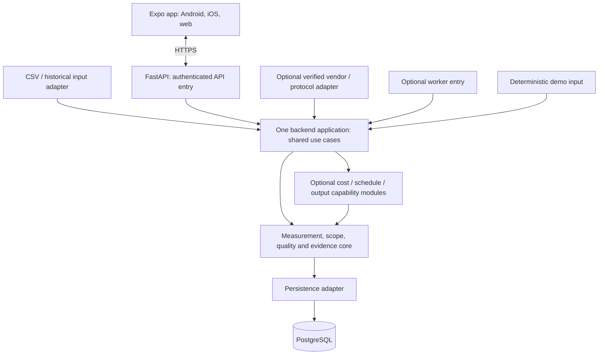

# HematDaya — Self-Contained Claude Design Handoff

Version: 1.4.0. Updated November 9, 2026, Asia/Jakarta. Canonical product PRD: Generic 1.4. Specification language: English. Product interface: Indonesian by default, with English selectable. Currency: IDR.

**This file contains the complete product context, ready prompt, and canonical English PRD.** Use the agreed design-system-first sequence: create HematDaya Design System, then attach this application handoff and select/import that actual system or its exported reference. No repository access or earlier chat is needed to understand the product. If the system is unavailable, establish a clearly labelled local draft system from the seed guidance before composing screens and record the missing binding; do not claim inheritance. Preparing this handoff does not create, register, or publish a system or application.

## 1. Authority, owner decisions, and requested outcome

Build a working, stateful, mobile-first application prototype for electricity monitoring and evidence-based advice. The intended future product is one shared Expo/React Native/TypeScript application for Android, iOS, and web, supported by a modular server. Use the actual Claude Design runtime available in the session. If it cannot execute native apps, deliver a responsive browser simulation with mobile navigation and an explicit native engineering handoff. A browser preview, responsive resize, or device frame is not native execution.

The owner has accepted **a modular monolith with a reusable family core**, rather than independent household and industrial products or permanent customer forks. The reusable boundary is electricity measurement, scope-safe accounting, data quality, evidence, and the related journeys. It does not make unrelated products part of HematDaya, establish a multi-tenant SaaS business, or require a dynamic plugin framework. Preserve one product, calculation contract, navigation, and source of maintained fixes.

Resolve conflicts in this order: latest explicit product-owner decision → canonical PRD embedded below → approved implementation decision → proposed visual or interaction choices in this brief. Preserve all PRD requirement IDs in the delivery map. Do not silently loosen arithmetic, optionality, security, accessibility, or evidence requirements to simplify a prototype. Where the runtime cannot fulfill a requirement, demonstrate the useful local behavior, identify the boundary, and record the unavailable part as blocked or not run. Never label a mock as verified fulfillment.

The core works for a refrigerator/router at home, lighting in a shop, or an oven/compressor in a workshop. No air conditioner, production quantity, schedule, tariff, live meter, login, push permission, cloud AI, or paid service is a prerequisite for demo value. A preset is optional and changes examples/demo selection, not permissions, calculations, schedules, or production requirements. Start unspecified when no choice was made.

**Required outcome:** playable success and recovery journeys with honest data, rather than a marketing page, screenshot gallery, static artboards, fake controls, or decorative dashboard. Every primary action must produce its named state transition, or an explicit, useful unavailable response. Keep the prototype private. This handoff authorizes no publication, external sharing, production deployment, real credentials, real telemetry enrollment, physical control, or messages to other people.

### 1.1 Design-system-first sequence and binding

First create **HematDaya Design System** using its dedicated design-system handoff and prompt. That stage establishes tokens, HD-prefixed component contracts, states, chart/content rules, and a component/pattern workbench. Its initial requested release is 1.0.0-draft until the actual review/validation status is recorded. It precedes the full S01–S12 application, rather than becoming another screen-specific palette.

For this application stage, select/attach/import the actual system artifact or its guide, token/manifest export and component reference as the runtime permits. Record system name/version, source identifier if actually supplied, method of binding, component/token inventory, review status, and any deviations. The dedicated system documents are supplied as 04_Claude_Design_System_HematDaya_EN.md and 05_Prompt_Claude_Design_System_EN.md; those filenames describe the earlier stage, not a hidden dependency for understanding this product contract.

Reuse its tokens, named HD components and interaction patterns. Do not silently use an unrelated organization default, fork a palette per screen, or call a local approximation an imported library. If the artifact is missing, create a local draft system before screens using section 4 and the component/state contracts in this file, record exactly what was unavailable, and label the result unbound/local. The preferred completed workflow supplies the actual system first.

The canonical PRD controls product semantics, arithmetic, permissions and optionality. A bound compatible system controls visual/interaction implementation; the section 4 seed is only a fallback. If a genuine component gap appears, prefer composition, then record the smallest shared component change and recheck affected states. Keep system version, PRD version, application source release and analysis-policy version separate. Verify consumption in this project; do not assume a library update changed an older artifact automatically. Keep the system and application private; neither publishing nor changing organization defaults is authorized here.

## 2. Product tasks and interaction priorities

The task hierarchy is: understand what was measured → inspect a fair comparison → decide what to investigate → optionally revisit after a human action. Lower consumption, fewer dismissed suggestions, engagement, or an attractive chart is not proof of savings or equipment efficiency.

The first populated screen should answer “Berapa energi yang dipantau pada periode ini?” The reading order is site and period, measurement scope, recorded kWh, qualified estimated cost, coverage/freshness, largest contributors, and one eligible observation. Meaning-changing qualifications remain near their numbers. Detailed formulae and source metadata can be disclosed later.

Use exactly three persistent labelled primary destinations: **Beranda**, **Perangkat**, **Saran**. Perangkat includes devices, groups, circuits, and site-total meters with visible type/scope labels. Settings, imports, scope resolution, optional metrics, and demo scenarios are secondary. Native detail routes use a stack; the browser prototype may use the same bottom navigation on phones and a restrained equivalent on wider screens. Do not add a fourth primary dashboard, production, reports, AI, or integrations tab.

Prioritize complete paths in this order:

1. **Meter setup:** S01, S02 or S04 → Hubungkan alat ukur → S05 catalog. In the isolated lab, eligible setup proceeds to the first valid reading and asset confirmation. A browser prototype presents catalog availability without suggesting that it connects to hardware.
2. **Hardware-free start:** S01 → Coba demo → demo selection → S03. Opening household demo must immediately show useful measured energy without a setup wizard.
3. **Interpretation:** S03 → choose period → largest contributor → S06 history; the contributor and featured evidence are each reachable within three deliberate taps from populated Beranda. Count taps separately from whether the user understands the result.
4. **Evidence:** S03 featured observation or S07 list → S08 → inspect comparison, limitations, and harmless feedback. Return preserves the period and list position.
5. **Historical import:** secondary Impor riwayat CSV → S10 input → mapping/semantics → preview → explicit commit → S03 for the imported range. Include repair and retry.
6. **Recovery:** missing tariff, partial readings, stale live source, cached offline view, historical import, and overlapping scope each preserve useful context and offer their own next action.
7. **Optional capability:** schedule, asset inheritance/continuous profile, actual or estimated output metric, tariff, and notification preferences are entered only when requested. Industry core tasks remain complete with schedule/output disabled.

Do not lead with sector selection, equipment lists, or production fields. “Lewati” must continue the core journey. Never treat a refrigeration, IT, pumping, or unknown load as wasteful simply because it runs continuously.

## 3. Research basis and limits

The source research notes were compiled October 21, 2026 and report opening the primary sources linked here. Their findings inform this brief; no HematDaya participant study, native test, live-meter comparison, or savings evaluation was conducted. The proposed interface is a hypothesis to test, not a research-proven design.

| Primary evidence | What it supports and what it does not establish |
|---|---|
| [Hargreaves, Nye and Burgess, 2010](https://www.wren.uk.com/images/documents/publications/hargreaves_smart_meters.pdf) | Qualitative interviews with 15 UK households, 12 with displays: money and named appliances could be meaningful, while wrong tariffs and rapid annual extrapolation undermined interpretation. This does not prove causal savings, Indonesian comprehension, or industrial suitability. |
| [Bonino, Corno and De Russis, 2012](https://iris.polito.it/bitstream/11583/2465381/1/energySurvey.pdf) | A video-mockup survey had 992 completers from a predominantly young, technically educated Italian sample. Room goal colours were interpreted inconsistently. Do not transfer percentages to HematDaya or use colour as a self-explanatory efficiency verdict. |
| [Froehlich, Findlater and Landay, 2010](https://makeabilitylab.cs.washington.edu/media/publications/Froehlich_TheDesignOfEcoFeedbackTechnology_CHI2010.pdf) | The synthesis separates design/usability evaluation from behavior-change evaluation. It does not identify one universally optimal dashboard or validate this app's effectiveness. |
| [Heer and Bostock, 2010](https://hci.stanford.edu/publications/2010/crowd-perception/heer-chi2010.pdf) | Controlled proportional-judgment tasks favored aligned position over angle/circular area. A directly labelled horizontal contribution ranking is our task-specific inference, not a tested HematDaya finding. |
| [Song and Szafir, missing-data manuscript](https://cmci.colorado.edu/visualab/papers/song_VIS_2018.pdf) | Missing-data representations affected estimation and perceived quality. This supports deliberate gap treatment and testing; it does not authorize filling missing energy with zero or interpolation. |
| [Hullman, 2019](https://arxiv.org/html/1908.01697v1) | A survey/interviews describe visualization authors' uncertainty practices and beliefs. They do not prove that disclosure always increases consumer trust. Aim for accurate interpretation. |
| [NNGroup progressive disclosure](https://www.nngroup.com/articles/progressive-disclosure/), [GOV.UK error summary](https://design-system.service.gov.uk/components/error-summary/), [GOV.UK moderated testing](https://www.gov.uk/service-manual/user-research/using-moderated-usability-testing) | Guidance for primary versus specialist choices, actionable linked errors, and neutral tasks. These are design/practice sources, not local user-study results. |
| [WCAG 2.2](https://www.w3.org/TR/WCAG22/), [WAI complex images](https://www.w3.org/WAI/tutorials/images/complex/), [Android accessibility](https://developer.android.com/guide/topics/ui/accessibility/apps) | Specific standards/guidance for web and Android, used with separate product targets. They do not certify a prototype or a future native build. |

Our resulting proposals are: stable three-tab navigation; direct kWh plus qualified cost; aligned contribution bars; explicit missing-data text; progressive evidence; optional specialist setup; no goal colours, efficiency score, streaks, rankings against other households, or manufactured urgency. Indonesian words such as “cakupan”, tariff comprehension, gap presentation, discoverability, and industrial workflows require separate local research. The four-of-five and 30-second targets are proposed formative acceptance targets, not measured results or population estimates.

## 4. Design-system consumption and seed fallback

Use the bound HematDaya Design System as the visual/component authority when compatible with the canonical PRD. The foundations below are a self-contained seed for a missing-system fallback, not an instruction to overwrite the system created in the preceding stage. Consume shared aliases and named HD components; record any local deviation and recheck the affected states.

Use a calm, practical utility character: warm off-white background, dark readable text, restrained green for selected/data accents, amber for conditions needing attention, and red for rejected input or a failed operation. Avoid generic enterprise density, neon monitoring walls, decorative gauges, gradient panels, excessive cards, circuit-board decoration, oversized empty hero areas, and “AI” badges. Energy facts should feel ordinary and inspectable.

These are **new proposed tokens, not an existing HematDaya brand system**. Start with background `#F6F7F3`, surface `#FFFFFF`, text `#17221D`, secondary text `#4C5F55`, decorative grouping border `#CAD4CC`, essential control boundary `#6E8175`, primary `#1F6947`, subtle selected `#E5F0E8`, warning text `#7A4B00`, danger text `#A32929`, and focus `#145CC5`. The pale border is for decorative grouping only; essential control, focus, and chart boundaries need separately measured ≥3:1 contrast where required. Measure actual foreground/background pairs in every used state; these proposed tokens have not been validated. Prefer a locally available system sans-serif; use tabular numerals where supported. No external font download is required.

Proposed type scale in logical units: body 16/24, supporting text 14/20, section title 20/28, screen title 24/32, primary kWh 34/40. Units and qualifiers remain readable; do not make them tiny to enlarge the number. Space on a 4-unit grid with typical page padding 16–20 and section spacing 24–32. Use thin borders and modest 10–14 radius only where grouping helps. Prefer one flat information surface with clear headings to nested cards. Shadows, if used, identify an overlay rather than decorate every metric.

Use the bound HD component inventory for labelled buttons, secondary/text actions, icon buttons with full hit areas, tabs, period selectors, scope summaries, metrics, quality notices, asset rows, direct-labelled rankings, history/data alternatives, insight/evidence sections, fields/error summaries, sheets/dialogs, progress/results, and empty states. In a local fallback, define these once as reusable components before composing screens; preserve the same names/contracts for a later system binding. Each interactive component needs default, pressed, focused, selected/checked where relevant, disabled-with-reason, loading, success, and error states. A disabled action is not a substitute for explaining a missing prerequisite.

Use subtle state transitions around 120–180 ms when supported, with no animated energy counter, blinking alerts, parallax, spinning charts, or looping decoration. Respect reduced motion. A loading indicator describes the task, such as “Memeriksa berkas…”; a skeleton must not masquerade as a measured chart. Keep confirmed content visible during refresh with an update status. One obvious primary action belongs to each task screen or import step.

## 5. Shared navigation, drafts, and action rules

Keep selected site, local timezone, period, aggregation selection, data revision, and return route in shared navigation context. Opening an asset from a ranking must show that asset and the same period; back restores the originating ranking and scroll position. Tab switches preserve their own stack/list context when possible. Demo reset is explicit and resets only isolated demo state. Browser back, visible back, native back, and close must have consistent destinations.

Maintain separate confirmed state and non-secret drafts. Back/cancel from a form retains its draft when returning to the flow; offer explicit discard if necessary. Do not modify confirmed summaries until a save is acknowledged. If an optimistic presentation is used, roll it back on failure while keeping the draft. Offline mutations remain unconfirmed; never claim they were queued safely unless that behavior exists. After expiry, retain non-secret draft, show the login boundary, and require explicit retry; the demo does not need authentication.

For every action define pending, success, rejection, timeout/unknown result, retry, and cancellation. While an import or save is in progress, prevent duplicate submissions. A timeout after commit must look up the existing operation/idempotency key before retrying. Status must remain inspectable beyond a fleeting toast. A retry cannot manufacture a second asset, binding, reading, or feedback record.

On web, focus the screen heading after route change, place focus inside an opened modal, contain focus while modal, support Escape to dismiss non-destructive overlays, and return focus to the invoking control. Validation moves focus to a linked error summary and exposes matching field messages. Announce saving/results as status updates without unnecessarily stealing focus. On phones, use suitable numeric/time keyboards, safe-area padding, and scroll/keyboard avoidance; the active field, error, and primary action must remain reachable. A decimal comma is accepted where the field contract allows it.

## 6. Screen contract S01–S12

The common pending/error/draft/focus rules above apply to every screen. The named actions below are required, not decorative affordances. Any additional visible control receives an equally explicit contract in the final route map.

### S01 — Welcome

Give one short explanation. **Hubungkan alat ukur** opens the catalog as the primary action. Offer **Coba demo** and **Lanjut tanpa data**. Continue opens empty Beranda without creating a server workspace. Offer optional usage context in Settings and the language selector on Welcome and in Settings once the MVP is bilingual.

### S02 — Empty Beranda

Lead with **Hubungkan alat ukur** / **Connect a meter** to open S05. Offer **Coba demo** and **Impor riwayat CSV** as secondary actions. File selection remains an explicit action on the CSV screen. Use a compact hierarchy. Populated dashboards and lists may use a supporting column from 768 logical pixels, while forms stay single-column.

### S03 — Populated Beranda

Display site, period selector, scope control, **Energi yang dipantau**, optional **Estimasi biaya energi terpantau**, quality, ranking, and a single eligible observation. Primary task action is **Lihat perangkat terbesar** → S06; the row itself can perform the same action. Period sheet supports Hari ini/Minggu ini/range and explicit local boundaries; apply updates all views atomically. Scope control → S11. **Lihat dasar saran** → S08; **Lihat semua saran** → S07. Cost detail shows synthetic/entered tariff, effective dates, covered energy, and bill limitation. Refresh retains confirmed data while pending; failure leaves timestamp and **Coba lagi**. No setting draft is created by opening detail. Historical selected week stays “19–25 Oktober”, even when virtual now is Monday October 26.

### S04 — Perangkat list

Use the shared period/scope. Rows show name, location if provided, scope kind, recorded kWh, and relevant quality; full names wrap. Each row → S06. Primary **Hubungkan alat ukur** → S05. Secondary **Impor riwayat CSV** → S10 remains discoverable. Use the same actions on an empty list. No switch or power-state icon suggests control. Sorting may use recorded energy with deterministic tie-break. Avoid “paling boros” for the largest measured load. For unresolved aggregation, retain individual values and the scope notice. Back returns the previous stack; tab selection remains Perangkat. Preserve list position after detail. Loading or error never clears a known list into fake zeros.

### S05 — Source catalog and setup

Show model, measurement scope and availability first. The isolated lab flow for Shelly Plug PM Gen3 shows waiting, ready to confirm, connected and expired. Confirm one new monitored asset only after the server accepts a real first reading. Retry reuses the operation identity. For a planned or unavailable model, explain its status and offer a return to the catalog or historical CSV. Browser prototypes show the catalog and its unavailable states. Back moves one step and close returns to the entry screen. Retain non-secret input. The lab operator provides a separate access code. Vendor credentials and mains rewiring are outside app setup.

### S06 — Asset detail and history

Show name, scope type, period, kWh, applicable cost, history, coverage/gaps, source origin/time/resolution, and related observations. Primary **Lihat riwayat** reveals chart/data for the same asset and period; **Lihat data** provides table/text. Saran row → S08. Secondary edit opens name/category/location and reversible archive with scope-specific confirmation; do not make source unlinking delete history. Schedule/profile and metric links appear as optional detail actions, not compulsory cards. Back returns the exact S03/S04 invoker and context. Empty period offers **Lihat periode data**. Chart refresh/error retains confirmed points and exact gaps. Name edit saves acknowledged state, preserves its draft on rejection, and never alters stable IDs.

### S07 — Saran list and restored items

Separate blocking data notices from consumption observations. Each item names asset/scope, observed statement, period, and qualification; primary row action **Lihat bukti** → S08. Learning says “Belum cukup periode pembanding” and links to history. No finding says “Belum ada perubahan yang memenuhi kriteria pada periode ini”, not efficient/normal/safe. **Saran tersembunyi** opens a secondary list with **Pulihkan**; snoozed items expose their next local-day return. General guidance is labelled **Saran umum**. Back/tab context persists. Feedback updates only after local mock acknowledgment or actual service acknowledgment, with error and retry; the measurement store is untouched. No empty list is filled with invented alarms.

### S08 — Insight detail and evidence

Reading order: **Yang tercatat** → **Dibandingkan dengan** → **Kualitas dan cakupan** → **Yang belum diketahui** → **Langkah pemeriksaan** → optional feedback. Show current/reference kWh, absolute change, eligible percent, matched windows/common mask, and source provenance. **Lihat dasar perhitungan** expands resolution, threshold/version, schedule/denominator, and arithmetic. Primary **Lihat data pembanding** opens aligned chart/table; feedback actions **Berguna**, **Tidak sesuai**, **Tunda hingga besok**, **Sembunyikan** are optional and reversible. Hiding returns S07 or the invoking S03 with confirmation and restore link. Back preserves origin. A superseded evidence version is labelled and retained; feedback never silently attaches to rewritten evidence. No “Terapkan”, shutdown action, diagnosed cause, or verified savings claim appears.

### S09 — Settings and optional schedule

Fields: site name, context, timezone; effective-dated tariff; optional site expected-use schedule; output-metric entry; optional notification preference. Primary **Simpan perubahan** saves a coherent draft with preview where boundaries change; cancel/back returns invoker and confirmed values. Changing context previews that examples change while data/settings persist. Timezone confirmation explains local-day recalculation without rewriting UTC measurements. Tariff accepts explicit zero and non-negative finite decimals; missing stays absent. Schedule editor uses weekdays, multiple start/end windows, **Berakhir hari berikutnya**, separate **24 jam**, effective time, and preview. Asset controls distinguish **Ikuti jadwal lokasi**, **Tanpa jadwal**, **Diharapkan terus menyala**, **Jadwal khusus**. Invalid equal times need correction; overlapping windows merge for calculations. Save failure keeps draft and previous results. Notifications remain off until explicit consent; do not open a real permission prompt for the demo.

### S10 — CSV import, mapping, preview, commit, result

Primary actions change by step: **Periksa berkas** → **Lihat pratinjau** → **Konfirmasi impor** → **Lihat periode data**. Input supports file or paste, copyable example, format/size/row requirements. Mapping fields include column/kind/unit, timezone, interval convention/cadence, source identity, target asset/scope, and collision choices. Preview shows accepted unique/invalid/exact duplicate/conflicting counts, affected period, assumptions, and row/field errors. Back edits mapping or input while preserving content. Replace-file is explicit. Commit has a stable operation key; pending shows progress, unknown status checks existing result, and retry cannot double-import. Failed commit rolls back the whole candidate set and preserves earlier readings. Result reports actual added/skipped/duplicate rows and mapped/created assets. The imported range becomes the landing selection; current real-user time is not changed.

### S11 — Scope and source resolution

Show affected sources/assets, physical inclusion, current selection, and why a combined number is blocked. Primary **Konfirmasi cakupan** is enabled only for a valid selection. Parent example offers **Meter utama · 10 kWh** or **Kulkas · 1 kWh**, never 11. Alternative sources for one load require selecting authority/effective time or skipping the new source; values are not additive. Unknown overlap offers individual review and confirmation that loads are disjoint; do not assume it. Show included/excluded assets and reasons before confirmation. Back returns S03/import mapping with existing confirmed selection; cancel changes nothing. Failed save retains the proposed selection for retry and previous confirmed summary. No topology drawing tool is required.

### S12 — Optional energy-per-output setup

Entry is secondary from S09 or relevant S06. Fields: metric name, numerator assets/non-overlapping scope, output unit/product meaning, exact period, **Aktual** or **Estimasi dari rata-rata**, and quantity or per-output-day average/eligible days. Actual output requires matching positive quantity; zero gives “Tidak dapat dihitung: keluaran nol”. Estimated partial days require declared output windows plus explicit uniform-output confirmation, otherwise use complete eligible days or request actual output. Primary **Pratinjau metrik** shows numerator, denominator, method, units, period, coverage, and estimate limitation; **Simpan metrik** commits only valid preview. **Nonaktifkan metrik** removes optional display without changing readings. Back/cancel returns invoker with draft retained and prior metric unchanged. Invalid/mismatched values remain fields with correction messages, never zero/infinity. Keyboard and error summary follow the common rules.

## 7. Data authority, reusable modules, and mock boundary

Use one application state, one virtual clock, and one accepted-reading store. All totals, chart buckets, ranking, dates, coverage, prices, and insight snapshots are derived from this authority. Do not hardcode one total into Beranda, a different chart into detail, and prose evidence elsewhere. Scenario selection changes fixture inputs and flags, then invokes the same selectors/rules. Persist demo state only in an explicitly isolated namespace if the runtime permits; reset must not touch imported/user records.

Suggested state responsibilities: session/demo mode; site/timezone/context; assets/sources/bindings; normalized readings; aggregation selection; tariffs; schedules/profiles; optional output definition/inputs; evidence snapshots and revisions; feedback; navigation; form/import drafts; operation status; client-network flag; virtual now. Numeric unavailable values are `null` with a reason, not `0`. Keep source origin (`simulated`, `import`, `dataset_replay`, `live`) separate from status (planned/unavailable/connected/stale). `simulated` is provenance, not a test result.

For a browser-only prototype, a local domain/mock module may implement the contract faithfully. Label it “Backend simulasi” in the demo information and delivery report. Its main operations are preview import, commit import, get operation status, calculate summary/history/contribution, resolve scope, save settings, evaluate insights, and save/restore feedback. Each returns confirmed revision or structured errors in the selected language; no screen mutates an unrelated chart directly. Summary includes UTC/local window, timezone, included/excluded assets, unrounded energy, cost availability/covered energy, per-asset and combined coverage, latest measurement, origin, schedule/metric applicability, and revision. Evidence retains its own snapshot/version.

| Maintained responsibility | Prototype behavior and future boundary |
|---|---|
| Measurement/import | Parse and normalize declared units/time semantics; retain original provenance. CSV/demo and future adapters enter the same rules. |
| Scope/energy/quality | Enforce source authority, parent-child exclusion, decimal totals, gaps, coverage, and matched support. These cannot be bypassed by a hidden UI toggle. |
| Tariff/schedule/output capabilities | Consume canonical measurements and explicit optional inputs. Missing capability inputs yield reasons, not fabricated values. |
| Evidence/feedback | Generate deterministic snapshots, explain limitations, keep harmless owner-scoped preferences and revisions. |
| Interface/presets | Reuse routes/components. Examples, labels, and demo choices vary; the calculation engine and schema do not fork by sector/customer. |
| Future saved service | Actual owner authorization, atomic persistence, secure sessions, audit, export, deletion/retention, backup/restore, and verified adapters require server implementation and separate evidence. |

The future server remains one modular application with internal boundaries, initially one repository/release. Do not build microservices, a universal IoT framework, billing, self-service tenancy, arbitrary rule builders, or client-specific `if` branches. Branding/configuration is separate from customer-data isolation. Source reuse requires explicit tested releases and rollout; copying a project does not propagate future fixes automatically. None of these engineering terms belongs in normal product UI.

Model the PRD's small read-only capability manifest: schema version, source release, composition ID/version, supported enabled capabilities/adapters with status, and policy IDs/versions. Future `GET /api/v1/capabilities` supplies explanation, never authorization. A local mock supplies the same non-secret shape. Validate supported combinations; demonstrate a core-only composition and a composition with optional analyses without changing measurement arithmetic. Disabled capability requests fail with a stable reason at the mock/service boundary even if invoked outside the UI. The future API and worker must enforce the same rule plus ownership/prerequisites; a hidden button is insufficient. Record source/composition/migration versions, affected regression checks, actual deployment upgrade status, and rollback/restore steps in delivery notes. A browser demonstration cannot establish real isolated-deployment or fleet-upgrade behavior.

Authentication screens may show a clear unavailable saved-service explanation or a labelled simulation. A local login form is not secure authentication. Candidate integrations cannot show unqualified “Terhubung” without real enrollment and valid first reading. No credentials, external network dependency, paid storage, cloud execution service, broker, push delivery, or vendor account is required for this prototype.

## 8. Deterministic fixtures, clock, and arithmetic checkpoints

Implement the complete generation rules and oracles in canonical PRD §19. Both fixtures: Asia/Jakarta; hourly interval-start rows; four disjoint assets; integer Wh; 1 Wh resolution; valid zero rows; origin `simulated`; range `[2026-09-28T00:00+07:00, 2026-10-26T00:00+07:00)`; **2,688 rows each**. Main virtual now is **October 26, 2026 00.00**. Initial selected observation week is **19–25 Oktober**, not Minggu ini. No future rows are included in a current-period query. Simulated tariff Rp1.500/kWh is explicitly synthetic, not a statement of actual PLN rates.

| Fixture | Exact generation and principal oracles |
|---|---|
| Household H | Kulkas 50 Wh every hour; Router 10 Wh every hour; Pompa Air 150 Wh at interval starts 06.00 and 18.00, otherwise zero; TV 120 Wh at 20.00/21.00/22.00, otherwise zero. Daily 2.100 kWh/Rp3,150; week 14.700/Rp22,050; four weeks 58.800/Rp88,200. Week: Kulkas 8.400 (57.14%), Router 1.680, Pompa 2.100, TV 2.520. No schedule/output. Explicit continuous profiles for Kulkas/Router. No change alert in the base fixture. |
| Household change | Add 200 Wh to TV at 19.00 on seven selected-week days. TV 3.920 versus median 2.520; +1.400 kWh, about +55.56%; site 16.100/Rp24,150. For 168 intervals, r=0.168 kWh; threshold max(0.756, 0, 0.840)=0.840, so the change qualifies below 3 kWh. No outside-schedule claim. |
| Industry I | Monday–Saturday: Oven 2,000 Wh at starts 08.00–13.00 inclusive; Kompresor 1,000 at those same six starts; Mesin Press 1,000 at 13.00–16.00 inclusive; Lampu Area 200 at 07.00–16.00 inclusive. All other hours and Sundays are valid zero. Daily output-day 24.000/Rp36,000; week 144.000/Rp216,000; four weeks 576.000/Rp864,000. Week assets: 72/36/24/12 kWh; Oven 50%. Optional schedule Mon–Sat 07.00–17.00 gives outside energy zero. |
| Industry optional output/change | Actual 480 units per output day, 2,880/week gives 0.050 kWh/unit for all fixture assets. Disable metric and schedule to test a complete industry core. Variant adds 500 Wh to Kompresor at 18.00 on six selected-week output days: outside +3.000 kWh versus zero baseline, no percent; site 147.000/Rp220,500. Extra use is not proven avoidable waste. |

An additional **current-period** scenario uses the same base readings but virtual now **2026-10-21T12:00:00+07:00**. Filter out intervals starting at or after now; full intervals ending at now remain included. Household today is **0.870 kWh/Rp1,305**, Monday-to-now **5.070/Rp7,605**. Industry today is **13.000/Rp19,500**, Monday-to-now **61.000/Rp91,500**. These values were independently checked from hourly generation when preparing this handoff; they are document arithmetic checks, not prototype execution evidence. Show elapsed boundaries and compare equivalent elapsed history. Do not reuse completed-week baselines or output quantities unmodified.

Assertions must cover all PRD boundary oracles: parent 10/child 1 never 11; alternative same-load 2 never 4; average 100 W for 30 min = 50 Wh; instantaneous 100 W gives no implied energy; counter 100→130→5 with reset gives valid 30 Wh and unknown reset interval; Monday 22.00–Tuesday 06.00 inside ten hourly kWh gives 8 inside/2 outside; 60 Wh at 16.30–17.30 ending schedule 17.00 gives 30/30 estimated; half-day missing gives 50% coverage; 2/10 invalid allows explicit 8-row acceptance, 3/10 blocks; effective tariff split gives Rp3,000; zero output gives no intensity; all-valid zero produces no contribution percentage.

Use decimal-safe arithmetic or integer Wh/minor-unit/rational treatment with documented parity to the PRD. Preserve unrounded authority and round only display. Format Indonesian UI as `14,700 kWh` when three decimals are meaningful, `Rp22.050`, `19–25 Oktober 2026`, `Asia/Jakarta`. Compact display may use fewer trailing zeros consistently; details retain sufficient precision. Do not compute money from a rounded displayed kWh.

## 9. CSV transaction and recovery contract

The actual parser, not the selected scenario name, must produce preview counts and row errors. Accept UTF-8/BOM, comma or semicolon, quoted fields/common newlines, and unambiguous decimal commas according to the PRD. Keep aliases case-insensitive. Timestamp-only `energi` means interval Wh. `power_w` requires explicit interval-average confirmation; instantaneous power cannot silently become energy. Competing value columns require a chosen kind/column. Counter input follows counter rules.

Show a requirements panel before parsing: proposed **10 MiB**, **150,000 nonblank data rows**, asset names ≤60 characters, declared unit/timezone/interval, non-negative finite consumption. Count header/blank lines separately from data. State whether a diagnostic number means data row or physical file line; never invent a physical line number. An example error is `Baris data 7, energy_wh: gunakan angka 0 atau lebih.`

Timestamp preview preserves explicit offsets. Confirm the site's timezone for naive times. Impossible/ambiguous times need correction or explicit offset. Timestamp-only rows use interval-start semantics and declared cadence including the last row. Infer cadence per source/asset only when the specified 90%/one-second condition holds; one row or irregular cadence requires explicit interval/start/end. A large gap must stay a gap rather than stretching an earlier row.

Map by stable identity and source, not just name. If two existing assets share a name, show location/type/ID context and require explicit reuse/create. Resolve scope overlap and alternative sources before preview can commit. Confirming skipped invalid rows cannot waive structural, meaning, or scope conflicts.

Preview counts reconcile: accepted unique + invalid + exact duplicate + conflicting = all nonblank data rows. At most 20% invalid can proceed only with explicit skipped-result acceptance; more than 20%, no usable rows, unknown semantics, or conflicts blocks. Show before/after period and scope. **Konfirmasi impor** creates one atomic operation; success appears only after confirmed result. Simulate validation errors, rejection before write, and interruption after a committed result, with distinct messages. Roll back candidate changes after failed commit; retain earlier data and draft. Query operation status using the same key before retry. Reimport of the identical file counts accepted records once.

Example copy: `2 dari 10 baris tidak valid. Delapan baris valid unik dapat diimpor setelah Anda mengonfirmasi.`; `Impor diblokir: 3 dari 10 baris tidak valid.`; `Nilai berbeda ditemukan untuk sumber dan interval yang sama. Pilih sumber atau perbaiki data sebelum melanjutkan.`; `Hasil impor belum diketahui. Periksa status sebelum mencoba lagi.`; `Impor belum dikonfirmasi. Data tersimpan sebelumnya tetap tersedia.` Retain pasted text/mapping and selected-file context where the browser allows it. After browser restart, say a file needs reselection instead of claiming recovery of inaccessible bytes.

## 10. Independent data states and meaningful combinations

Treat these as independent facts, not one exclusive “error” enum. Display the minimum set that changes interpretation without a stack of redundant banners. Scope validity blocks aggregate arithmetic before price or advice; missing tariff never blocks energy; stale transport never rewrites historical completeness.

| State | Visible meaning and useful action |
|---|---|
| No data | “Belum ada data energi”; import/demo/supported source. No fake zero. |
| Valid zero | `0 kWh` plus actual coverage and period; no contributor percent, infinity, or fake change. |
| Learning | Measured totals/ranking remain; “Belum cukup periode pembanding” with missing-history reason and history link. |
| No tariff / explicit zero tariff | Missing: “Biaya belum dihitung · tarif belum diatur” and optional Tambah tarif. Confirmed zero: valid Rp0 with tariff provenance. |
| No schedule/output | Core stays clean. No outside value or empty production panel. Relevant setup stays optional. |
| Partial readings | “Energi tercatat · sebagian data belum tersedia”; gaps and per-asset/minimum coverage; incompatible comparisons withheld. |
| Stale live source | Last valid capture time/cadence and Periksa sumber/Coba lagi. “Data belum diperbarui” never means equipment off. |
| Client offline | “Offline · menampilkan data tersimpan” plus cache timestamp; read/drafts work, writes wait for online confirmation. |
| Historical import | “Data historis · Impor CSV”, actual range/latest record, Lihat periode data. Never mislabel it a disconnected live meter. |
| Unknown overlap / conflicting binding | Individual readings visible; aggregate unavailable with Pilih cakupan. Preserve chosen scope until explicit resolution. |
| Invalid CSV | Field/row/meaning message, reconciled preview, correction/reselect; no changed saved measurements. |
| Unavailable adapter | Planned/unavailable capability explanation, CSV alternative, asset draft retained. No invented connection success. |
| Rejected setting / session expiry | Confirmed setting unchanged, non-secret draft retained; correct/retry or authenticate and explicitly retry. |
| No qualifying observation | Honest Saran state plus history/general guidance. It does not certify efficient, safe, normal, or waste-free operation. |

Required combination scenarios: **learning + no tariff + partial** shows recorded kWh/gaps, absent cost, and insufficient comparison without blocking history; **offline client + stale source** shows separate cache age and last source capture time, with retry unable to fabricate a fresh reading; **historical CSV + offline client** retains historical provenance without a live-disconnection claim; **valid zero + no tariff** has numeric zero energy and unavailable cost; **scope conflict + known individual values** refuses only the combined total; **failed schedule save + pending insight view** preserves previous confirmed schedule/evidence; **missing output + industry context** leaves the complete monitoring journey usable. Scenario controls live in secondary **Pengaturan → Tentang demo → Skenario demo** and use readable names, not debug JSON. Reset confirms it affects only demo data.

## 11. Evidence, schedules, output, and safe interpretation

Use three disclosure levels: visible summary and meaning-changing qualifier; detail with comparison and next human investigation; expandable calculation/provenance. The first level must already identify simulated/import/live origin, selected period/scope, partialness, and estimate when applicable. Never bury a qualification that reverses the headline's meaning.

Household change copy: `TV memakai 3,92 kWh pada 19–25 Oktober. Median tiga minggu pembanding: 2,52 kWh. Kenaikan tercatat 1,40 kWh (55,56%).` Follow with `Penyebab perubahan belum diketahui` and `Periksa apakah waktu pemakaian berubah.` Industrial copy: `Energi kompresor di luar jadwal bertambah 3,00 kWh dibandingkan periode pembanding.` Explain `Persentase tidak tersedia karena nilai pembanding nol` and ask whether a legitimate activity required it. Do not call either fault, wastage, occupancy, or a command to interrupt equipment.

The domain checks same scope, equivalent local weekday/time, at least two eligible previous-three-week windows, each coverage ≥90%, common valid mask ≥90%, known resolution, and the canonical scale-aware rule. Show full recorded totals separately from common-mask comparison totals. Baseline zero allows absolute change only. Unknown resolution permits descriptive comparison but suppresses automatic personalized alert. No alert should be invented to fill space. Rank blocking quality notices separately; eligible observations rank by additional kWh then recency/stable ID.

Schedule preview must explain Monday 22.00 → Tuesday 06.00 as anchored on Monday, support multiple windows, and distinguish inheritance/custom/disabled/continuous. Equal start/end is invalid without explicit 24-hour choice. Changes default effective now; historical correction is explicit and versioned. A continuous refrigerator/router overrides site hours and is not an outside-use warning. Unspecified hours produce unavailable split, not zero outside energy. Boundary allocation is visibly proportional estimate, conserving source energy; hourly input never becomes apparently measured minute data.

Output preview must name numerator scope, denominator quantity/unit/product, exact period, and actual/estimated method. Do not divide a partial day's energy by a whole day's output. Actual comparison requires complete compatible periods and meaning. Estimated partial output needs confirmed uniform output within declared windows; batch output is not uniform by default. Missing, zero, negative, non-finite, or mismatched output yields an explanation, not 0 or infinity. Partial numerator yields provisional recorded-energy-per-output with coverage; no efficiency-change claim. Area/output units are distinct. Disabling optional metrics removes the display and preserves readings.

## 12. Charts, accessibility, and responsive checks

Use a ranked horizontal contribution list with common zero baseline, direct asset/kWh labels, and percentage only for valid positive denominator. Show `Dari 4 perangkat yang dipantau`. Weekly history may use daily energy bars; detailed time series keeps declared cadence and explicit missing slots/gaps. Axes, unit, period/timezone, legend, scale, and aggregation remain readable. Do not interpolate/zero-fill missing energy, smooth apparent measurements, or use pie area as the only ranking clue. Reference/current comparisons use aligned support and scales. No tooltip, hover, precise scrub, drag, or colour recognition is essential.

Every chart has a visible text summary and **Lihat data** alternative. Example: `Kulkas mencatat energi terbesar: 8,4 dari 14,7 kWh pada 19–25 Oktober. Angka ini hanya mencakup empat sumber yang dipilih.` Table/stacked rows include period, asset, value/unit, and quality. A gap says `Data 14.00–16.00 belum tersedia`; valid zero is explicitly `0 kWh`. Measurement scope and time completeness use separate labels, never “92% akurat”.

The HematDaya product target is minimum **48×48 logical-unit mobile hit areas**. Measure web CSS px, Android dp, and iOS implementation points/logical units separately; equal token numbers do not establish physical equivalence. WCAG 2.2 AA SC 2.5.8 specifies 24×24 CSS px with exceptions, not 48. Android recommends 48 dp. The iOS 48 policy is this product's target, not a quoted Apple minimum. Include tabs, back, icon actions, period chips, chart controls, and menus; adjacent hit areas cannot overlap.

Measure normal text ≥4.5:1, large text ≥3:1, and necessary non-text control/graphic information ≥3:1, applying the relevant standard exceptions. Selected state uses text/icon/shape beyond colour. Check 200% text resizing separately from reflow: 320 CSS px, or 1280 CSS px at 400% browser zoom, for vertical web content. Also check PRD widths 360/390/430/768/1280/1440 CSS px and a short phone viewport. Record viewport, zoom, browser, and actual interactions. Reduce tick density rather than shrinking all text; allow long names to wrap and data tables to become stacked rows.

Web checks include complete keyboard tasks, logical focus, visible/unobscured focus, Escape/focus restoration, meaningful names/roles/values, error links, live status announcements, and no traps. Native checks separately require TalkBack/VoiceOver, OS text scale, safe areas, screen keyboard, permission handling, secure storage/session behavior, and hardware back where relevant. A browser accessibility tree or screenshot cannot mark these native checks passed. The checklist is not complete WCAG certification. Respect reduced motion and ensure safe areas/keyboard do not conceal required actions.

## 13. Build sequence and no-dead-action acceptance map

Build through completed vertical slices; do not stop after describing a plan. First declare runtime and any capability limitation. Then create shared state/clock, generate fixtures, and assert arithmetic. Connect household S01–S04/S06, then industry with the same components. Add S07/S08 evidence/feedback, full S10 import/recovery, S11 scope resolution, S09/S12 optional settings, and combinations. Apply the proposed visual system after facts and routes work. Run verification, fix blocking failures, inspect available exports, and separately test exported interactions. Record remaining blocked work explicitly.

| Working action set | Required observable result | Traceability |
|---|---|---|
| Start/skip/demo/reset | Both no-AC fixtures, neutral unspecified path, isolated reset and correct selected week | P01/P11; UX-01/02/03/12; AT-01–04/43/47 |
| Period/contributor/history/data | Same period/scope/values; largest/history and featured evidence within three taps; chart alternative works | P03; UX-04/05/06/13/14/17/18/19; AT-05/06/19/21/45/46/51/55–57 |
| Evidence/feedback/hide/restore | Evidence snapshot, pending/retry, restored item, unchanged readings | P04/P10; UX-05/06/11; AT-16–21/39/40 |
| File/paste/map/preview/commit/retry | Real parsed counts, explicit acceptance, rollback and idempotent result, historical landing | P02; UX-02/05/11/20; AT-26–34/37/40/44/58 |
| Source/scope choice | Available status honest; parent/child and alternative-source totals cannot add twice | P07/P09; UX-06/12; AT-35/36/38/42/49 |
| Tariff/schedule/profile/metric | Optional validated preview/save/cancel; correct effective times, overnight, zero/missing output guards | P05/P06/P08; UX-11/15; AT-07–15/22–25/40/51 |
| Offline/partial/no finding/retry | Distinct independent facts, retained confirmed content/drafts, no fake OFF/zero | P08; UX-05/06/13; AT-16/19/38/40 |
| Export/platform handoff | Available HTML actually works; archive contents/runtime identified; native/research claims separate | UX-07–10/14/16; AT-41/45–48/50/52 |
| Composition/capability boundary | Core-only and optional-enabled cases keep identical energy semantics; unsupported requests fail with reasons; shared release record is explicit | FR-21/22; AT-53/54 |

The embedded PRD contains the complete updated requirement and acceptance set; this map highlights principal interactions and does not waive additional rows. Add any newly named control to the final control inventory with route, data prerequisite, pending/success/failure, return destination, and evidence reference. A control that merely changes a screen while falsely claiming save/connect/import success fails its gate.

## 14. Verification records and separate usability scripts

Every implementation result starts **not run**. Use one execution status: **pass**, **fail**, **not run**, or **blocked**. Record provenance independently as simulated/import/dataset replay/live; “simulated” is not a substitute for pass/fail. Pass means the named behavior was observed in the named build/runtime/input. An arithmetic check of this document is not a prototype pass. Blocked names a concrete limitation and its effect; not run means no execution evidence. Native, backend, field, and participant results never inherit browser status.

| Verification group | Required expected result/evidence | Initial execution status |
|---|---|---|
| H base/change/current-period | Exact oracles, continuous profiles, no schedule/output prerequisite, retained navigation | Not run |
| I base/change/current-period | Exact totals/ranking, optional 0.050 metric, no forced output, zero-baseline wording | Not run |
| Import and recovery | Threshold/alias/number/time limits; preview versus commit; atomic failure and retry result | Not run |
| Scope/source/data semantics | No 11/4 totals; power/counter/reset/boundary oracles; explicit conflicts | Not run |
| Independent quality states | Required combinations, timestamps, gaps, no fake zero/OFF, learning/no-finding distinction | Not run |
| Optional settings/feedback | Draft/confirmed rollback, schedule inheritance/overnight, output guards, restore | Not run |
| Composition/reuse boundary | Validated core-only and enabled manifest cases, disabled-request rejection, same H/I arithmetic; real rollout/isolation separately evidenced | Not run |
| Web UI/accessibility | Declared widths, measured targets/contrast, 200% text, 320 reflow/400% zoom, keyboard/AT | Not run |
| Interactive HTML export | Open exported file/bundle and repeat primary tasks; no missing asset/runtime dependency | Not run |
| Android / iOS | Named build/device/OS, separate native checks and unresolved mapping | Not run / Not run |
| Real service/security/restore/live meter | Actual ownership, credentials, persistence, backup restore, adapter suitability/reference evidence | Not run |
| Household / industry participants | Separate recruitment/task records; observed outcomes and failures | Not run / Not run |

For each executed case save ID(s), release/configuration, date, runtime/browser/device/OS/assistive technology, fixture and origin, steps, expected/actual, status, evidence location, limitation, and fix/retest reference. Tests with mocks can pass only their simulated boundary. A runtime limitation cannot mark a required release gate fulfilled.

**Household script:** use H without tariff, schedule, or output first, then synthetic tariff and change variant. Moderator says: `Kami menguji aplikasinya. Coba lakukan seperti biasanya dan ceritakan apa yang Anda pikirkan. Data yang dipakai adalah simulasi.` Do not give a navigation tour. Ask: `Perangkat mana yang memakai energi paling besar pada periode ini? Tunjukkan pemakaiannya.`; `Ceritakan apa yang termasuk dalam angka energi dan biaya.`; `Ada bagian data yang belum tersedia. Apa bedanya dengan energi nol?`; `Apa yang dapat disimpulkan dari perubahan TV, dan apa yang belum diketahui?`; `Masukkan data berkas ini, lalu tangani baris yang salah.`; `Biaya belum muncul. Cari pemakaian energinya dan jelaskan penyebabnya.` Finish with stale/offline and scope-overlap recovery. Correct ranking is Kulkas, not a household-wide total; continuous use is not automatic waste. No production task is required.

**Business/industry script:** use I with schedule/output disabled first; ask the same neutral core questions using oven/compressor/press/lighting. Largest contributor is Oven. Introduce the outside-window variant only after the participant requests/reviews applicable hours. Ask `Ada energi di luar jadwal. Apa yang masih perlu diperiksa?` without implying waste. For participants who actually need it, add Monday 22.00–Tuesday 06.00 schedule and matching actual output, then zero/mismatched-output recovery. Ask them to explain numerator, denominator, period, and why lower kWh/unit is not proven efficiency. Core completion must remain possible before those optional tasks.

Recruit five household and five business/industrial participants when available, report separately, and include access needs/configurations. Record independent/assisted/failed outcome per task and across the entire core sequence, time, deliberate taps, wrong turns, moderator assistance, scope/quality errors, unsafe interpretations, and participant wording. Target ≥4/5 per segment independently completing core interpretation and ≥4/5 identifying largest contributor within 30 seconds; these remain pending formative targets, not population claims. Do not demand identical speed from different assistive-technology configurations or average away access barriers. If real commit is unavailable, mark its usability task blocked at the prototype boundary. Obtain consent before recording; do not include identifying personal data in the handoff.

## 15. Delivery package, runtime honesty, and known limits

Official Claude Design guidance reviewed in the source notes describes interactive prototypes with **Play**, standalone HTML/ZIP exports, and engineering handoff. Availability/layout can differ by session. See [current getting-started guide](https://support.claude.com/en/articles/14604416-get-started-with-claude-design), [official prototype tutorial](https://academy.claude.com/tutorials/using-claude-design-for-prototypes-and-ux), and [admin sandbox guide](https://support.claude.com/en/articles/14604406-claude-design-admin-guide-for-team-and-enterprise-plans). If Play is absent, explicitly make the experience clickable. Do not promise native binaries, Expo project export, or clean React Native source from these sources. Previews are sandboxed; do not rely on access to the user's account/login or editor.

Deliver the design-system binding/version and deviation record; a playable project; interactive HTML and source/project archive where the actual session supports them; route/state/control map; proposed tokens and component states; fixture generator/readings and assertable oracles; calculation and import rules; mock-versus-service capability ledger; verification records; and known limitations. Inspect archive contents and name the real framework/runtime/dependencies, included assets, build/run instructions, and any missing source. Exporting a ZIP alone does not prove reusable Expo source. Test HTML after export separately from the editor preview, including import fallback, navigation, feedback, and reset; static PDF/PNG is only supplementary.

Native handoff must map browser routes to Expo Router stacks/tabs, semantic fields to platform controls, tokens to logical units, chart text/data alternatives, file/paste behavior, safe area/keyboard, back handling, local demo isolation, secure session storage, network/cache state, and permissions. Identify which browser primitives need native replacement. Keep server measurement/auth contracts authoritative; a future client port cannot create a competing live calculation engine. Supply fixture parity tests for the language boundary and retain known IDs/history/CSV compatibility when integrating existing systems.

Limitations must remain concrete: native execution, real server ownership/security, durable storage/atomic transactions, real meter compatibility, calibration, push delivery, restore/deletion, industrial scale/performance, user studies, and realized savings are unverified unless separately implemented and evidenced. No architecture diagram, screenshot, mock success, fixture pass, or exported file proves those outcomes. Record omissions and blocked scope without disguising them as passes. Keep the project private and do not publish/share during delivery.

## 16. Ready English prompt

Copy the marked block exactly. Attach this application handoff and select/import the HematDaya system created in the preceding stage. The canonical appendix contains the complete product authority. If the system is unavailable, follow the explicit local-draft fallback and report the missing binding.

<!-- BEGIN READY PROMPT -->
Build HematDaya as a working, stateful, mobile-first interactive application prototype using the attached self-contained handoff. Read the full brief and embedded canonical English PRD before building. Provide plain Indonesian and equivalent English with exactly three primary destinations. Default to Beranda, Perangkat and Saran. Serve household, business, and industrial users through the same product and reusable rules. This is electricity monitoring and evidence-based advice only.

Use the HematDaya Design System created in the preceding stage. Record its version and actual attachment/import method; reuse its tokens and HD components. If unavailable, establish a labelled local draft system before screens and record the missing binding. Do not silently mix another default or reinterpret an old seed palette as an approved system.

Use the actual Claude Design runtime available here. Declare it first. If native execution is unavailable, build a responsive browser simulation with mobile navigation and provide a separate Expo/React Native engineering handoff. Make the project playable with working state transitions; do not stop at a plan, static artboards, screenshots, marketing page, or decorative charts.

Start with the meter catalog entry from Welcome, empty Beranda and Perangkat. In the browser prototype, show the declared availability and recovery for unavailable models. Implement household and industrial demo journeys using the same components and calculation authority, then historical CSV import/recovery, scope resolution, evidence/feedback and optional settings. Demo use requires no AC, login, hardware, schedule, production quantity, tariff, push, external account, credentials, or paid service. Use the handoff's exact fixture generation, shared virtual clock, arithmetic assertions, and observation evidence. Derive every total, chart, ranking, and explanation from one accepted-data authority. Keep scenario/reset controls secondary and reset only isolated demo state.

Complete all S01–S12 actions and recovery behavior. Preserve period, scope, navigation, drafts, and previous confirmed values. Parse CSV into a mapping/validation preview before explicit commit; reconcile counts, reject blocked cases, roll back failure, and make retry idempotent. Distinguish zero, missing, partial, learning, no tariff, historical import, stale source, and client offline, including their combinations. Never double-count parent/child or alternative sources. Optional overnight schedules, inheritance/continuous profiles, and actual/estimated output must follow the stated guards.

Use the bound system’s calm utility tokens/components, readable typography, honest charts with text/data alternatives, accessible targets/focus, larger text, keyboard and safe-area handling, reduced motion, and retained context. Explain scope and limitations near the values. Label simulated data, synthetic tariffs, mocked backend, and unavailable integrations. Never fake authentication, live connection, equipment diagnosis, verified waste/savings, or native completion. No physical control, real credentials, external sharing, publication, or deployment is authorized; keep the project private.

Continue through the complete agreed prototype. Run fixture and interaction checks, both segment walkthroughs, error/retry combinations, and available accessibility/responsive checks. Record expected/actual evidence as pass, fail, not run, or blocked; record simulated provenance separately. Do not invent participant, native, service, or savings results. Deliver the design-system binding/deviation record, playable project, tested interactive HTML and inspected source/project export where supported, route/component/token map, fixture assertions, mock/service ledger, native handoff, acceptance matrix, and concrete limitations. Test exported interactions separately from editor Play and report unsupported exports honestly.
<!-- END READY PROMPT -->


## 17. Complete canonical English PRD snapshot

The complete English PRD below is included verbatim. Snapshot version: Generic 1.4, November 9, 2026. SHA-256 of the canonical UTF-8 file: `aa5b6442f648cb961835a908a50d6d90d976da480736ab750a11713bcd3a5e4d`.

<!-- BEGIN CANONICAL PRD EN v1.4 -->
# HematDaya — Product Requirements Document

Version: Generic 1.4. Date: November 9, 2026 (Asia/Jakarta).
Document language: English. Product interface: Indonesian by default, with English selectable. Initial currency: IDR.
Status: accepted product and modular-architecture direction; development specification, implementation verification and field validation are pending.

## 0. Document authority and evidence status

This document defines HematDaya product behaviour and acceptance requirements. The product owner has accepted the reusable modular-monolith direction in section 15; acceptance of that direction is not evidence that it has been implemented. Resolve requirement conflicts in this order: latest explicit product-owner decision → this PRD → an explicitly approved implementation decision. Record approved changes with their affected requirements and verification criteria.

Evidence labels used throughout:

| Label | Meaning |
|---|---|
| Required | Behaviour that must be implemented and verified for generic release |
| Proposed target | An engineering or research acceptance target, not a measured result |
| Deferred | Outside generic v1; must not become a prerequisite for core use |

This is a development specification, not evidence of an implemented application, verified integration, production service, field accuracy, user-study outcome or realized savings. Every acceptance test starts as **not run**; a pass requires evidence against the implemented release and the stated input, runtime and scope. The requirements are self-contained.

## 1. Applicability contract

HematDaya serves household, business and industrial users through one electricity-monitoring and advice product. Every context uses the same measurement semantics, scope-safe calculations and evidence rules. Context selection is optional; a useful core journey requires neither AC, an operating schedule nor production data. Household and industrial journeys are separate release gates.

Generic means reusable electricity monitoring logic, not universal hardware compatibility, automatic appliance identification, or equal suitability for every industrial installation. The family boundary is related electricity-monitoring and advice products, including household, business, industrial and other measured-electricity contexts. An unrelated domain with different user jobs or invariants is a separate product; useful UI or infrastructure patterns may be reused without forcing its domain into HematDaya.

## 2. Product purpose and non-negotiable contract

HematDaya helps a person understand how electricity is used within a declared measurement scope and decide what to investigate or adjust. The same core product must work for a refrigerator and router at home, lighting in a shop, or a compressor and oven in a workshop.

It answers, where supported by data:

1. How much electrical energy was recorded in this period?
2. What is the estimated energy cost when a tariff is known?
3. Which monitored assets contribute most within the selected scope?
4. How does consumption compare with equivalent earlier periods?
5. What happened outside the user's expected-use windows, if any were supplied?
6. How much energy was used per output unit, if a valid output metric was supplied?
7. What evidence supports each observation, and what remains unknown?

Core principles:

- **Monitoring and advice only.** No commands, mains cutoff, relays, IR remotes, thermostat control, arrival automation, or unattended switching.
- **No mandatory AC.** No screen, calculation, fixture, onboarding branch, or acceptance test may depend on an air conditioner being present.
- **Useful without production or a schedule.** Energy, contribution, history, data quality, and eligible trend observations remain available.
- **Honest scope.** A plug meter is not a whole-home or whole-factory reading. A circuit reading is not evidence of each connected appliance's consumption.
- **Evidence before advice.** Categories, power patterns, and an offline meter do not prove faults, occupancy, waste, or an asset being off.
- **One shared product.** Context presets cannot fork the calculation engine, schema, or app into separate household and industrial products.

## 3. Users, contexts, and successful outcomes

| User/context | Example question | Minimum successful outcome |
|---|---|---|
| Household resident | “Which monitored device used the most this week?” | Contribution and history without factory setup |
| Renter or shared-home resident | “What did the devices I measure use?” | Clearly scoped totals; no claim about unmeasured rooms or shared billing |
| Shop, office, or service-business operator | “Did usage change outside opening hours?” | Optional schedule and matched comparison |
| Workshop or IKM owner | “Did energy per batch change?” | Optional output metric with explicit units and measurement boundary |
| Industrial operator | “Which measured circuit or machine changed?” | Compatible source ingestion with overlap-safe scope and data-quality evidence |
| User who does not choose a sector | “Can I inspect this CSV?” | Full core journey with neutral labels |

Initial product: one owner account and one active site; several assets and sources within it. A site may represent a home, shop, workshop, or industrial location. The data model identifies the site from day one. Cross-site dashboards, team permissions, district aggregation, and enterprise administration are deferred.

Optional context presets: `household`, `business`, `industry`, `unspecified`. Default is `unspecified`; selecting a preset is skippable. A preset changes introductory examples and demo selection only. It must not infer occupancy, set a tariff, enable notifications, assign a schedule, or activate output metrics. Changing a preset preserves all readings and settings.

Proposed research targets must be evaluated separately for household and business/industrial participants: at least 4 of 5 first-time users complete core interpretation tasks without help; at least 4 of 5 identify the largest measured contributor within 30 seconds. Combined averages cannot hide one segment failing. No field effectiveness or savings claim is made by these targets.

## 4. Release scope

### 4.1 Required generic v1

- Isolated hardware-free demo, account access for saved server data, one owned site.
- Arbitrary monitored assets with names, categories, optional location labels, and an explicit measurement scope.
- Connecting a meter is the primary path for monitoring actual electricity use. Historical CSV import is a secondary path and remains usable without hardware. The initial live scope is one verified model and installation.
- Interval energy, estimated cost, contribution, history, matched historical comparisons, freshness, and temporal coverage.
- Optional weekly expected-use schedule, with multiple windows and overnight support.
- Optional output-normalized energy metric for users who need it.
- Evidence-bearing observations, conservative advice, and optional feedback.
- Empty, learning, partial, stale, offline, conflicting-source, unsupported-capability, and invalid-import recovery.
- Shared Android, iOS, and web implementation with a bilingual interface and accessibility requirements.
- Deterministic household and industrial demo fixtures, using the production calculation path.
- Concrete shared-domain, optional-capability and adapter boundaries; validated product composition and a shared-source release/upgrade process as defined in FR-21–22 and section 15.

### 4.2 Deferred

All physical control; weather or occupancy inference; automatic load disaggregation; fault diagnosis; predictive maintenance; non-electric energy such as fuel or heat; solar generation, export, batteries, and signed net-energy accounting; utility-bill reconciliation; demand, reactive-power, tiered or time-of-use billing; cross-user sharing; multiple-site dashboards; sector benchmarks; automated savings verification; paid cloud AI; optional ML beyond the baseline; certification claims.

Microservices, a dynamic plugin platform, an arbitrary rules/workflow engine, per-client source forks, SaaS billing, and self-service tenant provisioning are not required for generic v1. Reuse does not require pooled hosting or a white-label offering.

These exclusions limit the first implementation, not the user's choice of appliance category. A fixed-wired or three-phase load may be analysed through compatible, correctly scoped imported energy data. This does not declare the selected plug meter suitable for it or require a new industrial meter integration in v1.

## 5. Shared domain and measurement boundaries

### 5.1 Records and responsibilities

| Record | Required meaning |
|---|---|
| User/session | Owner identity; authenticated, revocable access to saved data |
| Site | Owner, name, context preset, timezone, currency; initial default Asia/Jakarta and IDR |
| Asset | Stable ID, site, user name, optional category/location, scope kind, optional declared parent, optional expected-use profile |
| Measurement source/channel | Meter channel or imported series; units, interval semantics, origin, cadence, quality and integration status |
| Source binding | Source → asset with effective dates; one authoritative energy source per asset per instant |
| Measurement | Source identity, measurement time/interval, received time, value/unit, quality, provenance and revision |
| Aggregation selection | An explicit set of non-overlapping assets whose readings can be summed |
| Expected-use schedule | Site default or asset override; timezone, weekly windows, effective date |
| Tariff | Optional IDR/kWh, effective time and provenance; single flat rate at each instant |
| Output metric/input | Optional selected asset scope, unit, denominator method, quantity and exact period |
| Insight | Observation type, evidence snapshot, version, limitations, status and feedback |
| Import | Validation preview, source mapping, errors, accepted/skipped/conflicting row counts and commit result |

An asset can represent `device`, `group`, `circuit`, or `site_total`. A name is not an ID. Two assets may share a name; import preview must distinguish or resolve them explicitly. A category is not a sensor capability or verified equipment identity.

Location labels such as “Dapur” or “Area produksi” organize assets. They are not additional metered readings. A derived group may sum disjoint members but cannot create a second copy of their energy in the site total.

A declared containment relation must stay within the same site and cannot contain a cycle or self-reference. Unknown physical overlap is a distinct unresolved state, not permission to assume disjoint loads. A simple parent relation and a confirmed disjoint selection are enough for v1; a full electrical-topology editor is deferred.

### 5.2 No double counting

Every summary includes `aggregation_scope`, included assets, excluded assets with reasons, and data coverage. Enforce these rules before showing a combined total or contribution chart:

1. Two alternative sources for the same asset and interval are replacements, never additive. A binding selects the authoritative source; unresolved overlap blocks those intervals from combined totals and shows a conflict.
2. A measured parent and its contained children cannot all belong to the same aggregation selection. Example: home main meter 10 kWh and measured refrigerator 1 kWh produce a 10 kWh main-meter view or a 1 kWh refrigerator view, never 11 kWh.
3. For unrelated meters, the user confirms that their measured loads are disjoint. If physical overlap is unknown, show individual values and request clarification; do not silently sum them.
4. When a whole-site meter is selected, child details may remain visible separately. Child percentages use the parent only when intervals, boundaries, and coverage are comparable. Unmeasured remainder is not a named appliance or proof of waste.
5. Do not silently switch from a main meter to child meters when the main meter becomes stale. Keep the selected scope and its quality state until the user changes it.
6. Do not add phase-total energy to the sum of the same meter's individual phases. An adapter must declare whether a channel is a total or a component.

For a simple installation with one non-overlapping source per asset, the summary is the sum of those assets. Complex hierarchy editing is not required: the minimum UI is a clear scope selection and overlap warning, with advanced uncertain aggregations refused.

## 6. Asset categories, expected use, and hardware support

### 6.1 Categories remain open

Optional examples: refrigeration, lighting, electronics/IT, pumping, heating/cooking, motors/process equipment, cooling/ventilation, other. Users can keep a custom label or “Lainnya”. Do not route all unknown assets into AC logic. No required brand, category, rated-power value, room sensor, schedule, or production input is part of basic CSV onboarding.

### 6.2 Expected-use profiles

| Profile | Examples, not automatic assignments | Permitted interpretation |
|---|---|---|
| Unknown | Unclassified imported circuit | Totals, quality, matched trends; no expected-hours claim |
| Continuous expected | Refrigerator, router, server, required process cooling | Changes may be observed; continuous use itself is not waste |
| Scheduled | Shop lighting, selected process machine | Compare against explicit windows; off-schedule is an observation |
| Intermittent/cycle | Pump, press, oven, TV | Period energy; no OFF conclusion from a low sample or gap |

The user chooses a profile or keeps unknown. Categories may suggest an explanation but cannot silently assign behaviour. An explicit per-asset “continuous expected” choice overrides the site schedule for that asset. A custom schedule becomes effective only after confirmation. Explanations must say which schedule/profile was used.

### 6.3 Source capability contract

Shelly Plug PM Gen3 is the sole model selected for the isolated lab pilot. It covers one compatible plug-in appliance and one new monitored asset. The catalog distinguishes an available lab setup from verified release support. TP-Link and other models remain planned or unsupported. Demo and historical CSV import remain independent of hardware.

Catalog entries declare supported measurement kind, units, cadence, channel scope, and validation status. Show “Terhubung” only after authenticated source enrollment and a valid first reading. A connected meter still does not establish that a particular load is electrically suitable. Installation requirements and actual vendor specifications must be checked for the chosen model and load; fixed wiring requires appropriate qualified installation. Do not provide a DIY mains-rewiring flow.

No integration may advertise switching merely because the hardware includes a relay. No control endpoint is part of generic v1.

## 7. User journeys

| ID | Journey | Acceptance outcome |
|---|---|---|
| P01 | Welcome → Try demo → household demo | Useful data with no AC, schedule, production, tariff, or credentials required |
| P02 | Choose historical CSV import → review mapping and errors → confirm | Clear scope and totals; failed import preserves input and existing data |
| P03 | Beranda → period → largest contributor → history | At most 3 deliberate taps; values and scope reconcile |
| P04 | Saran → change observation → evidence | User can identify observed value, comparison, quality, and unknown cause |
| P05 | Settings → optional expected-use schedule → asset override | Overnight windows and continuous assets behave consistently |
| P06 | Optional output metric → unit and scope → denominator | A valid intensity appears; missing/invalid inputs never become zero |
| P07 | Connect a meter → select supported model → wait for the first reading → confirm monitored asset | Verified first reading before connection confirmation. Retry does not create duplicate assets or bindings |
| P08 | No tariff, missing data, stale source, or offline client → recovery | Last known values labelled honestly; retry preserves drafts |
| P09 | Two sources or parent/child meters → resolve scope | Conflict is visible and no double-counted total is shown |
| P10 | Insight feedback → snooze/hide → restore | Feedback persists, never deletes measurements or sends a hardware action |
| P11 | Household preset → industry or unspecified | Existing measurements and optional settings remain intact; only examples change |

Continue without data opens empty Home without creating a server workspace. Settings holds optional usage context. The MVP uses a compact layout with a supporting column on populated screens from 768 logical pixels and single-column forms. Indonesian remains the default. The English selector becomes available when all MVP flows, accessibility labels, and recovery copy are ready. Changing language preserves the current context and never dispatches or retries a server mutation or re-evaluates Insights.

P01–P04, P08–P10 must be complete with schedule and output metric absent. Industry must also be usable without output data. No persona is forced to fill an inapplicable field.

## 8. Information architecture and screen contract

Three persistent labelled tabs: **Beranda**, **Perangkat**, **Saran**. “Perangkat” includes metered groups and circuits, with a visible scope label. Settings, import, and tester scenarios are secondary. Native detail screens use a stack; web may use a side navigation with the same three destinations.

| ID | Screen | Content and working actions |
|---|---|---|
| S01 | Welcome | Short value statement and primary **Connect a meter**. **Try demo** and **Continue without data** remain available, along with the language selector. |
| S02 | Empty Beranda | Primary **Connect a meter** opens the source catalog. **Try demo** and **Import CSV history** are secondary. Choose file on the CSV screen opens the picker. |
| S03 | Populated Beranda | Period, scope, kWh, optional estimated cost, coverage/freshness, contribution, one observation |
| S04 | Perangkat | Asset name, category/scope, energy, quality and detail. **Connect a meter** opens the source catalog. Historical import is secondary. |
| S05 | Source setup | Model and availability → verified first reading → asset confirmation. Show waiting, ready, connected and expired states for eligible lab setup. Preserve non-secret drafts. |
| S06 | Asset detail | History, source provenance, totals, quality, related insights; schedule/intensity only when applicable |
| S07 | Saran | Evidence-based list; learning/no-finding state; feedback and restore hidden |
| S08 | Insight detail | What changed, baseline periods, arithmetic, quality, limitations, general advice and feedback |
| S09 | Settings | Site name/context/timezone, tariff, optional schedule/output metric, notification choice |
| S10 | Import | File/paste, example, units/timezone/interval confirmation, scope mapping, preview, commit/retry |
| S11 | Scope/source resolution | Parent/child or duplicate-source explanation; choose a valid non-overlapping view |
| S12 | Optional metric setup | Select numerator assets, unit, denominator method/period; preview and disable |

Default heading: “Energi yang dipantau”; cost heading: “Estimasi biaya energi terpantau”. “Total tagihan” is never a synonym for measured energy cost, including when a main meter is present. Output metrics stay outside Beranda until explicitly enabled with valid data. Household screens must not contain permanent empty “produksi” cards.

## 9. Functional requirements

### FR-01 Demo and saved accounts

Demo runs without credentials, hardware, push permissions, or paid services and carries “Demo · Data simulasi”. It is isolated from user imports and saved live data; reset affects only demo state. Saved server resources require login, short-lived access credentials, revocable refresh sessions, secure native secret storage and appropriate web session protection. A demo is not evidence that server authentication exists.

### FR-02 Site and neutral context

Create one owned site with a visible timezone. Context is optional and independent of data. All resource access is scoped to the owner/site. A timezone change requires confirmation and recalculates local-day boundaries and comparisons; imported naive timestamps retain their original interpretation, and the change does not rewrite stored UTC instants.

### FR-03 Assets and bindings

Create, rename, categorize and archive arbitrary assets. Preserve stable IDs and historical bindings. Removal of a source binding stops future association and retains history. Archiving is reversible; permanent data deletion is a separate explicit action. Source replacement uses an effective time and never splices old and new streams without provenance.

### FR-04 Catalog and enrollment

Show implemented versus planned adapters. Enrollment is expiring and single-use, verifies source identity server-side, and requires a valid first reading. Retry is idempotent. A provider error uses actionable text in the selected language and preserves setup input. Unsupported models return to the catalog without fake success.

### FR-05 Data ingestion

Normalize supported measurements into the contract in section 10. Preserve raw provenance, captured/received times, units, interval/counter semantics, missingness and quality. Handle duplicate delivery, late readings and counter resets. Invalid telemetry is rejected or quarantined with diagnostics; never converted into a valid zero measurement.

### FR-06 CSV import and preview

Support the accepted CSV aliases and canonical format in section 10. Parse, map, validate and preview before commit. Report accepted, skipped, exact duplicate and conflicting rows separately. Import commit is atomic and retry-safe. No bad upload can erase earlier data. All row/size limits, timezone and inferred cadence assumptions are visible before confirmation; details are in section 10.

### FR-07 Energy and history

Provide today/this-week selection and an explicit date range in history. Derive summaries and chart buckets from the same accepted intervals, selection and timezone. Retain full precision internally; round display values only. Missing buckets are gaps; measured zero is a real value. A current incomplete day/week is compared with an equivalent elapsed period.

### FR-08 Estimated cost

Tariff is optional, non-negative, effective-dated IDR/kWh. Use decimal arithmetic and section 11's formula. No tariff means unknown cost, not Rp0. An explicitly entered zero tariff is a valid free-energy estimate, visibly sourced. Explain that taxes, demand/reactive charges and bill components are excluded. A change effective now does not rewrite old costs; a confirmed retroactive correction recomputes affected periods with an audit entry.

### FR-09 Contribution and scope

Rank measured assets only within a valid non-overlapping selection. State selection, exclusions and coverage. For a zero measured total, show no percentage distribution. Preserve an explicit parent view versus child view. Resolve ambiguous overlap before aggregation; never imply that all electrical loads have been captured merely because all enrolled assets are listed.

### FR-10 Optional expected-use schedules

Support site defaults, per-asset override, weekly days, multiple time windows and overnight windows. Schedule is skippable and disabled by default. No schedule means the outside-window metric is unavailable, not zero or 24 hours of waste. Validate, preview and save schedules atomically; details and boundary semantics are in section 11.

### FR-11 Optional output-normalized energy

Enable only on user request. Require a numerator asset selection, explicit denominator unit, exact period, and actual output quantity or a clearly labelled average estimate. Household users never need a denominator. “IKE” is explained as energy per the selected output unit, not a universal benchmark. Section 11 defines denominator validity and matching rules.

### FR-12 Baseline, readiness, and quality gates

Use the same engine for every context. Store baseline windows, readiness, coverage and version separately from tariff. Schedule or output changes invalidate incompatible comparisons. Basic measured totals remain useful during learning. No “normal” verdict may be inferred merely because the baseline is missing or the comparison was suppressed.

### FR-13 Evidence-based insights

Support measured contribution, matched energy change, optional outside-window change and optional intensity change. Every generated insight retains an evidence snapshot and limitations. Thresholds and suppression rules are in section 12. General guidance is explicitly labelled and never substitutes for personalized evidence.

### FR-14 Feedback and notifications

Useful, not relevant, snooze until next local day, hide and restore are optional. Scope feedback to the insight and owner. Suppress repeat notifications for the same observation revision; preserve feedback across equivalent recomputations. In-app Saran is required; push is optional and off until consent. Gateway acceptance is not delivery proof. No response or dismissed feedback can trigger an actuator.

### FR-15 Consistent state and offline reading

One domain state drives summaries, charts, counts and evidence. Refresh on foreground and user request; the phone is not the permanent collector. Cached data includes timestamp, scope and quality. Offline v1 allows reading cached data and retaining drafts; mutating operations wait for an online, confirmed save rather than silently claiming success or attempting complex offline merge.

### FR-16 Data rights and retention

Provide export of accepted measurements with units, intervals, UTC times, original timezone/provenance and scope metadata. Explain archive versus deletion. Confirm permanent deletion and document retention/backup expiry before a live release; deferred purge status is visible. Avoid exporting session or meter credentials. Exported CSV text must be safe to open in spreadsheet software without formula execution.

### FR-17 Demo and repeatability

Provide separate household and industrial scenario entries, plus empty, no-tariff, partial, stale, import-error, source-overlap and reset scenarios. One shared virtual clock makes charts and evidence reproducible. Ordinary product screens do not display tester jargon or debug payloads. Section 19 defines exact fixture oracles.

### FR-18 Error recovery

Back, retry, file parsing errors, lost connection and expired login preserve non-secret drafts and the last confirmed state. Roll back a failed optimistic setting save. API validation never accepts invalid settings just because the UI validated them. Errors distinguish unavailable data from rejected input and offer a meaningful next action.

### FR-19 Audit and recomputation

Imports, binding changes, tariff changes, scope changes and optional metric changes record who, when and affected intervals without secrets. Late data or corrected settings recompute affected aggregates idempotently. Preserve the evidence version of an already viewed insight and mark superseded observations; do not silently rewrite the evidence behind feedback.

### FR-20 Read-only capability enforcement

Neither the client nor the server exposes machine-control routes, actuator credentials, relay commands, AC-specific setup, or IR integrations. Adapter credentials must be measurement-scoped where supported. Tests inspect UI actions and API surface for this contract; a generic label on an AC-control product does not satisfy this PRD.

### FR-21 Bounded reusable product composition

Implement the shared measurement, scope, quality and evidence core once. Cost, expected-use schedules and output/intensity are ordinary optional capability modules with explicit prerequisites; CSV, verified vendors/protocols, persistence and delivery use adapters that call the same application use cases. A small versioned, validated composition specification selects supported capabilities, adapters and policy versions, separately from brand/copy, user context and server authorization. Reject unsupported combinations. Configuration cannot disable correctness/security invariants, grant access, introduce executable client rules or create a customer-specific calculation fork. The backend checks capability availability and prerequisites on API and worker paths; hiding a screen is insufficient. Demo/CSV and the three-tab core remain usable with tariff, schedule, output, live broker and hardware absent.

### FR-22 Shared releases and client delivery

Keep one maintained source release and reproducible builds for each supported product composition. Record release, composition schema/version, selected modules/adapters, policy versions and applied migrations per deployment. An isolated client deployment uses the same source with separate data/storage/secrets/access boundaries when needed; it does not require a source fork or tenant provisioning. Fix shared defects once, add relevant regression proof, verify every supported composition's critical journey plus affected adapter/migration contracts, then roll out with health checks and rollback/recovery instructions. Publishing a release does not automatically upgrade installations. Track rollout status and agree a supported upgrade window before ongoing client operation; exact support duration is an operating decision. Distinct branding or native identifiers may require different client artifacts from the same source release.

## 10. Measurement and import contracts

### 10.1 Canonical measurement

Required normalized fields: `schema_version`, `site_id`, `asset_id`, `source_id`, `source_record_id`, `measurement_kind`, `origin`, `received_at`, `quality`, and the appropriate measured value/time fields below. Owner/site identity comes from authenticated authorization and server mapping, never from a trusted payload claim.

| Kind | Value and time | Meaning and restrictions |
|---|---|---|
| `interval_energy` | `energy_wh`, `interval_start`, `interval_end` | Non-negative consumption within `[start, end)` |
| `average_power` | `average_power_w`, same interval | Average over the declared interval; convertible to energy |
| `cumulative_energy` | `cumulative_wh`, `measured_at`, counter/segment identity | Counter reading; energy requires a second valid reading in the same segment |
| `instant_power` | `power_w`, `measured_at` | Point observation; not automatically an average or energy interval |

`origin` is one of `live`, `import`, `dataset_replay`, `simulated`. Import is not relabelled live just because the user says it came from a real meter. Record source provenance separately if known. Optional voltage/current values do not establish power factor or permit invented kWh.

Example normalized interval, illustrative and independent of any vendor payload:

```json
{
  "schema_version": 1,
  "site_id": "site-demo-home",
  "asset_id": "asset-router",
  "source_id": "source-demo-router",
  "source_record_id": "router-20261020T0000",
  "measurement_kind": "interval_energy",
  "interval_start": "2026-10-19T17:00:00Z",
  "interval_end": "2026-10-19T18:00:00Z",
  "energy_wh": "10",
  "origin": "simulated",
  "quality": ["valid"],
  "received_at": "2026-10-19T18:00:01Z"
}
```

Store UTC instants and the original import timezone/offset assumptions. Reject invalid dates and non-finite numbers. Preserve measurement resolution where known. Input strings representing decimals are parsed with decimal semantics; API representations must not encourage binary floating-point money arithmetic.

### 10.2 CSV formats and backward compatibility

Accepted minimal timestamp-only input:

```csv
timestamp,perangkat,energi_wh
2026-10-20 00:00,Router,10
2026-10-20 01:00,Router,10
```

Neutral explicit-interval input:

```csv
interval_start,interval_end,asset,energy_wh
2026-10-20T00:00:00+07:00,2026-10-20T01:00:00+07:00,Router,10
2026-10-20T00:00:00+07:00,2026-10-20T01:00:00+07:00,Kulkas,50
```

Accept these case-insensitive aliases: timestamp = `timestamp`, `waktu`, `tanggal`, `datetime`, `time`; asset = `asset`, `perangkat`, `mesin`, `device`, `nama`, `alat`; interval Wh = `energy_wh`, `energi_wh`, `wh`, `energi`; average W = `average_power_w`, `daya_w`, `watt`, `daya`, `power_w`. The `power_w` alias is accepted as an interval average only after the preview explicitly confirms that meaning. A sparse instantaneous-power file must not be silently integrated.

Explicit start/end headers are required for irregular interval-energy or average-power input. A distinct `cumulative_wh` column with point timestamps selects the counter path with its reset rules; the `energi` alias means interval Wh, never automatically a cumulative counter. If multiple competing value columns exist, preview asks for one measurement kind and column. Do not sum energy and its equivalent power-derived energy.

Import algorithm and UI contract:

1. Accept UTF-8 CSV with optional BOM, comma or semicolon delimiter, quoted fields and line endings from common systems. Decimal comma is accepted in a quoted value or semicolon-delimited file. Reject ambiguous delimiter/number combinations with an example.
2. Enforce proposed limits of 10 MiB upload size and 150,000 data rows before commit. Report which limit failed; upload limits and parsing timeouts also apply server-side.
3. Show column mapping, units, source binding, timezone and expected measurement interval. Required values cannot be inferred from the asset category.
4. Offset timestamps retain their explicit instant. Naive timestamps use the site's timezone only after the user confirms the preview. Ambiguous/nonexistent local times require an offset or correction; impossible dates never roll into another date.
5. With explicit start/end, require end after start and no unresolvable overlap within a source. With timestamp-only interval-energy/average-power rows, infer cadence separately per asset/source from the median positive gap only when at least 90% of positive gaps agree within 1 second. Otherwise request an explicit interval or explicit start/end columns. One-row interval streams always require an interval. Counter rows remain point readings; their adjacent timestamps define candidate deltas and are not converted into assumed-cadence intervals.
6. The timestamp-only convention is interval start. After confirmation, each row covers exactly the declared cadence, including the final row; this is a labelled assumption, not a measured duration. A long gap between records never stretches the earlier row across the gap. Never infer across distinct assets or sources.
7. Missing name/time/value, non-finite or negative consumption, impossible time, and invalid interval are invalid rows. Up to and including 20% invalid rows permits a preview requiring explicit acceptance of the skipped-row result. More than 20%, no usable rows, unknown measurement meaning, or unresolved conflicting rows blocks commit. Structural and scope conflicts cannot be waived as ordinary skipped rows.
8. Count exact duplicate records separately from invalid rows; accept only one. Same source/interval with different values is a conflict to resolve before commit. Reimporting the identical file is idempotent. A different source overlapping a live binding requires explicit replace/skip mapping and cannot be added silently.
9. Limit asset names to 60 characters without truncating silently. Assign IDs explicitly when imported names collide with existing distinct assets; user confirmation selects reuse or creation.
10. Preview shows total data rows and counts that reconcile: accepted unique rows + invalid rows + exact duplicates + conflicting rows. Invalid percentage uses all nonblank data rows as denominator. Header and blank lines are excluded. Conflicting rows are blocked even if invalid percentage is low.
11. Commit accepted rows transactionally with an idempotency key; interruption returns a retryable import status. Result states rows added, skipped, duplicated, assets mapped/created and periods affected. Existing data remains intact after a rejected file or failed commit.

Keep pasted content or selected-file context on error. A large server upload may need reselection after a browser restart; say so rather than claiming a recovered file. Imported text and names are treated as data, never executed as HTML, code, or spreadsheet formulae.

### 10.3 Duplicate, reset, and late-data handling

- Prefer a stable source capture ID; otherwise use source, measurement kind and interval/time identity. Equal values in different intervals remain legitimate records.
- Same identity and same value is an idempotent repeat; a changed value is a revision/conflict with provenance, not a second reading.
- A cumulative counter's first reading establishes an anchor. A non-negative delta between valid adjacent readings in the same segment supplies interval energy. A confirmed reset starts a new segment; do not take absolute values or assume the reset value accounts for the whole interval.
- A gap beyond the source's declared valid-counter interval keeps the interval uncertain. Even if its counter delta is retained as measured energy across a long span, subperiod allocation and outside-window comparisons remain unavailable without finer evidence. Do not manufacture hourly detail.
- Late readings trigger bounded recomputation of affected intervals, costs and insights. Repeated ingestion or recomputation must not change an already correct total.
- Distinguish time coverage from measurement uncertainty: a long counter delta may establish a total while providing inadequate temporal resolution for schedule analysis.

## 11. Calculations and comparison rules

### 11.1 Energy, cost, and rounding

For accepted interval energy, `E_kWh = sum(energy_wh) / 1000` within the valid aggregation selection. For interval-average power, `E_Wh = average_power_w × duration_seconds / 3600`. Instantaneous W never becomes Wh by merely changing the unit label.

Cost for known flat tariffs is `C_IDR = sum(E_interval_kWh × tariff_effective_for_interval)`. If a tariff boundary falls inside an interval, split by overlap duration only under a stated uniform-rate assumption; flag the resulting allocation estimate. Where that assumption is inappropriate or not accepted, show that portion as unknown cost. A gap in tariff history leaves an incomplete cost total with its covered energy stated, not a zero-price interval. Negative tariff is invalid; explicit zero is valid.

Use decimal arithmetic for energy totals, tariffs and money. Keep unrounded totals as the calculation authority. Show kWh with sensible precision for small loads (up to three decimals when needed) and IDR rounded once for display. If rounded contributors do not sum visually, disclose rounding; never change the recorded energy to force equality. Never use a rounded display total as an exact cost oracle.

### 11.2 Period and interval boundaries

All queries use half-open UTC intervals `[start, end)`, derived from the site's local calendar; weeks start Monday. “Hari ini” ends at the shared current time, not a full future day. A historical data-only demo uses its declared virtual now. An imported historical file does not silently move a real user's clock: offer “Lihat periode data” when today is empty.

When a query/schedule boundary crosses a measured interval, proportional allocation is allowed only as a visible uniform-within-interval estimate. The allocated parts must sum exactly to the original interval. Preserve the source resolution; do not show minute-level evidence from hourly data as if minute readings existed. If allocation would materially mislead, show a coarser view or suppress the affected insight.

### 11.3 Coverage and freshness

`temporal_coverage = duration of union(valid measured intervals within requested window) / requested-window duration`. Count overlapping time only once. Exclude invalid intervals and gaps. A sampled instantaneous power point does not provide an energy interval. For counter data, report energy-span validity and temporal granularity separately; a measured total does not prove intrainterval timing.

For a combined scope, show each contributor's coverage and the minimum contributor coverage as the conservative summary coverage. Also expose the window where all selected contributors have valid concurrent data. Do not average a missing high-consumption asset away. A new source covers only its actual start onward; requesting a whole week still reveals the unmeasured earlier period.

Proposed defaults: a live stream becomes stale after more than 2 expected sample intervals; a coverage banner appears below 90%. These are explicit engineering defaults, validated during pilots, not universal equipment tolerances. Historical imports show their range and latest data time with “Data historis”; they are not treated as live sources that have failed to transmit. Client offline status is separate from source staleness.

### 11.4 Expected-use windows

Weekly windows are local-time ranges attached to a starting weekday. Support more than one window per day. Example: Monday 22.00–Tuesday 06.00 is one overnight window anchored on Monday. Use an explicit next-day end flag; equal start/end is invalid unless the user chooses the separate 24-hour option. Merge overlapping windows for arithmetic; never count shared minutes twice.

For an asset, effective expected use is: explicit continuous-expected override → explicit asset schedule → site schedule → unspecified. An explicit “no schedule for this asset” disables inheritance. Preserve the difference between inheriting, disabling, continuous expected, and a custom schedule.

Compute `outside_energy = sum(interval energy × fraction outside union(expected windows))`, and `inside_energy = measured energy − outside_energy`. Fractions are overlap-duration estimates when the interval crosses a boundary. All-day continuous expectation has no outside-use finding. An unspecified schedule leaves the split unavailable. Outside-window electricity is not automatically avoidable energy.

Validate all weekdays, durations and timezone transitions; label the effective schedule/version. Changes default to effective now. The user may explicitly apply a corrected schedule to historical data; recompute with the corrected definition and disclose it. Baseline comparisons must use one equivalent schedule definition or be withheld until compatible periods exist. V1 excludes holiday calendars and arbitrary shift rotation; users may disable comparisons for a known exceptional period.

### 11.5 Optional output/intensity

The user selects the measured numerator scope and denominator meaning. Units may be units produced, batches, kg of product, or another user-defined output; an optional floor-area denominator uses kWh/m² for its stated period and must never be mixed with production output. There is no mandatory household metric and no inferred denominator from sector selection.

Required inputs: metric name, unit, numerator assets, period and method. With actual output, `intensity = measured_energy_kWh_for_period / positive_output_quantity_for_same_period`. Zero output produces “Tidak dapat dihitung: keluaran nol”; missing, negative, non-finite or mismatched-period output does not produce zero, infinity or an interpolated quantity. Different products/units cannot be combined without a user-declared common denominator; v1 does not calculate conversions.

The average-output estimate is explicit: `estimated_output = average_output_per_output_day × eligible_output_days`. For a partial day, require the user to confirm uniform output over declared output windows before using the elapsed fraction of those windows. Without windows or that confirmation, compute only complete eligible days, or request actual output for the elapsed period. Do not prorate production merely because the calendar day is partly over. Batch output is never assumed uniform by default.

Estimated denominators label the result “Estimasi energi per …” and expose the assumption. Missing energy makes intensity provisional recorded-energy-per-output, with missing coverage visible; personalized efficiency-change claims require complete numerator periods and compatible denominators. For actual production comparisons, require the same product/output meaning, units, source scope and full corresponding periods. For area metrics require the same period length/elapsed window. Reset the comparison when these change. A lower ratio is an observation, not proof of realized savings or better equipment efficiency.

### 11.6 Matched baseline

For an eligible current window, consider the same local weekday/time window in each of the previous three weeks. Compare the same asset or unchanged aggregation selection, using equivalent elapsed duration, schedule definition and valid measurement kinds. Use at least two eligible historical windows; otherwise show “Sedang mempelajari pola”.

Each candidate and current window must have at least 90% temporal coverage. For an energy-change insight, compare the **common valid time mask** across current and chosen historical windows, aligned by local weekday/time. That common mask must still cover at least 90% of the requested elapsed window; otherwise suppress the change insight. Sum energy on that same mask, show mask coverage, and retain full recorded totals separately. Never compare a partial current total to a full historical total as if they had equal support.

`B = median(eligible historical energies on common mask)`. Store every baseline window, energy, coverage and the common-mask definition. For a zero baseline, show absolute change only; percentage is unavailable. If baseline or scope changes after correction, create an insight revision. “No eligible change detected” differs from “comparison unavailable”.

## 12. Insight policy and explanation contract

### 12.1 Allowed insight types

| Type | Prerequisites | Required wording/limits |
|---|---|---|
| Contribution | Valid non-overlapping selection and recorded energy | “Kontributor terbesar di antara perangkat yang dipantau”; no invented unmeasured appliances |
| Energy change | Matched baseline, common support, eligible resolution | State current/reference kWh, absolute and eligible relative change |
| Outside-window change | Explicit applicable schedule plus matched baseline | “Pemakaian di luar jadwal”; never automatically “pemborosan” |
| Intensity change | Enabled valid metric and complete compatible periods | State unit, denominator method, quantities and limitations |
| Data-quality notice | Missing/stale/conflicting data | Explain data limitation; do not present it as a load diagnosis |

Continuous/critical loads may receive consumption-change observations. Their advice must never recommend interruption simply because they run continuously. Cooling, heating, refrigeration, pumping, IT and unknown/group loads follow the same evidence rules. No universal “three reminders then OFF” rule exists.

### 12.2 Scale-aware change rule

Do not impose an absolute 3 kWh threshold on all assets. Proposed deterministic first-release increase policy:

- Use the common-mask current value `C`, baseline `B` and historical median absolute deviation `MAD = median(abs(historical_value − B))`.
- Let `r` be the larger of the current or historical window's sum of source interval energy resolutions, in kWh, over that same mask. This conservative floor prevents precision noise from being called a meaningful change. An average-power adapter supplies its propagated energy resolution. If resolution is unknown, show a descriptive comparison but suppress an automatic personalized change alert pending calibration.
- An increase qualifies only if `C − B > 0` and `C − B >= max(0.30 × B, 3 × MAD, 5 × r)`, and all readiness, quality, scope and schedule gates pass. The values 30%, 3 and 5 are proposed engineering policy constants, not validated detection accuracy or a user-facing threshold editor.
- When `B = 0`, require positive absolute change meeting the other floors; show no percentage. A decrease can be described with symmetric absolute/relative evidence after the same gates, without calling it verified savings.
- For intensity, use the equivalent rule in the metric's units, propagating measurement resolution through the compatible denominator. No rule may compare kWh/unit to kWh/kg or merge estimated and actual methods silently.

Fixtures must exercise both small household and larger industrial changes with this same rule. Calibrate sensitivity with both contexts before a live pilot; if calibration is unresolved, measured facts and non-alert descriptive comparisons still work. No expensive model is needed to deliver core value.

### 12.3 Evidence and ranking

Every personalized insight includes: asset/scope; observation period; observed value and unit; historical values and median; absolute change; relative change or why unavailable; schedule/denominator if used; current, baseline and common-mask coverage; source origin/resolution; calculation version; generated time; “Yang belum diketahui”; optional labelled “Saran umum”. Optional cost differences use an explicitly stated common tariff assumption, so a rate change is not misrepresented as consumption change.

Example household: “TV memakai 0,56 kWh pada periode pembanding yang sama, sebelumnya median 0,36 kWh. Penyebab perubahan belum diketahui.” Example industry: “Energi kompresor di luar jadwal meningkat; periksa apakah ada kegiatan yang memang memerlukan pemakaian tersebut.” Numbers must come from the evidence snapshot, not prose generation.

Rank blocking data-quality notices separately from consumption insights. Within eligible observations, rank by absolute additional kWh, then recency with a stable ID tie-breaker; show contribution even during learning if its scope is valid. Do not manufacture an alert to fill Saran. Fewer observations with clear limits are acceptable.

Statistics and deterministic explanations are sufficient. A future model must beat this baseline on chronological held-out data, evaluated separately by context and without train/test leakage. An LLM may not invent arithmetic, readings, diagnoses or autonomous physical actions.

## 13. State and recovery matrix

| State | What remains visible | Required action/recovery |
|---|---|---|
| No data | Explanation, no fake zero | Meter catalog first, then demo and historical CSV import |
| Known zero | Valid 0 kWh with coverage | No divide-by-zero contribution or baseline percentage |
| Learning | Measured totals/contribution | Explain insufficient comparable history |
| No tariff | kWh/history/eligible energy insights | Optional add tariff; no Rp0 |
| No schedule | Core data | No outside-window value or warning; optional setup only |
| No output metric | Core data | No production card or requirement |
| Partial data | Recorded totals labelled incomplete, gaps, per-asset coverage | Retry or inspect source; suppress incompatible comparisons |
| Live source stale | Last reading and timestamp | Inspect source/retry; no “perangkat mati” claim |
| Historical import | Its exact range and latest record | “Lihat periode data”; do not label offline live meter |
| Client offline | Cached confirmed values and age | Reconnect/retry; drafts retained |
| Unsupported adapter | Catalog capability explanation | Return without losing asset draft |
| Invalid CSV | Row/header/time/units explanation and preview | Correct/reselect; existing readings unchanged |
| Conflicting source/scope | Individual values with warning | Resolve source/selection before combined total |
| Rejected optional setting | Last confirmed settings, unsaved draft | Correct/retry or cancel without recomputation mismatch |
| Expired session | Non-secret draft | Login and explicitly retry; no duplicate commit |
| No qualifying observations | Honest empty Saran | Show history or useful general guidance, not fake warnings |

These states are independent flags. A site can simultaneously be learning, without a tariff, and partially measured. One generic “error” state cannot erase those distinctions.

## 14. UI, accessibility, and content acceptance

| ID | Required check |
|---|---|
| UX-01 | Exactly three primary destinations labeled in the selected language and selected state independent of colour |
| UX-02 | One obvious primary action per task screen; optional setup has a visible skip/cancel path |
| UX-03 | Neutral default labels: Perangkat, Lokasi, Energi; no mandatory factory, AC, occupancy or production wording |
| UX-04 | Largest contributor and featured evidence reachable within 3 deliberate taps from populated Beranda |
| UX-05 | Back/retry retains form input, selected period, scope and navigation context |
| UX-06 | Source origin, estimation, freshness and coverage visible where they change interpretation |
| UX-07 | Internal minimum 48×48 logical-unit mobile hit areas, measured in each runtime; web mobile controls use 48×48 CSS px, Android uses 48×48 dp, iOS uses declared point/logical units. Normal text contrast ≥4.5:1 and required non-text control/chart information ≥3:1, with applicable WCAG exceptions; verify actual states |
| UX-08 | Text resized to 200% without lost content/function; long Indonesian names wrap; controls expose meaningful names in the selected language, roles, selected states and values; charts have a readable summary and structured data alternative |
| UX-09 | Verify 320 CSS px web reflow, plus 360, 390, 430, 768, 1280 and 1440 CSS px responsive widths; small-height phone, safe areas and keyboard avoidance. No horizontal page scrolling or lost controls; use stacked data rows where needed. Record text resize and reflow separately |
| UX-10 | Complete web tasks by keyboard without a trap; visible logical focus remains unobscured, overlays manage focus, Escape dismisses sheets and focus returns to the invoking action; announce save/import status to assistive technology |
| UX-11 | Loading/pressed/saving/error states for every primary action; failed save never looks confirmed |
| UX-12 | No AC controller, mandatory schedule, mandatory output data, forced push permission, or sector-dependent core navigation |
| UX-13 | Gap, unknown value, measured zero and incomplete total have distinguishable presentation |
| UX-14 | Same units, totals and evidence on every screen; reduced-motion preference respected |
| UX-15 | Schedule preview explains overnight start/end and inheritance; metric preview shows numerator and denominator |
| UX-16 | Household and industry participants each receive tasks using their own familiar examples; results reported separately |
| UX-17 | Beranda reading order: period and measurement scope → recorded kWh → qualified optional cost → completeness/freshness → largest contributors → eligible observation. Keep meaning-changing qualifications visible; reveal comparison, calculation and provenance progressively through clearly labelled detail actions |
| UX-18 | Contributor ranking uses directly labelled horizontal bars/list with a shared zero baseline; comparison graphics use aligned periods and comparable scales. Every chart has period, unit, scope, exact-value text/data alternative and quality; no hover, colour or precise dragging is required to answer the core task |
| UX-19 | Label physical measurement scope separately from temporal completeness, for example “Cakupan pengukuran: 4 perangkat” and “Kelengkapan data: 92% periode”. Annotate gaps with unavailable periods; measured zero, learning, no eligible change, stale source, historical import and client offline remain independently understandable, never “92% akurat” |
| UX-20 | CSV flow exposes file/paste → semantics/mapping → preview → explicit confirmation → result. Provide a focusable error summary linked to row/field details where actionable; consistent messages in the selected language state the correction and whether commit is blocked. Define data-row versus file-line numbering; retain input/mapping and confirmed data on back/error/retry |

Approved copy patterns: “Hanya mencakup sumber yang dipilih”; “Data belum diperbarui”; “Sebagian data belum tersedia”; “Tidak ada jadwal yang diatur”; “Estimasi ini tidak sama dengan tagihan listrik”; “Penyebab perubahan belum diketahui”. Do not shame users for continuous operation, skipped setup, rejected advice, or dismissed notifications.

### 14.1 Research rationale and standards boundary

These UX requirements are design decisions informed by published work and accessibility guidance, not findings from a HematDaya participant study. Qualitative household work found that monetary feedback depended on tariff credibility and that appliance-linked explanations helped interpretation; its context does not validate Indonesian households or industry. Therefore kWh remains the measurement authority, cost is qualified, and named measured contributors support investigation. Graphical-perception experiments support aligned position for quantity comparison; missing-data experiments show that presentation changes interpretation. They motivate direct labels, comparable scales and explicitly annotated gaps, without establishing one universally best chart or authorizing imputation. ([Hargreaves et al.](https://www.wren.uk.com/images/documents/publications/hargreaves_smart_meters.pdf); [Heer and Bostock](https://hci.stanford.edu/publications/2010/crowd-perception/heer-chi2010.pdf); [Song and Szafir](https://cmci.colorado.edu/visualab/papers/song_VIS_2018.pdf))

Progressive disclosure supports task-first complexity; it must not hide a limitation that changes the apparent meaning of a total. Recoverable validation follows the pattern of an error summary plus linked field messages. Chart summaries/data alternatives follow WAI guidance for complex graphics. These are adapted patterns, not evidence that the proposed navigation or import flow is already intuitive. ([NNGroup](https://www.nngroup.com/articles/progressive-disclosure/); [GOV.UK error summary](https://design-system.service.gov.uk/components/error-summary/); [WAI complex images](https://www.w3.org/WAI/tutorials/images/complex/))

WCAG 2.2 SC 2.5.8 defines a **24×24 CSS px AA target minimum with exceptions**; it does not define a 48-unit minimum. HematDaya deliberately uses the stricter internal 48-unit mobile target above, with runtime-specific measurements. Android recommends 48×48 dp. WCAG also supplies web criteria for 200% text resize, 320 CSS px reflow, contrast, keyboard/focus, error identification and programmatic status. Applying this selected checklist is not a full WCAG conformance audit or native certification. Check Android/TalkBack, iOS/VoiceOver and web separately; screenshots alone cannot prove focus or screen-reader behaviour. ([WCAG 2.2](https://www.w3.org/TR/WCAG22/); [Android accessibility](https://developer.android.com/guide/topics/ui/accessibility/apps))

## 15. Architecture and implementation boundary

### 15.1 Accepted modular-monolith decision

The accepted architecture is one backend domain application with explicit internal boundaries, an API entry point and an optional worker invoking the same use cases. PostgreSQL is the initial persistence target. The implementation target remains React Native + Expo + TypeScript with Expo Router for Android/iOS/web, FastAPI/Python for the backend, and Docker Compose for a pilot server. A verified MQTT adapter may use Mosquitto with TLS; neither the broker nor a separate worker is required for CSV/demo. These are accepted direction and implementation targets, not claims that components already exist or versions are verified.



Related future electricity products extend concrete modules/adapters or validated composition. V1 implements boundaries needed by its actual CSV/demo and optional analyses; it does not build an arbitrary generic engine, plugin registry, microservices or one service per module. Cohesive components and ordinary function/service interfaces are sufficient. The accepted separation follows ports-and-adapters and modular-component guidance; a folder diagram alone does not enforce it. ([Cockburn](https://alistair.cockburn.us/hexagonal-architecture/); [Brown](https://simonbrown.je/modular-monolith/))

### 15.2 Responsibilities and invariants

| Boundary | Responsibility and constraint |
|---|---|
| Shared core | Site/asset/source identity and effective bindings; normalized measurement semantics; interval energy derivation; overlap-safe selection; period summaries; completeness/freshness; immutable or revisioned evidence. No context-specific arithmetic fork |
| Optional capability modules | Cost requires effective tariff; outside-window analysis requires an applicable schedule; output/intensity requires a compatible positive denominator and period. Consume canonical summaries and retain limitations; do not redefine energy, scope or authorization |
| Adapters | CSV and actual supported vendor/protocol mappings, PostgreSQL persistence, API/export delivery and worker invocation. Translate at the boundary; do not bypass core validation or add interfaces for hypothetical providers |
| Product composition | Bounded, schema-versioned supported capabilities/adapters and approved policy IDs/versions. Validate at startup/build or deployment; reject unsupported combinations |
| Presentation/context | Branding/copy and user-selected context/examples are separate from composition. The unspecified/household/business/industry preset keeps its narrow meaning in section 3 |
| Server authorization | Verified owner/resource permissions apply independently of brand, context and enabled capabilities. Configuration never grants access; every API/worker path enforces eligibility and permission |

Correctness and security invariants are unconditional: compatible units, explicit interval meaning, no missing-as-zero, no duplicate/double counting, valid counters, ownership, atomic imports and traceable evidence. Analysis policies are separate versioned, calibratable decisions: baseline selection, coverage readiness, the 30%/MAD/resolution rule and stale thresholds. Preserve section 11–12 defaults and record the policy identity/version on each finding. Updating a policy cannot disable an invariant; no end-user arbitrary rule editor is required.

The frontend consumes summaries/evidence rather than implementing a second contradictory live calculation authority. A standalone demo may use equivalent fixture calculations when the runtime differs; parity assertions must cover the exact server contract. Backend API and optional worker call the same domain use cases. The phone holds no vendor secrets, does not collect continuously, and never becomes the permanent ingestion process. Backend ingestion continues when the app closes.

### 15.3 Shared source, deployment and upgrades

Start from one repository and one maintained source release for app, backend, contracts, fixtures and supported composition specifications. A branded/native build may differ by identifier, assets or platform configuration while remaining reproducible from the recorded source release. Permanent per-client calculation branches, copied template cores and customer-name conditionals are not the reuse strategy. Extract a separately versioned package only when independent consumers need it; do not create a package platform in advance.

An isolated client deployment is supported as a delivery option when data or operating commitments require it: repeatable deployment definition, separate database/storage/secrets/access boundaries, and an inventory of release/composition/migration versions. **Site is a domain location, not a tenant.** V1's owner/site authorization does not claim pooled tenant isolation. White-label identity, shared code, SaaS delivery and tenancy are separate choices; no billing or self-service tenant provisioning follows from this decision.

For a shared fix, add relevant regression proof, run core and affected adapter contracts plus each supported composition's critical household/industrial journey, record migrations/restore implications, tag the source release, then stage and roll out with health checks and rollback. Track which deployments actually upgraded; a source publication is not an installation update. Before client operation, define a bounded support/upgrade window. These requirements adapt common-codebase and version-inventory guidance without imposing a fleet-management framework. ([Azure deployment/configuration](https://learn.microsoft.com/en-us/azure/architecture/guide/multitenant/approaches/deployment-configuration); [Azure updates](https://learn.microsoft.com/en-us/azure/architecture/guide/multitenant/considerations/updates))

### 15.4 Minimal runtime/design contract

The client needs a small read-only capability/deployment manifest, not a configurable UI engine: manifest schema version, source release, composition ID/version, enabled supported capabilities/adapters and their status, and policy IDs/versions. It contains no secrets or authorization grants. Use it to explain unavailable setup/analysis; the server remains authoritative for permission and per-request applicability. A disabled capability is rejected consistently server-side with an actionable reason, not accepted through a hidden route.

CSV/demo operation requires no broker, vendor account, cloud AI, push, tariff, schedule or output metric. Record exactly which native builds and web runs were exercised; a browser preview is not proof of Android/iOS execution. A future product with unrelated domain rules is a separate application, even if it reuses infrastructure patterns.

## 16. Proposed API contract

These are new generic API requirements, not claims about existing routes. All data routes are under `/api/v1`; identifiers are opaque; every read and mutation checks ownership. Path nesting does not itself establish authorization.

| Method and route | Responsibility |
|---|---|
| POST `/auth/register`, `/auth/login`, `/auth/refresh`, `/auth/logout` | Account/session lifecycle |
| GET/PATCH `/me` | Account metadata |
| POST `/sites`; GET/PATCH `/sites/{site_id}` | Initial owned site, context/timezone settings |
| GET `/capabilities` | Non-secret manifest in section 15.4; client explanation only, never an authorization grant |
| GET `/device-catalog` | Implemented/planned measurement adapters and capabilities |
| POST `/sites/{site_id}/enrollments`; GET `/enrollments/{id}` | Expiring, verified measurement setup |
| GET/POST `/sites/{site_id}/assets`; GET/PATCH `/assets/{id}` | Asset identity, scope, category, archive state |
| POST `/assets/{id}/bindings`; DELETE `/assets/{id}/bindings/{binding_id}` | Effective-dated measurement source assignment; retain history |
| GET/PUT `/sites/{site_id}/aggregation-selection` | Non-overlapping default summary scope |
| POST `/sites/{site_id}/imports/preview`; GET `/imports/{id}` | Parse and validate without committing readings |
| POST `/imports/{id}/commit` | Explicit, idempotent acceptance of resolved preview |
| GET `/sites/{site_id}/summary`; GET `/assets/{id}/summary` | Explicit start/end or period, timezone, selected scope |
| GET `/assets/{id}/measurements` | Bounded, paginated/downsampled history with gaps/provenance |
| GET/PUT `/sites/{site_id}/schedule`; GET/PUT `/assets/{id}/schedule` | Optional schedule and asset inheritance/override |
| GET/POST `/sites/{site_id}/tariffs` | Effective-dated flat rates and correction provenance |
| GET/PUT/DELETE `/sites/{site_id}/output-metric` | One optional initial metric, numerator selection and denominator definition |
| GET/PUT `/sites/{site_id}/output-inputs` | Actual-period quantity or explicitly estimated denominator input |
| GET `/sites/{site_id}/insights`; GET `/insights/{id}` | Evidence-bearing observations and revisions |
| POST `/insights/{id}/feedback` | Useful/not relevant/snooze/hide/restore |
| GET/PATCH `/notification-preferences`; POST/DELETE `/push-registrations` | Optional consent and registrations |
| POST `/sites/{site_id}/exports`; GET `/exports/{id}` | Owner-only, expiring measurement export |
| DELETE `/sites/{site_id}` | Explicit confirmed deletion request and purge status |
| GET `/health/live`, `/health/ready` | Process readiness, not meter health or physical load safety |

Enforce deployed capabilities and per-request prerequisites on optional analysis/setup routes as well as worker invocation. Reject disabled or unsupported capability use with a stable reason; owner checks still apply.

Summary response contract includes selected UTC/local window, timezone, source origins, asset selection/exclusions, unrounded recorded energy, display rounding policy, cost availability/covered energy, per-asset and combined quality, latest measurement time, schedule/metric applicability and revision. Unavailable values use `null` plus a reason such as `missing_tariff`, `no_schedule`, `no_output`, `insufficient_history`, `partial_coverage` or `scope_conflict`; never overload numeric zero as an error.

Validation errors contain a stable diagnostic code and actionable message in the selected language, with row/field details where appropriate. Source credentials, internal tracebacks and other users' resource existence are not returned. Bound all range queries and history pages; no endpoint returns unbounded raw years of samples.

UI-facing records use `asset`, not `machine`. If an integrating application already exposes `/machines` routes or equivalent machine-specific contracts, preserve supported callers through an explicit compatibility adapter and verified migration. Do not silently rename or remove a supported interface.

## 17. Security, privacy, and operational reliability

- Require HTTPS; use broker TLS, authenticated per-source identity and ACLs for live ingestion. Never accept a claimed `device_id` or `site_id` as authorization, expose meter ports through router forwarding, or put vendor credentials in mobile/web code.
- Apply owner checks to site, source, import preview/commit, raw history, feedback, export and deletion. Revoke sessions and source credentials independently. Server authorization also applies to nested records referenced in a valid request.
- Validate file size, row limits, timestamps, units, numeric finiteness, intervals and asset mappings at the server trust boundary. Rate-limit authentication, imports and exports; parse CSV as data.
- Keep personal routine and production patterns private. Collect only fields needed for monitoring. No continuous location permission, occupancy inference, ad tracking or cross-customer model training is required.
- Do not log tokens, passwords, broker credentials, raw personal CSV content, or sensitive asset names in routine telemetry. Log correlation IDs, counts, quality and failure categories instead.
- Back up saved data and configuration with a documented restore procedure. Before opening the user-facing pilot, perform a restore rehearsal and ensure restored aggregates reconcile against raw readings.
- Default measurement retention is until owner deletion; v1 has no hidden automatic expiry. Publish any operator storage limit before upload. Deletion revokes user-facing access immediately, purges active records within a proposed 30 days, and expires residual backups within a further proposed 30 days; disclose actual configured periods and test them before a live launch.
- Separate demo reset, archive, source unlinking and permanent deletion. Confirm destructive operations with the specific scope; unlinking or feedback must never delete readings.
- Keep import commits and recomputation idempotent. A crash between stages must recover to a known status without partial double-counted data. Quarantined readings remain excluded and diagnosable.
- Provide source health and processing-lag diagnostics without presenting an app health endpoint as evidence that a physical device is operating safely.

These are product requirements for data the user entrusts to the service, not a claim of regulatory certification or a substitute for an installation assessment.

## 18. Non-functional and operating targets

All numbers below are proposed acceptance targets to benchmark and revise with evidence.

| Area | Initial target / required evidence |
|---|---|
| Working site scale | Demonstrate one site with 20 sources and 90 days of one-minute intervals without unbounded client downloads |
| Summary response | p95 under 2 seconds on a documented pilot-size server and dataset; name hardware, concurrency, cold/warm state |
| Import | A file within 10 MiB and 150,000 rows completes validation/commit within 60 seconds on the benchmark server, or reports queued progress and a recoverable status |
| History | Return at most 1,000 plotted buckets per requested series by default; retain raw data and disclose aggregation |
| Calculation correctness | Exact decimal fixture totals; equivalent segmentation/replay order produces the same result |
| Ingestion freshness | Display actual capture/receive lag; approximately 60-second live cadence is an adapter target, not a requirement for hourly CSV |
| Failure recovery | Retry after timeout/crash does not duplicate imports, assets, bindings, cost or alerts |
| Accessibility | Complete UX-01–UX-20 checks with recorded tools/devices and failures |
| Privacy | No cross-owner data in acceptance tests; no real secrets in source/runbooks |
| Platform evidence | Name Android device/emulator, iOS device/simulator and web browsers actually tested; unsupported runtime checks stay not run |

Do not claim arbitrary industrial scale or service-level availability from these targets. Daily use must not require a background phone polling loop. Offline caching is for reading/drafts, with explicit online commits in v1.

## 19. Deterministic fixtures and arithmetic oracles

### 19.1 Fixture protocol

These are **specifications for fixtures to implement**. Fixture generators and tests must assert the exact values below from their generated readings. Simulated fixtures verify deterministic behaviour; they do not establish live integration, field accuracy or user outcomes.

Both main fixtures use Asia/Jakarta, hourly interval-start readings, one disjoint source per asset, resolution 1 Wh, integer Wh, origin `simulated`, and complete coverage. Range: September 28, 2026 00.00 through October 26, 2026 00.00 exclusive: 28 days × 24 hours × 4 assets = **2,688 data rows per fixture**. Explicitly emit valid zero intervals. Use virtual now October 26, 2026 00.00. Initial demo selection is the completed range “19–25 Oktober”, not a falsely populated “Minggu ini”.

Comparison window: October 19 00.00–October 26 00.00, against the equivalent three preceding complete weeks. In the variants below, “current” means this selected observation window, not the virtual clock's new calendar week. These fixed ranges avoid comparing a finished week against a partial current week. Today/this-week on the virtual Monday can correctly be empty; a separate partial-period scenario exercises current-period UI.

### 19.2 Household fixture H — no AC

| Asset | Exact daily hourly generation | Daily energy | Weekly energy |
|---|---|---:|---:|
| Kulkas | 50 Wh every hour | 1.200 kWh | 8.400 kWh |
| Router | 10 Wh every hour | 0.240 kWh | 1.680 kWh |
| Pompa Air | 150 Wh in each interval starting 06.00 and 18.00; zero otherwise | 0.300 kWh | 2.100 kWh |
| TV | 120 Wh in each interval starting 20.00, 21.00, 22.00; zero otherwise | 0.360 kWh | 2.520 kWh |
| **Total** | Sum of the four disjoint sources | **2.100 kWh** | **14.700 kWh** |

Tariff scenario uses an explicitly synthetic Rp1,500/kWh: daily Rp3,150; weekly **Rp22,050**. Four-week energy is **58.800 kWh**, estimated cost **Rp88,200**. Largest contributor is Kulkas, `8.4 / 14.7`, approximately 57.14%. Baseline and current energy are identical; no change alert is expected.

No site schedule or output metric is enabled. Kulkas and Router have explicit continuous-expected profiles. Their normal operation must not generate an off-hours warning or shutdown advice. Clear the tariff to verify that all core energy journeys still work.

Household change variant: add 200 Wh to the TV interval starting 19.00 on each of the seven current-week days only. Current TV energy becomes **3.920 kWh**, baseline **2.520 kWh**, absolute change **1.400 kWh**, relative change approximately **55.56%**. The 168 hourly intervals give `r = 0.168 kWh`, so the rule's floor is `max(0.756, 0, 0.840) = 0.840 kWh`; the change qualifies despite being below 3 kWh. Site current energy becomes **16.100 kWh**, estimated cost **Rp24,150**. No outside-window claim is possible without a schedule.

### 19.3 Industrial fixture I — no AC

Monday–Saturday are output days. On Sunday all four assets have recorded zero intervals. On each output day:

| Asset | Exact hourly generation on output days | Daily energy | Six-day week energy |
|---|---|---:|---:|
| Oven | 2,000 Wh per interval starting 08.00–13.00 inclusive | 12.000 kWh | 72.000 kWh |
| Kompresor | 1,000 Wh per interval starting 08.00–13.00 inclusive | 6.000 kWh | 36.000 kWh |
| Mesin Press | 1,000 Wh per interval starting 13.00–16.00 inclusive | 4.000 kWh | 24.000 kWh |
| Lampu Area | 200 Wh per interval starting 07.00–16.00 inclusive | 2.000 kWh | 12.000 kWh |
| **Total** | All other intervals recorded as zero | **24.000 kWh** | **144.000 kWh** |

Expected-use schedule: Monday–Saturday 07.00–17.00. Outside-window energy is exactly zero; Sunday zero is measured, not missing. Synthetic flat tariff Rp1,500/kWh yields **Rp36,000 per output day**, **Rp216,000 per week**, **576.000 kWh / Rp864,000 across four weeks**. Oven contributes 50% of weekly energy.

Optional actual output: 480 units per output day, 2,880 units per week; whole-fixture selection intensity is `144 / 2880 = 0.050 kWh/unit`. Disabling the metric removes it without breaking totals, rankings, trends or advice. No default production value exists outside this fixture.

Industrial outside-window variant: add 500 Wh to Kompresor at 18.00 on each of the six current-week output days. Current outside-window energy is **3.000 kWh**, baseline **0.000 kWh**; absolute change is shown, percentage unavailable. Current total is **147.000 kWh**, cost **Rp220,500**. The extra 3 kWh is an observation, not verified avoidable waste.

### 19.4 Boundary and recovery oracles

| Scenario | Exact expectation |
|---|---|
| Parent 10 kWh plus child 1 kWh | Valid parent selection 10; child selection 1; never 11 |
| Alternative source duplicates 2 kWh for same load/time | Resolve authority; never 4 kWh |
| Average power 100 W for 30 minutes | 50 Wh = 0.050 kWh |
| Single instantaneous 100 W sample | No implied interval energy |
| Counter readings 100 → 130 → 5 Wh with reset | First 30 Wh delta valid; reset interval unknown, not −125 or +125 Wh |
| Monday 22.00–Tuesday 06.00 schedule; 1 kWh per hourly interval during Monday 21.00–Tuesday 07.00 | 10 kWh total; 8 inside and 2 outside |
| One 60 Wh interval spanning 16.30–17.30, schedule ending 17.00 | 30 Wh inside, 30 outside, both labelled proportional estimates |
| Half of an asset's daily intervals missing | 50% coverage; recorded partial energy, no zero fill or matched change alert |
| 10 nonblank CSV data rows, 2 invalid | 20% invalid; preview may commit the 8 valid unique rows only after confirmation |
| Same row count, 3 invalid | 30% invalid; commit rejected, earlier data intact |
| 2 kWh; 1 kWh under Rp1,000 then 1 kWh under Rp2,000 | Rp3,000, not a retroactive Rp4,000 |
| Zero output with positive energy | No numeric intensity; explicit zero-output explanation |
| All readings zero with full coverage | Valid zero energy; no contributor percentages or division error |

## 20. Acceptance and verification matrix

**Initial execution status for every row: not run.** Document creation verifies the specification's internal structure and arithmetic only; these tests must be executed against a future generic implementation. Each result records runtime, fixture/input, expected/actual outcome and evidence. A simulated meter pass is labelled simulated, not live.

| ID | Scenario | Pass condition |
|---|---|---|
| AT-01 | Household demo without AC | P01–P04 and feedback work; no controller, production or schedule prerequisite |
| AT-02 | Industrial demo without AC | Same engine and navigation, correct I fixture, no mandatory output entry |
| AT-03 | Unspecified context | Neutral onboarding and complete CSV/core journeys |
| AT-04 | Switch context preset | Readings, source identity, tariff and optional inputs unchanged |
| AT-05 | Household H totals | Exact daily, week and four-week energy/cost oracles |
| AT-06 | Industrial I totals | Exact daily, week, four-week and optional intensity oracles |
| AT-07 | No tariff | Energy/history retained; cost unavailable, never implied free |
| AT-08 | Explicit zero tariff | Valid zero cost distinguished from missing tariff |
| AT-09 | Effective-dated tariff | Exact split-cost oracle; no silent rewriting of old prices |
| AT-10 | No schedule or output metric | Core screens useful; no mandatory empty factory cards |
| AT-11 | Continuous assets | No normal-operation waste or shutdown recommendation |
| AT-12 | Multiple schedule windows | Union of windows used; overlapping time not counted twice |
| AT-13 | Overnight weekly boundary | 8 kWh inside / 2 outside oracle; correct start-day anchoring |
| AT-14 | Asset schedule override | Continuous/custom/disable/inherit are distinct; displayed evidence names effective schedule |
| AT-15 | Interval crossing boundary | Energy conserved; uniform allocation disclosed |
| AT-16 | No valid baseline | Learning state; no fake “normal” conclusion |
| AT-17 | Household small change | H change variant qualifies at +1.4 kWh using shared rule |
| AT-18 | Industrial outside-window change | I variant +3 kWh, zero baseline and no percent/waste claim |
| AT-19 | Missing/unequal comparison coverage | Correct common mask or suppressed comparison; totals still labelled |
| AT-20 | Unknown resolution | Descriptive comparison allowed; automatic change alert withheld |
| AT-21 | Zero baseline and zero total | No infinity, NaN, divide-by-zero or arbitrary percent |
| AT-22 | Optional actual output | 0.050 kWh/unit oracle; period, units and scope explicit |
| AT-23 | Missing/zero/negative output | No invented intensity; actionable validation |
| AT-24 | Estimated partial output | No unconfirmed calendar-time prorating; labelled estimate only with valid windows/assumption |
| AT-25 | Incompatible output unit or product | Comparison withheld until compatible data exists |
| AT-26 | Timestamp-only and explicit-interval CSV | Correct aliases, mapping and preserved interval-Wh meaning |
| AT-27 | Power/counter semantics | Average power converted correctly; instantaneous and cumulative values not misread |
| AT-28 | Semicolon, quoted field, decimal comma, BOM | Parsed without altering values or asset names |
| AT-29 | Bad header/date/unit/non-finite/negative value | Actionable preview/error; no silent coercion or overwritten data |
| AT-30 | Invalid-row threshold | 2/10 may confirm skipped result; 3/10 rejected |
| AT-31 | Irregular cadence and one-row import | Explicit interval requested; missing gaps not integrated across |
| AT-32 | Row/byte/name limits | Client/server enforce limits without partial commit or silent name truncation |
| AT-33 | Duplicate/reimport | Exact repeats counted once; conflicting values require resolution |
| AT-34 | Interrupted import commit | Retry returns one committed result, no duplicate readings |
| AT-35 | Source overlap and rebinding | Authority/effective times explicit, history retained, no double counting |
| AT-36 | Parent/child or phase-total overlap | Exact no-double-counting oracles; ambiguous combination refused |
| AT-37 | Late readings/counter reset | Correct bounded recomputation, no negative/artificial energy |
| AT-38 | Partial/stale/offline/historical states | Independent labels; cached timestamp; no false device-OFF claim |
| AT-39 | Feedback/snooze/hide/restore | Persists and respects revisions; measurements intact; no actuator |
| AT-40 | Save failure/back/retry/session expiry | Draft and confirmed values retained; no success on failure |
| AT-41 | Another owner's identifiers | Denied on all reads/mutations/exports without data leakage |
| AT-42 | Enrollment and credentials | Identity verified, first reading required, no duplicate binding or client vendor secret |
| AT-43 | Demo reset/unlink/archive/delete | Actions affect only their declared scope; proper confirmation and retention behaviour |
| AT-44 | Text/CSV injection and export | Names rendered safely; spreadsheet export cannot execute untrusted text as formulae |
| AT-45 | Small mobile and large text | UX-01–UX-20 mobile checks pass with measured hit areas, 200% text, declared widths, safe areas and keyboard avoidance |
| AT-46 | Web keyboard and responsive views | 320 CSS px reflow, visible/unobscured focus, keyboard-only tasks, Escape/return focus, chart alternatives and programmatic status checks pass; record actual contrast and hit areas |
| AT-47 | Core-only installation | CSV/demo complete without broker, live meter, AI subscription or push |
| AT-48 | Platform status | Android, iOS and web runs individually evidenced or honestly not run |
| AT-49 | No physical-control path | UI, API and adapters contain no enabled actuation path |
| AT-50 | Restore and recomputation | Restored raw data reconciles; idempotent replay preserves totals |
| AT-51 | Timezone/date-range change | UTC data preserved; local boundaries and naive-import assumptions explicit |
| AT-52 | Per-segment usability | Household and industrial research reported separately; no invented participant results |
| AT-53 | Bounded composition and backend enforcement | Supported core-only/enabled compositions validate; unsupported combinations rejected. API/worker cannot bypass disabled capability, prerequisites, scope checks or ownership through changed config/context/brand; no invariant can be disabled |
| AT-54 | Shared release and isolated delivery | Two supported composition/build records use one source release and exact H/I oracles; affected adapter/regression checks documented. Isolated option has separate data/secrets/access; release/migration/rollout/rollback records identify deployed versions; no tenant claim inferred from Site |
| AT-55 | Plain hierarchy and progressive evidence | UX-17 holds in both fixtures: period/scope, kWh, qualified cost and quality interpretable before opening details; optional setup remains skippable and detail/back retains period/scope |
| AT-56 | Comparable and accessible charts | UX-18: ranking labels/scales and exact values reconcile; current/reference support matches; text/data alternatives answer the task by touch, keyboard and screen reader without hover/colour dependence |
| AT-57 | Scope, completeness and independent states | UX-19: selected equipment scope differs visibly from time completeness; gaps annotated rather than zero-filled; valid zero, learning, no finding, stale, historical and offline states combine without invented equipment status |
| AT-58 | Recoverable accessible CSV | UX-20: error summary focuses and links to actionable row/field errors with explicit numbering; valid/invalid/duplicate/conflict counts reconcile, 20% threshold obeyed, retry/back retains mapping and confirmed data; status is announced and no premature success occurs |

### 20.1 User-study protocol

Recruit five household users and five small-business/industrial users when available; do not infer household success from five factory operators. No participant needs electrical or MQTT expertise. Give neutral tasks, without naming the controls to press:

1. “Cari perangkat yang memakai energi paling besar pada periode ini.”
2. “Jelaskan apa saja yang termasuk dalam angka energi dan biaya di beranda.”
3. “Jelaskan arti saran ini dan apa yang belum bisa diketahui dari datanya.”
4. “Masukkan data dari berkas ini; lalu perbaiki berkas yang salah.”
5. “Lihat pemakaian tanpa tarif dan jelaskan mengapa biayanya belum ada.”
6. “Tunjukkan bagian waktu yang belum tersedia dan jelaskan bedanya dengan pemakaian nol.”
7. “Meter utama mencakup perangkat ini. Pilih tampilan yang dapat dijumlahkan dengan benar.”

Optional contextual task: business users set an overnight schedule; users who actually need output metrics enter a unit/quantity. Household participants must be able to finish without these tasks. Record completion, time, wrong turns, assistance, scope/quality misunderstanding and any unsafe interpretation. Report segment counts, failures and observations, not just averages. Record unaided success per task and across the entire core sequence, task time, assistance, wrong turns, scope/quality mistakes, runtime and assistive technology. Use neutral instructions and participants' own accessibility configurations where practical; a small formative round does not estimate population success. Accessibility review and participant comprehension are separate evidence. A missing study remains pending. ([GOV.UK moderated usability testing](https://www.gov.uk/service-manual/user-research/using-moderated-usability-testing))

## 21. Delivery sequence and completion gates

| Stage | Deliverable | Gate before advancing |
|---|---|---|
| G0 — specification | Complete Indonesian/English PRDs, standalone English design handoff and execution prompt | Matching requirement IDs, accepted architecture, fixture authority and evidence status; no AC prerequisite |
| G1 — shared calculation proof | Shared core/use cases, bounded composition, optional modules, import validation, H/I fixtures and boundary oracles | Decimal totals, source/scope integrity, backend capability checks, schedule and optional metric checks |
| G2 — playable core | Shared three-tab app, meter catalog, demo and historical CSV, state recovery, evidence/feedback | Household and industrial journeys both work without schedule/output input |
| G3 — saved data service | Owner auth, persistence, import commits, exports, retention/restore | Ownership, privacy, idempotency and failure tests |
| G4 — platforms and usability | Responsive web/native builds and separate segment studies | Declared platform evidence and UX checks; task-blocking issues fixed |
| G5 — live pilot release | Selected meter adapter, authenticated measurement ingestion and appropriate installation | Actual reference comparison and quality evidence for the installed meter. G3 and G4 passed. |

Run catalog and isolated lab work in parallel with the pilot account lane. An operator provisions the lab site, one meter assignment and an expiring, revocable access code. Lab access does not satisfy the saved-data, platform or field gates. Enable the user-facing live pilot only after owner accounts, data rights, HTTPS deployment, retention/restore, platform/usability and physical validation pass G3–G5. Before then, show the available catalog, demo and historical import paths.

Final deliverables for implementation: runnable shared app/server as applicable; fixture generator and calculation/contract tests; source adapter capability/status list; setup/runbook with no secrets; UX/platform results; household and industrial walkthroughs; research script/results or pending status; explicit list of simulated, implemented-unverified, verified and blocked paths. A running demonstration alone does not satisfy the release gates.

## 22. Implementation and handoff requirements

### 22.1 Product and calculation contract

Implement electricity monitoring and evidence-based advice through the three-tab bilingual interface and shared mobile/web target. The complete CSV/demo path, optional tariff, statistical baseline, missing-data semantics, provenance, scope-safe aggregation, secure ownership checks, retry-safe operations and exclusion of physical control are required parts of the handoff. No delivery may omit a safeguard because another context does not display its setup screen.

### 22.2 Compatibility and data preservation

When integrating with an application or migrating stored data, explicitly map IDs, source bindings, browser/server records, CSV aliases, API clients, calculations and tests. Preserve supported timestamp-only CSV aliases and their interval-Wh interpretation, original imported asset names and valid historical measurements. Industrial machine records can be represented as assets without losing their identity or history. Use compatibility adapters for supported external contracts and verify affected callers before removing an interface.

Do not perform an unverified bulk string rename or destructive schema conversion. Document migration, rollback and recovery steps; prove restored readings reconcile with summaries and that repeated migration/import does not duplicate energy. Schedule, tariff, metric and source changes retain effective times and evidence revisions. Data deletion remains a separate explicit owner action.

### 22.3 Reusable delivery contract

Deliver the concrete boundaries and release records in section 15 and FR-21–22, including supported composition validation, the minimal capability manifest, shared-domain/API/worker checks, and an upgrade/rollback process. Preserve identical core arithmetic across supported builds; a client-specific change belongs in a named module, adapter or bounded configuration only when it matches that responsibility. Unsupported combinations fail clearly. Do not implement a microservice split, generic plugin system or tenant control plane merely to demonstrate reuse.

### 22.4 Verification and operational handoff

Deliver a reproducible setup, versioned measurement/API contracts, deterministic fixture inputs and calculation assertions, adapter capability/status records, and recorded acceptance results. Identify the release, configuration, runtime and dataset used for each result. Include owner-isolation and invalid-import checks, source/parent-child overlap cases, retry/recovery behaviour, restore evidence and separate household/industrial usability outcomes. Unexecuted checks remain not run.

Keep secrets out of code, fixtures, exports and runbooks. Document deployment, backup/restore, credential revocation, retention/deletion and failure diagnosis before saved live data is offered. Verify framework versions, vendor behaviour, electrical suitability and physical measurement accuracy for each supported adapter at implementation time; unsupported capability remains visibly unavailable. No field or savings claim follows from passing a simulated fixture.

## 23. Open assumptions, risks, and definition of done

| Uncertainty | Required evidence / disposition |
|---|---|
| Whether users understand measurement scope | Separate household/business usability tasks; fix misleading totals before release |
| Whether the chosen adapter/load combination works | Physical setup and reference-meter comparison; publish only tested capability |
| Sensitivity of change thresholds | Calibrate household and industrial datasets; report false/missed observations by context |
| Imported interval semantics and resolution | Explicit preview confirmation; retain provenance; suppress unsupported comparisons |
| Industrial shift calendars and output meaning | Explicit weekly windows and output units; advanced rotations/conversions deferred |
| Mixed parent/child or net-energy meters | Resolve aggregation; unsupported signed net-energy remains blocked rather than miscomputed |
| Native build and push availability | Test named runtimes separately; push never blocks core value |
| Real savings and equipment efficiency | Not established by a demonstration or consumption observations; require separate measured evaluation |

Generic v1 is complete only when the implemented release satisfies its required functional, UX, data-integrity, security and reusable-delivery checks; both H/I core journeys are evidenced without AC; households work without schedules or output inputs; supported scopes never double count; arithmetic and import oracles pass; unavailable values remain honest; and runtime/field status is explicitly reported. A documented failed or not-run gate is not a pass.

The specification is generic across **measured electricity-consuming assets and user contexts**. It does not promise that every electrical device can use the same hardware, that every connected appliance can be identified separately, or that monitoring alone can prove avoidable waste. This boundary is part of the product contract.
<!-- END CANONICAL PRD EN v1.4 -->
