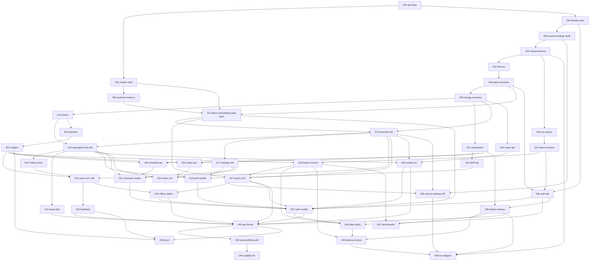

# HematDaya roadmap

The base app (001, 002) ships navigation, tokens, the API contract and "Segera hadir" for everything else. Each planned feature has a spec and plan for one small pull request. Independent tasks can proceed in parallel.

Authority: `docs/product/PRD-EN.md` for behaviour, `docs/roadmap/architecture.md` for binding decisions, `.specify/memory/constitution.md` above both.

## Pick up the next PR

1. Choose a spec in your lane whose task prerequisites are merged. Prioritize the MVP rows, then use the lowest ready number as a tie-breaker. Read its `spec.md` and `plan.md`, then `architecture.md`.
2. Create the branch with the folder's exact name: `git checkout -b 009-energy-summary`. Spec Kit commands depend on that shape.
3. Run `speckit-tasks` to generate `tasks.md` against the code as it stands now. The plan's task outline is the input, not a substitute.
4. Run `speckit-implement`, test first.
5. Flip what the spec's **Flips** line names, and nothing more.
6. Update the spec's **Status** line, run `make check`, then `pr-generate-description`.

Never run `speckit-specify` on a seeded spec. `setup-plan.sh` keeps an existing `plan.md`, so `speckit-plan` is safe, but it is rarely needed.

## Milestones and gates

| Milestone | Specs | Outcome | PRD gate |
|---|---|---|---|
| M0 Foundations | 001–003 | Base app, contract, first native smoke run | G0 → G1 |
| M1 Energy core | 004–011 | Exact fixture totals through the API, scope refusal, composition | G1 |
| M2 Read journey on phone | 012–016 | Demo opens real data on the phone: Beranda, Perangkat, history | G2 |
| M3 Settings and cost | 017–019 | Site settings, optional tariff, qualified cost | G2 follow-up for the internal MVP |
| M4 Evidence | 020–023 | Matched comparison, evidence-backed Saran, feedback | G2 |
| M5 CSV | 024–027 | Complete import with recovery | G2 |
| M6 Scope | 028–029 | Parent/child and alternative-source resolution | G2 |
| M7 Optional analysis | 030–033 | Schedules, outside-window, energy per output | G1, G2 optional-module evidence |
| M8 Recovery | 034–035 | Offline and combined states, then source catalog and simulated enrollment | G2 |
| M9 Saved service | 036–041 | Accounts, data rights, deployment, restore, benchmarks | G3 |
| M10 Platforms and usability | 042–044 | Native builds, accessibility audit, study kit | G4 |
| M11 Gated | 045–046 | Push and a verified live adapter, each behind its entry condition | G5 |

Household and industrial journeys are separate release gates (PRD §1). Both must work with schedule and output absent.

## Dependency graph



## Two-person delivery plan

**Person A owns backend, data integrity and operations.** Deliver site ownership, ingestion and calculations, the import commit and its end-to-end screen, scope contracts and deployment. Own database migrations in those tasks and review API usage in Person B's PRs.

**Person B owns client journeys and platform evidence.** Deliver native smoke tests, onboarding, the three tabs, evidence and recovery. Own CSV parsing and preview while Person A builds the measurement core. Review copy, accessibility and the import screen with Person A.

Each task has one lead. The other person reviews the shared contract and the relevant acceptance evidence. Generate each task's implementation checklist from its plan after its prerequisites are merged. Before two migration PRs merge, reconcile their revisions against the target branch and check that Alembic has one head.

### Internal MVP

The minimum is an internal, expiring workspace running the G2 core journey on web and Android smoke infrastructure. It supports two distinct household and industrial demos, CSV preview and atomic import, recorded energy and scope-safe history, evidence-backed Saran and feedback, and recovery from failed saves or offline reads. Use synthetic/demo data or approved non-sensitive CSV. Verify both journeys separately with exact totals, overlap refusal and replay without double counting.

The MVP includes 001–016, 020–029 and 034. 001 and 002 already exist. The workspace uses its configured timezone and the app confirms assumptions for CSV timestamps. Site settings and tariff editing (017–019), schedules and output metrics (030–033), the simulated meter catalog (035), saved accounts and deployment operations (036–041), release builds and research (042–044), push (045) and live integration (046) are follow-up work. An MVP walkthrough does not close the saved-data, platform-study or live-pilot gates. Keep production saved data gated on G3, including owner isolation, retention and a successful restore rehearsal.

### Parallel work

| When | Person A | Person B |
| --- | --- | --- |
| Start from the base | 004 → 005 → 006 | 003 Android smoke |
| After 006 | 007 → 008 | 024 → 025 |
| After 008 and 003 | 009 → 010 and the 011 composition guard | 012, then 013 once 009 merges |
| After 010 and 013 | 020 → 021, with 028 ready once 009 merges | 014 → 015 and 016 while evidence computation is in progress |
| After 021 and 025 | 026 → 027 | 022 → 023 after 015, and 029 after 028 |
| Close the MVP | Verify H/I totals, import replay and scope consistency | 034 after 022 and 027, then record separate H/I walkthroughs |

### Task owners and prerequisites

Each row is one spec-sized task. **Depends on** lists the task/spec IDs that must merge first. An em dash means the task has no predecessor. The corresponding spec header and the graph above use the same direct dependencies.

<!-- task-map:start -->
| Task/spec | Lead | Depends on | Delivery |
| --- | --- | --- | --- |
| [001 API base](../../specs/001-api-base/spec.md) | A | — | MVP · implemented in PR #3 |
| [002 Mobile shell](../../specs/002-mobile-shell/spec.md) | B | `001` | MVP · implemented in PR #3 |
| [003 Android smoke CI](../../specs/003-android-smoke-ci/spec.md) | B | `002` | MVP |
| [004 Identity and sites](../../specs/004-identity-sites/spec.md) | A | `001` | MVP |
| [005 Assets, bindings and audit](../../specs/005-assets-bindings-audit/spec.md) | A | `004` | MVP |
| [006 Measurements](../../specs/006-measurements/spec.md) | A | `005` | MVP |
| [007 Demo fixtures](../../specs/007-fixtures/spec.md) | A | `006` | MVP |
| [008 Demo sessions](../../specs/008-demo-sessions/spec.md) | A | `007` | MVP |
| [009 Energy summary](../../specs/009-energy-summary/spec.md) | A | `008` | MVP |
| [010 History buckets](../../specs/010-history/spec.md) | A | `009` | MVP |
| [011 Composition enforcement](../../specs/011-composition/spec.md) | A | `009` | MVP |
| [012 Demo onboarding and data layer](../../specs/012-demo-onboarding-data-layer/spec.md) | B | `002`, `003`, `008` | MVP |
| [013 Populated Beranda](../../specs/013-beranda-s03/spec.md) | B | `009`, `012` | MVP |
| [014 Perangkat and asset detail](../../specs/014-perangkat-s04-s06/spec.md) | B | `010`, `013` | MVP |
| [015 History chart](../../specs/015-history-chart/spec.md) | B | `014` | MVP |
| [016 Asset edit and archive](../../specs/016-asset-edit/spec.md) | B | `014` | MVP |
| [017 Site settings](../../specs/017-settings-s09/spec.md) | B | `013` | Follow-up |
| [018 Tariff and cost API](../../specs/018-tariff-api/spec.md) | A | `011` | Follow-up |
| [019 Tariff and cost on mobile](../../specs/019-tariff-mobile/spec.md) | B | `014`, `017`, `018` | Follow-up |
| [020 Matched baseline](../../specs/020-baseline/spec.md) | A | `010` | MVP |
| [021 Insights and evidence](../../specs/021-insights/spec.md) | A | `020` | MVP |
| [022 Saran and evidence screens](../../specs/022-saran-s07-s08/spec.md) | B | `013`, `015`, `021` | MVP |
| [023 Insight feedback](../../specs/023-feedback/spec.md) | B | `022` | MVP |
| [024 CSV parser](../../specs/024-csv-parser/spec.md) | B | `006` | MVP |
| [025 Import preview](../../specs/025-import-preview/spec.md) | B | `024` | MVP |
| [026 Import commit](../../specs/026-import-commit/spec.md) | A | `021`, `025` | MVP |
| [027 Import screens](../../specs/027-import-s10/spec.md) | A | `012`, `013`, `026` | MVP |
| [028 Scope API](../../specs/028-scope-api/spec.md) | A | `009` | MVP |
| [029 Scope screen](../../specs/029-scope-s11/spec.md) | B | `013`, `014`, `028` | MVP |
| [030 Schedule API](../../specs/030-schedule-api/spec.md) | A | `011`, `021` | Follow-up |
| [031 Schedule on mobile](../../specs/031-schedule-mobile/spec.md) | B | `014`, `017`, `030` | Follow-up |
| [032 Output metric API](../../specs/032-output-api/spec.md) | A | `011`, `021` | Follow-up |
| [033 Metric screen](../../specs/033-metric-s12/spec.md) | B | `014`, `017`, `032` | Follow-up |
| [034 Offline and combined states](../../specs/034-offline-states/spec.md) | B | `022`, `027` | MVP |
| [035 Source catalog and simulated setup](../../specs/035-source-catalog-s05/spec.md) | B | `005`, `013`, `027` | Follow-up |
| [036 Accounts API](../../specs/036-auth-api/spec.md) | A | `004`, `008`, `025` | Follow-up |
| [037 Accounts on mobile](../../specs/037-auth-mobile/spec.md) | B | `012`, `019`, `027`, `029`, `031`, `034`, `036` | Follow-up |
| [038 Data rights](../../specs/038-data-rights/spec.md) | A | `026`, `036`, `037` | Follow-up |
| [039 Deployment and release](../../specs/039-deploy-release/spec.md) | A | `011`, `036` | Follow-up |
| [040 Backup and restore](../../specs/040-backup-restore/spec.md) | A | `026`, `038`, `039` | Follow-up |
| [041 Benchmarks](../../specs/041-benchmarks/spec.md) | A | `026`, `039` | Follow-up |
| [042 Native builds](../../specs/042-eas-builds/spec.md) | B | `016`, `023`, `027`, `029`, `034`, `037`, `039` | Follow-up |
| [043 Accessibility and platform audit](../../specs/043-accessibility-audit/spec.md) | B | `042` | Follow-up |
| [044 Usability study kit](../../specs/044-usability-kit/spec.md) | B | `043` | Follow-up |
| [045 Push notifications](../../specs/045-push/spec.md) | B | `021`, `023`, `042` | Follow-up |
| [046 Live meter adapter](../../specs/046-live-adapter/spec.md) | A | `006`, `035`, `039`, `040` | Follow-up |
<!-- task-map:end -->

## Spec format

Each `specs/NNN-name/` holds `spec.md` (what and why, in the Spec Kit template) and `plan.md` (how: contracts, tables, files, tests, task outline). The header of `spec.md` carries:

| Field | Meaning |
|---|---|
| **Depends on** | Specs that must be merged first |
| **Size** | S up to a day, M up to three days, L up to a week; split anything larger |
| **Covers** | PRD IDs this spec delivers or carries evidence for |
| **Flips** | Manifest or registry entries this PR may change |

`traceability.md` is generated from the **Covers** lines:

```bash
python3 docs/roadmap/check_traceability.py          # fails if any requirement has no home
python3 docs/roadmap/check_traceability.py --write  # rewrites traceability.md
```

## What is proven today

Base only: API and mobile checks, JavaScript bundles for Android, iOS and web, and the web build against a live API. No native build has run. No feature, service, field or participant result exists. Each spec starts **not run**, as PRD §20 requires.
