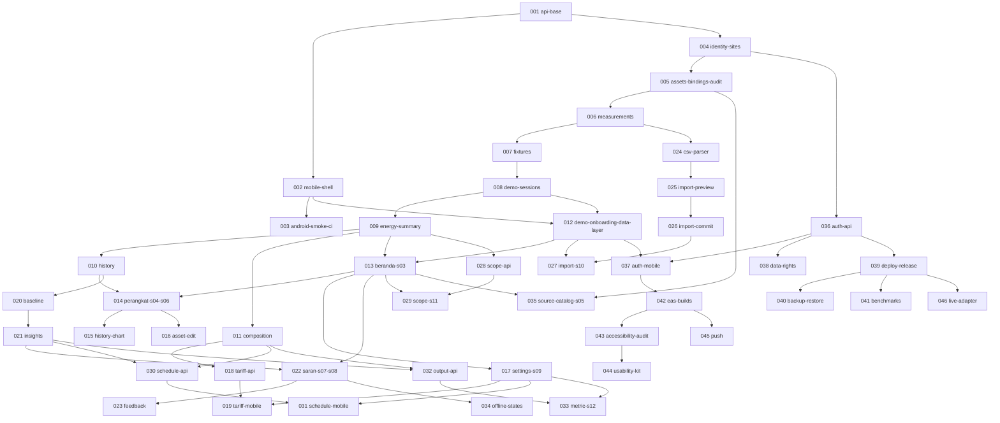

# HematDaya roadmap

The base app (001, 002) ships navigation, tokens, the API contract and "Segera hadir" for everything else. This roadmap turns each planned feature into one small pull request with a written spec and plan, so work continues one PR at a time.

Authority: `docs/product/PRD-EN.md` for behaviour, `docs/roadmap/architecture.md` for binding decisions, `.specify/memory/constitution.md` above both.

## Pick up the next PR

1. Choose the lowest-numbered spec whose dependencies are merged. Read its `spec.md` and `plan.md`, then `architecture.md`.
2. Create the branch with the folder's exact name: `git checkout -b 009-energy-summary`. Spec Kit commands depend on that shape.
3. Run `speckit-tasks` to generate `tasks.md` against the code as it stands now. The plan's task outline is the input, not a substitute.
4. Run `speckit-implement`, test first.
5. Flip what the spec's **Flips** line names, and nothing more.
6. Update the spec's **Status** line, run `make check`, then `pr-generate-description`.

Never run `speckit-specify` on a seeded spec. `setup-plan.sh` keeps an existing `plan.md`, so `speckit-plan` is safe, but it is rarely needed.

## Milestones and gates

| Milestone | Specs | Outcome | PRD gate |
|---|---|---|---|
| M0 Foundations | 001–003 | Base app, contract, first native smoke run | G0 → G1 |
| M1 Energy core | 004–011 | Exact fixture totals through the API, scope refusal, composition | G1 |
| M2 Read journey on phone | 012–016 | Demo opens real data on the phone: Beranda, Perangkat, history | G2 |
| M3 Settings and cost | 017–019 | Site settings, optional tariff, qualified cost | G2 |
| M4 Evidence | 020–023 | Matched comparison, evidence-backed Saran, feedback | G2 |
| M5 CSV | 024–027 | Complete import with recovery | G2 |
| M6 Scope | 028–029 | Parent/child and alternative-source resolution | G2 |
| M7 Optional analysis | 030–033 | Schedules, outside-window, energy per output | G1, G2 |
| M8 Recovery | 034–035 | Offline and combined states, source catalog. **G2 complete** | G2 |
| M9 Saved service | 036–041 | Accounts, data rights, deployment, restore, benchmarks | G3 |
| M10 Platforms and usability | 042–044 | Native builds, accessibility audit, study kit | G4 |
| M11 Gated | 045–046 | Push and a verified live adapter, each behind its entry condition | G5 |

Household and industrial journeys are separate release gates (PRD §1). Both must work with schedule and output absent.

## Dependency graph



Specs that share no dependency can run in parallel, such as 024 and 020, or 018 and 028.

## Spec format

Each `specs/NNN-name/` holds `spec.md` (what and why, in the Spec Kit template) and `plan.md` (how: contracts, tables, files, tests, task outline). The header of `spec.md` carries:

| Field | Meaning |
|---|---|
| **Depends on** | Specs that must be merged first |
| **Size** | S up to a day, M up to three days, L up to a week; split anything larger |
| **Covers** | PRD IDs this spec delivers or carries evidence for |
| **Flips** | Manifest or registry entries this PR may change |

`traceability.md` is generated from the **Covers** lines:

```bash
python3 docs/roadmap/check_traceability.py          # fails if any requirement has no home
python3 docs/roadmap/check_traceability.py --write  # rewrites traceability.md
```

## What is proven today

Base only: API and mobile checks, JavaScript bundles for Android, iOS and web, and the web build against a live API. No native build has run. No feature, service, field or participant result exists. Each spec starts **not run**, as PRD §20 requires.
