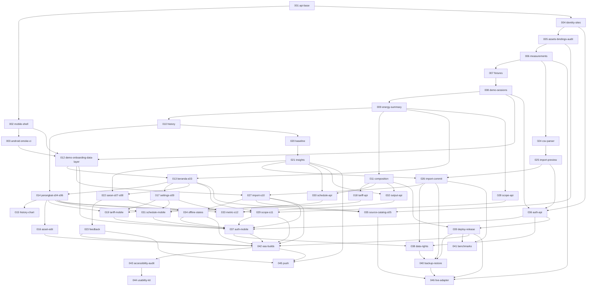

# HematDaya roadmap

The base app (001, 002) ships navigation, tokens, the API contract and "Segera hadir" for everything else. Each planned feature has a spec and plan for one small pull request. Independent tasks can proceed in parallel.

Authority: `docs/product/PRD-EN.md` for behaviour, `docs/roadmap/architecture.md` for binding decisions, `.specify/memory/constitution.md` above both.

## Pick up the next PR

1. Choose the next piece of work in your milestone lane. Prioritize the MVP rounds and check the spec header for prerequisites before opening a branch. Read its `spec.md` and `plan.md`, then `architecture.md`.
2. Create the branch with the folder's exact name: `git checkout -b 009-energy-summary`. Spec Kit commands depend on that shape.
3. Run `speckit-tasks` to generate `tasks.md` against the code as it stands now. The plan's task outline is the input, not a substitute.
4. Run `speckit-implement`, test first.
5. Flip what the spec's **Flips** line names, and nothing more.
6. Update the spec's **Status** line, run `make check`, then `pr-generate-description`.

Never run `speckit-specify` on a seeded spec. `setup-plan.sh` keeps an existing `plan.md`, so `speckit-plan` is safe, but it is rarely needed.

## Two-person delivery plan

**P1 owns backend, data integrity and operations, plus the evidence, read and scope journeys end to end.** P1 leads the data model, energy calculation, API contracts and deployment, and builds the mobile data layer, Beranda, Saran with feedback, scope, tariff and schedule from API to screen.

**P2 owns client journeys and platform evidence, plus the import and history journeys end to end.** P2 leads Android smoke, CSV parsing, preview, commit and import screens, Perangkat, history and asset editing, recovery, settings, the output metric, the source catalog and native platform work.

Each person reviews the other's shared contracts and acceptance evidence. Whoever builds a feature's API also builds its screen, so no module changes hands mid-milestone. Start a spec only when every spec it depends on is merged on `main`, never on the partner's unmerged branch, and end each round by merging both PRs. Before parallel migration PRs merge, reconcile their revisions with the target branch and verify a single Alembic head; the API test `test_single_migration_head` enforces it.

### Internal MVP

**Finish M0, M1, M2, M4, M5, M6 and the recovery portion of M8 (034).** Site settings and tariffs (M3), schedules and output metrics (M7), the M8 source catalog and simulated enrollment (035), and M9–M11 are follow-up work.

The MVP is an internal, expiring workspace on web and the Android smoke environment. Verify the household and industrial journeys separately using synthetic/demo data or approved non-sensitive CSV. Each walkthrough must cover recorded energy, scope-safe history, evidence and feedback, and recovery from an offline read or failed save. Record exact totals, refusal of overlapping scopes, and import replay without double counting before calling the MVP complete. Production saved data requires G3, including owner isolation, retention and a successful restore rehearsal.

### Parallel work

Rounds show handoffs. Start each lane when its inputs are ready.

| Round | P1 | P2 | Prerequisites |
| --- | --- | --- | --- |
| 1 | **M1** (004–006) Data foundation for sites, assets, bindings and measurements | **M0** (003) Android smoke | Done and merged: M1 in PR #25, M0 in PR #24. P1 used the base API and P2 the base mobile shell from PR #3. |
| 2 | **M1** (007–011) Demo fixtures, sessions, summary, history and composition guard, then **M4** (020–021) matched baseline and insight evidence | **M5** (024–025) CSV parser and preview | P1's work merged in PR #25 and PR #26. The CSV parser and preview merged in PR #30. |
| 3 | **M2** (012) Demo onboarding and workspace data layer | **M5** (026) Atomic import commit | The onboarding and workspace data layer merged in PR #28. Atomic import commit merged in PR #31. |
| 4 | **M2** (013) Populated Beranda | **M5** (027) Import screens | Populated Beranda merged in PR #28. The import screens merged in PR #33. |
| 5 | **M4** (022) Saran and evidence detail, introducing the shared history chart | **M2** (014) Perangkat list and asset detail | Saran and evidence detail merged in PR #29. Perangkat list and asset detail merged in PR #32. |
| 6 | **M4** (023) Feedback, then **M6** (028) scope API | **M2** (015) History chart | Feedback merged in PR #29. Scope API needs M1 summary. History needs M2 Perangkat and the shared chart from round 5. |
| 7 | **M6** (029) Scope screen | **M2** (016) Asset editing, then **M8** (034) offline and combined-state recovery | P1 needs M2 Beranda and Perangkat from rounds 4–5 and the M6 API from round 6. P2 needs M2 Perangkat and M4 Saran from round 5 and the M5 import flow from round 4. |
| 8 | Verify backend H/I totals, scope refusal and import replay | Finish **M8** (034) recovery | Every MVP input is merged by round 7. |
| MVP sign-off | Review the numbers and failure evidence with P2 | Record both walkthroughs with P1 | M0, M1, M2, M4, M5 and M6 are complete, and M8 recovery has passed. |

### MVP refresh

Deliver the approved refresh in sequence from the merged predecessor.

| Spec | Scope | Status |
| --- | --- | --- |
| 047 | Explore-first onboarding and explicit CSV entry | Implemented and verified locally |
| 048 | Compact app and prototype layout | Implemented and verified locally |
| 049 | Localization foundation and API copy | Implemented and verified locally |
| 050 | Bilingual MVP app and prototype | Planned |

Record both joint walkthroughs on the refreshed build after 050.

#### After MVP

| Round | P1 | P2 | Prerequisites |
| --- | --- | --- | --- |
| 9 | **M3** (018) Tariff and cost API, then **M7** (030) schedule API | **M3** (017) Site settings and **M7** (032) output metric API | MVP signed off. Both use the M1 composition guard and M4 insights. P2 also uses M2 Beranda. |
| 10 | **M3** (019) Tariff editor and qualified cost display | **M7** (033) Output metric screen | P1 needs the M3 API and site settings from round 9 plus M2 asset detail. P2 needs the output API and site settings from round 9 plus M2 asset detail. |
| 11 | **M7** (031) Schedule screens, then **M9** (036) account and session API | **M8** (035) Source catalog and simulated enrollment | P1 needs the schedule API and site settings from round 9; the account API needs M1 ownership and demo sessions plus M5 import preview. P2 needs M1 assets, M2 Beranda and the M5 import flow. |
| 12 | **M9** (039, 041) HTTPS rehearsal deployment, then benchmarks | **M9** (037) Account UI and session recovery | Both need the account API from round 11. P1 also uses M1 composition and M5 import commit. P2 needs the M3 tariff, M6 scope and M7 schedule screens plus the MVP save and recovery flows. |
| 13 | **M9** (038, 040) Export and deletion, then backup and restore rehearsal | **M10** (042–043) Native builds, then accessibility audit | P1 needs M5 import commit, the M9 account flow and rehearsal deployment. P2 needs the MVP journeys and the M9 account flow and HTTPS rehearsal from round 12. Use synthetic data for device checks while saved-data evidence is pending. |
| 14 | **M11** (046) Live adapter implementation and reference-meter checks on the approved installation | **M10** (044) Usability kit and separate household and industrial study evidence | P1 needs M1 ingestion, the M8 catalog, M9 deployment and restore evidence, and a model with measurement-only credentials. P2 prepares the kit after the accessibility audit and records evidence from the owner's participant studies when available. |
| 15 | **M11** (046 release gate) Live-pilot sign-off | **M11** (045) Opt-in push | P1 needs the preceding PRD gates and verified reference and quality evidence from round 14. P2 needs M4 insight and feedback, M10 native builds and owner confirmation that users want push. |

The owner approves the HTTPS host and domain, retention settings, app identity and build accounts required for the chosen distribution. Open production saved data after G3 passes, including export, deletion and restore evidence. Close G4 after the platform checks and both participant studies have evidence and task blockers have passed retests. The live pilot also requires G5 evidence from the actual installation and a qualified installer for fixed wiring. If a device or study is pending, the push lane can proceed once its own prerequisites are ready. Push remains off until the user opts in.

### Milestones and dependencies

The prerequisite column lists direct cross-milestone inputs from the spec headers. A milestone can start with a completed input from another milestone while the rest of that milestone is still in progress. PRD gates require their own acceptance evidence.

| Milestone | Specs | P1 | P2 | Direct prerequisites | MVP and release gate |
| --- | --- | --- | --- | --- | --- |
| **M0 Foundations** | 001–003 | Base API and contract | Mobile shell and Android smoke | None | Complete. Base merged in PR #3 and Android smoke in PR #24. G0 → G1 evidence. |
| **M1 Energy core** | 004–011 | Ownership, ingest, fixtures, demo sessions, exact totals and history | Review fixture oracles and the client contract | M0 base API | Required. Core calculation evidence for G1. |
| **M2 Read journey** | 012–016 | Data layer, Beranda | Perangkat, history chart, asset editing | M0 Android smoke and mobile shell, M1 demo, summaries and history | Required for the G2 journey. |
| **M3 Settings and cost** | 017–019 | Tariff and cost API, tariff editor and cost display | Site settings | M1 composition guard, M2 Beranda and asset detail | Follow-up for the G2 journey. |
| **M4 Evidence** | 020–023 | Baseline, insights, Saran, evidence detail, feedback | Review the evidence contract | M1 history, M2 Beranda and chart | Required for the G2 journey. |
| **M5 CSV** | 024–027 | Review the commit contract and replay evidence | Parser, preview, atomic commit, import screens | M1 measurements, M2 onboarding and Beranda, M4 insight revision contract | Required for the G2 journey. Parser and preview can start from M1 measurements. |
| **M6 Scope** | 028–029 | Scope API and scope screen | Review scope refusal on Beranda and Perangkat | M1 summary, M2 Beranda and Perangkat | Required for the G2 journey. The API can start from M1 summaries. |
| **M7 Optional analysis** | 030–033 | Schedule API and screens | Output metric API and screen | M1 composition guard, M2 asset detail, M3 settings, M4 insights | Follow-up. Optional-module evidence for G1 and G2. |
| **M8 Recovery** | 034–035 | Review state and calculation evidence | Offline recovery and combined states, then source catalog and simulated enrollment | Recovery needs M4 Saran and M5 import. Catalog needs M1 assets, M2 Beranda and M5 import. | **MVP cutoff is recovery.** Catalog and simulated enrollment follow later. |
| **M9 Saved service** | 036–041 | Account API, data rights, deployment, backup/restore and benchmarks | Account UI and session recovery | M1, M2, M3, M5, M6, M7 and M8 recovery | Follow-up. G3 gates production saved data. |
| **M10 Platforms and usability** | 042–044 | Support HTTPS and contract verification on devices | Native builds, accessibility and usability evidence | M2, M4, M5, M6, M8 recovery and M9 account/deployment inputs | Follow-up. G4 requires platform and participant evidence. |
| **M11 Gated features** | 045–046 | Verified live meter adapter | Opt-in push | Push needs M4 and M10 native builds. Live meter needs M1 measurements, M8 catalog and M9 deployment and restore. | Follow-up. Push needs owner demand and consent. G5 requires reference comparison and quality evidence from a verified installation. |

<details>
<summary>Technical spec dependency graph</summary>



</details>

## Spec format

Each `specs/NNN-name/` holds `spec.md` (what and why, in the Spec Kit template) and `plan.md` (how: contracts, tables, files, tests, task outline). The header of `spec.md` carries:

| Field | Meaning |
|---|---|
| **Depends on** | Specs that must be merged first |
| **Size** | S up to a day, M up to three days, L up to a week; split anything larger |
| **Covers** | PRD IDs this spec delivers or carries evidence for |
| **Flips** | Manifest or registry entries this PR may change |

`traceability.md` is generated from the **Covers** lines:

```bash
python3 docs/roadmap/check_traceability.py          # fails if any requirement has no home
python3 docs/roadmap/check_traceability.py --write  # rewrites traceability.md
```

## What is proven today

Base: API and mobile checks, JavaScript bundles for Android, iOS and web, and the web build against a live API. M1 (004–011, branch `f/m1-energy-core`): the API's ownership, asset model, ingestion, fixtures, demo sessions, summary, history and composition guard pass unit and Postgres integration tests, with golden summaries for the H, I and scope fixtures. M4 API (020–021, branch `f/m4-evidence`): matched baseline and insight evidence revisions pass, including the AT-17 numbers. Saran, evidence detail, and feedback are available from PR #29. M5 CSV import, including the web flow against the live API, is available from PR #33. The first successful Android debug APK and Maestro smoke run on `main` completed on 7 November 2026 WIB with API 34 and the `pixel_6` profile. AT-48 has Android emulator evidence. iOS remains **not run** until 042. No field or participant result exists. [First successful Android smoke run](https://github.com/Sidiq-Tri-Pratikto/pertanian/actions/runs/42255936265)
