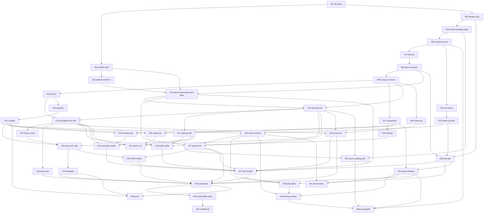

# HematDaya roadmap

The base app (001, 002) ships navigation, tokens, the API contract and "Segera hadir" for everything else. Each planned feature has a spec and plan for one small pull request. Independent tasks can proceed in parallel.

Authority: `docs/product/PRD-EN.md` for behaviour, `docs/roadmap/architecture.md` for binding decisions, `.specify/memory/constitution.md` above both.

## Pick up the next PR

1. Choose the next piece of work in your milestone lane. Prioritize the MVP rounds and check the spec header for prerequisites before opening a branch. Read its `spec.md` and `plan.md`, then `architecture.md`.
2. Create the branch with the folder's exact name: `git checkout -b 009-energy-summary`. Spec Kit commands depend on that shape.
3. Run `speckit-tasks` to generate `tasks.md` against the code as it stands now. The plan's task outline is the input, not a substitute.
4. Run `speckit-implement`, test first.
5. Flip what the spec's **Flips** line names, and nothing more.
6. Update the spec's **Status** line, run `make check`, then `pr-generate-description`.

Never run `speckit-specify` on a seeded spec. `setup-plan.sh` keeps an existing `plan.md`, so `speckit-plan` is safe, but it is rarely needed.

## Two-person delivery plan

**P1 owns backend, data integrity and operations.** P1 leads the data model, energy calculation, API contracts, import commit and screen, and deployment.

**P2 owns client journeys and platform evidence.** P2 leads Android smoke, onboarding, the three tabs, evidence and recovery. P2 also owns CSV parsing and preview while P1 builds the measurement core.

Each person reviews the other's shared contracts and acceptance evidence. Before parallel migration PRs merge, reconcile their revisions with the target branch and verify a single Alembic head.

### Internal MVP

**Finish M0, M1, M2, M4, M5, M6 and the recovery portion of M8.** The MVP stops at offline and combined-state recovery in M8. Site settings and tariffs (M3), schedules and output metrics (M7), the M8 source catalog and simulated enrollment, and M9–M11 are follow-up work.

The MVP is an internal, expiring workspace on web and the Android smoke environment. Verify the household and industrial journeys separately using synthetic/demo data or approved non-sensitive CSV. Each walkthrough must cover recorded energy, scope-safe history, evidence and feedback, and recovery from an offline read or failed save. Record exact totals, refusal of overlapping scopes, and import replay without double counting before calling the MVP complete. Production saved data requires G3, including owner isolation, retention and a successful restore rehearsal.

### Parallel work

Rounds show handoffs. Start each lane when its inputs are ready.

| Round | P1 | P2 | Prerequisites |
| --- | --- | --- | --- |
| 1 | **M1** Data foundation for sites, assets, bindings and measurements | **M0** Android smoke | P1 uses the base API. P2 uses the base mobile shell. Both are in PR #3. |
| 2 | **M1** Demo fixtures and isolated sessions | **M5** CSV parser and preview | Both use M1's measurement foundation from round 1. |
| 3 | **M1** Summary, history and composition guard | **M2** Demo onboarding and workspace data layer | P1 needs M1 demo sessions from round 2. P2 needs those sessions and M0 Android smoke from round 1. |
| 4 | **M4** Matched baseline and insight evidence, then **M6** scope API | **M2** Populated Beranda, Perangkat, history chart and asset editing | P1 needs M1 summary and history from round 3. P2 also needs M2 onboarding from round 3. |
| 5 | **M5** Atomic import commit and import screens | **M4** Saran, evidence detail and feedback | P1 needs M5 preview from round 2, M4 insight evidence and M2 Beranda from round 4. P2 needs M4 insight evidence and the M2 chart from round 4. |
| 6 | Verify backend H/I totals, scope refusal and import replay | **M6** Scope screen and **M8** offline and combined-state recovery | Scope screen needs the M6 API and M2 screens from round 4. Recovery needs M4 Saran and the M5 import flow from round 5. |
| MVP sign-off | Review the numbers and failure evidence with P2 | Record both walkthroughs with P1 | M0, M1, M2, M4, M5 and M6 are complete, and M8 recovery has passed. |

### Milestones and dependencies

The prerequisite column lists direct cross-milestone inputs from the spec headers. A milestone can start with a completed input from another milestone while the rest of that milestone is still in progress. PRD gates require their own acceptance evidence.

| Milestone | P1 | P2 | Direct prerequisites | MVP and release gate |
| --- | --- | --- | --- | --- |
| **M0 Foundations** | Base API and contract | Mobile shell and Android smoke | None | Required. Base is in PR #3 and Android smoke is pending. G0 → G1 evidence. |
| **M1 Energy core** | Ownership, ingest, fixtures, demo sessions, exact totals and history | Review fixture oracles and the client contract | M0 base API | Required. Core calculation evidence for G1. |
| **M2 Read journey** | Review the client integration against API contracts | Onboarding, Beranda, Perangkat, history chart and asset editing | M0 Android smoke and mobile shell, M1 demo, summaries and history | Required for the G2 journey. |
| **M3 Settings and cost** | Tariff and cost API | Site settings, tariff editor and qualified cost UI | M1 composition guard, M2 Beranda and asset detail | Follow-up for the G2 journey. |
| **M4 Evidence** | Matched baseline, insight rules and revisioned evidence | Saran, evidence detail and feedback | M1 history, M2 Beranda and chart | Required for the G2 journey. |
| **M5 CSV** | Atomic commit, replay and import screens | Parser and preview | M1 measurements, M2 onboarding and Beranda, M4 insight revision contract | Required for the G2 journey. Parser and preview can start from M1 measurements. |
| **M6 Scope** | Scope validation, preview and atomic save API | Scope screen and explicit resolution | M1 summary, M2 Beranda and Perangkat | Required for the G2 journey. The API can start from M1 summaries. |
| **M7 Optional analysis** | Schedule and output APIs | Schedule and output screens | M1 composition guard, M2 asset detail, M3 settings, M4 insights | Follow-up. Optional-module evidence for G1 and G2. |
| **M8 Recovery** | Review state and calculation evidence | Offline recovery and combined states, then source catalog and simulated enrollment | Recovery needs M4 Saran and M5 import. Catalog needs M1 assets, M2 Beranda and M5 import. | **MVP cutoff is recovery.** Catalog and simulated enrollment follow later. |
| **M9 Saved service** | Account API, data rights, deployment, backup/restore and benchmarks | Account UI and session recovery | M1, M2, M3, M5, M6, M7 and M8 recovery | Follow-up. G3 gates production saved data. |
| **M10 Platforms and usability** | Support HTTPS and contract verification on devices | Native builds, accessibility and usability evidence | M2, M4, M5, M6, M8 recovery and M9 account/deployment inputs | Follow-up. G4 requires platform and participant evidence. |
| **M11 Gated features** | Verified live meter adapter | Opt-in push | Push needs M4 and M10 native builds. Live meter needs M1 measurements, M8 catalog and M9 deployment and restore. | Follow-up. Push needs owner demand and consent. G5 requires reference comparison and quality evidence from a verified installation. |

<details>
<summary>Technical spec dependency graph</summary>



</details>

## Spec format

Each `specs/NNN-name/` holds `spec.md` (what and why, in the Spec Kit template) and `plan.md` (how: contracts, tables, files, tests, task outline). The header of `spec.md` carries:

| Field | Meaning |
|---|---|
| **Depends on** | Specs that must be merged first |
| **Size** | S up to a day, M up to three days, L up to a week; split anything larger |
| **Covers** | PRD IDs this spec delivers or carries evidence for |
| **Flips** | Manifest or registry entries this PR may change |

`traceability.md` is generated from the **Covers** lines:

```bash
python3 docs/roadmap/check_traceability.py          # fails if any requirement has no home
python3 docs/roadmap/check_traceability.py --write  # rewrites traceability.md
```

## What is proven today

Base only: API and mobile checks, JavaScript bundles for Android, iOS and web, and the web build against a live API. No native build has run. No feature, service, field or participant result exists. Each spec starts **not run**, as PRD §20 requires.
