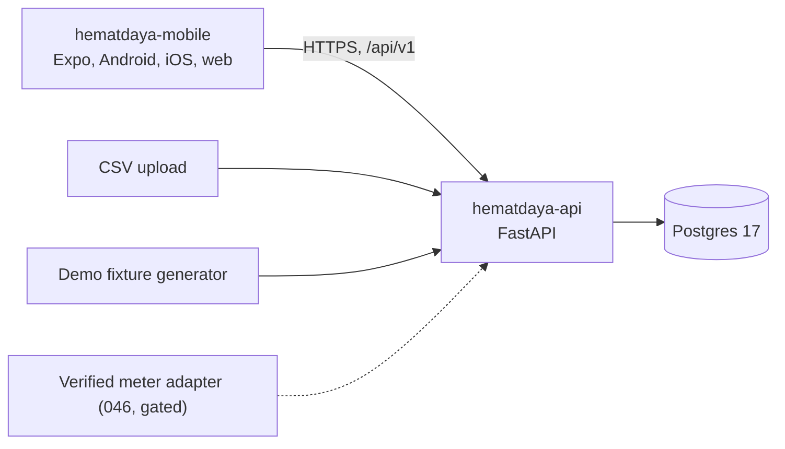

# HematDaya architecture decisions

Binding for every spec in `specs/`. The PRD (`docs/product/PRD-EN.md`) says what the product does. This file says how it is built. When a spec and this file disagree, this file wins until it is changed in a PR. The constitution wins over both.

## System shape

One modular monolith API, one mobile client, one Postgres database.

The API is the one calculation authority. The mobile app never computes energy, cost, coverage, comparison or percentages. There is no TypeScript calculation engine, so the demo needs a reachable API.

## API modules

Each is a feature module under `applications/hematdaya-api/app/` following rule 005. A module imports another module's service interface, never its repository.

| Module | Owns | First spec |
|---|---|---|
| `capabilities` | Manifest, composition validation, capability guard | 001, 011 |
| `identity` | Principals, the request's acting principal | 004 |
| `sites` | Sites, timezone, context, clock | 004 |
| `assets` | Assets, sources, bindings, relations | 005 |
| `audit` | Append-only change records | 005 |
| `measurements` | Normalized readings, identity, revision | 006 |
| `demo` | Fixture generator, scenarios, demo sessions, reset | 007, 008 |
| `energy` | Periods, summaries, coverage, gaps, ranking, history | 009, 010 |
| `scope` | Aggregation selection, overlap rules | 009, 028 |
| `cost` | Tariffs, cost of energy (optional capability) | 018 |
| `baseline` | Matched windows, common mask, readiness | 020 |
| `insights` | Rules, evidence snapshots, revisions, notices | 021 |
| `feedback` | Useful, not relevant, snooze, hide, restore | 023 |
| `imports` | CSV parsing, previews, atomic commit | 024–026 |
| `schedules` | Weekly windows, effective schedule, outside split (optional capability) | 030 |
| `output` | Output metric and inputs (optional capability) | 032 |
| `catalog` | Source catalog, simulated enrollment | 035 |
| `auth` | Users, sessions, rate limits | 036 |
| `exports` | Export, deletion, retention | 038 |

## Data model

Created by the spec named. Every table carries `created_at`; identifiers are UUID unless noted.

| Table | Key columns and constraints | Spec |
|---|---|---|
| `principals` | `kind` (`demo`, `user`) | 004 |
| `sites` | `owner_principal_id` → principals, `kind` (`demo`, `standard`), `name`, `context`, `timezone`, `currency`, `virtual_now`; `CHECK (virtual_now IS NULL OR kind = 'demo')` | 004 |
| `assets` | `site_id`, `name`, `category`, `location`, `scope_kind` (`device`, `group`, `circuit`, `site_total`), `parent_asset_id`, `expected_use` (`unknown`, `continuous`, `scheduled`, `intermittent`), `archived_at` | 005 |
| `sources` | `site_id`, `label`, `origin` (`live`, `import`, `dataset_replay`, `simulated`), `measurement_kind`, `cadence_seconds`, `resolution_mwh` (nullable means unknown), `transport_status` | 005 |
| `bindings` | `source_id`, `asset_id`, `effective_from`, `effective_to`, `authoritative`; partial `EXCLUDE` on overlapping authoritative ranges per asset | 005 |
| `asset_relations` | `site_id`, `from_asset_id`, `to_asset_id`, `kind` (`contains`, `unknown_overlap`); same site, no self-reference, no cycle | 005 |
| `audit_events` | `site_id`, `actor_principal_id`, `action`, `subject`, `affected_from`, `affected_to`, `detail`; append-only | 005 |
| `measurements` | `source_id`, `source_record_id`, `kind`, `interval_start`, `interval_end`, `energy_mwh` BIGINT, `received_at`, `quality`, `revision`; unique on source identity and revision; index `(source_id, interval_start)` | 006 |
| `demo_sessions` | `principal_id`, `site_id`, `scenario_id`, `token_hash`, `expires_at` | 008 |
| `aggregation_selections` | `site_id` (unique), `revision` | 009 |
| `aggregation_selection_assets` | `selection_id`, `asset_id` | 009 |
| `tariffs` | `site_id`, `effective_from`, `milli_rupiah_per_kwh` BIGINT `>= 0`, `provenance` (`synthetic`, `user`) | 018 |
| `insights` | `site_id`, `kind`, `asset_id`, `period_start`, `period_end`, stable `identity_key`, `current_revision` | 021 |
| `insight_revisions` | `insight_id`, `revision`, `evidence` JSONB, `policy_id`, `policy_version`, `superseded_at` | 021 |
| `insight_feedback` | `insight_id`, `revision`, `principal_id`, `action`, `until` | 023 |
| `imports` | `site_id`, `status`, `file_name`, `content_sha256`, `mapping` JSONB, counts, `idempotency_key` unique per site | 025 |
| `import_rows` | `import_id`, `data_row`, `file_line`, `status`, `parsed`, staged rows | 025 |
| `schedules`, `schedule_windows` | Weekly windows, version, `effective_from`, `is_correction` | 030 |
| `asset_schedule_overrides` | `asset_id`, `mode` (`inherit`, `none`, `continuous`, `custom`), `schedule_id` | 030 |
| `output_metrics`, `output_inputs` | Definition, numerator assets, unit, method, quantities | 032 |
| `users`, `refresh_sessions` | Owner identity; rotating refresh tokens | 036 |
| `exports`, `deletion_requests` | Owner-only exports, purge status | 038 |

## Binding decisions

### Ownership

`sites.owner_principal_id` → `principals(kind)` exists from the first migration. A demo session and a user are both principals, so authorization has one shape. Auth (036) adds `users` and never rewrites sites. Every read and mutation resolves the site through the acting principal. A resource owned by someone else returns `NOT_FOUND`, so its existence never leaks. AT-41 runs with two principals from 004 onward, and each later data PR adds its routes to that test.

### Demo sessions

Demo is a public write: each anonymous session seeds 2,688 or more rows. So the API caps active sessions, sets a TTL, purges expired sessions at creation, and seeds with `INSERT … SELECT` from `generate_series` or a shared template site, not row by row. Tokens are opaque, stored hashed, and sent as a bearer token. An expired session returns a typed error and the app offers to start again. "Mulai" before auth (036) is an empty labelled expiring workspace, not a saved account.

### Two clocks

`sites.virtual_now` (demo sites only) drives periods, staleness, snooze and "today". The wall clock drives `received_at`, audit, TTL and security. One dependency, `site_clock(site)`, returns the right `now`; nothing else calls `datetime.now` for product time. Queries exclude intervals ending after now, and include a full interval that ends exactly at now.

### Numbers

Storage: integer mWh, integer milli-rupiah per kWh, cost computed in integer nano-rupiah (Python `int`) and rounded once at the response. Wire: decimal strings (`"14.700"`, `"22050"`), through a string-only Pydantic type, because Pydantic `Decimal` input also accepts JSON numbers. Unavailable values are `null` beside a stable reason: `missing_tariff`, `no_schedule`, `no_output`, `insufficient_history`, `partial_coverage`, `scope_conflict`, `capability_disabled`. The mobile app formats these strings for display with string operations and never parses them into floats.

### Reads

Compute on read with SQL aggregation (`SUM`, `range_agg` for coverage union, `generate_series` for buckets). No rollup tables until the benchmarks in 041 fail. FR-19 recompute therefore means creating a new insight revision, not rebuilding aggregates. Bound every range and page: at most 1,000 buckets per series.

### Bindings and conflicts

A partial `EXCLUDE` constraint covers authoritative bindings only. Two non-authoritative bindings for one asset and time are allowed, because that is how an unresolved conflict is represented; the summary then refuses that asset until a user picks one.

### Imports

Previews are staged in Postgres (`imports`, `import_rows`), never in memory, so they survive a restart and any instance can serve them. Commit runs in one transaction. Idempotency comes from `imports.status` plus the unique measurement identity. A repeated commit returns the first result.

### Transactions

One request is one transaction: `SessionDep` commits before the response is sent, and repositories only flush. See rule 005.

### Contract

`contracts/openapi.json` is generated by `make openapi` and drift-checked in CI on every PR. `src/api/schema.generated.ts` comes from it. Golden responses in `contracts/golden/` (added in 009) pin exact fixture numbers across the boundary; they replace the TypeScript parity test suggested in the old native handoff.

### Capabilities

`cost`, `schedule` and `output` are optional capabilities. Disabled ones are refused at the service boundary by one guard, with a stable reason, wherever the request comes from (011). The manifest explains; it never grants.

### Mobile

- Server state lives in TanStack Query from 012. No client copy of business data beyond its cache.
- Navigation context (period, scope, site) lives in one provider and survives tab switches.
- Detail routes go in `src/app/(tabs)/(beranda,perangkat,saran)/`, so the tab bar stays and back stays in the tab.
- `src/components/hd/` ports a component when a feature first needs it, with the same name and meaning as `window.HD`.
- No `@gorhom/bottom-sheet`, FlashList or `expo-sqlite` until a measured need. Sheets use RN `Modal`, with focus into the sheet and back to the opener verified.
- `expo-secure-store` has no web build, so 036 decides web session handling.
- Until 039 a phone reaches the API over LAN. Release builds block cleartext HTTP, so a release build needs a deployed HTTPS API.
- Charts use `react-native-svg` with a visible text summary and a data table.

## API conventions

| Topic | Rule |
|---|---|
| Base path | `/api/v1`; health stays at `/health/live` and `/health/ready` |
| Auth header | `Authorization: Bearer <token>`, for demo sessions and users alike |
| Time | RFC 3339 UTC instants; ISO local dates for periods; half-open `[start, end)` windows derived from the site's calendar |
| Period query | `start_date` and `end_date` (inclusive local dates) or `preset` (`today`, `this_week`, `last_7_days`); every response echoes the resolved UTC window and timezone |
| Lists | `limit` (max 100) and opaque `cursor` |
| Idempotency | `Idempotency-Key` header on commit, enrollment and feedback |
| Errors | The envelope in `app/core/errors`; new failures get a typed error, a code in `codes.py`, a row in `public.py`, and a row in `docs/error-handling/catalog.md` |
| Copy | User-facing messages are Indonesian and two clauses: what happened, what to do next |

## Definition of done for every PR

- `make check` passes in each changed application; generated contract and tokens have no drift.
- Failure paths are tested, including an owner-isolation case for new data routes.
- The manifest or registry entry flips only for what actually shipped.
- `docs/error-handling/catalog.md` matches new codes.
- Verification says which runtime was exercised. A web run is never reported as a native result.
- Nothing states a diagnosis, verified waste, verified savings, or an unqualified live connection.
