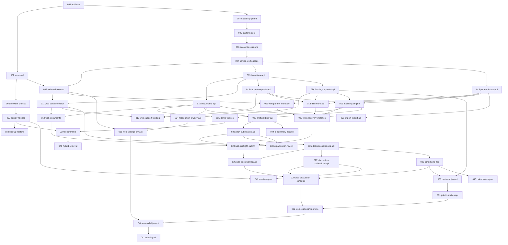

# TemuRiset roadmap

The base app (001, 002) ships navigation for both personas, the design system, the API contract and "Segera hadir" for everything else. This roadmap turns each planned feature into one small pull request with a written spec and plan, so work continues one PR at a time.

Authority: the constitution, then [`architecture.md`](architecture.md) for binding decisions, then the PRD for behaviour (links in [`docs/product/`](../product/README.md)).

## Pick up the next PR

1. Choose the lowest-numbered spec whose **Depends on** specs are merged. Read its `spec.md` and `plan.md`, then `architecture.md`.
2. Create the branch with the folder's exact name, for example `git checkout -b 009-inventions-api`. Spec Kit commands depend on that shape.
3. Run `speckit-tasks` to generate `tasks.md` against the code as it stands now. The plan's task outline is the input, not a substitute.
4. Run `speckit-implement`, test first. Port the prototype oracles the plan names before writing the code they check.
5. Flip what the spec's **Flips** line names, and nothing more.
6. Update the spec's **Status** line, run `make check` from the project folder, then `pr-generate-description`.

Never run `speckit-specify` on a seeded spec. `setup-plan.sh` keeps an existing `plan.md`, so `speckit-plan` is safe, but it is rarely needed. When a spec turns out wrong, change the spec in the same PR and say why in the description.

## Milestones

| Milestone | Specs | Outcome | Release |
|---|---|---|---|
| M0 Foundations | 001–005 | Base app, browser checks, capability guard, idempotency, audit, outbox and worker | R1 |
| M1 Identity and access | 006–008 | Email sign-in, personal and organization contexts, invitations, isolation tests | R1 |
| M2 Portfolio and evidence | 009–012 | Versioned inventions, private documents with grants, four-step editor | R1 |
| M3 Needs and funding | 013–015 | Project support budgets and one company raise linked to several inventions | R1 |
| M4 Partner intake | 016–017 | Partner profiles, versioned opportunities with typed requirements | R1 |
| M5 Discovery and matching | 018–021 | Search, explainable matching, golden fixtures F01–F06, labelled demo data | R1 |
| M6 Pitch submission | 022–024 | Preflight, template brief, idempotent submission, journey J01 to submitted | R1 |
| M7 Review and revisions | 025–026 | Decisions, itemized revision rounds, journey J03 | R1 |
| M8 Discussion and scheduling | 027–029 | Shared room, tasks, notifications, race-safe booking, journey J04 | R1 |
| M9 Relationships | 030–032 | Same-version confirmation, consent intersection, public profiles, journey J05 | R1 |
| M10 Governance | 033–035 | Optional organization review, moderation, privacy requests | R1 |
| M11 Portability and operations | 036–041 | Import and export, deployment, restore drills, benchmarks, accessibility audit, usability kit | R1 → R2 |
| M12 Gated adapters | 042–045 | Email, calendar, AI summary and hybrid retrieval, each behind its entry condition | R2 / L |

R1 is complete when the five journeys work with permissioned or visibly synthetic data, every R1 acceptance scenario has recorded evidence, the three compositions pass, and restore and migration are exercised (PRD section 24). A milestone outcome is never claimed from a front-end simulation.

## Dependency graph



Specs that share no dependency can run in parallel: after 007, the portfolio line (009–012), partner intake (016–017) and the browser checks (003) proceed independently; after 019, demo fixtures (021) and preflight (022) do too.

## Journeys

The five journeys from the application handoff become end-to-end Playwright tests, each owned by the spec that completes it.

| Journey | Owner | Earlier specs build its parts |
|---|---|---|
| J01 independent inventor to a submitted project pitch | 024 | 009–013, 016, 019–022 |
| J02 one company raise linked to two inventions | 024 | 014, 015, 019, 020 |
| J03 revision, answers, resubmission and approval | 026 | 025 |
| J04 slot alternatives, conflict and replacement | 029 | 028 |
| J05 correction and same-version confirmation with consent | 032 | 030, 031 |

## Spec format

Each `specs/NNN-name/` holds `spec.md` (what and why, in the Spec Kit template) and `plan.md` (how: contracts, tables, files, tests, task outline). The header of `spec.md` carries:

| Field | Meaning |
|---|---|
| **Status** | `Built, awaiting review`, `Seeded, not started`, `In progress`, `Merged` |
| **Depends on** | Specs that must be merged first |
| **Size** | S up to a day, M up to three days, L up to a week; split anything larger |
| **Covers** | PRD and handoff IDs this spec delivers or carries evidence for: FR, AC, UX, S, J |
| **Flips** | Manifest capability, adapter or web registry entries this PR may change |

`traceability.md` is generated from the **Covers** lines:

```bash
python3 docs/roadmap/check_traceability.py          # fails if any requirement has no home
python3 docs/roadmap/check_traceability.py --write  # rewrites traceability.md
```

## What is proven today

Base and M0: API unit and integration tests against Postgres, web lint, types, unit, page and axe tests in jsdom, a production build, and Chromium checks of every base route at 320, 360, 768 and 1280 px (overflow, 200% text, axe with contrast, keyboard focus) in CI. M0 adds the capability guard and startup configuration checks, and the platform core: idempotency with one effect under 20 parallel retries, operation status, append-only audit, a transactional outbox and a worker with retries and backoff, all proven against Postgres with test-only routes. No feature, account, document, match, pitch, meeting or relationship exists. All 72 acceptance scenarios remain **NOT RUN**, as PRD section 23 requires.
