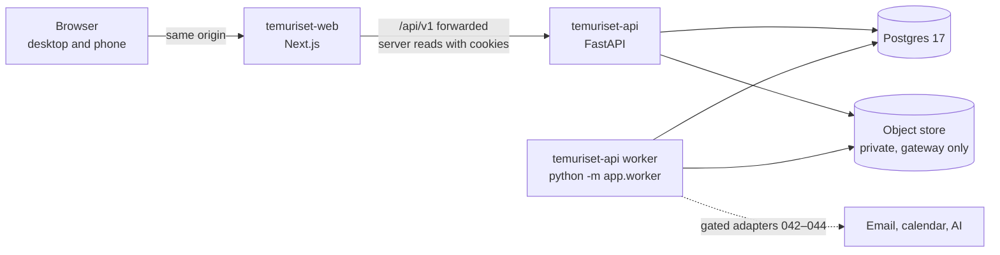

# TemuRiset architecture decisions

Binding for every spec in `specs/`. The PRD says what the product does. This file says how it is built. When a spec and this file disagree, this file wins until it is changed in a PR. The constitution wins over both.

## System shape

One modular monolith API, one background worker from the same codebase, one web client, one Postgres database, one private object store.

The API is the one authority for rules, matching, permissions, money semantics, scheduling and consent. The web client never re-implements a rule. There is no microservice, message broker or cache until a benchmark in 039 fails.

## API modules

Each is a feature module under `applications/temuriset-api/app/` following rule 005. A module imports another module's service interface, never its repository. Cross-module writes in one request share the request's transaction.

| Module | Owns | First spec |
|---|---|---|
| `capabilities` | Manifest, compositions, capability guard, configuration validation | 001, 004 |
| `platform` | Clock, money and version types, pagination, idempotency records, operations, audit events, outbox, jobs, worker loop | 005 |
| `identity` | Accounts, email verification codes, sessions, mailbox adapter | 006 |
| `access` | Parties, workspaces, organizations, memberships, capabilities per member, invitations, acting context, authorization policy | 007 |
| `portfolio` | Inventions, versions, facts, contributions, rights and authority claims, public projection | 009 |
| `documents` | Upload intents, document versions, storage adapter, scanner adapter, extraction state, grants, download gateway | 010 |
| `needs` | Support requests, project budgets and lines | 013 |
| `funding` | Funding requests, legal entities, invention links | 014 |
| `intake` | Partner profiles, opportunities and versions, typed requirements | 016 |
| `discovery` | Search projection, filters, saved items, relevance feedback | 018 |
| `matching` | Requirement evaluation, financial compatibility, fit bounds, match runs | 019 |
| `demo` | Labelled demo accounts, fixtures F01–F06, reset | 021 |
| `briefs` | Preflight tokens, template brief, summarizer port, brief export | 022 |
| `pitches` | Pitches, submissions, decisions, revision rounds, answers, withdrawal | 023, 025 |
| `discussion` | Messages, tasks, notifications, whose-turn projection | 027 |
| `scheduling` | Proposals, slots, meetings, bookings, outcomes, ICS | 028 |
| `relationships` | Partnerships, versions, confirmations, restrictions, public projection | 030, 031 |
| `review` | Organization review checklists, queue, decisions | 033 |
| `moderation` | Reports, operator actions, suspension, privacy requests | 034 |
| `portability` | JSON import preview and apply, exports | 036 |

## Data model

Created by the spec named. Every table has `id` (UUID), `created_at` and, when mutable, `updated_at` and `version INT NOT NULL DEFAULT 1`. Money columns are `NUMERIC(20,4)` beside a `CHAR(3)` currency. Times are `timestamptz` in UTC.

| Table | Key columns and constraints | Spec |
|---|---|---|
| `idempotency_records` | `actor_party_id`, `operation`, `key`, `request_sha256`, `status` (`pending`, `committed`), `response_status`, `response_body` JSONB, `operation_id`, `expires_at`; unique (`actor_party_id`, `operation`, `key`) | 005 |
| `audit_events` | `actor_account_id`, `actor_party_id`, `action`, `subject_type`, `subject_id`, `detail` JSONB; append-only | 005 |
| `outbox_events` | `topic`, `payload` JSONB, `available_at`, `attempts`, `dispatched_at`, `last_error_code` | 005 |
| `outbox_deliveries` | `event_id`, `consumer`; unique pair, so consumers are idempotent | 005 |
| `jobs` | `kind`, `status` (`PENDING`, `RUNNING`, `SUCCEEDED`, `FAILED`, `CANCELLED`, `NEEDS_MANUAL_INPUT`), `actor_party_id`, `input`, `result_ref`, `attempts`, `run_after` | 005 |
| `accounts` | `email` (stored trimmed and lower-case, unique; no `citext` extension needed), `email_verified_at`, `display_name`, `locale`, `time_zone`, `persona` (`inovator`, `mitra`), `kind` (`user`, `demo`), `status` | 006 |
| `email_codes` | `account_id` or `email`, `code_sha256`, `purpose`, `expires_at`, `attempts`, `consumed_at` | 006 |
| `sessions` | `account_id`, `token_sha256` (unique), `active_party_id`, `expires_at`, `revoked_at`, `last_seen_at` | 006 |
| `mailbox_messages` | Development and test mailbox only: `to_email`, `subject`, `body`, `created_at` | 006 |
| `parties` | `kind` (`personal`, `organization`), `display_name`, `account_id` (personal only, unique), `organization_id` (organization only); exactly one of the two | 007 |
| `organizations` | `name`, `kind` (`company`, `nonprofit`, `community`, `research_group`, `other`) | 007 |
| `memberships` | `organization_id`, `account_id`, `capabilities` TEXT[], `status`, `revoked_at`; unique active pair | 007 |
| `invitations` | `organization_id`, `email`, `capabilities`, `token_sha256`, `expires_at`, `revoked_at`, `accepted_at` | 007 |
| `inventions` | `managing_party_id`, `status` (`DRAFT`, `PENDING_REVIEW`, `PUBLISHED`, `ARCHIVED`), `published_version_id`, `draft_version_id` | 009 |
| `invention_versions` | `invention_id`, `number`, `state` (`draft`, `published`, `superseded`), `title`, `summary`, `problem`, `solution`, `intended_users`, `sector`, `stage`, `keywords`; unique (`invention_id`, `number`) | 009 |
| `invention_facts` | `version_id`, `label`, `value`, `unit`, `timing` (`CURRENT`, `PLANNED`, `REQUESTED`), `provenance` (`SOURCE_REPORTED`, `SELF_DECLARED`, `PROVIDED`, `REVIEWED`, `UNKNOWN`), `key`, `document_version_id` | 009 |
| `invention_claims` | `version_id`, `kind` (`creator`, `contributor`, `manager`, `rights_holder`, `authority`), `subject_name`, `party_id`, `scope`, `status` (`asserted`, `not_established`, `reviewed`), `source`, `asserted_at` | 009 |
| `documents` | `owner_party_id`, `kind`, `title` | 010 |
| `document_versions` | `document_id`, `number`, `storage_key`, `sha256`, `media_type`, `size_bytes`, `file_state` (`CREATED`, `UPLOADING`, `QUARANTINED`, `AVAILABLE`, `REJECTED`), `extraction_state`, `review_state`, `reviewed_by`, `review_scope` | 010 |
| `document_grants` | `document_version_id`, `grantee_party_id`, `purpose`, `pitch_id`, `expires_at`, `revoked_at`; one active grant per version and grantee and purpose | 010 |
| `download_events` | `grant_id`, `actor_party_id`, `range`, `at`; evidence that copies left the gateway | 010 |
| `support_requests` | `invention_id`, `owner_party_id`, `outcome`, `support_forms` TEXT[], `relationship_form` (`PROJECT`, `LICENSE`), `scope`, `months`, `region`, `accepts_partial`, `accepts_noncash`, `noncash_description`, `status`, `invention_version_id` | 013 |
| `project_budgets` | `support_request_id`, `version`, `min_amount`, `max_amount`, `currency`, `period`, `scope`, `estimated_on`, `assumptions`; `CHECK (min_amount >= 0)`, `CHECK (max_amount >= min_amount)` | 013 |
| `project_budget_lines` | `budget_id`, `label`, `quantity`, `unit_cost`, `explanation` | 013 |
| `legal_entities` | `name`, `jurisdiction`, `registration_ref`, `review_status` (`declared`, `reviewed`) | 014 |
| `funding_requests` | `owner_party_id`, `subject_type` (`EXISTING_ENTITY`, `PROPOSED_ENTITY`), `legal_entity_id`, `financing_stage`, `financing_form`, `target_amount`, `currency`, `desired_min`, `desired_max`, `accepts_partial`, `intended_use`, `timing`, `status`; `legal_entity_id` required for `EXISTING_ENTITY` | 014 |
| `funding_invention_links` | `funding_request_id`, `invention_version_id`; unique pair | 014 |
| `partner_profiles` | `party_id` (unique), `subtype`, `thesis`, `sectors`, `stages`, `regions`, `support_forms`, `relationship_forms`, `review_expectations`, `check_min`, `check_max`, `currency`, `range_subject`, `range_basis`, `range_period`, `range_months`, `unknown_reason`, `intake_status` (`OPEN`, `CLOSED`, `UNCONFIRMED`), `intake_from`, `intake_until`, `source` (`OWNER_CONFIRMED`, `SOURCE_REPORTED`), `contact_route` (`IN_APP`, `EXTERNAL`, `NONE`), `external_url`, `general_intake_version_id` | 016 |
| `opportunities` | `partner_party_id`, `kind` (`SPECIFIC`, `GENERAL_INTAKE`), `status` (`DRAFT`, `ACTIVE`, `PAUSED`, `CLOSED`, `EXPIRED`), `current_version_id`, `closes_at`; at most one open `GENERAL_INTAKE` per partner | 016 |
| `opportunity_versions` | `opportunity_id`, `number`, `title`, `outcome`, `included`, `excluded`, `support`, `accepted_stages`, `relationship_forms`, `sectors`, `keywords`, `financial` JSONB (`subject`, `basis`, `min`, `max`, `currency`, `period`, `months`, `scope`, `noncash`, `terms`, `unknown_reason`), `timing` | 016 |
| `requirements` | `opportunity_version_id`, `position`, `label`, `field`, `operator` (`equals`, `in_set`, `intersects`, `minimum`, `maximum`, `range_overlap`, `exists`, `manual_review`), `value` JSONB, `mandatory`, `applies_at` (`SUBMISSION`, `DISCUSSION`, `PILOT`, `COMMERCIALIZATION`), `verification_mode` (`DECLARATION`, `DOCUMENT_PRESENT`, `REVIEWER_CONFIRMED`), `visibility` (`PUBLIC`, `PARTNER_ONLY`), `reason`; `CHECK (NOT mandatory OR visibility = 'PUBLIC')` | 016 |
| `external_handoffs` | `partner_party_id`, `actor_party_id`, `external_url`; append-only, and never a pitch | 016 |
| `search_documents` | `subject_type` (`INVENTION`, `FUNDING_REQUEST`, `PARTNER`), `subject_id`, `version_id`, `owner_party_id`, `title`, `body`, `tsv` (generated `tsvector`), `filters` JSONB, `card` JSONB, `published_at`, `curated`; GIN on `tsv`, trigram GIN on `title`; unique (`subject_type`, `subject_id`) | 018 |
| `alias_terms` | `term`, `canonical`; English words and the Indonesian words they also match, seeded by migration 0009 | 018 |
| `saved_items`, `relevance_feedback` | `party_id`, `subject_type`, `subject_id`; unique | 018 |
| `match_runs` | `actor_party_id`, `source_type`, `source_id`, `source_version`, `source_title`, `engine`, `policy_versions`, `inputs` JSONB, `created_at` | 019 |
| `match_results` | `run_id`, `position`, `shown`, `opportunity_version_id`, `eligibility`, `readiness`, `relevant`, `fit_lower`, `fit_upper`, `coverage`, `result` JSONB (rows, reasons, gap, later work, evidence) | 019 |
| `preflights` | `actor_party_id`, `actor_account_id`, `token_sha256`, `source_type`, `source_id`, `source_version`, `invention_version_ids` JSONB, `opportunity_id`, `opportunity_version_id`, `recipient_party_id`, `configuration_ref`, `permission_generation`, `result` JSONB, `shareable_files` JSONB, `expires_at` | 022 |
| `briefs` | `preflight_id`, `owner_party_id`, `summarizer`, `text`, `sentences` JSONB (text and references per sentence) | 022 |
| `pitches` | `requester_party_id`, `recipient_party_id`, `opportunity_id`, `opportunity_version_id`, `opportunity_title`, `subject_type` (`SUPPORT_REQUEST`, `FUNDING_REQUEST`), `subject_id`, `subject_title`, `purpose` (empty when none), `status`, `active` BOOLEAN; partial unique (`subject_type`, `subject_id`, `recipient_party_id`, `opportunity_id`, `purpose`) WHERE `active` | 023 |
| `pitch_submissions` | `pitch_id`, `number`, `preflight_id` (the preflight pins the versions; empty for a resubmission), `snapshot` JSONB (source, invention versions with the facts shown, opportunity version, requirement rows), `brief`, `submitted_by_account_id`, `created_at` | 023 |
| `pitch_submission_files` | `submission_id`, `document_id`, `document_version_id`, `version`, `title`, `grant_id` | 023 |
| `pitch_decisions` | `pitch_id`, `submission_number`, `pitch_version`, `decision` (`APPROVE`, `REJECT`), `reason` (shared with the requester only), `decided_by_party_id`, `decided_by_account_id` | 025 |
| `revision_rounds`, `revision_items` | Round `number` and `submission_number`; item `position`, `category`, `question`, `reason`, `required`, `due_date`, `expected_evidence`, `review` (`ACCEPTED`, `NEEDS_DETAIL`), `review_note`, `version` | 025 |
| `revision_answers` | One per item: `response` (`CAN`, `DISCUSS`, `CANNOT`), `text`, `files` JSONB (document, version, title), `version`, `saved_by_account_id` | 025 |
| `messages`, `tasks`, `notifications` | Pitch-scoped messages (text never logged); tasks with owner party, `due_date`, `reference`, `status` (`OPEN`, `DONE`), `version`; per-party notifications with `event_key`, `channel`, `text`, `tab`, `read_at`, unique (`event_key`, `party_id`, `channel`) | 027 |
| `schedule_proposals`, `schedule_slots` | `pitch_id`, `proposed_by`, `minutes` (30, 60), `time_zone`, `agenda`, `link`, `state` (`OPEN`, `ACCEPTED`, `SUPERSEDED`, `EXPIRED`, `CANCELLED`), `expired_reason`, `replaces_meeting_id`; slots with `starts_at` | 028 |
| `meetings`, `meeting_outcomes` | `pitch_id`, `starts_at`, `ends_at`, `state` (`CONFIRMED`, `COMPLETED`, `CANCELLED`, `NO_SHOW_REPORTED`); outcome per party | 028 |
| `bookings` | `party_id`, `meeting_id` (empty for another agenda), `title`, `during` `tstzrange` half-open; `EXCLUDE USING gist (party_id WITH =, during WITH &&)` with `btree_gist` | 028 |
| `partnerships` | `pitch_id`, `type` (`PROJECT`, `LICENSE`, `EQUITY`), `legal_entity_id`, `contested` | 030 |
| `partnership_versions` | `partnership_id`, `number`, `values` JSONB, `ceiling` TEXT[], `status` (`PENDING_COUNTERPARTY`, `CONFIRMED`, `CHANGES_REQUESTED`, `DECLINED`), `proposed_by`, `checksum` | 030 |
| `partnership_confirmations` | `version_id`, `party_id`, `subset` TEXT[], `confirmed_by`; unique (`version_id`, `party_id`) | 030 |
| `partnership_restrictions` | `partnership_id`, `field`, `party_id`, `at`; append-only | 030 |
| `review_checklists`, `review_items` | Versioned checklist; queued exact version, state, reviewer, reason | 033 |
| `reports`, `operator_actions`, `privacy_requests` | Private case, scoped actions, request state and retained categories | 034 |
| `import_runs`, `external_references` | Preview and apply; unique (`managing_party_id`, `external_system`, `external_id`) | 036 |

## Binding decisions

### Web and API boundary

Browsers only ever call the web origin. `next.config.ts` forwards `/api/v1/*` and `/health/*` to `API_URL`, so session cookies are first-party and the API needs no CORS. Server Components read with `src/api/server.ts`, which forwards the incoming `cookie` header to `API_URL`. Mutations run in client components through the same-origin proxy with the typed client. No Server Action calls the API, so one path carries idempotency keys, expected versions and failure parsing. Rewrites are fixed at build time; 037 decides how a deployed web app reaches the API.

### Identity and sessions

Sign-in is an emailed six-digit code, valid 10 minutes, five attempts, with per-email and per-address rate limits. There are no passwords to store. A session is an opaque 32-byte token, stored as SHA-256, sent in the `tr_session` cookie (`HttpOnly`, `Secure` outside development, `SameSite=Lax`, 30 days sliding). Every unsafe method also needs an `Origin` that matches the configured web origin. Until 042 the mailbox adapter writes to `mailbox_messages` and is readable only when `ENVIRONMENT=development` or in tests. Demo accounts (`kind = demo`) exist only in the demo composition from 021 and are excluded from every metric.

### Acting context

Every request resolves an account, the session's `active_party_id` and that party's capabilities, after checking membership again. `PUT /api/v1/me/context` changes the active party. Consequential mutations also send `acting_party_id` in the body; a mismatch with the session returns `STALE_CONTEXT`, so two tabs in different contexts cannot cross over. A personal party exists for every account from sign-up, so no one needs an organization.

### Authorization

Deny by default, in one policy module, `app/access/service/policy.py`. A route asks `policy.require(principal, action, resource)`. When the actor may not know a resource exists, the answer is `NOT_FOUND`. When the resource is visible but the action is not allowed, the answer is `FORBIDDEN` (AC04). Every data PR adds its routes to the two-party isolation test started in 007. Search, exports, job results, previews and downloads go through the same policy.

### Versions and concurrency

Every mutable aggregate has `version`. Mutations send `expected_version`; a mismatch returns `STALE_VERSION` with the current version and never overwrites. A published invention is immutable: an edit creates a draft successor. Support requests, funding requests and opportunities have no draft successor: a save on a live one creates the next version, current at once, and earlier versions stay frozen. Submissions freeze references to exact versions plus a JSONB snapshot of the facts shown, so history never changes when a profile does (AC08).

### Idempotency and operations

Consequential POSTs require `Idempotency-Key`. The record stores a SHA-256 of actor, operation, path and canonical body. Same key, path and body replays the stored response with `Idempotent-Replayed: true`. Same key and a different path or body returns `IDEMPOTENCY_CONFLICT`, so a key reused on another resource is never answered with the first resource's response. Records live seven days (policy `idempotency-retention` v1). Every consequential response carries `operation_id`. `GET /api/v1/operations/{id}` reports `PENDING`, `COMMITTED` with a result reference, or `UNKNOWN`, and never reveals another actor's operation. A client that never received a response retries with the same key.

### Audit, outbox and the worker

A state change, its audit event and its outbox event commit in the same transaction. `python -m app.worker` polls `outbox_events` and `jobs` with `FOR UPDATE SKIP LOCKED`, runs registered consumers, and records each delivery in `outbox_deliveries`, so consumers are idempotent. A failed side effect retries with backoff and never repeats the decision that caused it. Time-based work (proposal expiry, opportunity expiry) runs as worker jobs, and every read also evaluates expiry lazily, so a late worker never shows a stale state.

### Money

Wire format is a decimal string matching `^\d{1,16}(\.\d{1,4})?$` through a string-only Pydantic type, because Pydantic `Decimal` also accepts JSON numbers. Storage is `NUMERIC(20,4)` with `CHAR(3)` currency. `null` means unknown and travels with a reason. Amounts are compared only with the same currency, subject, basis and period (PRD section 10). There is no conversion, valuation, percentage derived from an amount, or sum across unlike subjects. The web client formats strings with string operations and never parses them into floats.

### Time

Timestamps are UTC `timestamptz`; display uses the account's IANA zone. Scheduling stores instants and uses half-open `tstzrange` intervals, so 09:00–10:00 and 10:00–11:00 do not overlap. `app.core.clock.now()` is the only source of product time. A demo workspace may carry a virtual clock from 021; everything security-related uses the wall clock.

### Documents and downloads

Bytes never get a public URL. Uploads go through an upload intent with declared size and media type (PDF and DOCX up to 20 MB, images up to 5 MB), then the API validates signature and size and stores under a generated key. File state, extraction state and review state are separate columns and never overwrite each other. Downloads go through `GET /api/v1/documents/{id}/versions/{n}/content`, which re-authorizes every request, including range requests. Revocation blocks new requests only; the response and UI say that delivered copies cannot be recalled. Storage adapters are `local` (development volume) and `s3` (S3-compatible, 037). Scanner adapters are `clamav` and `development-accept`; configuration validation refuses `development-accept` outside development.

### Matching

`app/matching/engine/` is pure Python: no database, no I/O, deterministic. It receives authorized projections and returns rows, eligibility, readiness, relevance, fit bounds, coverage, reasons and gaps. Weights and thresholds come from the versioned policies in the capability manifest. A known failed mandatory requirement can never be averaged away, a target with no relevance signal abstains, and `UNKNOWN` outranks a score in the label. Golden responses for F01–F06 live in `contracts/golden/` from 019. The lexical baseline is Postgres full-text search with the `simple` configuration plus `pg_trgm`; dense retrieval waits for 045.

### Search projection

Discovery reads `search_documents` only. A row exists for a published invention version, an active funding request and an active opportunity or partner profile, and holds only fields the owner published. Private evidence never enters it. Projection updates are outbox consumers, so a revoke or archive removes the row in the same release of work.

### Discovery and matching (M5)

Rows of `search_documents` are written by one consumer, `discovery-projection`, on `invention.published`, `invention.archived`, `funding_request.changed`, `partner.changed` and `opportunity.changed`. It re-reads the subject through its module's service and writes or removes the row, so a late or retried event never revives what was withdrawn. Subject types are `INVENTION`, `FUNDING_REQUEST` (active raises, one row per raise) and `PARTNER` (a saved profile with its active opportunities folded in). A `card` JSONB column holds what a result card shows; `curated` is set only through `DiscoveryService.set_curated`. Sections are computed per page: curated items, items whose sectors meet the searcher's own stated sectors (partner profile or published inventions), then the rest by publication time. Saved items and "Kurang relevan" are naturally idempotent `PUT` and `DELETE` routes with no key. Funding results are empty without `company_funding`.

Matching reads only what the source's owner may see and what applicants may see of each target (`PARTNER_ONLY` rows are left out). A `document:<key>` requirement is met by a fact with that key on the linked invention version whose `document_version_id` points at a file the same party owns; `evidence_status` decides `PASS` per verification mode. `feature:<key>` reads fact timings, and a required `CURRENT` is never met by `PLANNED`. `authority` reads authority claims, `entity` is `IDENTIFIED` for an existing company and `PROPOSED` otherwise, and a support request never states an entity. A raise's relationship form is `EQUITY` only for `financing_form = equity`. Budgets compare only with a partner's range on the same currency, basis and months, and with the same scope when both state one; contributions compare only with an investor check. Fit features with no source today (`timing`; `support` and `geography` fixed at 1, as in the prototype) are recorded limitations. `match_runs.inputs` keeps the source projection and target version ids, so a run can be reproduced.

### Preflight and submission (M6)

`POST /pitches/preflight` writes a `preflights` row and returns its token once; only the SHA-256 is stored. It pins the source version, the invention versions, the opportunity's current version, the recipient, a `configuration_ref` (composition, engine and policy versions) and a `permission_generation` (a digest of the acting party and the member's capabilities). It expires after 30 minutes. Preflight needs no `Idempotency-Key`: it sends nothing, and repeating it gives a new token. Shareable files are the owner's own `AVAILABLE` document versions linked from facts of the pinned invention versions, each with its fact keys.

The template brief is a list of sentences, each with references (`invention_version`, `fact` with its `document_version_id`, `support_request`, `funding_request`, `opportunity`), stored as JSONB on `briefs` instead of a separate `brief_dependencies` table. Export rechecks today's access and replaces any sentence whose file is no longer the owner's or no longer available with a labelled redaction. The summarizer is a port, `off` by default; any output is used only when every number and most words of each sentence appear in the supplied sentences.

`POST /pitches` takes the token, the brief as edited and the chosen file versions. An unknown token, or another party's, is `NOT_FOUND`; an expired one or any changed pin is `PREFLIGHT_STALE` with a `reason`. It rechecks target availability (`TARGET_CLOSED` with a `reason`), the active pitch (`DUPLICATE_PITCH` with `pitch_id`), readiness and required files (`NOT_READY` with `requirement`), and the policy `pitch-rate-limit` v1 (five new pitches per party per 24 hours, `RATE_LIMITED`). The pitch, the frozen submission, the grants (made with `submit_pitch`, not `edit_portfolio`), the audit event and `pitch.submitted` commit together. The partial unique index `uq_pitches_active` makes a second active pitch impossible even under a race; the loser gets `DUPLICATE_PITCH`. Pitches start `SUBMITTED`; the organization-review gate (033) will hold them in `PENDING_WORKSPACE_REVIEW`.

### Decisions and revisions (M7)

`app/pitches/service/transitions.py` holds the PRD section 7 table as data: for each action the statuses it may start from, the status it leads to, and the sides that may take it. Every status change goes through `target()`, and a unit test walks every status and action pair. Recipient actions need `decide_pitch`, requester actions `submit_pitch`; the other side of the pitch gets `FORBIDDEN`, anyone else `NOT_FOUND`. Each consequential POST (`begin-review`, `decisions`, `revision-rounds`, `resubmit`, `withdraw`, `close`) takes `Idempotency-Key` and `expected_version`, locks the pitch row, and commits the status, version, audit and a `pitch.<action>` event together, so two decisions on one version commit once and the other gets `STALE_VERSION` (AC41). Decisions and revision requests also name the submission number; an older one is `STALE_VERSION`. Approval makes no funding, partnership or commitment record (AC40).

Revision answers are drafts with their own version, saved with `PUT` and no key, and visible to the recipient only once the round is resubmitted. Resubmission is refused with `REQUIRED_ANSWERS_MISSING` (with `items`) until every required item has an answer; "Belum dapat dipenuhi" is an answer, not approval (AC43). It freezes the source as it is now in a new submission, shares the chosen file versions plus the answers' attachments, and leaves earlier submissions and answers as they were (AC45). Answers never change invention facts (AC44). The recipient marks each answered item `ACCEPTED` or `NEEDS_DETAIL` once the pitch is back in review. Rejected, withdrawn and closed pitches leave the active-pitch index, so a new pitch to the same target is possible; the seven-day resubmission pause of PRD section 7 is not built. The organization review gate (033) does not exist yet, so a resubmission goes straight to `SUBMITTED`.

`PitchSummary.waiting_on_party_id` is whose turn it is (from the status until discussion tasks in 027), and `PitchResponse.allowed_actions` lists what the reader may do now, so screens never re-derive the table.

### Demo (M5)

Demo accounts are `accounts.kind = 'demo'` with `.invalid` addresses; they receive no code by email and sign in only from `POST /demo/sign-in`. The demo namespace is those accounts, their personal parties, and organizations whose every member is a demo account. Reset deletes that namespace in a fixed order (audit and outbox events stay as history) and seeds again through the domain services inside `seeded_ids("demo")`, which gives every content row an id derived from its table and creation order, so ids and versions repeat exactly. Idempotency records of demo parties are deleted too, so a replay never answers for the old state. `DEMO_MODE` outside development needs `DEMO_DEPLOYMENT=true`. The prototype's virtual clock is not built: no R1 rule yet reads a demo time.

### Discussion and whose turn (M8)

`app/discussion/service/next_action.py` is the prototype's `pitchTurn` on the server: from the pitch status and, once approved, the scheduling state (open proposal and who made it, a confirmed meeting and whether it started, who recorded an outcome, a completed meeting), it returns `who` (`you`, `other` or null), a title, a sentence, the room tab and an action key for each side. `GET /pitches/{id}/next-action`, `GET /me/queue` (Beranda, "Menunggu Anda" first) and `PitchSummary.waiting_on_party_id` all read it, so no screen derives turns. A completed meeting waits on no one until partnerships (030) exist. Messages and tasks need the side's capability (`submit_pitch` or `decide_pitch`) and an unended pitch; lists poll with `since`. In-app notifications are outbox consumers (`notifications.in_app`) on the pitch and scheduling topics; each inserts with `ON CONFLICT DO NOTHING` on (`event_key`, `party_id`, `channel`), where the key is the topic, the pitch and its version or the proposal or meeting, so a redelivery or a failing sibling consumer never adds a second one (AC46). Marking read is a naturally idempotent `PUT`.

### Scheduling

Proposals need `schedule` and an approved pitch. A new proposal supersedes any open one, which is how a counter works; with a confirmed meeting, a proposal must name it in `replaces_meeting_id`. Policy `proposal-expiry` v1: an open proposal expires at 72 hours of age (`AGE`) or when every slot has started (`ALL_PAST`), evaluated on every read and accept and persisted by the `scheduling.expire` job queued for that instant. `POST /dev/bookings` (development only) marks a party busy, as the prototype's "Agenda lain Peserta P" does. The ICS file is built from stored UTC instants; outside calendar availability is reported as `unknown` (AC68).

Accepting a slot inserts a booking for every required party inside the request's transaction; the `EXCLUDE` constraint makes overlap impossible even under a race, and the losing request gets `BOOKING_CONFLICT` with the proposal intact. A replacement deletes the old bookings and inserts the new ones in the same transaction. An elapsed meeting stays `CONFIRMED` until both parties record an outcome.

### Relationships

A partnership version is identified by a checksum of its values and ceiling. Confirmations bind to that version, so a correction starts a new version with no confirmations. Public fields are computed on read: the intersection of both parties' subsets within the ceiling, minus restrictions. Narrowing appends a restriction and takes effect on the next read. EQUITY needs an identified legal entity and dated optional percentage permission.

### Partner intake

Mandates are changed with `edit_portfolio`, the only edit capability 007 defines. In an organization that is both inventor and partner, an invention editor can also publish a mandate, so review this when a second edit capability is justified.

A profile has no draft state: others read it once it is saved. Others never reach a `DRAFT` opportunity or an earlier version, and read every other status of the current one. A save on an `ACTIVE` or `PAUSED` opportunity passes the same check as activation: a saved profile, every field a partner must state, and a reason on every mandatory requirement. `SOURCE_REPORTED` profiles are written only through `IntakeService.record_directory_profile`, so nobody can claim a source through the API. The first profile save sends a null `expected_version`, and the loser of two first saves gets `STALE_VERSION`.

A cash range always states subject, basis and period, and a `total_period` range also states `months`, because `directly_comparable` compares months and not period text. `per_investment` extends the project budget's bases for one investor's check, with the period `per investasi`.

A mandatory requirement is always `PUBLIC`, so no secret criterion can reject a pitch. A requirement with no operator is stored as a non-mandatory `narrative` `manual_review`.

`IntakeService.target_availability` is the one answer to whether a pitch may target an opportunity, and 019 and 023 call it. Checks run in order, and the first that fails gives the reason: not `ACTIVE` is `TARGET_NOT_ACTIVE`, an `EXTERNAL` route is `EXTERNAL_ROUTE`, a `NONE` route is `NO_NEW_APPROACHES`. A general intake also needs direct intake open: `CLOSED` is `DIRECT_INTAKE_CLOSED`, and `UNCONFIRMED` or a date outside `intake_from` and `intake_until` is `INTAKE_UNCONFIRMED`. A specific opportunity ignores direct intake (AC23). An external route blocks in-app pitching and offers the handoff instead.

### Capabilities and compositions

`company_funding` and `organization_review` are optional capabilities; AI summary, external email and external calendar join as adapters in 042–044. A disabled capability is refused at the service boundary by one dependency, `require_capability`, with `CAPABILITY_UNAVAILABLE` (HTTP 403, not retryable), wherever the request comes from. The manifest explains; it never grants. Startup refuses an unknown composition, a missing core, an unsupported combination, or a secret written into composition config (AC69). Funding mutations carry the guard; funding reads do not, so owners keep reading their records when the capability is off (AC67 overrides the wording of 014 FR-004).

### Web client

- Server Components render pages; client components hold forms, polling and dialogs.
- No client store of business data. Reads come from the server render; client refreshes use the typed client. TanStack Query is added only when 027 needs polling.
- `src/components/tr/` ports a design-system component when a feature first needs it, with the same name, props and class names as `window.TR`.
- Copy is Indonesian and inline until a second locale is required.
- Persona is a cookie in the base release and becomes the account's `persona` in 008.

## Recorded deviations from the design system

| ID | Deviation | Reason | Remove when |
|---|---|---|---|
| D1 | `.tr-choice:has(input:checked)` in `src/design/app.css` | TR.ChoiceGroup sets `.is-selected` from JavaScript; server-rendered forms need a CSS selector | The design system adds the selector |
| D2 | `.tr-tabbar__item` keeps whole words and drops side padding | At 320 px the design system split "Temukan" across lines | The design system fixes the tab bar |
| D3 | `Screen` takes real links instead of `onNavigate` | Next.js routing and prefetch | Never; documented port |
| D4 | `Screen` scrolls a focused control clear of the sticky tab bar | Chrome does not scroll a partly visible control, so a tall textarea took focus under the bar at 360 px (found by the 003 keyboard check) | The design system handles focus scrolling |
| D5 | `Checkbox.Group` is the named export `CheckboxGroup`, and `FundingRequestCard` takes linked inventions as nodes, not only titles | Static members do not survive a `'use client'` boundary; S07 links each invention so Back returns to the raise | Never; documented port |
| D6 | `RequirementRow` takes an optional `headingLevel` | S09 places rows directly under a section heading, so a fixed `h4` would skip a level | The design system adds the prop |
| D7 | `Link` runs `onClick` beside the navigation instead of preventing it | D3 chose real links; following an external route must both open the site and record the handoff | Never; documented port |
| D8 | `Tabs` is controlled (`value` and `onChange` required), and `ChoiceGroup` takes an optional `value` and `onChange` | S13 keeps the tab in the address (`?tab=`), and `RevisionItem` holds each answer in state so a failed save keeps it | Never; documented port |
| D9 | `ScheduleSlotList` takes `canConfirm`, an `accepted` state, and slots with an `end` | The proposer sees its own slots read-only, and slot ends come from the API rather than from the client's arithmetic | The design system adds the props |

## API conventions

| Topic | Rule |
|---|---|
| Base path | `/api/v1`; health stays at `/health/live` and `/health/ready` |
| Session | `tr_session` cookie; no bearer tokens for browsers |
| Acting party | Session `active_party_id`; body `acting_party_id` on consequential mutations |
| Time | RFC 3339 UTC instants; IANA zone names; half-open windows |
| Money | Decimal strings, currency codes, `null` plus reason for unknown |
| Lists | `limit` (max 100) and opaque `cursor` |
| Concurrency | `expected_version` in the body of every mutation of a versioned resource |
| Idempotency | `Idempotency-Key` header on consequential POSTs; `operation_id` in the response |
| Errors | The envelope in `app/core/errors`; new failures get a typed error, a code in `codes.py`, a row in `public.py`, and a row in `docs/error-handling/catalog.md` |
| Copy | User-facing messages are Indonesian and two clauses: what happened, what to do next |

New public codes expected along the roadmap: `UNAUTHENTICATED`, `FORBIDDEN`, `STALE_CONTEXT`, `STALE_VERSION`, `IDEMPOTENCY_CONFLICT`, `CAPABILITY_UNAVAILABLE`, `RATE_LIMITED`, `CODE_INVALID`, `CODE_EXPIRED`, `INVITATION_EXPIRED`, `FILE_TOO_LARGE`, `FILE_TYPE_UNSUPPORTED`, `FILE_NOT_AVAILABLE`, `GRANT_REVOKED`, `TARGET_CLOSED`, `PREFLIGHT_STALE`, `DUPLICATE_PITCH`, `NOT_READY`, `INVALID_TRANSITION`, `REQUIRED_ANSWERS_MISSING`, `BOOKING_CONFLICT`, `PROPOSAL_CLOSED`, `TOO_EARLY`, `ENTITY_REQUIRED`, `REVIEW_PENDING`.

## Definition of done for every PR

- `make check` passes in each changed application; the contract, generated types and design copies have no drift.
- Failure paths are tested, including a two-party isolation case for every new data route.
- Every new mutation of a versioned resource is tested for a stale version, and every consequential POST for replay and key conflict.
- The capability manifest or feature registry flips only for what actually shipped.
- `docs/error-handling/catalog.md` matches new codes.
- Web screens have loading, empty, failure and denied states, an axe test, and the copy in the application handoff.
- Verification names the runtime that was exercised. A jsdom test is never reported as a browser result.
- Nothing claims funding, ownership, legal effect, verification or security beyond what was built and tested.
