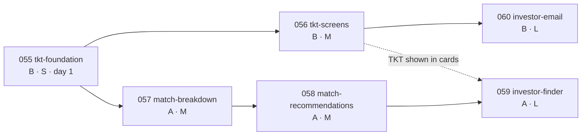

# Revamp 2: demo feedback (specs 055–060)

Status: planned 2026-11-28, nothing built. Authority as for every spec: the constitution, then [`architecture.md`](architecture.md), then the PRD v1.2 (FR03, FR09–FR11, FR25, FR26), then each spec.

This page is the entry point for people and AI agents. Read it fully before opening a spec.

## 1. Feedback from the demo and what we build

| # | Feedback | Decision | Spec |
|---|---|---|---|
| 1 | Inventions have no TKT (Tingkat Kesiapterapan Teknologi). Inventors should optionally state TKT per product, with documentation. Investors see it when given. Tooltips explain TKT and each level. | Optional TKT 1–9 on each invention version, with an optional evidence file and a short note. Self-declared, labelled as such. Shown as "TKT 6 · Prototipe" (the iHub UMS pattern). Investors may set an optional minimum TKT on a mandate. A shared, accessible Toggletip explains TKT and every level. | 055 (data), 056 (screens) |
| 2 | Inventors see that a product matches an investor, but not what to do to match better. | Every match result carries **improvement recommendations**: what is missing, why it matters to this investor, where to fix it (deep link) and what it would change ("could rise to Kecocokan potensial"). | 058 |
| 3 | The score should be detailed per aspect, for inventors and investors. | Every match result carries a **breakdown** of eight dimensions, each with a 0–100 score, a status and one sentence: Bidang, Topik dan detail produk, Tahap dan TKT, Dana, Bentuk kerja sama, Syarat wajib, Bukti, Ketersediaan. The headline range and label are unchanged in meaning. | 057 |
| 4 | Investor emails (subscriptions without an account) should be more appealing. | Multipart email (HTML plus the existing plain text) with a researched layout: preheader, one-column cards, one call to action per invention, reasons as chips, one-click unsubscribe headers. Applies to subscription and follow emails. | 060 |
| 5 | In "Temukan Investor/Mitra" an inventor cannot see how each own product matches the chosen investor. | The page is rebuilt around a product selector and a **product × mandate** matrix: choose an investor and see every one of your products scored against each of that investor's mandates, with breakdown and recommendations; or choose a product and see investors ranked for it. | 059 |

## 2. Split for two people working in parallel

Two tracks touch different folders, so they rarely collide. Track B lays a one-day foundation (055) that both tracks build on.

| Track | Suggested owner | Specs, in order | Main folders |
|---|---|---|---|
| **A: Matching** | Product owner (knows the demo story) | 057 → 058 → 059 | `app/matching/`, `app/briefs/` (read only), `src/views/discovery/`, `src/features/discovery/`, `src/app/discover/`, `src/app/matches/` |
| **B: Data, TKT and email** | Teammate | 055 → 056 → 060 | `app/portfolio/`, `app/intake/` (min TKT only), `app/subscriptions/service/mail*`, `app/identity/service/mailbox_service.py`, `src/views/portfolio/`, `src/features/portfolio/`, design system |

### Suggested calendar (working days)

| Day | Track A | Track B |
|---|---|---|
| 1 | 057 engine work in `app/matching/engine/` only (pure functions and unit tests; TKT read as unknown until 055 lands) | **055**: migration 0026, schemas, contract, Toggletip, split dictionary. Merge the same day. |
| 2–3 | 057 API and screens, then **058** | **056** TKT editor step, badges, tooltips, mandate minimum TKT, demo seed |
| 4–6 | **059** finder revamp | **060** investor email |
| 7 | Both: rebase, demo script, `make check`, `make e2e`, browser check in ID and EN at 320 and 1280 px | Both |

If 055 slips, Track A continues on the engine with `tkt=None` everywhere; nothing in 057 waits on the database.

## 3. Rules that keep two branches mergeable

1. **Two migrations, in order.** 055 owns `0026_tkt_readiness`; 060 owns the next free number (`0027_mailbox_html` today) and renumbers after rebasing if `main` moved. No other spec in this revamp changes the schema.
2. **Generated files are never hand-merged.** After every rebase run `make -C applications/temuriset-api openapi` and `make -C applications/temuriset-web generate-api`, and commit the result.
3. **The English dictionary is split per area by 055**: `src/features/i18n/app-en/{core,tkt,matching,finder,mail}.ts`, merged in `app-en.ts`. Track A edits only `matching.ts` and `finder.ts`; Track B edits only `tkt.ts` and `mail.ts`. Existing entries stay in `core.ts`.
4. **Shared components are owned by one spec.** `Toggletip` belongs to 055; others use it and never change it. `MatchCard` and everything under `views/discovery/` belongs to Track A; the editor, invention views and mandate form belong to Track B.
5. **Deep-link contract.** Track A links into Track B screens only through these addresses (added by 055 as stable element ids, tested by 056):

   | Target | Address |
   |---|---|
   | TKT level and evidence | `/inventions/{id}/edit?step=2#tkt` |
   | Facts | `/inventions/{id}/edit?step=2#fakta` |
   | Evidence documents | `/inventions/{id}/edit?step=2#dokumen` |
   | Keywords | `/inventions/{id}/edit?step=1#kata-kunci` |
   | Sector | `/inventions/{id}/edit?step=1#sektor` |
   | Stage | `/inventions/{id}/edit?step=1#tahap` |
   | Need's cost range | `/support-requests/{id}#kisaran` |
   | Need's form of partnership | `/support-requests/{id}#bentuk` |
   | New need for an invention | `/support-requests?invention={id}#baru` |

6. **Isolation harness.** Every new data route is registered in `tests/integration/test_isolation.py` in the same PR.
7. **Demo data.** Only 056 changes `app/demo/service/scenario.py` (adds TKT values). Track A adapts `tests/integration/demo/test_scenario.py` labels when rebasing onto it.
8. **One PR per spec**, branch named after the folder (`f/057-match-breakdown`), opened against `main`. Rebase before merging; never merge `main` into a branch with conflicts in generated files.

## 4. How an AI agent picks up a spec

Give the agent this prompt, with the number filled in:

> Implement `specs/0NN-<name>` in `applications/generic/temuriset`. Read `docs/roadmap/revamp-2-demo-feedback.md`, then the spec's `spec.md` and `plan.md`, then `docs/roadmap/architecture.md` and `AGENTS.md`. Follow the plan's task list in order, test first. Keep to the files the plan names; if you must touch another track's files, stop and say so. Run the plan's "Done when" commands and report their real output.

Every `plan.md` in 055–060 ends with:

- **Files**: exact paths to create or change.
- **Contracts**: request and response shapes, with field names.
- **Tasks**: numbered, each small enough for one commit, tests named.
- **Done when**: commands to run and what must be true.
- **Do not**: the traps found while planning.

## 5. Definition of done (every spec)

- Unit and integration tests from the plan pass; `DEMO_MODE=false make check` in the API, `make check` in the web.
- New routes in the isolation harness; OpenAPI and web types regenerated.
- Every new string has Indonesian source text and an English entry; the dictionary guard test passes.
- Browser check of the changed screens in Indonesian and English at 320 and 1280 px: no horizontal overflow, no console errors, axe clean (`make e2e` for journeys the spec names).
- `spec.md` **Status** set to `Built, awaiting review`; traceability rewritten; PR opened with the checks run and their results.

## 6. Research behind the decisions

- **TKT**: Indonesia's technology readiness scale, nine levels set by Permenristekdikti No. 42 Tahun 2016 (Berita Negara 2016 No. 1010) with field-specific indicators. Levels 1–3 are basic research, 4–6 applied research, 7–9 development. The UMS Innovation Hub catalogue (ihub.ums.ac.id/katalog) filters by TKT and shows each product as "TKT 6 · PROTOTIPE" beside field and sector; 056 follows that pattern.
- **Investor email**: current guidance favours a simple single-column HTML message with a full plain-text alternative, short scannable blocks and one clear action. Gmail and Yahoo bulk-sender rules expect `List-Unsubscribe` with `List-Unsubscribe-Post: List-Unsubscribe=One-Click` (RFC 8058). 060 applies these within the existing mailbox port.
