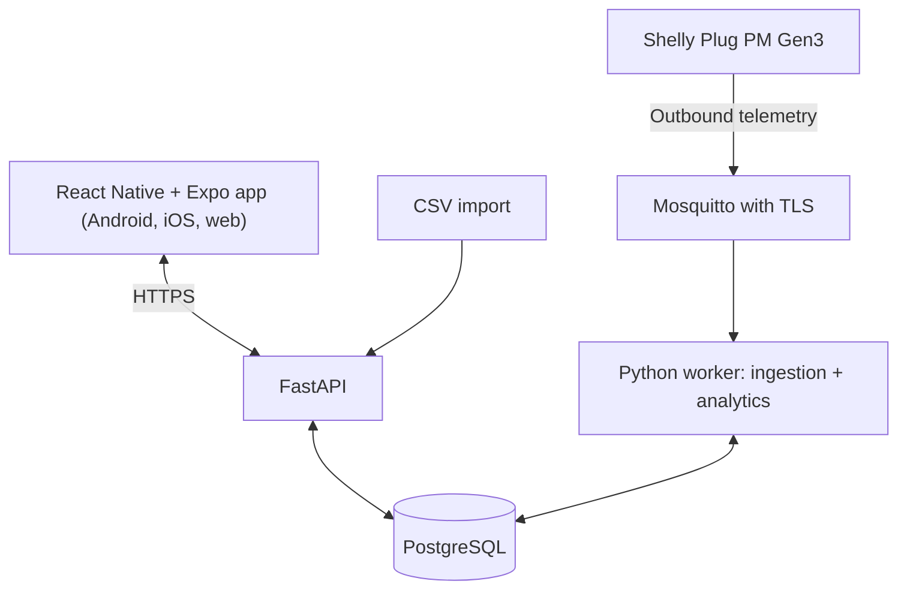

# HematDaya — Product Requirements Document
## Version 1.0: energy monitoring and evidence-based advice for Indonesian small and medium manufacturers (IKM)

Date: October 18, 2026 (Asia/Jakarta). Document language: English. Product interface: Indonesian.
Status: development specification. Usability and field targets are proposed hypotheses. Live hardware integrations are unverified. The runnable prototype uses synthetic data.
Derived from: `01_PRD_HematRumah_Mobile_v3_EN.md` (v3.0, household edition), the HematDaya proposal (ANGEL Innovation Hackathon 2026, Topic 6) and the runnable prototype `applications/angel-2026-hematdaya/hematdaya.html`.

## 0. What changed from HematRumah v3

| Area | HematRumah v3 | HematDaya v1.0 |
|---|---|---|
| Target users | Households, apartments, boarding rooms | Owners and managers of IKM manufacturers; trade-association/district industry offices as a secondary audience |
| Challenge | None (internal idea) | ANGEL Innovation Hackathon 2026, Track Sustainable Energy, Topic 6 *Industrial Energy Efficiency Copilot* (Problem Owner: PT Indmira Global Energi) |
| Platforms | React Native + Expo, mobile only; browser was only a preview runtime | React Native + Expo + TypeScript for **Android, iOS and web from one codebase**; the prototype shows the mobile layout only |
| Appliances | TV, refrigerator, computer, AC | Production machines: air compressor, dryer/oven, press, utility/AC, other |
| Core calculations | Energy, estimated cost, comparison to prior periods | Same, plus **operating-hours split** and **energy intensity (IKE, kWh per production unit)** |
| Data entry | Meter enrollment (Shelly) | Meter enrollment **and CSV import of historical energy data** |
| AC control, arrival preparation, three-reminder remote-OFF (Tier B, FR-12–FR-14, AT-21–AT-24) | Optional module | **Removed.** HematDaya only monitors and advises. Listed under further enhancements |
| Field of strategic focus | Not applicable | Energy only (proposal checkbox) |
| AI/ML | Optional Ridge baseline | Unchanged and optional; not a claim of the product |

HematRumah v3 is kept unchanged as the historical source. Where this document and v3 disagree, this document wins.

## 1. Product contract and authority

HematDaya helps an IKM owner understand where electricity is used across production machines and receive useful, evidence-based explanations. It answers three questions: which machine contributes most, how much energy is used outside operating hours, and how much energy a production unit takes (IKE). A supported meter or a CSV of historical energy data alone must deliver the core value.

The product only monitors and advises. It has no machine control path.

Delivery target: React Native + Expo + TypeScript, one shared codebase for Android, iOS and web. The mobile layout is the primary design. The web layout reuses the same components in a wider arrangement for computers. The current prototype is a single HTML file that simulates the mobile layout. A full web build does not exist yet.

Authority order for conflicts: the user's latest explicit correction, then this document, then the proposal, then v3.

## 2. Problem, users and outcomes

### Problem

An owner of a small manufacturer sees one electricity number: the monthly bill. A rise cannot be told apart between higher production and waste. Energy-management obligations apply only to users of at least 4,000 TOE per year [2, 3]. In 2023 only 217 industrial entities reported energy management [4], against roughly 4.45 million IKM units [5]. An IEA survey found that only 15% of firms with fewer than 100 employees had audited energy in the previous five years [6]. (Numbers come from desk research cited in the proposal; field data will be collected with pilot IKM.)

### Users

- **Primary:** owners and managers of IKM manufacturers (food, textile, metal, plastic, wood) without an energy manager.
- **Secondary:** district industry offices that mentor IKM clusters (future aggregate views; not in this release).
- Users do not need to understand MQTT, watts, models or credentials.

### Outcomes

- Which machine is largest this period.
- How much energy was used outside operating hours and how that compares with earlier weeks.
- Energy per production unit (IKE) against the factory's own history.
- A plain-language explanation of each finding: what changed, compared with what, how complete the data is, and what remains unknown.

### Proposed success measures (targets, not results)

| Measure | Target |
|---|---|
| Data coverage in pilot IKM | ≥ 90% |
| Findings rated relevant by owners | ≥ 80% |
| Find the largest machine from a populated Beranda | ≤ 30 seconds for at least 4 of 5 testers |
| Usability | at least 4 of 5 first-time testers complete each core task unaided |
| Trust | correct units, visible freshness and coverage, no missing data shown as zero |

No savings percentage or field accuracy is claimed. Prototype numbers are synthetic.

## 3. Release boundary

### Tier A — required

- Accounts and an isolated demo mode.
- Several monitored machines per account.
- Supported-meter catalog and guided enrollment (Shelly Plug PM Gen3 first; TP-Link shown as "Segera hadir").
- **CSV import** of historical energy data.
- Energy and estimated cost per machine and period.
- Operating-hours settings and **off-hours energy**.
- **IKE** from the user's average production per working day.
- Baseline comparison with the median of earlier weeks over the same elapsed window.
- Evidence-based insights, optional feedback (useful, not relevant, snooze, hide), settings.
- Learning, empty, stale, partial-coverage, missing-tariff and import-error states.
- Hardware-free simulator, provenance labels and a deterministic demo dataset.

### Further enhancements — do not build now

Machine control and relays; physical mains cutoff; room or ambient sensors; PLN bill integration, peak-load (WBP) and reactive-power (kVArh) analysis; thermal energy (LPG, diesel, wood); optional ML models beyond the median baseline (for example Ridge regression); multi-factory and district aggregation; household use cases from HematRumah; separate native-only or web-only products; savings guarantees.

## 4. Domain model

| Concept | Meaning |
|---|---|
| Meter / channel | A measuring device or imported series; one channel per machine in the simple case |
| Machine (appliance) | A user-labelled load with a category |
| Reading | Timestamp, machine, energy in Wh for the interval (or average watts converted to Wh) |
| OperatingSchedule | Start hour, end hour, working days; used only to split energy |
| Production input | Average units produced per working day (optional) |
| Tariff | Rupiah per kWh entered by the user (optional; effective-dated in the server edition) |
| Insight | Observation plus evidence, uncertainty and optional advice |

Categories: air compressor, dryer/oven, press, utility/AC, other. The category is the user's classification, not proof of identity.

| Load profile | Appropriate baseline | Avoid |
|---|---|---|
| Continuous or idling (compressor, chiller) | Interval energy and off-hours energy | Claiming that continuous operation proves waste |
| Cycle (oven, press) | Energy per period, off-hours energy | Treating every low-power gap as OFF |
| Unknown / group | Conservative energy totals | Machine-specific diagnoses |

Schedules are optional. No model assumes occupancy or claims an exact waste amount from a meter alone.

## 5. Information architecture (mobile and web)

Three persistent tabs: **Beranda**, **Perangkat**, **Saran**. Settings (gear icon), Import, and Demo scenarios open as sheets. Detail screens use a stack.

| ID | Screen | Content and main action |
|---|---|---|
| S01 | Welcome / demo entry | Short value statement; start; "Coba demo" |
| S02 | Empty Beranda | Why data helps; "Impor data", "Pakai data contoh" |
| S03 | Beranda | Period (Hari ini / Minggu ini); estimated cost and kWh with scope text; stacked chart; top machines; one featured insight; IKE card |
| S04 | Perangkat | Machine cards with energy, share and cost; add or import |
| S05 | Add meter wizard | Brand → model → connection and first reading → name and category |
| S06 | Machine detail | Period summary, operating vs off-hours energy, coverage, history chart, related insights, measurement details |
| S07 | Saran | Insight list; learning banner; restore hidden |
| S08 | Insight detail | What changed, evidence table, unknown, general suggestion, feedback |
| S09 | Settings | Operating hours, working days, tariff, production per day; import, scenarios |
| S10 | Import | Paste or choose a CSV; sample format; analyze; errors |

Heading text: "Estimasi biaya mesin yang dipantau". Never "total tagihan" for plug-meter or imported data.

Web layout: same components and tabs; content width grows with the viewport; a persistent side navigation is optional. Do not add a fourth main tab.

## 6. UI/UX quality contract

| ID | Requirement | Verification |
|---|---|---|
| UX-01 | Three labelled tabs; selected state visible without colour alone | Navigate all tabs and return paths |
| UX-02 | One primary action per task screen | Check first use, import, detail, error screens |
| UX-03 | Ordinary Indonesian; explain terms (IKE, kWh) on demand | No MQTT, JSON or trace codes in task copy |
| UX-04 | At most 3 deliberate taps from populated Beranda to the largest-machine detail or the featured insight | Count taps |
| UX-05 | Back and retry preserve entered values | Go back, induce an import error, retry |
| UX-06 | Visible freshness, coverage, estimates and demo labels | Inspect normal, stale, partial, simulated |
| UX-07 | Accessible targets and contrast | ≥ 48-unit touch areas on mobile; text contrast ≥ 4.5:1 |
| UX-08 | Large text and screen readers | About 200% text scale; chart has a text summary |
| UX-09 | Responsive layout | 360, 390, 430 px mobile; 768 px tablet; 1280 and 1440 px web; no horizontal page scroll |
| UX-10 | Predictable feedback and recovery | Loading and pressed state; clear retry; no dead primary action |
| UX-11 | Optional setup stays optional | Tariff, production, schedule, weather and notifications can be skipped |
| UX-12 | Calm, non-judgmental advice | Explain evidence; no alarm colour for normal operation; no guilt for dismissing |
| UX-13 | Missing is not zero; synthetic is labelled | Dashed marker for gaps; "Demo · Data simulasi" chip |
| UX-14 | Web keyboard access | Tab order, visible focus, Escape closes sheets |

Language: IDR and Indonesian number and date formats; "Tidak ada data" differs from "0 kWh"; "Data belum diperbarui" differs from "mesin mati".

## 7. Core journeys

| ID | Journey | Required outcome |
|---|---|---|
| P01 | Start with the demo or import a CSV: Impor data → paste or choose file → Analisis data | Machines, period and totals appear; a bad file shows a clear Indonesian error and keeps the text |
| P02 | Beranda → switch Hari ini / Minggu ini → open the largest machine | Values reconcile (total equals the sum of machines); context kept |
| P03 | Saran → off-hours finding → evidence | Observed, comparison, difference in kWh (and rupiah with a tariff), coverage, and "Yang belum diketahui" |
| P04 | Settings → change operating hours, tariff, production | Beranda, detail and Saran update consistently; empty tariff hides rupiah; empty production hides IKE |
| P05 | Insight feedback: useful, not relevant, snooze, hide, restore | Persisted; hiding does not delete data |
| P06 | Recover from bad data: empty, stale, partial coverage, no tariff, malformed CSV | Honest banner or error; last known values kept with timestamp; no zero-filling |

## 8. Functional requirements

### FR-01 Accounts and demo
Register, log in, log out with short-lived access tokens and revocable refresh sessions; server ownership checks on every read and mutation; native secure storage for session secrets. Demo works with no hardware or credentials, is isolated from live data, and carries "Demo · Data simulasi". The prototype has no accounts yet.

### FR-02 Catalog
Provider → model → connection → machine. Shelly Plug PM Gen3 is enabled (monitoring). TP-Link opens a "Segera hadir" notice with no live binding. Catalog capabilities are potential; effective capabilities require a verified first reading.

### FR-03 Enrollment and binding
Expiring single-use enrollment with authenticated meter identity (a claimed device_id is not proof). A first valid reading is required before "Terhubung". Removing a binding keeps history. Retries do not create duplicates.

### FR-04 Telemetry and data quality
Configurable sampling (target about 60 seconds; hourly for imported data). Store power W, cumulative Wh, optional V and A, measured and received timestamps, origin (live, simulated, dataset_replay, import) and quality. Deduplicate delivery, handle counter resets and out-of-order data, preserve gaps. Never fill gaps with zero. UTC storage; display timezone Asia/Jakarta.

### FR-05 CSV import (implemented in the prototype)
- Accepted columns (case-insensitive): time = `timestamp`, `waktu`, `tanggal`, `datetime`, `time`; machine = `perangkat`, `mesin`, `device`, `nama`, `alat`; energy = `energi_wh`, `wh`, `energi`; average power = `daya_w`, `watt`, `daya`, `power_w`.
- Delimiter `,` or `;`. Time `YYYY-MM-DD HH:MM` (also `T`, optional seconds); interpreted as local time. Decimal comma accepted.
- `daya_w` is converted to Wh using the median positive gap between readings as the interval.
- Rows with an invalid time, missing machine name, non-numeric or negative value are skipped and counted. If more than 20% are invalid the import is rejected with an error.
- Duplicate machine and time pairs are dropped and counted. Machine names are limited to 60 characters. Limit: 150,000 rows.
- Errors are Indonesian and actionable (for example the expected header, or the time format). The pasted text is kept after an error.
- Success message states rows, machines, skipped and duplicate rows.

### FR-06 Energy and estimated cost
Energy is the sum of interval Wh (server edition: positive cumulative-counter deltas within valid segments, reset-aware) divided by 1000. Cost = kWh × tariff entered by the user, using decimal arithmetic. With no tariff, show kWh and a "Tambahkan tarif" cue; never show Rp0. Totals cover only monitored channels and are never labelled as a PLN bill or whole-factory consumption.

### FR-07 Operating hours and off-hours energy (implemented)
Settings: start hour (0–23), end hour (1–24, after start), working days. A reading is "off-hours" when its day is not a working day or its hour is outside the window. Machine detail and insights split energy into operating and off-hours. Changing settings recomputes every screen.

### FR-08 Energy intensity, IKE (implemented)
IKE = energy over working days in the period ÷ (average units per working day × number of working days, counting the current day proportionally). Production is the user's average, not daily records; the UI states this. With no production value, IKE is hidden and a cue to enter it is shown. A comparison against official sector benchmarks is out of scope; only the factory's own history is used.

### FR-09 Baseline and readiness (implemented)
Window: for k = 1…3, the same elapsed span of earlier weeks (Monday start). Baseline = median. Readiness: at least 2 earlier weeks of data; otherwise "Sedang mempelajari pola" with measured totals still shown. Coverage = readings ÷ expected readings at the median interval. Proposed server defaults: stale after 2 × interval; partial-coverage banner under 90%.

### FR-10 Insights (implemented types)
Types: off-hours increase, IKE change, cost contribution.
- Off-hours: raised when current off-hours energy is at least 3 kWh above and at least 1.3 × the baseline median.
- IKE: shown as stable when the change is under 5%; otherwise as an increase or decrease.
- Contribution: the largest machine's share of the period.
Priority: off-hours (by difference) → IKE → contribution. Each insight stores the observed value, comparison, baseline count, coverage and limitation text. Do not diagnose faults, occupancy or exact avoidable waste. Plain "Saran umum" text is labelled as general guidance.

### FR-11 Feedback
Useful, not relevant, snooze (until the next day) and hide; hidden items can be restored. Feedback and settings persist locally (prototype: browser storage; server edition: per account). Feedback never deletes measurements and never triggers an action.

### FR-12 Settings
Operating hours, working days, tariff, average production per working day, notification preference. All optional. No continuous location permission.

### FR-13 Notifications
In-app Saran is required. Optional push for new insights with a deep link; core tasks never depend on it. Delivery acceptance by a push gateway is not proof of receipt.

### FR-14 Demo and scenarios (implemented)
Scenarios: Normal, Kosong, Tanpa tarif, Data terlambat (virtual clock +3 h), Cakupan sebagian (about 40% of one machine's readings missing for the last four days), CSV salah format, and Reset. All use the same domain path as real data.

## 9. Data interpretation and analytics rules

1. Keep normalized readings with quality metadata; derive aggregates.
2. Deduplicate by stable capture identity; equal numeric readings can be legitimate.
3. Late readings recompute derived values idempotently; never add a delta twice.
4. Segment cumulative counters at resets; no negative energy.
5. Coverage is independent of tariff and of readiness.
6. Comparisons use the same machine and a matched elapsed window; suppress percentages when the reference is zero.
7. Missing data, missing tariff and learning are independent states.
8. Synthetic, dataset-replay, import and live data stay distinguishable.
9. An optional ML model (for example Ridge) must beat the median baseline on chronological splits with fit preprocessing on training data only.
10. A demonstrated saving opportunity is not realized saving; no savings score without a counterfactual.

## 10. Architecture



| Layer | Initial implementation |
|---|---|
| Client | React Native, Expo, TypeScript, Expo Router; tokenized styles; the same components for web with a wider layout |
| API | FastAPI modular monolith with generated OpenAPI |
| Storage | PostgreSQL with migrations, UTC timestamps, decimal money |
| Ingestion | Mosquitto TLS, per-meter identity and ACL, Python consumer |
| Analytics | Shared Python domain logic; statistics first; optional scikit-learn |
| Deployment | Docker Compose (API, worker, DB, broker) on one virtual server for the pilot |

The client holds no vendor secrets and is never the always-on collector. The prototype's analytics run in the browser and are a reference implementation of FR-05–FR-10.

## 11. Data and API contracts

Core records: User, RefreshSession, DeviceCatalog, MeterEnrollment, MeterChannel, Machine, MeterBinding, Measurement, EnergyAggregate, EffectiveTariff, OperatingSchedule, ProductionInput, Import, Insight, InsightFeedback, NotificationPreference, ActivityEvent.

| Method / route under /api/v1 | Purpose |
|---|---|
| POST /auth/register, /auth/login, /auth/refresh, /auth/logout | Sessions |
| GET/PATCH /me | Profile and timezone |
| GET /device-catalog | Supported and coming-soon meters |
| POST /enrollments; GET /enrollments/{id} | Verified setup |
| POST /machines; GET /machines; GET/PATCH /machines/{id}; DELETE /machines/{id}/binding | Machines |
| **POST /imports; GET /imports/{id}** | CSV import and its result (rows, skipped, duplicates, errors) |
| GET /summary?period=; GET /machines/{id}/summary | Totals, coverage, operating vs off-hours |
| GET /machines/{id}/measurements | Bounded history for charts |
| **GET/PATCH /settings/operating-hours; GET/PUT /production** | Schedule and production input |
| GET/POST /tariffs | Effective-dated tariff |
| GET /insights; GET /insights/{id}; POST /insights/{id}/feedback | Saran and feedback |
| GET/PATCH /notification-preferences; POST/DELETE /push-registrations | Optional notices |
| GET /health/live; GET /health/ready | Health |

Illustrative import envelope (not a native Shelly payload):

```json
{ "schema_version": 1, "machine": "Kompresor Udara", "measured_at": "2026-10-12T08:00:00", "energy_wh": 4120, "origin": "import" }
```

## 12. Security and reliability

HTTPS for the API; TLS, identity and ACLs for the broker; no router port forwarding. Ownership checks on every read and mutation. Per-meter credentials; never trust a payload's device_id. Imports are size-limited and parsed without executing content. No silent catch-and-continue that produces a zero summary. Demo reset affects only the demo dataset. Retention defaults are configuration, not an accident.

## 13. Canonical demo fixtures (synthetic)

Virtual time: data end Saturday, October 17, 2026, 23.00 Asia/Jakarta. Dataset: September 21 – October 17, 2026, hourly, four machines (Kompresor Udara, Oven Pengering, Mesin Press, AC Ruang Kantor); 2,592 rows; file `applications/angel-2026-hematdaya/data-contoh-ikm.csv`. Operating hours 07.00–16.00, Monday–Saturday. Tariff Rp1.500/kWh (a demo input, not an official rate). Production 420 units per working day.

| Item | Value |
|---|---|
| Week (Oct 12–17) energy | 873.0 kWh |
| Week estimated cost | Rp1.309.461 |
| Today (Oct 17) energy and cost | 145.2 kWh; Rp217.800 |
| Oven Pengering, week | 430.9 kWh (largest, about 49%) |
| Kompresor Udara off-hours, week vs median of 3 earlier weeks | 31.3 vs 13.7 kWh (+17.6 kWh, +128%) |
| Oven Pengering off-hours | 22.4 vs 9.1 kWh (+13.3 kWh, +147%) |
| IKE this week vs median | 0.35 vs 0.33 kWh per unit (+4%, shown as stable) |

Chart and card values derive from one shared dataset and reconcile exactly. These numbers are synthetic and must not be presented as field results.

## 14. Acceptance tests

Status key: **P** = exercised in the prototype end-to-end test; **—** = not built or not yet tested.

| ID | Scenario | Expected result | Status |
|---|---|---|---|
| AT-01 | Demo with no credentials | P01–P06 playable with a simulation label | P |
| AT-02 | Select TP-Link | "Segera hadir"; no live binding | — |
| AT-03 | Valid CSV import | Machines, rows and totals correct; message states counts | P |
| AT-04 | CSV with wrong header, unparsable time, or negative value | Indonesian error; text preserved; nothing imported | P |
| AT-05 | `daya_w` and `;` delimiter | Converted to Wh; parsed | P |
| AT-06 | Total equals sum of machines for the period | Exact match | P |
| AT-07 | Duplicate, reset, out-of-order readings (server) | No negative or doubled energy | — |
| AT-08 | Empty tariff | kWh shown; no rupiah; add-tariff cue | P |
| AT-09 | Change operating hours | Off-hours split and insights recompute | P |
| AT-10 | No production value | IKE hidden with a cue | — |
| AT-11 | Less than 2 baseline weeks | Learning state; measured totals still shown | — |
| AT-12 | Stale data (virtual clock) | Banner with last timestamp; no zero | P |
| AT-13 | Partial coverage | Banner with coverage; chart marks partial days; no zero | P |
| AT-14 | Feedback: useful, hide, restore | Persisted; hiding keeps data | P |
| AT-15 | Empty state | Explanation with import and sample actions | P |
| AT-16 | Phone widths 360–430 px | No overflow; targets ≥ 48 | partial (390 px) |
| AT-17 | Web widths 768, 1280, 1440 px | Same components, wider layout, keyboard focus | — |
| AT-18 | Other user's resource ID (server) | Denied without leaking data | — |
| AT-19 | Baseline vs optional ML | Chronological evaluation if a model is trained | — |
| AT-20 | Core-only install | App and server demo work without cloud services | — |

AT-01–AT-20 and UX-01–UX-14 gate Tier A. Simulated success is not live verification.

### Usability research protocol

Five representative IKM owners or managers when available. Neutral tasks: (1) "Impor data energi dari berkas ini." (2) "Cari mesin dengan estimasi biaya paling besar minggu ini." (3) "Jelaskan arti saran tentang konsumsi di luar jam kerja." (4) "Ubah jam kerja menjadi 08.00–17.00." (5) "Hapus tarif, lalu kembali ke ringkasan." Record completion, time, wrong turns, assistance and misunderstandings. Target 4 of 5 on tasks 1–3, with task 2 within 30 seconds. If no participants are available, ship the script with status "pending". Never invent results.

## 15. Delivery sequence

| Milestone | Program stage | Content |
|---|---|---|
| M0 | Now (TKT 3) | PRD, proposal, runnable prototype with synthetic data |
| M1 | Problem Validation Bootcamp, Problem Owner Clinic (October) | Interviews with 3–5 IKM; PRS with the Problem Owner; collect bills and energy logs |
| M2 | Prototype Alpha Refinement (October–November) | Accounts, meter enrollment, MQTT ingestion, API, mobile app, import in the app |
| M3 | Prototype Readiness Review (November) | Evaluation on pilot data: energy accuracy against a reference meter, relevance of findings, coverage |
| M4 | Workshop, Deeptech Hackathon, Demo Day (December) | Usability test with 5 IKM users, fixes, web layout, demo (TKT 4 target) |
| M5 | Post-Hackathon Acceleration (January–April 2027) | Pilot in 2–3 IKM; TKT and TKDN; IP; business matching (TKT 5) |

Tier A done: Expo app runs on the tested targets (state exactly which Android, iOS and web runs happened); server stack starts reproducibly; four-machine demo and P01–P06 work without paid services; calculation, ownership, data-quality and navigation checks pass; UI is Indonesian; runbook is complete with no real secrets; the status report separates tested, simulated, implemented-unverified, blocked and not run. Live monitoring additionally requires a configured Shelly and physical validation against a reference meter.

## 16. References and uncertainty

Implementation choices are specification decisions. Verify exact SDK versions and vendor behaviour during implementation.

| Reference | Use |
|---|---|
| [1] ANGEL Innovation Hackathon 2026, Program Guideline (UII) | Topic 6 requirement: accept historical energy consumption data and show at least one analysis (IKE, anomaly/waste, or efficiency recommendation) |
| [2] PP 33/2023 on Energy Conservation | Obligation threshold (abstract only was read) |
| [3] Permen ESDM 8/2025 on Energy Management | Reporting obligations |
| [4] Listrik Indonesia, 9 Feb 2024 (quoting ESDM) | 217 reporting entities in 2023 |
| [5] Industry.co.id, 23 Jul 2026 | About 4.45 million IKM units |
| [6] IEA, *Gaining an Edge* (2025) | Audit rate among small firms |
| https://docs.expo.dev/ and https://reactnative.dev/ | Shared app for Android, iOS and web |
| https://shelly-api-docs.shelly.cloud/gen2/Devices/Gen3/ShellyPlugPMG3/ | Selected meter model |
| https://shelly-api-docs.shelly.cloud/gen2/ComponentsAndServices/PM1/ | Measurement fields to normalize |

Open uncertainties: the Shelly meter and MQTT path are untested on real factory loads; plug-in meters suit only loads within their specification and fixed-wired machines need a technician; the Problem Owner's detailed requirements arrive after the Problem Owner Clinic; the web build does not exist; all prototype data is synthetic; savings and relevance targets are hypotheses; no partner support exists yet.
