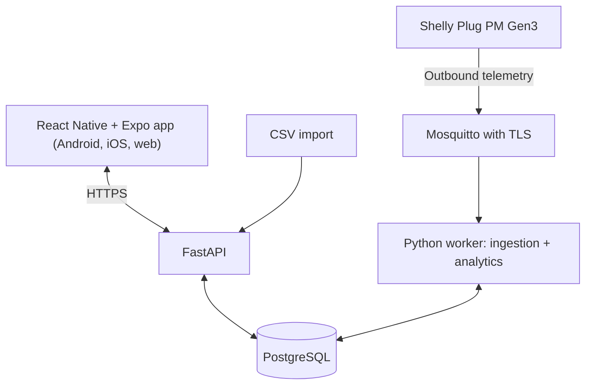

# HematDaya Faskes — Product Requirements Document
## Version 1.0: electricity monitoring and evidence-based advice for hospitals and clinics

Date: October 20, 2026 (Asia/Jakarta). Document language: English (Indonesian edition: `01_PRD_HematDaya_Faskes_ID.md`). Product interface: Indonesian.
Status: development specification. Usability and field targets are proposed hypotheses. Live hardware integrations are unverified. The runnable prototype uses synthetic data and no patient data.
Derived from: `01_PRD_HematDaya_EN.md` (v1.0, manufacturer edition), the HematDaya Faskes proposal (UMY Hackathon DeepTech 2026, strategic field Energy, sub-theme Cluster 08 *Sustainable and Green Healthcare*) and the runnable prototype `applications/umy-2026-hematdaya/hematdaya-faskes.html`.
Team: Tim Petani Digital.

## 0. What changed from HematDaya v1.0 (manufacturers)

| Area | HematDaya v1.0 (IKM) | HematDaya Faskes v1.0 |
|---|---|---|
| Target users | Owners and managers of IKM manufacturers | Facility managers and technicians of hospitals and clinics; management and clinical advisers as secondary audience |
| Challenge | ANGEL Innovation Hackathon 2026, Topic 6 | UMY Hackathon DeepTech 2026, problem statement "hospital and clinic energy consumption is high and not measured" (Cluster 08) |
| Loads | Compressor, oven, press, utility/AC | Outpatient AC, inpatient chiller, autoclave (CSSD), vaccine and medicine refrigerator, water pumps and lighting |
| Time rule | One operating-hours window for all machines | **Per-device service mode:** *poli* (service hours) or *24 jam* (around the clock) |
| Critical loads | Not applicable | **Critical-load flag.** Critical loads are only monitored; the product never advises switching them off |
| Insights | Off-hours increase, IKE change, contribution | Off-hours increase (poli devices), **consumption rise** (24-hour and critical devices), **total energy**, contribution |
| Intensity | IKE = kWh per production unit | **IKE = kWh per m² and kWh per bed per day**, from building area and bed count entered by the user |
| Money format | `Rp1.309.461` | `Rp 3,0 jt`, `Rp 602.595` (Nama Brand number rules) |
| Visual design | Botanical green, Plus Jakarta Sans | Design system **"Nama Brand"**: Inter, one blue accent, light and dark themes |
| Safety and ethics | Not a focus | Dedicated section 12: no patient data, no device control, critical-load wording rules, facility consent |
| Platforms | React Native + Expo (mobile prototype) | Same; the prototype shows the mobile layout only |

HematDaya v1.0 (manufacturers) is kept unchanged for the ANGEL submission. Where this document and that one disagree about hospitals and clinics, this document wins.

## 1. Product contract and authority

HematDaya Faskes helps a facility manager understand where electricity goes across devices and receive useful, evidence-based explanations. It answers four questions: which device contributes most, which service-hours device keeps consuming after service closes, which round-the-clock or critical device consumes more than before, and how much energy a building uses per m² and per bed (IKE). A supported meter or a CSV of historical energy data alone must deliver the core value.

The product only monitors and advises. It has no device-control path, no connection to medical equipment, and holds no patient data.

Delivery target: React Native + Expo + TypeScript, one shared codebase for Android, iOS and web. The mobile layout is primary; the web layout reuses the same components in a wider arrangement. The current prototype is a single HTML file that simulates the mobile layout. A full web build does not exist yet.

Authority order for conflicts: the user's latest explicit correction, then this document, then the proposal, then HematDaya v1.0 (manufacturers).

## 2. Problem, users and outcomes

### Problem

Hospitals and clinics run around the clock with large and varied electrical loads. Hospitals tend to use more energy per unit of floor area than other commercial buildings because of 24-hour operation, complex air conditioning and equipment such as sterilization and refrigeration [2]. The health sector accounts for about 4.4% of global net emissions, with fossil-fuel combustion as the largest source [3]. A facility manager usually sees one number, the monthly bill. A spike outside service hours or a gradual efficiency loss in one device is invisible. Published Indonesian hospital energy audits that we found are single-facility case studies, for example [4]; PP 33/2023 regulates the practice of energy conservation and its data [5]. The organizer's problem statement is "hospital and clinic energy consumption is high and not measured" [1]. (Numbers come from the desk research cited in the proposal; field data will be collected with a pilot facility.)

### Users

- **Primary:** facility (sarana-prasarana) managers and technicians of hospitals and clinics.
- **Secondary:** facility management and finance (cost and IKE reports); clinical advisers who review critical-load rules.
- **Out of the picture:** patients and clinical staff are not users, and no patient data enters the product.
- Users do not need to understand MQTT, watts, models or credentials.

### Outcomes

- Which device is largest this period.
- Energy that a service-hours device used outside service hours, compared with earlier weeks.
- A rise in consumption of a 24-hour or critical device against the facility's own history.
- IKE per m² and per bed per day for the monitored loads.
- A plain-language explanation of each finding: what changed, compared with what, how complete the data is, what remains unknown, and what to check with the responsible staff.

### Proposed success measures (targets, not results)

| Measure | Target |
|---|---|
| Energy error per device against a reference meter | ≤ 5% |
| Findings rated relevant by facility staff | ≥ 80% |
| Data coverage in the pilot | ≥ 90% |
| Advice to stop or change a critical load | 0 |
| Find the largest device from a populated Beranda | ≤ 30 seconds for at least 4 of 5 testers |
| Trust | correct units, visible freshness and coverage, no missing data shown as zero |

No savings percentage or field accuracy is claimed. Prototype numbers are synthetic.

## 3. Release boundary

### Tier A — required for the UMY demo and limited test

- Isolated demo mode with synthetic data (no accounts yet).
- Several monitored devices per facility.
- **CSV import** of historical energy data.
- **Device settings:** service mode (poli or 24 hours) and critical-load flag.
- Energy and estimated cost per device and period.
- **Service-hours** settings (start, end, days) and off-hours energy for poli devices.
- **Consumption-rise** check for 24-hour and critical devices against the median of earlier weeks over the same elapsed window.
- **IKE** per m² and per bed per day from building area and bed count.
- Evidence-based insights, optional feedback (useful, not relevant, snooze, hide), settings.
- Learning, empty, stale, partial-coverage, missing-tariff and import-error states.
- Hardware-free simulator, provenance labels, a deterministic synthetic dataset, light and dark themes.

### Further enhancements — do not build now

Device control or relays; connection to medical devices or building-management systems; room or temperature sensors; vaccine or drug quality assessment; patient, bed-occupancy or clinical data; PLN bill integration and peak-load or reactive-power analysis; thermal energy (gas, steam); optional ML beyond the median baseline; multi-facility or hospital-network aggregation; savings guarantees; official benchmark compliance claims; hard-wired high-power loads, which need a technician-installed clamp meter.

## 4. Domain model

| Concept | Meaning |
|---|---|
| Facility | A hospital or clinic with a building area (m²) and a bed count (both optional) |
| Meter / channel | A measuring device or imported series; one channel per device in the simple case |
| Device | A user-labelled load with `service_mode` (`poli` or `24`) and `is_critical` |
| Reading | Timestamp, device, energy in Wh for the interval (or average watts converted to Wh) |
| ServiceHours | Start hour, end hour, working days; used only to split energy of poli devices |
| Tariff | Rupiah per kWh entered by the user (optional) |
| Insight | Observation plus evidence, uncertainty and optional general advice |
| Feedback | Useful, not relevant, snooze, hide; per insight key |

Defaults for a device that appears in an import: `service_mode = 24`, `is_critical = false`. This is the conservative default: no "switch off" style finding is produced until the user marks a device as poli.

| Device type | Rule applied | Avoid |
|---|---|---|
| Poli, not critical (outpatient AC, autoclave) | Off-hours energy against the same window of earlier weeks | Concluding that off-hours use is waste; it may be a legitimate night service |
| 24-hour or critical (chiller, refrigerator, pumps) | Total energy against the same elapsed window of earlier weeks | Advising to stop or reduce; diagnosing faults |
| Unknown / not classified | Treated as 24-hour, not critical | Device-specific diagnoses |

A device marked critical is always treated with the 24-hour rule, even if it is also marked poli.

## 5. Information architecture (mobile and web)

Three persistent tabs: **Beranda**, **Perangkat**, **Saran**. A top bar shows the product name "HematDaya Faskes" and a gear icon. Settings, Import and Demo scenarios open as sheets. Detail screens use a stack with a back button.

| ID | Screen | Content and main action |
|---|---|---|
| S01 | Empty Beranda | Why data helps; "Impor data" (primary), "Pakai data contoh" |
| S02 | Beranda | Title; mode tags; period tabs (Hari ini / Minggu ini); estimated cost and kWh with scope text; stacked chart; top three devices; one featured insight; IKE card; monitoring-only note |
| S03 | Perangkat | Device cards with energy, share and cost; "Impor data lain" |
| S04 | Device detail | Critical-load note; type; energy; operating vs off-hours (poli) or average per hour (others); coverage; history chart; related insights; measurement details |
| S05 | Saran | Insight list with a type tag; learning banner; restore hidden |
| S06 | Insight detail | What changed; evidence table; what is unknown; general suggestion (wording rules in section 6); feedback |
| S07 | Settings | Service hours and days; device type and critical flag per device; tariff; building area; bed count; Import; Demo scenarios |
| S08 | Import | Sample format; choose or paste CSV; errors; analyze |

Heading text: "Estimasi biaya beban yang dipantau". Never "total tagihan" for meter or imported data.

Web layout: same components and tabs; content width grows with the viewport. Do not add a fourth main tab.

## 6. UI/UX quality contract

The visual language is the design system **"Nama Brand"** (https://claude.ai/artifact/KXHNGEEdSqthbvvwKBZ2WU). The prototype defines the same token names.

| ID | Requirement | Verification |
|---|---|---|
| UX-01 | Three labelled tabs; selected state visible without colour alone | Navigate all tabs and return paths |
| UX-02 | One primary action per task screen | Check empty, import, settings screens |
| UX-03 | Ordinary Indonesian, "Anda", short sentences, sentence case; verb-first buttons; no exclamation marks or emoji | Review all copy |
| UX-04 | At most 3 deliberate taps from populated Beranda to the featured insight or the largest device | Count taps |
| UX-05 | Back and retry preserve entered values | Go back, induce an import error, retry |
| UX-06 | Visible freshness, coverage, estimates and demo labels ("Demo · Data sintetis") | Inspect normal, stale, partial |
| UX-07 | Status is always a word (tag), never colour alone | Inspect tags and banners |
| UX-08 | Accessible targets and contrast | ≥ 44-unit touch areas; blue text uses `accent-text`, not `accent` |
| UX-09 | Responsive layout | 375 px mobile (verified); 768, 1280 px web (not yet); no horizontal page scroll |
| UX-10 | Themes | `light` and `dark` via `prefers-color-scheme` and `data-theme`; both verified on Beranda, detail, settings |
| UX-11 | Gesture and motion | One hover lift of 2 px; no entry animations; `prefers-reduced-motion` disables all |
| UX-12 | Numbers | Indonesian format: `1.284`, `2.019,4 kWh`, `Rp 3,0 jt`, `Rp 602.595`; tabular figures |
| UX-13 | One primary button per view; no gradients, heavy shadows or card borders | Review each screen |
| UX-14 | Missing is not zero; synthetic is labelled | Dashed marker for gaps; mode tag on every screen |
| UX-15 | Critical-load wording | See below |

**Critical-load wording (UX-15).** For a critical device, advice text must (a) ask the responsible staff or a technician to check the device and its surroundings (for example door seal, ventilation or maintenance schedule), (b) say that the load is only monitored, and (c) say "jangan menghentikan atau mengubah pengaturannya berdasarkan saran aplikasi ini" and that medicine or vaccine quality must be kept according to facility procedure. It must never contain a form of the verb "matikan". The application does not assess storage temperature or product quality. A test scans all insight text of critical devices for the substring "matik".

## 7. Core journeys

| ID | Journey | Required outcome |
|---|---|---|
| P01 | Start with the demo or import a CSV: Impor data → choose or paste → Analisis data | Devices, period and totals appear; a bad file shows a clear Indonesian error and keeps the text |
| P02 | Beranda → switch Hari ini / Minggu ini → open the largest device | Values reconcile (total equals the sum of devices) |
| P03 | Saran → "Di luar jam layanan" finding on a poli device → evidence | Observed, comparison, difference in kWh (and rupiah with a tariff), coverage, and "Yang belum diketahui" |
| P04 | Saran → consumption rise on the vaccine refrigerator → evidence | Same evidence table; critical-load wording; no advice to stop |
| P05 | Settings → change device type or critical flag, service hours, tariff, area, beds | Beranda, detail and Saran update; an empty tariff hides rupiah; an empty area or bed count hides the matching IKE value |
| P06 | Insight feedback: useful, not relevant, snooze, hide, restore | Persisted; hiding does not delete data |
| P07 | Recover from bad data: empty, stale, partial coverage, no tariff, malformed CSV | Honest banner or error; last known values kept with timestamp; no zero-filling |

## 8. Functional requirements

Status labels: **[prototype]** exercised in the runnable prototype; **[spec]** specified, not built.

### FR-01 Accounts and demo [spec; demo is prototype]
Register, log in, log out with short-lived access tokens and revocable refresh sessions; server ownership checks on every read and mutation; native secure storage for session secrets. The demo works with no hardware or credentials, is isolated from live data, and carries "Demo · Data sintetis". The prototype has no accounts and resets to the sample data at start; only settings and feedback persist in the browser.

### FR-02 Catalog [spec]
Provider → model → connection → device. Shelly Plug PM Gen3 is enabled (monitoring); TP-Link opens a "Segera hadir" notice. Catalog capabilities are potential; effective capabilities require a verified first reading. Hard-wired or high-power loads (chiller, autoclave) are outside the plug-in specification and need a technician-installed meter; until then they enter through CSV.

### FR-03 Enrollment and binding [spec]
Expiring single-use enrollment with authenticated meter identity. A first valid reading is required before "Terhubung". Removing a binding keeps history. Retries do not create duplicates.

### FR-04 Telemetry and data quality [spec]
Configurable sampling (about 60 seconds; hourly for imported data). Store power W, cumulative Wh, optional V and A, measured and received timestamps, origin (live, simulated, import) and quality. Deduplicate delivery, handle counter resets and out-of-order data, preserve gaps. Never fill gaps with zero. UTC storage; display timezone Asia/Jakarta.

### FR-05 CSV import [prototype]
- Accepted columns (case-insensitive): time = `timestamp`, `waktu`, `tanggal`, `datetime`, `time`; device = `perangkat`, `mesin`, `device`, `nama`, `alat`; energy = `energi_wh`, `wh`, `energi`; average power = `daya_w`, `watt`, `daya`, `power_w`.
- Delimiter `,` or `;`. Time `YYYY-MM-DD HH:MM` (also `T`, optional seconds); interpreted as local time. Decimal comma accepted.
- `daya_w` is converted to Wh using the median positive gap between readings as the interval.
- Rows with an invalid time, missing device name, non-numeric or negative value are skipped and counted. If more than 20% are invalid, the import is rejected.
- Duplicate device and time pairs are dropped and counted. Device names are cut at 60 characters. Limit: 150,000 rows.
- Errors are Indonesian and actionable; the pasted text is kept after an error.
- The success message states rows, devices, skipped rows and duplicates. Imported devices take the defaults of section 4.

### FR-06 Energy and estimated cost [prototype]
Energy is the sum of interval Wh divided by 1000 (server edition: positive cumulative-counter deltas within valid segments, reset-aware). Cost = kWh × the tariff entered by the user; decimal arithmetic on the server. With no tariff, show kWh and a "Tambah tarif per kWh" cue; never show Rp 0. Totals cover only monitored channels and are never labelled as a PLN bill or whole-facility consumption.

### FR-07 Device settings and service hours [prototype]
Settings: service start hour (0–23), end hour (1–24, after start), service days; per device: service mode (*Poli / jam layanan* or *Beroperasi 24 jam*) and *Beban kritis*. A reading is "off-hours" when its day is not a service day or its hour is outside the window. The off-hours split is shown for poli, non-critical devices. Changing any setting recomputes every screen and persists in the browser.

### FR-08 Energy intensity, IKE [prototype]
IKE has two values for the selected period, from the monitored loads only: kWh per m² = energy ÷ building area; kWh per bed per day = energy ÷ (beds × days covered by data in the period). A value is hidden when its input is empty and a cue to fill "Luas bangunan" or "Jumlah tempat tidur" is shown. The card states the basis ("memakai luas … m² dan … tempat tidur yang Anda isi") and that it is not the whole building and not an official benchmark. Comparing with official benchmarks is out of scope; only the facility's own history is used.

### FR-09 Baseline and readiness [prototype]
Window: for k = 1…3, the same elapsed span of earlier weeks (Monday start). Baseline = median. Readiness: at least 2 earlier weeks of data; otherwise "Sedang mempelajari pola" and no insights, with measured totals still shown. Coverage = readings ÷ expected readings at the median interval. Stale: the virtual or real clock is more than 2 × the data interval beyond the last reading. A partial-coverage banner appears when weekly coverage is below 90%.

### FR-10 Insights [prototype]
Each device is checked with exactly one rule.

| Type | Applies to | Raised when | Title pattern |
|---|---|---|---|
| Di luar jam layanan | Poli, not critical | current off-hours energy − baseline median ≥ 3 kWh **and** ≥ 1.3 × the median | "Konsumsi X di luar jam layanan naik N%"; when ≥ 3 × the median: "menjadi sekitar N kali minggu-minggu sebelumnya" |
| Kenaikan konsumsi | 24-hour, or critical (any service mode) | current total energy − baseline median ≥ 2 kWh **and** ≥ 1.15 × the median | "Konsumsi X naik N% dibanding minggu-minggu sebelumnya" |
| Total energi | All devices together | A baseline exists. Shown as stable when the change is under 5%, otherwise as a rise or a fall | "Total energi minggu ini stabil …" (with kWh/m² when an area is set) |
| Kontribusi | Largest device | Always | "X menyumbang N% energi minggu ini" |

Priority: device findings (sorted by the energy difference), then total energy, then contribution. Each insight stores the observed value, comparison, baseline count, coverage and limitation text. Do not diagnose faults, occupancy or exact avoidable waste. "Hal yang bisa diperiksa" text is labelled as general guidance; wording for critical devices follows UX-15.

### FR-11 Feedback [prototype]
Useful, not relevant, snooze (until the next day) and hide; hidden items can be restored. Feedback and settings persist locally (prototype: browser storage under `hematdaya-faskes.v1`; server edition: per account). Feedback never deletes measurements and never triggers an action.

### FR-12 Settings [prototype]
Service hours and days, device type and critical flag, tariff, building area, bed count; Import; Demo scenarios. All optional. The sheet explains that analysis runs in the browser, data is not sent to a server, and patient data must not be imported.

### FR-13 Notifications [spec]
In-app Saran is required. Optional push for new insights with a deep link; core tasks never depend on it.

### FR-14 Demo and scenarios [prototype]
Scenarios, each starting from clean sample data: **Normal**; **Kosong** (empty state); **Tanpa tarif** (empty tariff); **Data terlambat** (virtual clock +3 h); **Cakupan sebagian** (about 60% of the readings of two devices missing from October 14); **CSV salah format** (an import error is shown). **Reset ke awal** restores settings and device types. All use the same domain path as real data.

### FR-15 Reports for facility management [spec]
Export of weekly summary (energy, cost, IKE, findings) as printable HTML or CSV. Not needed for Tier A.

## 9. Data interpretation and analytics rules

1. Keep normalized readings with quality metadata; derive aggregates.
2. Deduplicate by stable capture identity; equal numeric readings can be legitimate.
3. Late readings recompute derived values idempotently; never add a delta twice.
4. Segment cumulative counters at resets; no negative energy.
5. Coverage is independent of tariff and of readiness.
6. Comparisons use the same device and a matched elapsed window; suppress percentages when the reference is zero (a ratio of 3 or more is stated as "kali").
7. Missing data, missing tariff and learning are independent states.
8. Synthetic, import and live data stay distinguishable.
9. Thresholds of FR-10 (3 kWh and 1.3 ×; 2 kWh and 1.15 ×; 5%) and the 2-week readiness rule are proposed defaults, versioned, to be calibrated on pilot data.
10. An optional ML model must beat the median baseline on chronological splits, with preprocessing fit on training data only.
11. A demonstrated saving opportunity is not realized saving; no savings score without a counterfactual.
12. The product does not classify a rise or an off-hours use as a fault or as waste; a night service, a seasonal load or a clinical need can explain it.

## 10. Architecture



| Layer | Initial implementation |
|---|---|
| Client | React Native, Expo, TypeScript, Expo Router; tokens from the Nama Brand design system; the same components for web |
| API | FastAPI modular monolith with generated OpenAPI |
| Storage | PostgreSQL with migrations, UTC timestamps, decimal money |
| Ingestion | Mosquitto with TLS, per-meter identity and ACL, Python consumer |
| Analytics | Shared Python domain logic; statistics first; optional scikit-learn |
| Deployment | Docker Compose (API, worker, DB, broker) on one virtual server for the pilot |

The client holds no vendor secrets and is never the always-on collector. The prototype's analytics run in the browser and are a reference implementation of FR-05–FR-11.

## 11. Data and API contracts

Core records: User, RefreshSession, DeviceCatalog, MeterEnrollment, MeterChannel, Facility, Device, MeterBinding, Measurement, EnergyAggregate, EffectiveTariff, ServiceHours, Import, Insight, InsightFeedback, NotificationPreference, ActivityEvent.

| Method / route under /api/v1 | Purpose |
|---|---|
| POST /auth/register, /auth/login, /auth/refresh, /auth/logout | Sessions |
| GET/PATCH /me | Profile and timezone |
| GET /device-catalog | Supported and coming-soon meters |
| POST /enrollments; GET /enrollments/{id} | Verified setup |
| GET/PATCH /facility | Name, building area, bed count |
| POST /devices; GET /devices; GET/PATCH /devices/{id}; DELETE /devices/{id}/binding | Devices, including `service_mode` and `is_critical` |
| POST /imports; GET /imports/{id} | CSV import and its result (rows, skipped, duplicates, errors) |
| GET /summary?period=; GET /devices/{id}/summary | Totals, coverage, operating vs off-hours, IKE |
| GET /devices/{id}/measurements | Bounded history for charts |
| GET/PATCH /settings/service-hours | Schedule |
| GET/POST /tariffs | Effective-dated tariff |
| GET /insights; GET /insights/{id}; POST /insights/{id}/feedback | Saran and feedback |
| GET/PATCH /notification-preferences; POST/DELETE /push-registrations | Optional notices |
| GET /health/live; GET /health/ready | Health |

CSV format (exactly as in the sample file `data-contoh-faskes.csv`):

```csv
timestamp,perangkat,energi_wh
2026-10-12 08:00,AC Poli Rawat Jalan,6120
2026-10-12 08:00,Chiller Rawat Inap,9040
```

Illustrative import envelope (not a native Shelly payload):

```json
{ "schema_version": 1, "device": "Lemari Pendingin Vaksin dan Obat", "measured_at": "2026-10-12T08:00:00", "energy_wh": 160, "origin": "import" }
```

## 12. Safety, ethics, privacy and security

**Patient safety and scope.** The product reads electricity data only. It does not control devices, does not connect to medical equipment, and does not hold patient, clinical or bed-occupancy data. Critical loads (vaccine and medicine refrigerators, vital equipment) are flagged and only monitored; advice never suggests stopping or changing them (UX-15). The application does not assess medicine or vaccine quality or storage temperature.

**Data and consent.** Testing uses synthetic data and simulation. Electricity data from a real facility is used only with written facility consent. The team consults the UMY regulation clinic on whether ethics approval is required; interviews and usability tests use written informed consent and anonymized data. The Import sheet states that patient data must not be imported.

**Security.** HTTPS for the API; TLS, identity and ACLs for the broker; no router port forwarding. Ownership checks on every read and mutation. Per-meter credentials; never trust a payload's `device_id`. Imports are size-limited and parsed without executing content. No silent catch-and-continue that produces a zero summary. Demo reset affects only the demo dataset. Retention defaults are configuration. Personal data follows UU No. 27 of 2022.

## 13. Canonical demo fixtures (synthetic)

Virtual time: data end Saturday, October 17, 2026, 23.00 Asia/Jakarta. Dataset: September 21 – October 17, 2026, hourly, five devices; 3,240 rows; file `applications/umy-2026-hematdaya/data-contoh-faskes.csv`. Service hours 07.00–16.00, Monday–Saturday. Tariff Rp 1.500/kWh (a demo input, not an official rate). Building area 2,400 m²; 30 beds.

| Device | Service mode | Critical | Built-in behaviour |
|---|---|---|---|
| AC Poli Rawat Jalan | poli | no | Runs in service hours; from Oct 12 it also runs 19.00–05.00 (about +1 kWh per hour) |
| Chiller Rawat Inap | 24 h | no | Day/night profile; no anomaly |
| Autoklaf CSSD | poli | no | Cycles in service hours; one extra evening session on Oct 14 (17.00–21.00) |
| Lemari Pendingin Vaksin dan Obat | 24 h | yes | Steady load; consumption rises gradually from Oct 6 |
| Pompa Air dan Penerangan | 24 h | no | Day/night profile; no anomaly |

Reference values for the week of Oct 12–17 (computed from the CSV; chart and card values derive from one dataset and reconcile exactly):

| Item | Value |
|---|---|
| Week energy / estimated cost | 2,019.4 kWh / Rp 3,0 jt (Rp 3.029.156) |
| Today (Oct 17) energy / cost | 338.2 kWh / Rp 507.294 |
| Largest device | Chiller Rawat Inap, 1,081.2 kWh (54%) |
| AC Poli off-hours, week vs median of 3 earlier weeks | 70.7 vs 10.9 kWh (about 6.5 ×) |
| Autoklaf CSSD off-hours | 16.9 vs 7.2 kWh (+135%) |
| Vaccine refrigerator total | 28.2 vs 23.1 kWh (+22%) |
| Total energy vs median | 2,019.4 vs 1,947.2 kWh (+3.7%, shown as stable) |
| IKE this week | 0.84 kWh/m²; 11.2 kWh per bed per day |

Expected insight order on the normal scenario: AC Poli off-hours, Autoklaf off-hours, vaccine refrigerator rise (critical wording), total energy (stable), contribution of the chiller. These numbers are synthetic and must not be presented as field results.

## 14. Acceptance tests

Status key: **P** = exercised in the prototype; **—** = not built or not yet tested.

| ID | Scenario | Expected result | Status |
|---|---|---|---|
| AT-01 | Demo with no credentials | P01–P07 playable with the mode tag | P |
| AT-02 | Select TP-Link | "Segera hadir"; no live binding | — |
| AT-03 | Valid CSV import | Devices, rows and totals correct; message states counts | P (parser) |
| AT-04 | CSV with wrong header, unparsable time or negative value | Indonesian error; text preserved; nothing imported | P |
| AT-05 | `daya_w` and `;` delimiter | Converted to Wh; parsed | P |
| AT-06 | Total equals the sum of devices | Exact match | P |
| AT-07 | Duplicate, reset, out-of-order readings (server) | No negative or doubled energy | — |
| AT-08 | Empty tariff | kWh shown; no rupiah; add-tariff cue | P |
| AT-09 | Change service hours | Off-hours split and insights recompute | P |
| AT-10 | Empty area or bed count | The matching IKE value hidden, with a cue | P |
| AT-11 | Fewer than 2 baseline weeks | Learning state; measured totals shown | — |
| AT-12 | Stale data (virtual clock) | Banner with last timestamp; no zero | P |
| AT-13 | Partial coverage | Banner with coverage; chart marks partial days; no zero | P |
| AT-14 | Feedback: useful, hide, restore | Persisted; hiding keeps data | P |
| AT-15 | Empty state | Explanation with import and sample actions | P |
| AT-16 | Poli device marked critical | Switches to the rise rule; no off-hours finding | P |
| AT-17 | Critical-device text | No form of "matikan" in any insight or device text; "jangan menghentikan" present | P |
| AT-18 | Device settings persist after reload | Stored under `hematdaya-faskes.v1` | P |
| AT-19 | Phone width 375 px, light and dark | No horizontal overflow; tokens correct | P |
| AT-20 | Web widths 768, 1280, 1440 px | Same components, wider layout, keyboard focus | — |
| AT-21 | Other user's resource ID (server) | Denied without leaking data | — |
| AT-22 | Real meter against a reference meter | Energy error ≤ 5% | — |
| AT-23 | Core-only install | App and server demo work without cloud services | — |

AT-01–AT-23 and UX-01–UX-15 gate Tier A. Simulated success is not live verification.

### Usability research protocol

Five representative facility managers or technicians when available, plus the clinical adviser assigned by the organizer. Neutral tasks: (1) "Impor data energi dari berkas ini." (2) "Cari perangkat dengan estimasi biaya paling besar minggu ini." (3) "Jelaskan arti saran tentang konsumsi di luar jam layanan." (4) "Tandai lemari pendingin vaksin sebagai beban kritis." (5) "Ubah jam layanan menjadi 08.00–17.00." Record completion, time, wrong turns, assistance and misunderstandings; also ask whether any advice could be read as an instruction to switch off a critical load. Target 4 of 5 on tasks 1–3, with task 2 within 30 seconds. If no participants are available, ship the script with status "pending". Never invent results.

## 15. Delivery sequence

| Milestone | Program stage (UMY) | Content |
|---|---|---|
| M0 | Now (TKT 3) | PRD, proposal, runnable prototype with synthetic data |
| M1 | Bootcamp, Nov 2–5, 2026 | Validate the problem; interview 5 facility managers or technicians; list critical loads and safety rules with the adviser |
| M2 | Limited test, Nov 9–12 | Usability test with at least 5 users; energy error against a reference meter on simulated loads; synthetic data |
| M3 | Regulation clinic and Demo Day, Nov 24–26 | Review ethics, data security and device rules; fixes; demo |
| M4 | Post-competition, Dec 2026 – Apr 2027 | Facility permit and data policy; pilot in 1–2 facilities with electricity data; meter integration; TKT 5 target |
| M5 | May – Oct 2027 | Pilot in 3–5 facilities; subscription model test; IP |

Tier A done: the demo runs on the tested targets (state exactly which runs happened); the checks of FR-05 to FR-11 pass on the synthetic data; the UI is Indonesian; the status report separates tested, simulated, implemented-unverified, blocked and not run. Live monitoring additionally requires a configured Shelly, physical validation against a reference meter and facility consent.

## 16. References and uncertainty

| Reference | Use |
|---|---|
| [1] Direktorat Inovasi dan Hilirisasi, UMY. *Buku Pedoman Peserta UMY Hackathon DeepTech 2026* (revised) | Problem statement, program stages, team rules |
| [2] U.S. Energy Information Administration. "Large hospitals tend to be energy-intensive," 23 Aug 2012. https://www.eia.gov/todayinenergy/detail.php?id=7670 | Hospital energy intensity |
| [3] Health Care Without Harm and Arup. *Health Care's Climate Footprint*, Sep 2019. https://global.noharm.org/resources/health-care-climate-footprint-report | Sector emissions |
| [4] N. O. Putra, Z. Aini, D. M. Putri. "Electrical Energy Audit in Pratama Tapan Hospital." *Jurnal Edukasi Elektro* 8(1), 80–93, 2024. doi:10.21831/jee.v8i1.65277 | Example of a single-facility audit |
| [5] PP 33/2023 on Energy Conservation | Regulatory context (abstract only was read) |
| Nama Brand design system https://claude.ai/artifact/KXHNGEEdSqthbvvwKBZ2WU | Tokens, components, tone |
| https://docs.expo.dev/ and https://reactnative.dev/ | Shared app for Android, iOS and web |
| https://shelly-api-docs.shelly.cloud/gen2/Devices/Gen3/ShellyPlugPMG3/ | Selected meter model |

Open uncertainties: the Shelly meter and MQTT path are untested on real facility loads; plug-in meters suit only loads within their specification and hard-wired loads need a technician; the team has no health professional and relies on an adviser assigned by the organizer; whether ethics approval is required is to be confirmed at the regulation clinic; no facility has agreed to a pilot yet; the web build does not exist; all prototype data is synthetic; the thresholds, savings and relevance targets are hypotheses.
