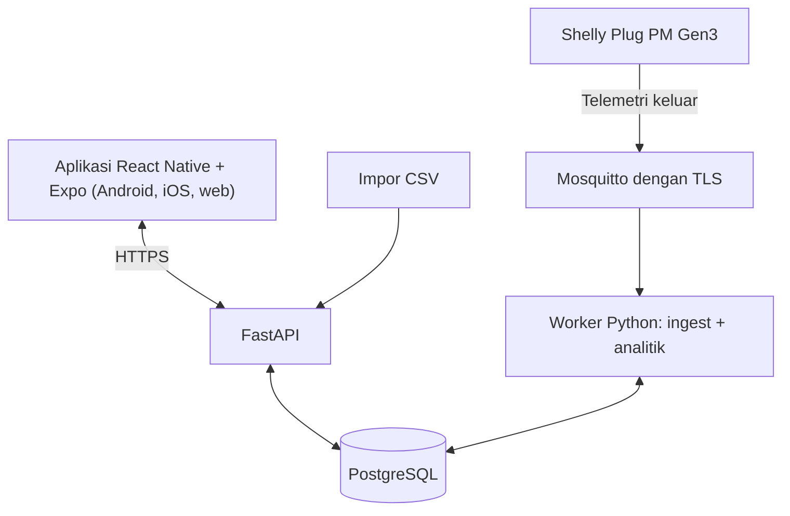

# HematDaya Faskes — Dokumen Kebutuhan Produk (PRD)
## Versi 1.0: pemantauan listrik dan saran berbasis bukti untuk rumah sakit dan klinik

Tanggal: 20 Oktober 2026 (Asia/Jakarta). Bahasa dokumen: Indonesia (edisi Inggris: `01_PRD_HematDaya_Faskes_EN.md`). Bahasa antarmuka produk: Indonesia.
Status: spesifikasi pengembangan. Target kegunaan dan lapangan adalah hipotesis usulan. Integrasi perangkat keras langsung belum diverifikasi. Purwarupa yang berjalan memakai data sintetis dan tanpa data pasien.
Diturunkan dari: `01_PRD_HematDaya_EN.md` (v1.0, edisi IKM), proposal HematDaya Faskes (UMY Hackathon DeepTech 2026, bidang strategis Energi, sub-tema Klaster 08 *Sustainable and Green Healthcare*), dan purwarupa `applications/umy-2026-hematdaya/hematdaya-faskes.html`.
Tim: Tim Petani Digital.

## 0. Perubahan dari HematDaya v1.0 (IKM)

| Aspek | HematDaya v1.0 (IKM) | HematDaya Faskes v1.0 |
|---|---|---|
| Pengguna | Pemilik dan pengelola IKM manufaktur | Pengelola sarana dan teknisi rumah sakit dan klinik; manajemen dan pendamping klinis sebagai pengguna sekunder |
| Tantangan | ANGEL Innovation Hackathon 2026, Topik 6 | UMY Hackathon DeepTech 2026, *problem statement* "konsumsi energi rumah sakit dan klinik tinggi dan belum terpantau secara terukur" (Klaster 08) |
| Beban | Kompresor, oven, press, utilitas/AC | AC poli rawat jalan, chiller rawat inap, autoklaf (CSSD), lemari pendingin vaksin dan obat, pompa air dan penerangan |
| Aturan waktu | Satu jendela jam operasional untuk semua mesin | **Jenis per perangkat:** *poli* (jam layanan) atau *24 jam* |
| Beban kritis | Tidak ada | **Tanda beban kritis.** Beban kritis hanya dipantau; produk tidak pernah menyarankan mematikannya |
| Saran | Kenaikan di luar jam, perubahan IKE, kontribusi | Kenaikan di luar jam (perangkat poli), **kenaikan konsumsi** (perangkat 24 jam dan kritis), **total energi**, kontribusi |
| Intensitas | IKE = kWh per unit produksi | **IKE = kWh per m² dan kWh per tempat tidur per hari**, dari luas bangunan dan jumlah tempat tidur yang diisi pengguna |
| Format uang | `Rp1.309.461` | `Rp 3,0 jt`, `Rp 602.595` (aturan angka Nama Brand) |
| Desain visual | Hijau botani, Plus Jakarta Sans | Design system **"Nama Brand"**: Inter, satu aksen biru, tema terang dan gelap |
| Keselamatan dan etik | Bukan fokus | Bagian 12 tersendiri: tanpa data pasien, tanpa kendali perangkat, aturan kata untuk beban kritis, persetujuan fasilitas |
| Platform | React Native + Expo (purwarupa seluler) | Sama; purwarupa hanya menampilkan tata letak seluler |

HematDaya v1.0 (IKM) tidak diubah dan tetap menjadi dokumen untuk ANGEL. Bila dokumen ini dan dokumen itu berbeda tentang rumah sakit dan klinik, dokumen ini yang berlaku.

## 1. Kontrak produk dan kewenangan

HematDaya Faskes membantu pengelola fasilitas memahami ke mana listrik mengalir di seluruh perangkat dan menerima penjelasan berbukti yang berguna. Produk menjawab empat pertanyaan: perangkat mana yang paling besar, perangkat jam layanan mana yang masih memakai listrik setelah layanan tutup, perangkat 24 jam atau kritis mana yang konsumsinya naik dibanding sebelumnya, dan berapa energi bangunan per m² dan per tempat tidur (IKE). Satu meter yang didukung atau satu berkas CSV riwayat energi saja harus sudah memberi nilai inti.

Produk hanya memantau dan menyarankan. Tidak ada jalur kendali perangkat, tidak ada koneksi ke alat medis, dan tidak ada data pasien.

Target pengiriman: React Native + Expo + TypeScript, satu basis kode untuk Android, iOS, dan web. Tata letak seluler adalah desain utama; tata letak web memakai komponen yang sama dalam susunan lebih lebar. Purwarupa saat ini berupa satu berkas HTML yang mensimulasikan tata letak seluler. Versi web penuh belum ada.

Urutan wewenang bila ada konflik: koreksi tertulis terbaru dari pengguna, lalu dokumen ini, lalu proposal, lalu HematDaya v1.0 (IKM).

## 2. Masalah, pengguna, dan hasil

### Masalah

Rumah sakit dan klinik beroperasi sepanjang hari dengan beban listrik yang besar dan beragam. Rumah sakit cenderung memakai energi per satuan luas lebih besar daripada bangunan komersial lain karena beroperasi 24 jam, memakai sistem pendingin udara yang kompleks, serta peralatan seperti sterilisasi dan pendinginan [2]. Sektor kesehatan menyumbang sekitar 4,4% emisi bersih global, dengan pembakaran bahan bakar fosil sebagai sumber terbesar [3]. Pengelola fasilitas biasanya hanya melihat satu angka, yaitu tagihan bulanan. Lonjakan di luar jam layanan atau penurunan efisiensi pada satu perangkat tidak terlihat. Audit energi rumah sakit di Indonesia yang kami temukan berupa studi kasus per fasilitas, misalnya [4]; PP 33/2023 mengatur pelaksanaan konservasi energi beserta data dan informasinya [5]. *Problem statement* dari penyelenggara adalah "konsumsi energi rumah sakit dan klinik tinggi dan belum terpantau secara terukur" [1]. (Angka berasal dari riset meja yang dikutip pada proposal; data lapangan akan dikumpulkan bersama fasilitas pilot.)

### Pengguna

- **Utama:** pengelola sarana-prasarana dan teknisi rumah sakit dan klinik.
- **Sekunder:** manajemen dan keuangan fasilitas (laporan biaya dan IKE); pendamping klinis yang meninjau aturan beban kritis.
- **Bukan pengguna:** pasien dan tenaga klinis; tidak ada data pasien yang masuk ke produk.
- Pengguna tidak perlu memahami MQTT, watt, model, atau kredensial.

### Hasil yang diinginkan

- Perangkat mana yang terbesar pada periode ini.
- Energi yang dipakai perangkat jam layanan di luar jam layanan, dibanding minggu-minggu sebelumnya.
- Kenaikan konsumsi perangkat 24 jam atau kritis dibanding riwayat fasilitas sendiri.
- IKE per m² dan per tempat tidur per hari untuk beban yang dipantau.
- Penjelasan bahasa sehari-hari untuk setiap temuan: apa yang berubah, dibanding apa, selengkap apa datanya, apa yang belum diketahui, dan apa yang perlu diperiksa bersama petugas penanggung jawab.

### Ukuran keberhasilan usulan (target, bukan hasil)

| Ukuran | Target |
|---|---|
| Galat energi per perangkat terhadap meter pembanding | ≤ 5% |
| Temuan yang dinilai relevan oleh petugas fasilitas | ≥ 80% |
| Cakupan data pada pilot | ≥ 90% |
| Saran untuk menghentikan atau mengubah beban kritis | 0 |
| Menemukan perangkat terbesar dari Beranda yang terisi | ≤ 30 detik untuk sedikitnya 4 dari 5 penguji |
| Kepercayaan | satuan benar, kesegaran dan cakupan data terlihat, data hilang tidak tampil sebagai nol |

Tidak ada klaim persentase penghematan atau akurasi lapangan. Angka purwarupa bersifat sintetis.

## 3. Batas rilis

### Tier A — wajib untuk demo dan uji terbatas UMY

- Mode demo terisolasi dengan data sintetis (belum ada akun).
- Beberapa perangkat terpantau per fasilitas.
- **Impor CSV** riwayat energi.
- **Pengaturan perangkat:** jenis (poli atau 24 jam) dan tanda beban kritis.
- Energi dan estimasi biaya per perangkat dan periode.
- Pengaturan **jam layanan** (mulai, selesai, hari) dan energi di luar jam layanan untuk perangkat poli.
- Pemeriksaan **kenaikan konsumsi** untuk perangkat 24 jam dan kritis terhadap median minggu-minggu sebelumnya pada rentang waktu yang sama.
- **IKE** per m² dan per tempat tidur per hari dari luas bangunan dan jumlah tempat tidur.
- Saran berbukti, umpan balik opsional (bermanfaat, kurang sesuai, ingatkan nanti, sembunyikan), pengaturan.
- Keadaan belajar, kosong, data terlambat, cakupan sebagian, tarif kosong, dan galat impor.
- Simulator tanpa perangkat keras, label asal data, dataset sintetis deterministik, tema terang dan gelap.

### Pengembangan lanjut — jangan dibangun sekarang

Kendali perangkat atau relai; koneksi ke alat medis atau sistem manajemen gedung; sensor ruangan atau suhu; penilaian mutu vaksin atau obat; data pasien, hunian tempat tidur, atau data klinis; integrasi tagihan PLN dan analisis beban puncak atau daya reaktif; energi termal (gas, uap); model ML di luar baseline median; agregasi banyak fasilitas atau jaringan rumah sakit; jaminan penghematan; klaim kepatuhan pada acuan resmi; beban berkabel berdaya besar, yang memerlukan meter penjepit yang dipasang teknisi.

## 4. Model domain

| Konsep | Arti |
|---|---|
| Fasilitas | Rumah sakit atau klinik dengan luas bangunan (m²) dan jumlah tempat tidur (keduanya opsional) |
| Meter / kanal | Perangkat ukur atau deret yang diimpor; satu kanal per perangkat pada kasus sederhana |
| Perangkat | Beban berlabel pengguna dengan `service_mode` (`poli` atau `24`) dan `is_critical` |
| Pembacaan | Waktu, perangkat, energi dalam Wh untuk interval (atau rata-rata watt yang diubah ke Wh) |
| Jam layanan | Jam mulai, jam selesai, hari; hanya dipakai untuk memisahkan energi perangkat poli |
| Tarif | Rupiah per kWh yang diisi pengguna (opsional) |
| Saran | Pengamatan beserta bukti, ketidakpastian, dan saran umum opsional |
| Umpan balik | Bermanfaat, kurang sesuai, ingatkan nanti, sembunyikan; per kunci saran |

Nilai bawaan untuk perangkat yang muncul dari impor: `service_mode = 24`, `is_critical = false`. Ini bawaan yang hati-hati: tidak ada temuan bergaya "matikan" sampai pengguna menandai perangkat sebagai poli.

| Jenis perangkat | Aturan yang dipakai | Hindari |
|---|---|---|
| Poli, tidak kritis (AC poli, autoklaf) | Energi di luar jam layanan terhadap jendela yang sama pada minggu-minggu sebelumnya | Menyimpulkan bahwa pemakaian di luar jam adalah pemborosan; bisa jadi layanan malam yang sah |
| 24 jam atau kritis (chiller, lemari pendingin, pompa) | Total energi terhadap rentang waktu yang sama pada minggu-minggu sebelumnya | Menyarankan menghentikan atau mengurangi; mendiagnosis kerusakan |
| Tidak diketahui / belum digolongkan | Diperlakukan sebagai 24 jam, tidak kritis | Diagnosis khusus perangkat |

Perangkat yang ditandai kritis selalu memakai aturan 24 jam, meskipun juga ditandai poli.

## 5. Arsitektur informasi (seluler dan web)

Tiga tab tetap: **Beranda**, **Perangkat**, **Saran**. Bilah atas menampilkan nama produk "HematDaya Faskes" dan ikon roda gigi. Pengaturan, Impor, dan Skenario demo terbuka sebagai lembar. Layar detail memakai tumpukan dengan tombol kembali.

| ID | Layar | Isi dan aksi utama |
|---|---|---|
| S01 | Beranda kosong | Mengapa data membantu; "Impor data" (primer), "Pakai data contoh" |
| S02 | Beranda | Judul; tag mode; tab periode (Hari ini / Minggu ini); estimasi biaya dan kWh dengan teks cakupan; grafik bertumpuk; tiga perangkat terbesar; satu saran utama; kartu IKE; catatan pemantauan saja |
| S03 | Perangkat | Kartu perangkat dengan energi, porsi, dan biaya; "Impor data lain" |
| S04 | Detail perangkat | Catatan beban kritis; jenis; energi; saat jam layanan vs di luar jam (poli) atau rata-rata per jam (lainnya); cakupan; grafik riwayat; saran terkait; detail pengukuran |
| S05 | Saran | Daftar saran dengan tag jenis; banner belajar; tampilkan kembali yang disembunyikan |
| S06 | Detail saran | Apa yang berubah; tabel bukti; yang belum diketahui; saran umum (aturan kata di bagian 6); umpan balik |
| S07 | Pengaturan | Jam dan hari layanan; jenis perangkat dan tanda kritis per perangkat; tarif; luas bangunan; jumlah tempat tidur; Impor; Skenario demo |
| S08 | Impor | Format contoh; pilih atau tempel CSV; galat; analisis |

Teks judul: "Estimasi biaya beban yang dipantau". Jangan pernah "total tagihan" untuk data meter atau impor.

Tata letak web: komponen dan tab sama; lebar isi mengikuti layar. Jangan menambah tab utama keempat.

## 6. Kontrak UI/UX

Bahasa visualnya adalah design system **"Nama Brand"** (https://claude.ai/artifact/KXHNGEEdSqthbvvwKBZ2WU). Purwarupa mendefinisikan nama token yang sama.

| ID | Kebutuhan | Verifikasi |
|---|---|---|
| UX-01 | Tiga tab berlabel; keadaan terpilih terlihat tanpa warna saja | Telusuri semua tab dan jalur kembali |
| UX-02 | Satu aksi primer per layar tugas | Periksa layar kosong, impor, pengaturan |
| UX-03 | Bahasa Indonesia sehari-hari, "Anda", kalimat pendek, huruf kapital kalimat; tombol berawalan kata kerja; tanpa tanda seru dan emoji | Tinjau semua teks |
| UX-04 | Paling banyak 3 ketukan dari Beranda terisi ke saran utama atau perangkat terbesar | Hitung ketukan |
| UX-05 | Kembali dan coba lagi mempertahankan isian | Kembali, picu galat impor, coba lagi |
| UX-06 | Kesegaran, cakupan, estimasi, dan label demo terlihat ("Demo · Data sintetis") | Periksa normal, terlambat, sebagian |
| UX-07 | Status selalu berupa kata (tag), tidak hanya warna | Periksa tag dan banner |
| UX-08 | Target sentuh dan kontras | Area sentuh ≥ 44; teks biru memakai `accent-text`, bukan `accent` |
| UX-09 | Tata letak responsif | Seluler 375 px (terverifikasi); web 768, 1280 px (belum); tanpa gulir horizontal halaman |
| UX-10 | Tema | `light` dan `dark` lewat `prefers-color-scheme` dan `data-theme`; keduanya terverifikasi pada Beranda, detail, pengaturan |
| UX-11 | Gerak | Satu gerak hover naik 2 px; tanpa animasi masuk; `prefers-reduced-motion` mematikan semuanya |
| UX-12 | Angka | Format Indonesia: `1.284`, `2.019,4 kWh`, `Rp 3,0 jt`, `Rp 602.595`; angka tabular |
| UX-13 | Satu tombol primer per tampilan; tanpa gradien, bayangan tebal, atau border kartu | Tinjau tiap layar |
| UX-14 | Data hilang bukan nol; data sintetis diberi label | Penanda putus-putus untuk celah; tag mode di setiap layar |
| UX-15 | Kata untuk beban kritis | Lihat di bawah |

**Kata untuk beban kritis (UX-15).** Untuk perangkat kritis, teks saran harus (a) meminta petugas penanggung jawab atau teknisi memeriksa perangkat dan lingkungannya (misalnya segel pintu, ventilasi, atau jadwal perawatan), (b) menyatakan bahwa beban itu hanya dipantau, dan (c) menyatakan "jangan menghentikan atau mengubah pengaturannya berdasarkan saran aplikasi ini" serta bahwa mutu vaksin atau obat harus dijaga sesuai prosedur fasilitas. Teks tidak boleh memuat bentuk apa pun dari kata kerja "matikan". Aplikasi tidak menilai suhu penyimpanan atau mutu produk. Satu uji memindai semua teks saran perangkat kritis untuk potongan kata "matik".

## 7. Alur inti

| ID | Alur | Hasil yang dibutuhkan |
|---|---|---|
| P01 | Mulai dari demo atau impor CSV: Impor data → pilih atau tempel → Analisis data | Perangkat, periode, dan total muncul; berkas yang buruk menampilkan galat bahasa Indonesia yang jelas dan mempertahankan teks |
| P02 | Beranda → ganti Hari ini / Minggu ini → buka perangkat terbesar | Nilai cocok (total sama dengan jumlah perangkat) |
| P03 | Saran → temuan "Di luar jam layanan" pada perangkat poli → bukti | Teramati, pembanding, selisih kWh (dan rupiah bila ada tarif), cakupan, dan "Yang belum diketahui" |
| P04 | Saran → kenaikan konsumsi lemari pendingin vaksin → bukti | Tabel bukti sama; kata beban kritis; tanpa saran menghentikan |
| P05 | Pengaturan → ubah jenis perangkat atau tanda kritis, jam layanan, tarif, luas, tempat tidur | Beranda, detail, dan Saran ikut berubah; tarif kosong menyembunyikan rupiah; luas atau tempat tidur kosong menyembunyikan nilai IKE yang bersangkutan |
| P06 | Umpan balik saran: bermanfaat, kurang sesuai, ingatkan nanti, sembunyikan, tampilkan kembali | Tersimpan; menyembunyikan tidak menghapus data |
| P07 | Pulih dari data buruk: kosong, terlambat, cakupan sebagian, tanpa tarif, CSV salah format | Banner atau galat yang jujur; nilai terakhir dipertahankan dengan stempel waktu; tanpa mengisi nol |

## 8. Kebutuhan fungsional

Label status: **[purwarupa]** sudah dijalankan pada purwarupa; **[spesifikasi]** ditentukan, belum dibangun.

### FR-01 Akun dan demo [spesifikasi; demo purwarupa]
Daftar, masuk, keluar dengan token akses berumur pendek dan sesi penyegaran yang dapat dicabut; pemeriksaan kepemilikan di server pada setiap baca dan ubah; penyimpanan aman bawaan untuk rahasia sesi. Demo berjalan tanpa perangkat keras atau kredensial, terpisah dari data langsung, dan berlabel "Demo · Data sintetis". Purwarupa belum punya akun dan kembali ke data contoh saat dibuka; hanya pengaturan dan umpan balik yang tersimpan di browser.

### FR-02 Katalog [spesifikasi]
Penyedia → model → koneksi → perangkat. Shelly Plug PM Gen3 diaktifkan (pemantauan); TP-Link membuka pemberitahuan "Segera hadir". Kemampuan katalog bersifat potensial; kemampuan efektif memerlukan pembacaan pertama yang terverifikasi. Beban berkabel atau berdaya besar (chiller, autoklaf) di luar spesifikasi meter colok dan memerlukan meter yang dipasang teknisi; sampai saat itu datanya masuk lewat CSV.

### FR-03 Pendaftaran dan pengikatan [spesifikasi]
Pendaftaran sekali pakai yang kedaluwarsa dengan identitas meter yang terautentikasi. Pembacaan valid pertama diperlukan sebelum "Terhubung". Melepas ikatan mempertahankan riwayat. Percobaan ulang tidak membuat duplikat.

### FR-04 Telemetri dan mutu data [spesifikasi]
Pencuplikan dapat diatur (sekitar 60 detik; per jam untuk data impor). Simpan daya W, Wh kumulatif, V dan A opsional, waktu ukur dan waktu terima, asal (langsung, simulasi, impor), dan mutu. Hapus duplikat kiriman, tangani reset penghitung dan data tidak berurutan, pertahankan celah. Jangan pernah mengisi celah dengan nol. Simpan UTC; tampilkan zona Asia/Jakarta.

### FR-05 Impor CSV [purwarupa]
- Kolom yang diterima (tidak peka huruf besar): waktu = `timestamp`, `waktu`, `tanggal`, `datetime`, `time`; perangkat = `perangkat`, `mesin`, `device`, `nama`, `alat`; energi = `energi_wh`, `wh`, `energi`; daya rata-rata = `daya_w`, `watt`, `daya`, `power_w`.
- Pemisah `,` atau `;`. Waktu `YYYY-MM-DD HH:MM` (juga `T`, detik opsional); dianggap waktu setempat. Koma desimal diterima.
- `daya_w` diubah ke Wh memakai median selisih positif antar pembacaan sebagai interval.
- Baris dengan waktu tidak valid, nama perangkat kosong, nilai bukan angka atau negatif dilewati dan dihitung. Bila lebih dari 20% tidak valid, impor ditolak.
- Pasangan perangkat dan waktu yang ganda dibuang dan dihitung. Nama perangkat dipotong pada 60 karakter. Batas: 150.000 baris.
- Galat berbahasa Indonesia dan dapat ditindaklanjuti; teks yang ditempel tetap ada setelah galat.
- Pesan berhasil menyebut jumlah baris, perangkat, baris dilewati, dan duplikat. Perangkat hasil impor memakai nilai bawaan bagian 4.

### FR-06 Energi dan estimasi biaya [purwarupa]
Energi adalah jumlah Wh interval dibagi 1000 (edisi server: selisih penghitung kumulatif positif dalam segmen valid, sadar reset). Biaya = kWh × tarif yang diisi pengguna; aritmetika desimal di server. Tanpa tarif, tampilkan kWh dan ajakan "Tambah tarif per kWh"; jangan pernah menampilkan Rp 0. Total hanya mencakup kanal yang dipantau dan tidak pernah dilabeli tagihan PLN atau konsumsi seluruh fasilitas.

### FR-07 Pengaturan perangkat dan jam layanan [purwarupa]
Pengaturan: jam mulai layanan (0–23), jam selesai (1–24, setelah mulai), hari layanan; per perangkat: jenis (*Poli / jam layanan* atau *Beroperasi 24 jam*) dan *Beban kritis*. Pembacaan dihitung "di luar jam layanan" bila harinya bukan hari layanan atau jamnya di luar jendela. Pemisahan di luar jam ditampilkan untuk perangkat poli yang tidak kritis. Perubahan pengaturan apa pun menghitung ulang semua layar dan tersimpan di browser.

### FR-08 Intensitas energi, IKE [purwarupa]
IKE memiliki dua nilai untuk periode terpilih, hanya dari beban yang dipantau: kWh per m² = energi ÷ luas bangunan; kWh per tempat tidur per hari = energi ÷ (tempat tidur × hari yang tercakup data pada periode). Nilai disembunyikan bila masukannya kosong dan ajakan mengisi "Luas bangunan" atau "Jumlah tempat tidur" ditampilkan. Kartu menyebut dasar hitungnya ("memakai luas … m² dan … tempat tidur yang Anda isi") dan bahwa angka itu bukan seluruh bangunan dan bukan acuan resmi. Perbandingan dengan acuan resmi di luar lingkup; hanya riwayat fasilitas sendiri yang dipakai.

### FR-09 Baseline dan kesiapan [purwarupa]
Jendela: untuk k = 1…3, rentang waktu terlewat yang sama pada minggu-minggu sebelumnya (awal Senin). Baseline = median. Kesiapan: minimal 2 minggu sebelumnya berisi data; bila tidak, "Sedang mempelajari pola" dan tanpa saran, sementara total terukur tetap tampil. Cakupan = pembacaan ÷ pembacaan yang diharapkan pada interval median. Terlambat: jam virtual atau nyata melebihi 2 × interval data dari pembacaan terakhir. Banner cakupan sebagian muncul bila cakupan mingguan di bawah 90%.

### FR-10 Saran [purwarupa]
Setiap perangkat diperiksa dengan tepat satu aturan.

| Jenis | Berlaku untuk | Muncul bila | Pola judul |
|---|---|---|---|
| Di luar jam layanan | Poli, tidak kritis | energi di luar jam saat ini − median baseline ≥ 3 kWh **dan** ≥ 1,3 × median | "Konsumsi X di luar jam layanan naik N%"; bila ≥ 3 × median: "menjadi sekitar N kali minggu-minggu sebelumnya" |
| Kenaikan konsumsi | 24 jam, atau kritis (jenis apa pun) | total energi saat ini − median baseline ≥ 2 kWh **dan** ≥ 1,15 × median | "Konsumsi X naik N% dibanding minggu-minggu sebelumnya" |
| Total energi | Semua perangkat bersama | Baseline ada. Stabil bila perubahan di bawah 5%, selain itu naik atau turun | "Total energi minggu ini stabil …" (dengan kWh/m² bila luas diisi) |
| Kontribusi | Perangkat terbesar | Selalu | "X menyumbang N% energi minggu ini" |

Prioritas: temuan perangkat (diurutkan menurut selisih energi), lalu total energi, lalu kontribusi. Setiap saran menyimpan nilai teramati, pembanding, jumlah baseline, cakupan, dan teks keterbatasan. Jangan mendiagnosis kerusakan, hunian, atau pemborosan yang pasti dapat dihindari. Teks "Hal yang bisa diperiksa" berlabel saran umum; kata untuk perangkat kritis mengikuti UX-15.

### FR-11 Umpan balik [purwarupa]
Bermanfaat, kurang sesuai, ingatkan nanti (sampai besok), dan sembunyikan; yang disembunyikan dapat ditampilkan kembali. Umpan balik dan pengaturan tersimpan lokal (purwarupa: penyimpanan browser dengan kunci `hematdaya-faskes.v1`; edisi server: per akun). Umpan balik tidak menghapus pengukuran dan tidak memicu tindakan.

### FR-12 Pengaturan [purwarupa]
Jam dan hari layanan, jenis perangkat dan tanda kritis, tarif, luas bangunan, jumlah tempat tidur; Impor; Skenario demo. Semuanya opsional. Lembar menjelaskan bahwa analisis berjalan di browser, data tidak dikirim ke server, dan data pasien tidak boleh diimpor.

### FR-13 Notifikasi [spesifikasi]
Saran di dalam aplikasi wajib. Dorongan opsional untuk saran baru dengan tautan dalam; tugas inti tidak bergantung padanya.

### FR-14 Demo dan skenario [purwarupa]
Skenario, masing-masing dimulai dari data contoh yang bersih: **Normal**; **Kosong** (keadaan kosong); **Tanpa tarif**; **Data terlambat** (jam virtual +3 jam); **Cakupan sebagian** (sekitar 60% pembacaan dua perangkat hilang sejak 14 Oktober); **CSV salah format** (galat impor ditampilkan). **Reset ke awal** memulihkan pengaturan dan jenis perangkat. Semuanya memakai jalur domain yang sama dengan data nyata.

### FR-15 Laporan untuk manajemen fasilitas [spesifikasi]
Ekspor ringkasan mingguan (energi, biaya, IKE, temuan) sebagai HTML siap cetak atau CSV. Tidak diperlukan untuk Tier A.

## 9. Aturan interpretasi data dan analitik

1. Simpan pembacaan ternormalisasi dengan metadata mutu; turunkan agregatnya.
2. Hapus duplikat berdasarkan identitas tangkapan yang stabil; pembacaan bernilai sama bisa sah.
3. Pembacaan terlambat menghitung ulang nilai turunan secara idempoten; jangan menambahkan selisih dua kali.
4. Pisahkan segmen penghitung kumulatif pada reset; tidak ada energi negatif.
5. Cakupan terpisah dari tarif dan dari kesiapan.
6. Perbandingan memakai perangkat yang sama dan rentang waktu yang cocok; tekan persentase bila acuannya nol (rasio 3 atau lebih dinyatakan sebagai "kali").
7. Data hilang, tarif kosong, dan belajar adalah keadaan yang berdiri sendiri.
8. Data sintetis, impor, dan langsung tetap dapat dibedakan.
9. Ambang FR-10 (3 kWh dan 1,3 ×; 2 kWh dan 1,15 ×; 5%) dan aturan kesiapan 2 minggu adalah bawaan usulan, berversi, untuk dikalibrasi pada data pilot.
10. Model ML opsional harus mengalahkan baseline median pada pembagian kronologis, dengan pra-pemrosesan hanya dari data latih.
11. Peluang penghematan yang ditunjukkan bukan penghematan yang terwujud; tidak ada skor penghematan tanpa pembanding kontrafaktual.
12. Produk tidak menggolongkan kenaikan atau pemakaian di luar jam sebagai kerusakan atau pemborosan; layanan malam, beban musiman, atau kebutuhan klinis dapat menjelaskannya.

## 10. Arsitektur



| Lapisan | Implementasi awal |
|---|---|
| Klien | React Native, Expo, TypeScript, Expo Router; token dari design system Nama Brand; komponen sama untuk web |
| API | Monolit modular FastAPI dengan OpenAPI yang dibangkitkan |
| Penyimpanan | PostgreSQL dengan migrasi, stempel waktu UTC, uang desimal |
| Ingest | Mosquitto dengan TLS, identitas dan ACL per meter, konsumen Python |
| Analitik | Logika domain Python bersama; statistik dahulu; scikit-learn opsional |
| Penyebaran | Docker Compose (API, worker, DB, broker) pada satu server virtual untuk pilot |

Klien tidak menyimpan rahasia vendor dan tidak pernah menjadi pengumpul yang selalu menyala. Analitik purwarupa berjalan di browser dan menjadi implementasi acuan FR-05–FR-11.

## 11. Kontrak data dan API

Rekaman inti: User, RefreshSession, DeviceCatalog, MeterEnrollment, MeterChannel, Facility, Device, MeterBinding, Measurement, EnergyAggregate, EffectiveTariff, ServiceHours, Import, Insight, InsightFeedback, NotificationPreference, ActivityEvent.

| Metode / rute di bawah /api/v1 | Tujuan |
|---|---|
| POST /auth/register, /auth/login, /auth/refresh, /auth/logout | Sesi |
| GET/PATCH /me | Profil dan zona waktu |
| GET /device-catalog | Meter yang didukung dan segera hadir |
| POST /enrollments; GET /enrollments/{id} | Pemasangan terverifikasi |
| GET/PATCH /facility | Nama, luas bangunan, jumlah tempat tidur |
| POST /devices; GET /devices; GET/PATCH /devices/{id}; DELETE /devices/{id}/binding | Perangkat, termasuk `service_mode` dan `is_critical` |
| POST /imports; GET /imports/{id} | Impor CSV dan hasilnya (baris, dilewati, duplikat, galat) |
| GET /summary?period=; GET /devices/{id}/summary | Total, cakupan, saat jam layanan vs di luar, IKE |
| GET /devices/{id}/measurements | Riwayat terbatas untuk grafik |
| GET/PATCH /settings/service-hours | Jadwal |
| GET/POST /tariffs | Tarif berlaku tanggal |
| GET /insights; GET /insights/{id}; POST /insights/{id}/feedback | Saran dan umpan balik |
| GET/PATCH /notification-preferences; POST/DELETE /push-registrations | Pemberitahuan opsional |
| GET /health/live; GET /health/ready | Kesehatan layanan |

Format CSV (persis seperti berkas contoh `data-contoh-faskes.csv`):

```csv
timestamp,perangkat,energi_wh
2026-10-12 08:00,AC Poli Rawat Jalan,6120
2026-10-12 08:00,Chiller Rawat Inap,9040
```

Contoh amplop impor (bukan muatan asli Shelly):

```json
{ "schema_version": 1, "device": "Lemari Pendingin Vaksin dan Obat", "measured_at": "2026-10-12T08:00:00", "energy_wh": 160, "origin": "import" }
```

## 12. Keselamatan, etik, privasi, dan keamanan

**Keselamatan pasien dan lingkup.** Produk hanya membaca data listrik. Produk tidak mengendalikan perangkat, tidak terhubung ke alat medis, dan tidak menyimpan data pasien, klinis, atau hunian tempat tidur. Beban kritis (lemari pendingin vaksin dan obat, peralatan vital) ditandai dan hanya dipantau; saran tidak pernah menyarankan menghentikan atau mengubahnya (UX-15). Aplikasi tidak menilai mutu obat atau vaksin maupun suhu penyimpanan.

**Data dan persetujuan.** Pengujian memakai data sintetis dan simulasi. Data listrik fasilitas nyata hanya dipakai dengan persetujuan tertulis fasilitas. Tim berkonsultasi pada Klinik Regulasi UMY tentang perlunya persetujuan etik; wawancara dan uji kegunaan memakai persetujuan tertulis dan data yang dianonimkan. Lembar Impor menyatakan bahwa data pasien tidak boleh diimpor.

**Keamanan.** HTTPS untuk API; TLS, identitas, dan ACL untuk broker; tanpa penerusan port router. Pemeriksaan kepemilikan pada setiap baca dan ubah. Kredensial per meter; jangan pernah memercayai `device_id` pada muatan. Impor dibatasi ukurannya dan diurai tanpa menjalankan isinya. Tidak ada tangkap-dan-lanjut diam-diam yang menghasilkan ringkasan nol. Reset demo hanya memengaruhi dataset demo. Bawaan retensi adalah konfigurasi. Data pribadi mengikuti UU No. 27 Tahun 2022.

## 13. Fixture demo kanonik (sintetis)

Waktu virtual: data berakhir Sabtu, 17 Oktober 2026, 23.00 Asia/Jakarta. Dataset: 21 September – 17 Oktober 2026, per jam, lima perangkat; 3.240 baris; berkas `applications/umy-2026-hematdaya/data-contoh-faskes.csv`. Jam layanan 07.00–16.00, Senin–Sabtu. Tarif Rp 1.500/kWh (masukan demo, bukan tarif resmi). Luas bangunan 2.400 m²; 30 tempat tidur.

| Perangkat | Jenis | Kritis | Perilaku bawaan |
|---|---|---|---|
| AC Poli Rawat Jalan | poli | tidak | Menyala pada jam layanan; sejak 12 Okt juga menyala 19.00–05.00 (sekitar +1 kWh per jam) |
| Chiller Rawat Inap | 24 jam | tidak | Profil siang/malam; tanpa anomali |
| Autoklaf CSSD | poli | tidak | Siklus pada jam layanan; satu sesi tambahan malam pada 14 Okt (17.00–21.00) |
| Lemari Pendingin Vaksin dan Obat | 24 jam | ya | Beban stabil; konsumsi naik bertahap sejak 6 Okt |
| Pompa Air dan Penerangan | 24 jam | tidak | Profil siang/malam; tanpa anomali |

Nilai acuan untuk minggu 12–17 Okt (dihitung dari CSV; nilai grafik dan kartu berasal dari satu dataset dan cocok persis):

| Butir | Nilai |
|---|---|
| Energi minggu / estimasi biaya | 2.019,4 kWh / Rp 3,0 jt (Rp 3.029.156) |
| Energi dan biaya hari ini (17 Okt) | 338,2 kWh / Rp 507.294 |
| Perangkat terbesar | Chiller Rawat Inap, 1.081,2 kWh (54%) |
| AC Poli di luar jam, minggu vs median 3 minggu sebelumnya | 70,7 vs 10,9 kWh (sekitar 6,5 ×) |
| Autoklaf CSSD di luar jam | 16,9 vs 7,2 kWh (+135%) |
| Total lemari pendingin vaksin | 28,2 vs 23,1 kWh (+22%) |
| Total energi vs median | 2.019,4 vs 1.947,2 kWh (+3,7%, tampil stabil) |
| IKE minggu ini | 0,84 kWh/m²; 11,2 kWh per tempat tidur per hari |

Urutan saran yang diharapkan pada skenario normal: AC Poli di luar jam, Autoklaf di luar jam, kenaikan lemari pendingin vaksin (kata beban kritis), total energi (stabil), kontribusi chiller. Angka-angka ini sintetis dan tidak boleh disajikan sebagai hasil lapangan.

## 14. Uji penerimaan

Kunci status: **P** = dijalankan pada purwarupa; **—** = belum dibangun atau belum diuji.

| ID | Skenario | Hasil yang diharapkan | Status |
|---|---|---|---|
| AT-01 | Demo tanpa kredensial | P01–P07 dapat dimainkan dengan tag mode | P |
| AT-02 | Pilih TP-Link | "Segera hadir"; tanpa ikatan langsung | — |
| AT-03 | Impor CSV valid | Perangkat, baris, dan total benar; pesan menyebut jumlah | P (pengurai) |
| AT-04 | CSV dengan judul salah, waktu tak terurai, atau nilai negatif | Galat berbahasa Indonesia; teks dipertahankan; tidak ada yang diimpor | P |
| AT-05 | `daya_w` dan pemisah `;` | Diubah ke Wh; terurai | P |
| AT-06 | Total sama dengan jumlah perangkat | Cocok persis | P |
| AT-07 | Pembacaan ganda, reset, tidak berurutan (server) | Tidak ada energi negatif atau ganda | — |
| AT-08 | Tarif kosong | kWh tampil; tanpa rupiah; ajakan menambah tarif | P |
| AT-09 | Ubah jam layanan | Pemisahan di luar jam dan saran dihitung ulang | P |
| AT-10 | Luas atau tempat tidur kosong | Nilai IKE yang bersangkutan disembunyikan, dengan ajakan | P |
| AT-11 | Kurang dari 2 minggu baseline | Keadaan belajar; total terukur tampil | — |
| AT-12 | Data terlambat (jam virtual) | Banner dengan waktu terakhir; tanpa nol | P |
| AT-13 | Cakupan sebagian | Banner dengan cakupan; grafik menandai hari sebagian; tanpa nol | P |
| AT-14 | Umpan balik: bermanfaat, sembunyikan, tampilkan kembali | Tersimpan; menyembunyikan tidak menghapus data | P |
| AT-15 | Keadaan kosong | Penjelasan dengan aksi impor dan data contoh | P |
| AT-16 | Perangkat poli ditandai kritis | Beralih ke aturan kenaikan; tanpa temuan di luar jam | P |
| AT-17 | Teks perangkat kritis | Tidak ada bentuk "matikan" pada teks saran atau perangkat; "jangan menghentikan" ada | P |
| AT-18 | Pengaturan perangkat bertahan setelah muat ulang | Tersimpan pada `hematdaya-faskes.v1` | P |
| AT-19 | Lebar ponsel 375 px, terang dan gelap | Tanpa luapan horizontal; token benar | P |
| AT-20 | Lebar web 768, 1280, 1440 px | Komponen sama, tata letak lebih lebar, fokus papan ketik | — |
| AT-21 | ID sumber daya milik pengguna lain (server) | Ditolak tanpa membocorkan data | — |
| AT-22 | Meter nyata terhadap meter pembanding | Galat energi ≤ 5% | — |
| AT-23 | Pemasangan inti saja | Demo aplikasi dan server berjalan tanpa layanan cloud | — |

AT-01–AT-23 dan UX-01–UX-15 menjadi gerbang Tier A. Keberhasilan simulasi bukan verifikasi langsung.

### Protokol riset kegunaan

Lima pengelola fasilitas atau teknisi yang representatif bila tersedia, ditambah pendamping klinis yang ditetapkan penyelenggara. Tugas netral: (1) "Impor data energi dari berkas ini." (2) "Cari perangkat dengan estimasi biaya paling besar minggu ini." (3) "Jelaskan arti saran tentang konsumsi di luar jam layanan." (4) "Tandai lemari pendingin vaksin sebagai beban kritis." (5) "Ubah jam layanan menjadi 08.00–17.00." Catat penyelesaian, waktu, salah belok, bantuan, dan salah paham; tanyakan juga apakah ada saran yang dapat dibaca sebagai perintah mematikan beban kritis. Target 4 dari 5 pada tugas 1–3, dengan tugas 2 dalam 30 detik. Bila tidak ada peserta, sertakan skrip dengan status "tertunda". Jangan pernah mengarang hasil.

## 15. Urutan pengiriman

| Tonggak | Tahap program (UMY) | Isi |
|---|---|---|
| M0 | Sekarang (TKT 3) | PRD, proposal, purwarupa berjalan dengan data sintetis |
| M1 | *Bootcamp*, 2–5 Nov 2026 | Validasi masalah; wawancara 5 pengelola fasilitas atau teknisi; susun daftar beban kritis dan aturan keselamatan bersama pendamping |
| M2 | Uji terbatas, 9–12 Nov | Uji kegunaan dengan sedikitnya 5 pengguna; galat energi terhadap meter pembanding pada beban simulasi; data sintetis |
| M3 | Klinik regulasi dan *Demo Day*, 24–26 Nov | Tinjau etik, keamanan data, dan ketentuan perangkat; perbaikan; demo |
| M4 | Pascakompetisi, Des 2026 – Apr 2027 | Izin dan kebijakan data fasilitas; pilot di 1–2 fasilitas dengan data listrik; integrasi meter; target TKT 5 |
| M5 | Mei – Okt 2027 | Pilot di 3–5 fasilitas; uji model langganan; HKI |

Tier A selesai bila: demo berjalan pada target yang diuji (sebutkan persis proses yang dijalankan); pemeriksaan FR-05 sampai FR-11 lolos pada data sintetis; antarmuka berbahasa Indonesia; laporan status memisahkan yang diuji, disimulasikan, diimplementasikan-belum-diverifikasi, terhambat, dan tidak dijalankan. Pemantauan langsung juga memerlukan Shelly yang terkonfigurasi, validasi fisik terhadap meter pembanding, dan persetujuan fasilitas.

## 16. Referensi dan ketidakpastian

| Referensi | Kegunaan |
|---|---|
| [1] Direktorat Inovasi dan Hilirisasi, UMY. *Buku Pedoman Peserta UMY Hackathon DeepTech 2026* (Revisi) | *Problem statement*, tahap program, aturan tim |
| [2] U.S. Energy Information Administration. "Large hospitals tend to be energy-intensive," 23 Agustus 2012. https://www.eia.gov/todayinenergy/detail.php?id=7670 | Intensitas energi rumah sakit |
| [3] Health Care Without Harm dan Arup. *Health Care's Climate Footprint*, September 2019. https://global.noharm.org/resources/health-care-climate-footprint-report | Emisi sektor kesehatan |
| [4] N. O. Putra, Z. Aini, D. M. Putri. "Electrical Energy Audit in Pratama Tapan Hospital." *Jurnal Edukasi Elektro* 8(1), 80–93, 2024. doi:10.21831/jee.v8i1.65277 | Contoh audit satu fasilitas |
| [5] PP 33/2023 tentang Konservasi Energi | Konteks regulasi (hanya abstrak yang dibaca) |
| Design system Nama Brand https://claude.ai/artifact/KXHNGEEdSqthbvvwKBZ2WU | Token, komponen, nada bahasa |
| https://docs.expo.dev/ dan https://reactnative.dev/ | Aplikasi bersama untuk Android, iOS, dan web |
| https://shelly-api-docs.shelly.cloud/gen2/Devices/Gen3/ShellyPlugPMG3/ | Model meter terpilih |

Ketidakpastian terbuka: meter Shelly dan jalur MQTT belum diuji pada beban fasilitas nyata; meter colok hanya cocok untuk beban dalam spesifikasinya dan beban berkabel memerlukan teknisi; tim belum memiliki tenaga kesehatan dan bergantung pada pendamping yang ditetapkan penyelenggara; perlunya persetujuan etik akan dikonfirmasi pada klinik regulasi; belum ada fasilitas yang menyetujui pilot; versi web belum ada; seluruh data purwarupa sintetis; ambang, penghematan, dan target relevansi adalah hipotesis.
