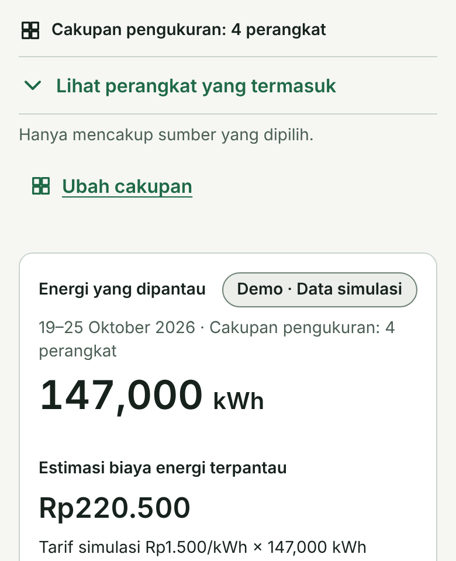
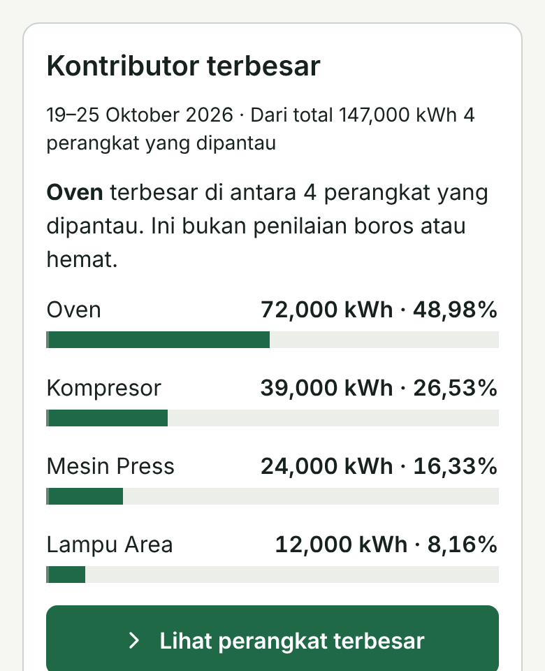
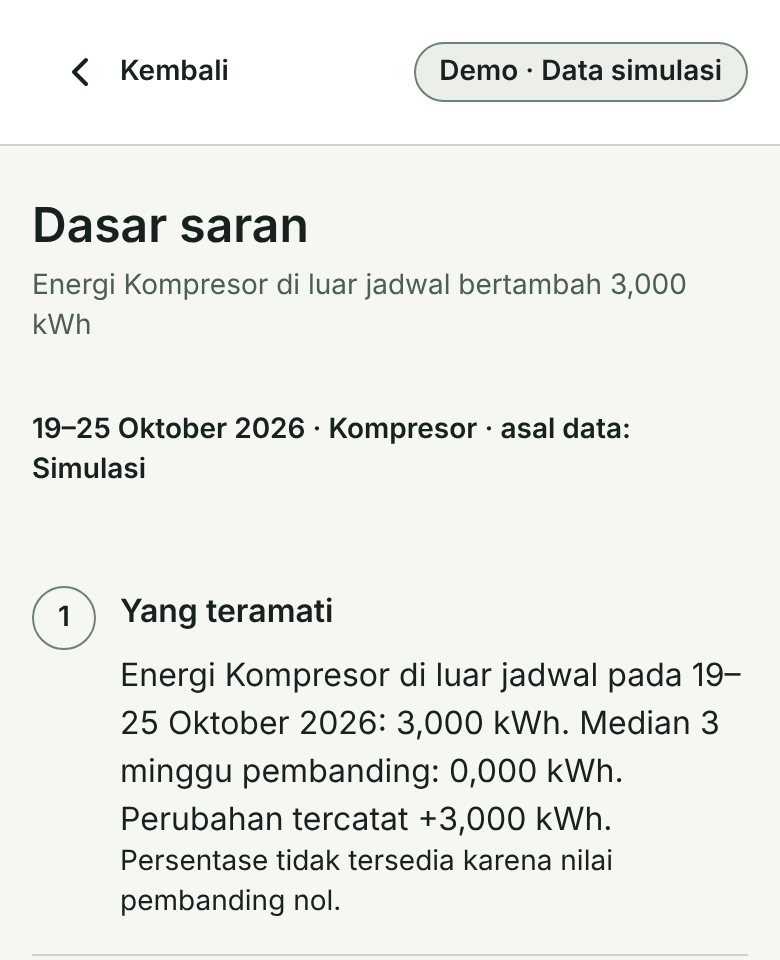
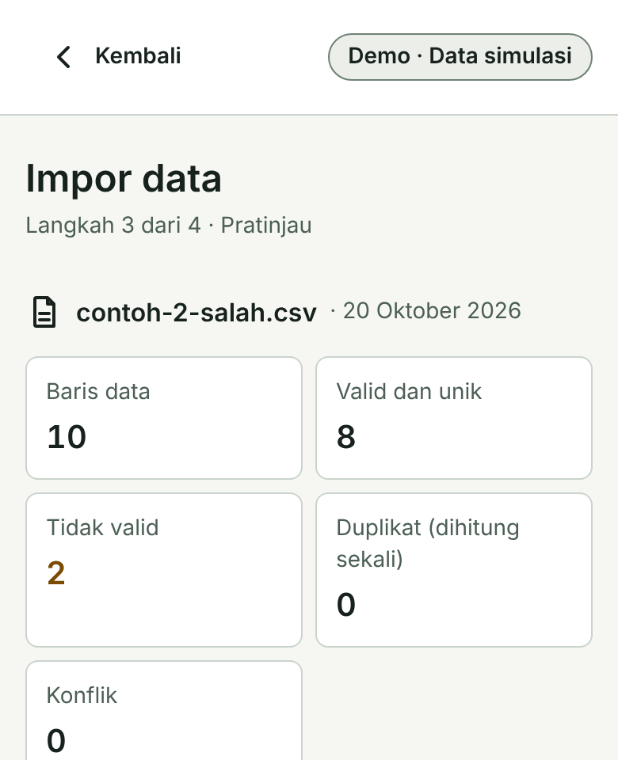

# 1. Judul Proposal

**HematDaya: Pemantauan Listrik dan Saran Berbasis Bukti untuk Berbagai Kebutuhan**

## 2. Tema Fokus Inovasi

**Bidang strategis:** Kesehatan - Smart and Sustainable Health Ecosystem for Human Well-being. **Klaster:** 08, Sustainable and Green Healthcare. **Tim:** Petani Digital.

## 3. Executive Summary

Pengelola rumah sakit dan klinik perlu menjaga fungsi layanan sambil menilai penggunaan listrik pada beban yang beragam. Perbedaan kebutuhan dan jam pemakaian membuat total konsumsi saja belum cukup untuk menentukan perangkat atau waktu yang perlu diperiksa. Mereka membutuhkan rincian yang dapat ditelusuri sebagai dasar penilaian.

HematDaya diusulkan sebagai aplikasi untuk memantau konsumsi listrik dan memberikan saran pemeriksaan. Fasilitas kesehatan menjadi penerapan awal dari produk yang juga dapat digunakan pada rumah tangga, usaha, dan industri. Pengguna mengimpor riwayat konsumsi melalui CSV; aplikasi memeriksa data, menghitung energi, lalu menampilkan kontribusi perangkat atau sirkuit dan perubahan antarperiode yang sebanding. Informasi ini membantu pengelola menyusun prioritas pemeriksaan; keputusan tindakan tetap berada pada petugas berwenang.

Tim telah menyiapkan dokumen kebutuhan produk dan prototipe di *browser* dengan data serta *backend* simulasi. Pengembangan berikutnya menghubungkan impor, penyimpanan, perhitungan, dan tampilan untuk pengujian terkontrol, disertai evaluasi pemahaman pengguna. Tim memperkirakan tingkat kesiapan teknologi (TKT) awal 3 dan menargetkan TKT 4 pada April 2027 melalui validasi serta peninjauan mentor atau asesor. Hasil pengujian akan digunakan untuk menilai manfaat operasional dan kelayakan jasa pemasangan, *deployment*, serta dukungan berkala.

## 4. Deskripsi Inovasi

**Masalah dan pengguna.** Rumah sakit dan klinik menggunakan listrik untuk penerangan, ventilasi, pompa, refrigerasi, serta peralatan penunjang layanan. Kebutuhan dan jam pemakaiannya berbeda, sementara fungsi penting harus tetap terjaga [1]. Untuk menelusuri perubahan konsumsi dan menyusun prioritas pemeriksaan, pengelola sarana serta teknisi memerlukan rincian pemakaian menurut bagian fasilitas dan waktu [2]. Kebutuhan informasi ini menjadi dasar penerapan awal HematDaya; kondisi pemantauan, beban, dan keputusan pengguna di fasilitas sasaran akan dikonfirmasi melalui wawancara sebelum *pilot*.

**Solusi dan pembeda.** HematDaya menyajikan konsumsi dan dasar saran dalam bahasa Indonesia melalui impor CSV tanpa pembelian meter. Pemantauan perangkat dan hierarki meter tersedia pada Home Assistant [3]; kemudahan alur impor hingga penilaian bukti menjadi pembeda yang akan diuji. Aplikasi hanya memantau dan memberi saran; beban kritis atau kontinu, termasuk kulkas obat, dipantau tanpa anjuran penghentian.

<!-- page -->

## 4. Deskripsi Inovasi (lanjutan)

**Cara kerja.** Monolit modular dirancang sebagai satu aplikasi *backend* dengan inti perhitungan bersama. Satu basis kode beserta modul kemampuan dan *adapter* mendukung berbagai penggunaan [4]. CSV menyediakan alur awal data historis; koneksi meter opsional setelah verifikasi. Tarif opsional untuk estimasi biaya; jadwal dan keluaran untuk analisis terkait.

Impor memeriksa satuan, waktu, duplikasi, dan konflik data. Data hilang tidak dianggap nol; meter induk dan turunannya tidak dihitung ganda. Aturan deterministik serta median periode sebanding mendasari analisis ketika riwayat mencukupi. Pemakaian di luar jadwal memerlukan pemeriksaan konteks sebelum dinilai sebagai pemborosan.

**Kondisi dan target.** Prototipe di *browser* dan catatan 36/36 pemeriksaan acuan hitung yang lulus mendasari perkiraan tim pada TKT 3. Data dan *backend* disimulasikan; layanan *backend* produksi, koneksi meter, serta penggunaan di fasilitas belum tervalidasi. Target TKT 4 pada April 2027 memerlukan uji integrasi terkontrol atas impor, penyimpanan, perhitungan, dan tampilan, serta peninjauan mentor atau asesor. Target keberhasilan: seluruh acuan hitung PRD lulus dan sedikitnya 4 dari 5 pengelola mampu membaca konsumsi, menemukan kontributor terbesar, dan memahami bukti tanpa bantuan. Manfaat operasional dan penghematan dinilai melalui *pilot* dengan data nyata.

**Peta jalan 12 bulan.** Tanggal kegiatan tatap muka mengikuti konfirmasi panitia.

| Waktu | Kegiatan dan keluaran yang dituju |
|---|---|
| Okt-Nov 2026 | Mewawancarai 5 pengelola atau teknisi; menetapkan beban dan tugas; membangun alur CSV serta menguji hitungan dengan data sintetis. |
| Des 2026-Jan 2027 | Mengintegrasikan penyimpanan, hak akses, impor ulang tanpa duplikasi, dan pemulihan. |
| Feb-Apr 2027 | Menguji kegunaan dan integrasi menuju TKT 4 berdasarkan konteks penggunaan. |
| Mei-Okt 2027 | Dengan izin dan mitra, menguji satu fasilitas memakai data nyata; menilai koneksi meter, dukungan, dan kesediaan membayar. |

**Keselamatan dan data.** Uji awal memakai data sintetis; data nyata memerlukan izin fasilitas, batas akses, dan kesepakatan penyimpanan. Sebelum *pilot*, tim wajib mengenkripsi komunikasi, memeriksa kepemilikan data di server, serta menguji pencadangan dan pemulihan. Aplikasi tidak mengendalikan listrik atau alat medis, menilai mutu vaksin, atau membuat keputusan klinis. Pelibatan pasien atau data klinis memerlukan penilaian etik dan izin resmi.

**Tim dan mitra.** Dua profesional, mahasiswa UGM, dan dosen UGM menyiapkan pengembangan serta validasi. Tim belum memiliki tenaga kesehatan, izin fasilitas, atau komitmen mitra *pilot*. Penjajakan melalui jejaring program dilanjutkan dengan penilaian kelayakan layanan bersama calon pelanggan setelah validasi.

<!-- page -->

## 5. Pembagian Tugas dan Tanggung Jawab Tim Pelaksana

| Anggota dan peran | Tanggung jawab dan keluaran |
|---|---|
| **Ahmad Widardi** - Ketua; profesional; Koordinator Bisnis dan Hilirisasi | Memimpin pengembangan bersama Sidiq; mengoordinasikan arsitektur, kebutuhan pengguna, bisnis, *pilot*, komunikasi, dan kepemilikan karya. |
| **Sidiq Tri Pratikto** - Profesional; Koordinator Teknis | Mengembangkan tampilan, layanan data, impor, dan hitungan bersama Ahmad; menangani penyimpanan, keamanan, pengujian, dan *deployment*. |
| **Akmal Rafli Fauzan** - Mahasiswa UGM; Koordinator Klinis dan Validasi Pengguna | Mengoordinasikan kebutuhan, batas operasi, uji kegunaan, dan izin bersama pengelola dan pendamping. Penilaian klinis dilakukan petugas berwenang. |
| **Erwin Eko Wahyudi, S.Kom., M.Cs.** - Dosen UGM; Mentor Analitik Data | Meninjau metode perbandingan, mutu data, evaluasi, dan bukti capaian; membimbing mahasiswa. |

Tugas mingguan memuat penanggung jawab, kriteria penerimaan, dan bukti hasil. Evaluasi membedakan perhitungan, akurasi meter, serta kegunaan menurut konteks penggunaan. Tim mencatat perubahan lingkup dan dampak jadwal.

## 6. Daftar Pustaka

[1] WHO, World Bank, SEforALL, IRENA. 2023. *Energizing health: accelerating electricity access in health-care facilities*. Bab 3, hlm. 46-50. [Publikasi WHO](https://www.who.int/publications/i/item/9789240066960). Diakses 24 Oktober 2026.

[2] Department of Health. 2015. *Health Technical Memorandum 07-02: EnCO2de 2015, Part A: Policy and management*. Bagian 3.6-3.7. [Dokumen NHS](https://www.england.nhs.uk/wp-content/uploads/2021/05/HTM_07-02_Part_A_FINAL.pdf). Diakses 24 Oktober 2026.

[3] Home Assistant. *Integrating individual device energy usage*, bagian Upstream devices and hierarchies. [Dokumentasi](https://www.home-assistant.io/docs/energy/individual-devices/). Diakses 24 Oktober 2026.

[4] Tim Petani Digital. *PRD HematDaya Generik*, versi 1.2, 21 Oktober 2026. Bagian 5, 11, 15, dan 20. Dokumen teknis pendamping; salinan Indonesia dan Inggris disertakan dalam folder PRD.

## 7. Lampiran

Sampul dan identitas ada di berkas administrasi terpisah. CV, portofolio, dan pakta integritas diunggah melalui sistem panitia; bukti kemitraan menyusul bila diperoleh.

   

**Gambar 1.** Prototipe, data simulasi: (a) Beranda; (b) kontributor; (c) dasar saran; (d) impor CSV.
